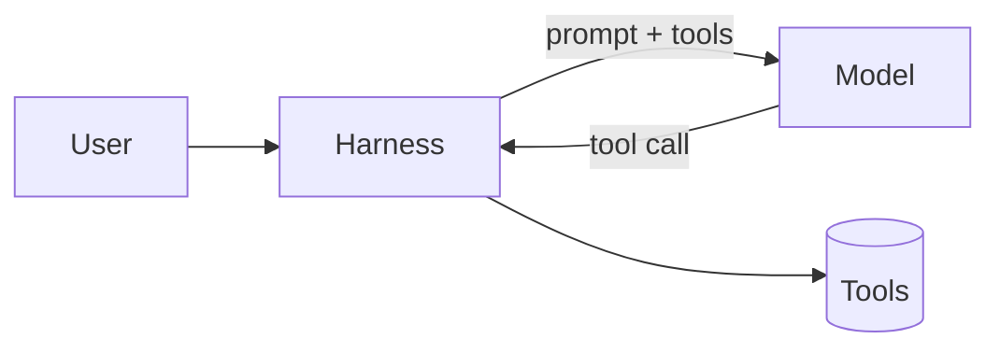

# Writing blog posts

Articles are Markdown files in `src/content/{en,es}/`, rendered by
`src/components/blog/BlogPost.tsx` with the styles in `src/styles/blog.css`.
This is the reference for everything the renderer understands, and the
house rules for using it.

`npx vitest run tests/unit/content` checks every post: frontmatter, that
every Mermaid diagram parses, and that `steps` blocks are well formed. Run it
after touching any article.

## Publishing a post

A post is three things:

1. **`src/content/en/<slug>.md` and `src/content/es/<slug>.md`** — same slug,
   same structure, translated prose.
2. **An entry in `content/seed/patent.json`** (the Firestore "posts"
   collection — the name is legacy): `_id` and `internalLink` are the slug,
   `title`/`description` are `{ en, es }`, `image` is the banner, `date` is
   ISO 8601, `link` is `""`, `loaded` is `true`. New entries go at the top.
   It reaches the live site with `npm run seed -- --only patent` (dry run),
   then `--apply`.
3. **A banner**: `node scripts/generate-banners.mjs --slug <slug>` writes
   `public/images/banners/<slug>.svg` from the frontmatter.

### Frontmatter

```yaml
---
slug: "/harness-engineering"
date: "2026-11-13"
title: "Harness engineering: the part of the agent that isn't the model"
kicker: "AI"
excerpt: "One or two sentences that make someone want to read the rest."
tags: [ai, agents, architecture]
featuredImage: "/images/banners/harness-engineering.svg"
---
```

The body starts straight after the frontmatter. Do not repeat the title as a
`#` heading — the page renders it. Use `##` for sections and `###` below
that; `####` is a small uppercase label.

## Voice

First person, direct, specific. Say what you did, what broke and what you
would do differently. Prefer one concrete example to three abstractions.
Be honest about limits and costs — every post on this site has a "what it
doesn't fix" or "when not to" moment. No hype words ("revolutionary",
"game-changer"), no filler intros ("In today's fast-paced world…").

Spanish posts are written in Spanish from Spain (vosotros is fine, "ordenador",
"fichero" or "archivo"), not a literal translation: same structure and
examples, natural sentences. Technical terms that are used in English in
Spanish (harness, prompt, pull request, deploy) stay in English, in italics
the first time if they need it.

**Diagrams, code and code comments are always in English**, in both language
versions, so one figure serves both.

## Building blocks

### Diagrams — ` ```mermaid `

Rendered by Mermaid with the site's palette, twice (light and dark), and
loaded only on pages that have one. Add a caption with `title="…"`.

````md

````

Rules that keep them legible:

- **Never set colours** (`style`, `classDef`, `%%{init}%%`). The theme does it,
  in both schemes.
- Quote every label that has spaces or punctuation: `A["Read the file"]`.
  Line breaks inside a label: `<br/>`.
- Keep it to roughly 4–12 nodes. Two small diagrams beat one dense one.
- `flowchart LR` for short pipelines (≤ 5 nodes in a row); `flowchart TB` for
  anything wider — a wide diagram is scaled down to the column and its text
  shrinks with it.
- Group with `subgraph id["Label"] … end`. Decisions are `{"…"}`, data stores
  `[("…")]`, start/end `(["…"])`.

Diagram types that are tested with the theme and look good:

| Type              | Use it for                                                                            |
| ----------------- | ------------------------------------------------------------------------------------- |
| `flowchart`       | Architecture, data flow, decision trees                                               |
| `sequenceDiagram` | Who calls whom, in what order (`autonumber`, `Note over A,B: …`, `loop`/`alt` blocks) |
| `stateDiagram-v2` | Lifecycles: pod phases, a reconcile loop, an agent's states                           |
| `timeline`        | History, release trains, evolution of an idea                                         |
| `mindmap`         | The shape of a topic at a glance                                                      |
| `classDiagram`    | Types and interfaces                                                                  |
| `quadrantChart`   | Placing options on two axes (cost vs. control…)                                       |

### Steps — ` ```steps `

A numbered process, laid out as cards. One step per line, `Title: description`.
Up to five fit in a row; more wrap. Add `loop` to show that the last step
feeds back into the first, or `loop="custom label"`.

````md
```steps loop="Implementation corrects the spec"
Specify: One page — the problem, the constraints, what to reuse, how to check it.
Plan: The agent proposes an approach. You correct the plan, not the code.
Implement: The agent writes the code against the plan.
Verify: Tests and the commands the spec named.
```
````

Use this instead of ASCII arrows in a code block (`a -> b -> c`) — those were
the ugliest thing on the old blog.

### Callouts

GitHub's alert syntax. Five kinds: `NOTE`, `TIP`, `IMPORTANT`, `WARNING`,
`CAUTION`. The label is translated automatically.

```md
> [!TIP]
> When the plan turns out to be wrong halfway through, fix the document first.
```

Use them sparingly — two or three per post. A plain `>` quote (no marker)
renders as a pull quote, for a sentence worth stopping on.

### Code

Fenced blocks get a window header, a language badge and a copy button.

````md
```ts title="src/hooks/useAuth.ts" {3,7-9}
// title= shows a file name; {…} highlights lines
```
````

- `title="path/to/file.ext"` — show where the code lives whenever it is real.
- `{2,5-7}` — highlight the lines the paragraph is talking about.
- `showLineNumbers` — for long listings that the text refers to by line.
- ` ```diff ` with `+`/`-` lines for before/after.
- ` ```text ` for terminal output and file trees.

Keep listings short (≤ 30 lines). Cut boilerplate with `// …`.

### Everything else

- **Tables** — GFM pipes. The first column is bold; use it for the row name.
- **Images** — ``.
  The title in quotes becomes a visible caption.
- **Task lists** — `- [x] done`, `- [ ] pending`.
- **Horizontal rule** — `---` between major parts of a long post.
- **Links** — internal articles as `/blog/<slug>` (the renderer adds the
  language prefix); external links open in a new tab.
- **CodePen** — a CodePen URL alone on a line becomes an embed.

Raw HTML is not rendered.
