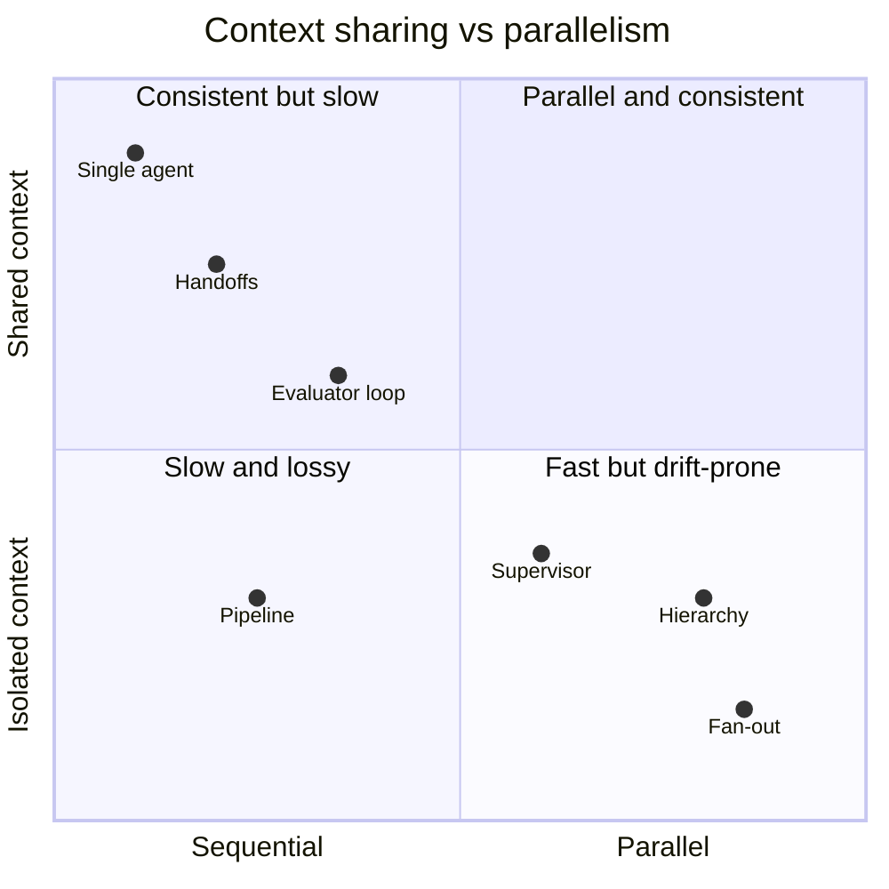
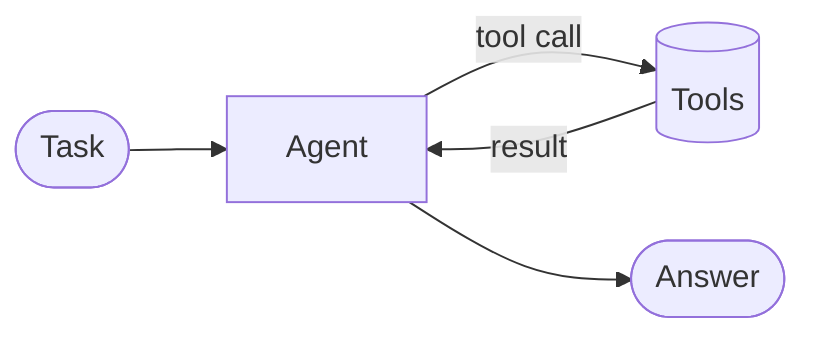
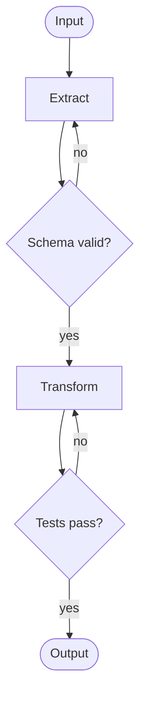
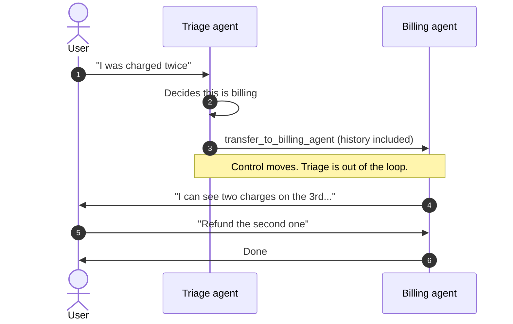
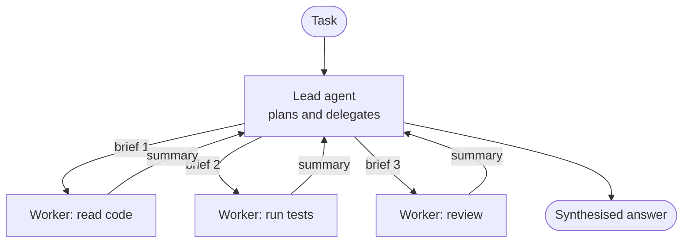
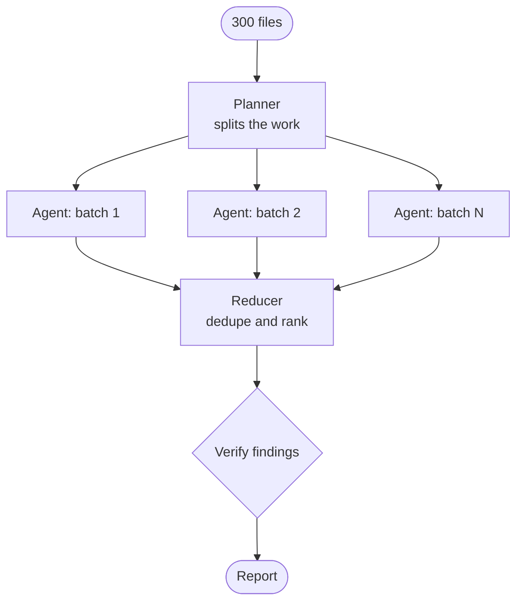
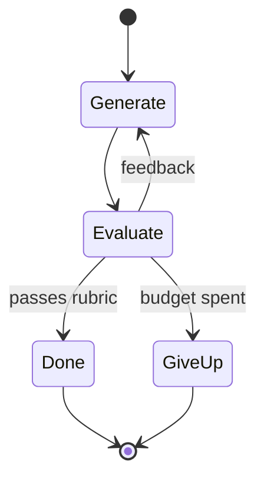
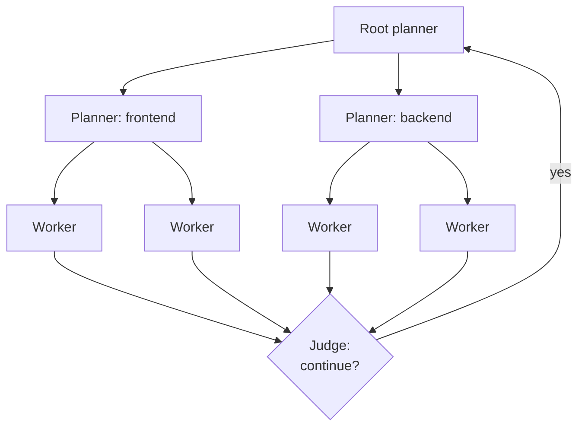
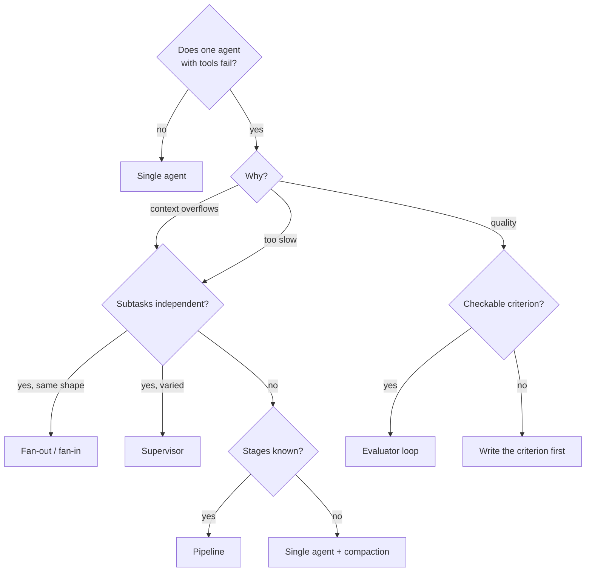

Most of the multi-agent diagrams I see would work better as one agent with a good set of tools. That isn't a dig at multi-agent systems. It's what the people who build them for a living write too. Anthropic's [Building effective agents](https://www.anthropic.com/engineering/building-effective-agents) opens by telling you to find the simplest thing that works and add complexity only when it measurably helps. Cognition's [Don't build multi-agents](https://cognition.com/blog/dont-build-multi-agents) goes further. And then Anthropic's own [multi-agent research system](https://www.anthropic.com/engineering/multi-agent-research-system) beat a single agent by a wide margin on their internal eval.

Both camps are right, about different tasks. An orchestration pattern is a trade: you pay in tokens, latency and new failure modes, and you get parallelism, specialisation or a second opinion back. This post is the price list I use. It covers the patterns that keep turning up across the agent frameworks, what each costs and when it is worth it.

## The three bills and the one axis

Every pattern below sends you some mix of three bills.

**Tokens.** Anthropic measured that agents use about 4× the tokens of a chat and multi-agent systems about 15× ([source](https://www.anthropic.com/engineering/multi-agent-research-system)). On their browsing eval, token usage alone explained 80% of the variance in performance. Part of what you buy with more agents is simply the ability to spend more tokens on a problem at once.

**Latency.** Agents in sequence add their latencies together. Agents in parallel finish when the slowest one does, plus whatever the synthesis step costs. A pipeline of five agents is five round trips of thinking before anyone sees a result.

**Error compounding.** One wrong decision early on becomes the premise for everything after it. Google Research's [Towards a science of scaling agent systems](https://research.google/blog/towards-a-science-of-scaling-agent-systems-when-and-why-agent-systems-work/) measured this directly. Independent agents running in parallel, with nothing checking their output, amplified errors 17.2× compared with a single agent. A centralised orchestrator that validates results kept it to about 4.4×. The same study found multi-agent variants made strictly sequential tasks *worse*, by 39–70%.

Then there's one axis that predicts most of how a pattern behaves: **does each agent share the full context, or work in isolation?** Shared context keeps decisions consistent and costs tokens. Isolated context is cheap and parallel, and it lets two agents quietly make incompatible assumptions. Cognition's example is a Flappy Bird clone split between two sub-agents, which came back with a Super Mario background and a bird that matched neither. I go into this axis properly in [/blog/context-engineering](/blog/context-engineering). Here it's enough to notice which side of it each pattern sits on.



## 0. One agent with tools: the baseline

This is the pattern every other one has to beat. One model, one context window, a loop that calls tools until the task is done. The harness around it ([/blog/harness-engineering](/blog/harness-engineering)) does most of the work: good tools, good error messages, a compaction strategy when the context gets long.



It has one context, so every decision is visible to every later decision, and nothing has to be handed over. It fails when the task outgrows the window, or when the work is genuinely parallel and you're waiting on it serially. Until one of those is true, I don't add agents.

## 1. Pipeline: fixed stages with gates

Anthropic calls it *prompt chaining*: split the task into stages known in advance, and pass each stage's output to the next one. The useful part is the **gate** between stages, a check in plain code that stops a bad intermediate result before the next stage builds on it.



Each stage gets a small, focused context and its own prompt and model, so a cheap model can do the boring stages. The cost is latency (stages add up) and rigidity: the pipeline can't decide halfway through that the task needed a different shape. Google ADK has a `SequentialAgent` for exactly this, and Microsoft Agent Framework calls it *sequential orchestration*.

I use it when I can write the stages down before I start and check each one with code. A migration with a fixed order is the classic case: parse, transform, type-check, test. If I can't name the gates, it's not a pipeline yet.

## 2. Handoffs: transfer control, keep the conversation

In a handoff, one agent decides another one is better placed and gives it **control**. It doesn't call it like a function. The receiving agent takes over the conversation and talks to the user directly. This is the triage pattern from customer support: a front-desk agent routes you to billing or refunds, and billing answers you.



In the OpenAI Agents SDK a handoff is exposed to the model as a tool, so `Billing agent` becomes a tool called `transfer_to_billing_agent` ([docs](https://openai.github.io/openai-agents-python/handoffs/)):

```python title="triage.py"
from agents import Agent, Runner

billing = Agent(
    name="Billing agent",
    handoff_description="Charges, invoices and refunds.",
    instructions="Resolve billing issues. You can see the full history.",
)
tech = Agent(
    name="Tech support agent",
    handoff_description="Login problems, errors, outages.",
    instructions="Diagnose technical problems step by step.",
)
triage = Agent(
    name="Triage agent",
    instructions="Work out what the user needs and hand off. Don't answer yourself.",
    handoffs=[billing, tech],
)

result = Runner.run_sync(triage, "I was charged twice this month.")
print(result.last_agent.name, "->", result.final_output)
```

The same SDK also has the opposite primitive, `agent.as_tool(...)`. That wraps a specialist as a tool the caller *invokes* and gets an answer back from, without giving up the conversation. The difference matters. A handoff is a one-way door. An agent-as-tool is a function call.

Handoffs keep the context shared, since the history travels with the transfer, and they keep each agent's instructions short. What they cost is a loss of oversight: nobody owns the whole task after the transfer. If billing needs something only tech knows, you need a handoff back, and handoff loops ("ping-pong") are a real failure mode. I reach for handoffs when the domains are separate and a conversation rarely needs both.

## 3. Orchestrator–worker (supervisor)

A lead agent breaks the task down at runtime, delegates pieces to workers, and synthesises what they bring back. Unlike a handoff, the lead **keeps control**. Workers are function calls with their own context window that return a summary. Anthropic recommends it for tasks where "you can't predict the subtasks needed", and it's the shape of their research system.



The worker's isolated context is the point. A worker can read forty files and return twelve lines, and the lead's context stays clean. Anthropic describes sub-agents as filters for exactly this reason. The [Claude Agent SDK](https://code.claude.com/docs/en/agent-sdk/subagents) makes this the default way to define workers. The lead delegates through the `Agent` tool, and each worker gets its own prompt, tool list and model:

```ts title="supervisor.ts" {6-7,21-27}
import { query } from "@anthropic-ai/claude-agent-sdk";

for await (const message of query({
  prompt: "Find why /api/orders is slow and propose a fix. Delegate the digging.",
  options: {
    // The lead can read and delegate; it can't edit anything itself.
    allowedTools: ["Read", "Grep", "Glob", "Agent"],
    agents: {
      "code-reader": {
        description: "Reads code paths and reports where time could be spent.",
        prompt: "Trace the request path. Report file:line and your reasoning.",
        tools: ["Read", "Grep", "Glob"],
        model: "haiku",
      },
      "profiler": {
        description: "Runs the benchmarks and reports numbers, not opinions.",
        prompt: "Run `npm run bench:orders`. Report p50/p95 and the hottest frames.",
        tools: ["Bash", "Read"],
      },
    },
    // Bound the tree: no nested delegation, at most 4 workers at once, $3 total.
    env: {
      ...process.env,
      CLAUDE_CODE_MAX_SUBAGENT_SPAWN_DEPTH: "1",
      CLAUDE_CODE_MAX_CONCURRENT_SUBAGENTS: "4",
    },
    maxBudgetUsd: 3,
  },
})) {
  if (message.type === "result") console.log(message.subtype, message.total_cost_usd);
}
```

Two details in that listing are lessons other people learned the hard way. The worker gets **only** the brief the lead writes, none of the lead's history. The SDK docs say it plainly: the Agent tool's prompt string is the only channel from parent to child. So the quality of the whole system depends on the lead writing good briefs. Anthropic's early version spawned 50 sub-agents for simple queries and had workers duplicating each other because the briefs were vague. And the caps on depth, concurrency and spend exist because the lead decides how many workers to start. Without them, one prompt can grow into a tree.

> [!TIP]
> Write the worker's brief the way you'd write a ticket for a colleague who has never seen the codebase: the goal, what's already ruled out, the paths, the expected output format, and when to stop. A brief that fits in one line is usually a title, not a task.

This is the pattern I use most. Exploration, review and debugging all split naturally into "go look at this and tell me what you found".

## 4. Fan-out / fan-in

A special case of the supervisor that deserves its own name: the same kind of work, **many independent items**, run in parallel and merged at the end. It's map-reduce with a model in the map step. Anthropic's workflow taxonomy calls it *parallelization*, in two flavours: *sectioning* (different slices of the input) and *voting* (the same task several times, to compare answers).



Here the orchestration is deterministic code, and it doesn't need a model at all. In LangGraph you return one `Send` per item from a conditional edge, and a reducer on the state merges the results ([docs](https://docs.langchain.com/oss/python/langgraph/graph-api-send-command)):

```python title="audit_graph.py" {8,13-14}
import operator
from typing_extensions import Annotated, TypedDict
from langgraph.graph import END, START, StateGraph
from langgraph.types import Send

class AuditState(TypedDict):
    files: list[str]
    findings: Annotated[list[dict], operator.add]  # reducer: concat worker outputs

class FileState(TypedDict):
    file: str

def fan_out(state: AuditState):
    return [Send("audit_file", {"file": f}) for f in state["files"]]

def audit_file(state: FileState):
    return {"findings": [run_auditor_agent(state["file"])]}  # your agent call

builder = StateGraph(AuditState)
builder.add_node("audit_file", audit_file)
builder.add_conditional_edges(START, fan_out, ["audit_file"])
builder.add_edge("audit_file", END)
graph = builder.compile()
```

Fan-out is where parallelism really pays: Anthropic reports research time cut by up to 90% on complex queries. It's also where the 17.2× error amplification lives, because nothing in the map step checks anything. My rule is that a fan-out without a verification step at the fan-in isn't finished. That's why the diagram ends in a check and not in "merge".

It works for audits, migrations, per-file reviews and anything else that really is "the same question, many times". It fails on anything where item 7 depends on what you learned from item 3.

## 5. Evaluator–optimizer, and debate

One agent generates and another one judges, with feedback, in a loop until the judge passes it or a budget runs out. *Debate* is the many-voice version: several agents argue and a judge, or a vote, settles it. Claude Code's [agent teams docs](https://code.claude.com/docs/en/agent-teams.md) suggest something like this for debugging: teammates holding competing hypotheses, each trying to disprove the others, because a single investigator tends to anchor on the first plausible theory.



The loop itself is simple. What's hard is the stopping rule. Here it is as **illustrative pseudo-code**. `generate`, `evaluate` and `Verdict` stand in for your own model calls:

```python title="refine_loop.py (pseudo-code)"
def refine(task: str, max_rounds: int = 3) -> str:
    draft = generate(task)
    for round in range(max_rounds):
        verdict: Verdict = evaluate(task, draft)   # separate context, rubric-driven
        if verdict.passes:
            return draft
        if round > 0 and verdict.score <= last_score:
            break                                  # not improving: stop paying
        last_score = verdict.score
        draft = generate(task, previous=draft, feedback=verdict.feedback)
    return escalate_to_human(task, draft, verdict)
```

It pays when there's a **clear criterion** the judge can apply. Anthropic's own guidance is to use it when "clear evaluation criteria exist". Their research eval also found that one LLM judge with a rubric, giving a score from 0.0 to 1.0 plus pass/fail, was the most consistent with human judgement. Without a rubric, two models will happily agree on a mediocre answer. Never let the generator judge itself in the same context either. I wrote about why in [/blog/agentic-development-sessions](/blog/agentic-development-sessions).

> [!WARNING]
> A judge is a model too. If the judge and the generator share a blind spot, the loop converges on the blind spot with great confidence. Where you can, make the judge executable: tests, a type-checker, a schema.

## 6. Hierarchical

Supervisors of supervisors. A top-level planner splits the problem into areas, each area has its own lead, and each lead has workers. Cursor's [Scaling long-running autonomous coding](https://cursor.com/blog/scaling-agents) is the best public account I know. Flat, self-coordinating agents became risk-averse and churned. What worked was planners that spawn sub-planners, workers that don't coordinate with each other, and a judge deciding at the end of each cycle whether to continue.



This is how work goes beyond what one lead can track. It's also where every cost above multiplies: each layer adds latency, each brief loses some detail, and each summary filters something out. That's why the Claude Agent SDK caps nesting depth by default. Once you're running tens or hundreds of agents, the problems stop being about prompting and become distributed-systems problems. That's the subject of the companion post, [/blog/agent-swarms-distributed-systems](/blog/agent-swarms-distributed-systems).

## The comparison

| Pattern | Latency | Token cost | Main failure mode | Pays off when |
| --- | --- | --- | --- | --- |
| **Single agent** | Serial | 1× | Context overflow | Almost always try this first |
| **Pipeline** | Sum of stages | Low | Early errors propagate | Stages and gates known in advance |
| **Handoffs** | Serial | Low–medium | Ping-pong, no owner | Separate domains, one at a time |
| **Supervisor** | Parallel + synthesis | High | Vague briefs, duplicated work | Subtasks only known at runtime |
| **Fan-out / fan-in** | Slowest worker | High, grows with N | Unchecked errors amplify | Many independent items |
| **Evaluator loop** | Rounds × 2 | Medium–high | Judge shares the blind spot | A rubric or test exists |
| **Hierarchical** | Layers add up | Very high | Lossy summaries, runaway trees | Work too big for one lead |

## How I pick

The question isn't "which pattern is best". It's "what is the cheapest structure that removes the bottleneck I actually have?"



```steps
Baseline: Build the single-agent version and an eval of 20 or so real cases. Anthropic started with about 20.
Diagnose: Read the traces. Is it context, latency or quality? Each has a different fix.
Smallest change: Add one pattern that targets that bottleneck, with depth, concurrency and spend caps.
Measure: Same eval, plus tokens and wall-clock. Keep it only if the gain is worth the bill.
```

Handoffs aren't on the decision tree because they answer a different question. They're about *who talks to the user*, not how to get the work done, and they combine with any of the others.

## When not to

The honest version: most coding tasks don't parallelise well. Anthropic says so about their own research system. Coding has fewer truly independent subtasks than research, and LLM agents are still weak at coordinating in real time. Berkeley's [MAST study](https://arxiv.org/abs/2503.13657) of multi-agent frameworks found gains over single agents were often minimal, and sorted the failures into specification problems, misalignment between agents, and weak verification. None of those is fixed by adding agents.

> [!IMPORTANT]
> If a task is sequential (each step depends on the one before), adding agents makes it worse, not just more expensive. Split work by *independence*, never by job title. A "designer agent", a "coder agent" and a "tester agent" passing one feature around is a pipeline of lossy handoffs.

I also don't reach for multi-agent setups for low-value tasks. At 15× the tokens, the task has to be worth it. And I don't use them where I can't verify the output. More agents produce more output, and output nobody checks is just a faster way to be wrong.

## Further reading

- [Building effective agents — Anthropic](https://www.anthropic.com/engineering/building-effective-agents). The workflow taxonomy (chaining, routing, parallelisation, orchestrator–workers, evaluator–optimizer) that most frameworks now copy. Read it first.
- [How we built our multi-agent research system — Anthropic](https://www.anthropic.com/engineering/multi-agent-research-system). The orchestrator–worker case study with real numbers: 15× tokens, the effort-scaling rules, early failure modes, evaluation with an LLM judge.
- [Don't build multi-agents — Cognition](https://cognition.com/blog/dont-build-multi-agents). The best argument for the other side: share full context, and remember that actions carry implicit decisions.
- [Towards a science of scaling agent systems — Google Research](https://research.google/blog/towards-a-science-of-scaling-agent-systems-when-and-why-agent-systems-work/). The controlled study behind the 17.2× vs 4.4× error amplification, and why sequential tasks get worse.
- [Why do multi-agent LLM systems fail? (MAST) — Cemri et al.](https://arxiv.org/abs/2503.13657). A taxonomy of 14 failure modes from annotated traces. Useful as a checklist when reading your own.
- [Handoffs — OpenAI Agents SDK](https://openai.github.io/openai-agents-python/handoffs/). The clearest documentation of handoffs vs agents-as-tools.
- [Subagents in the SDK — Claude Agent SDK](https://code.claude.com/docs/en/agent-sdk/subagents). Worker definitions, what a sub-agent inherits, and the depth/concurrency/spend caps.
- [Workflow orchestrations — Microsoft Agent Framework](https://learn.microsoft.com/en-us/agent-framework/workflows/orchestrations/). The same patterns under other names (sequential, concurrent, handoff, group chat, magentic), handy for seeing what's universal.
