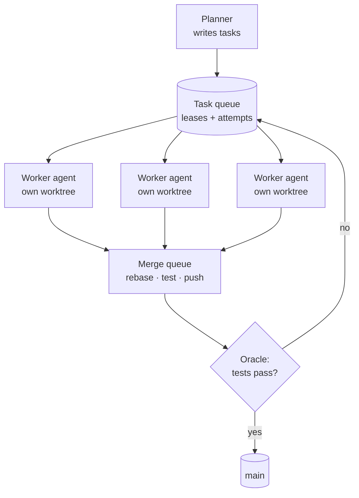
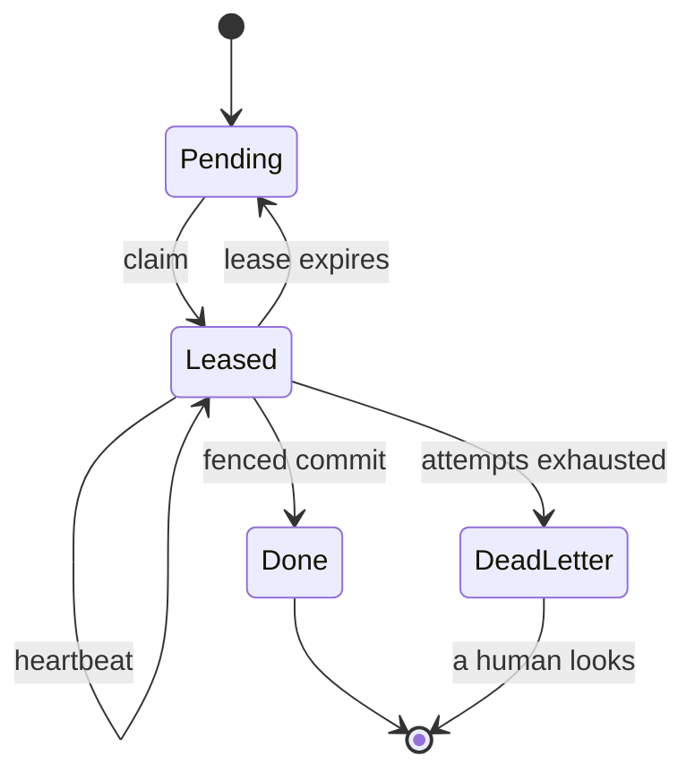
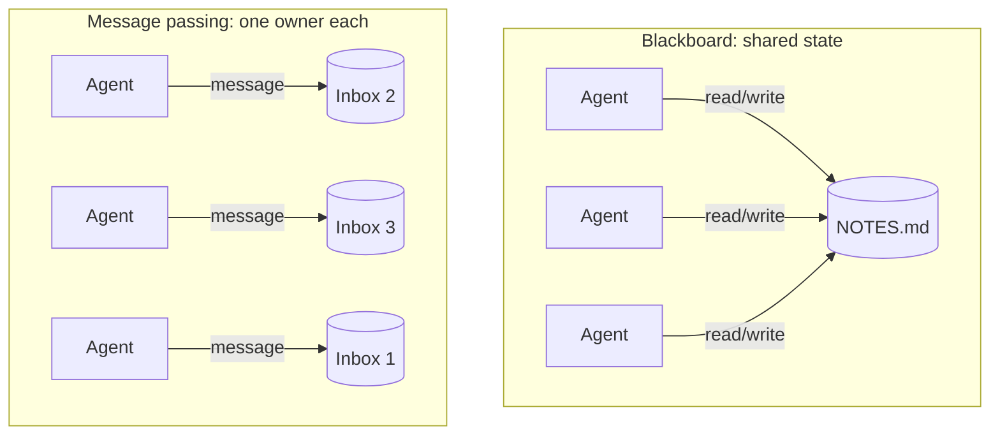
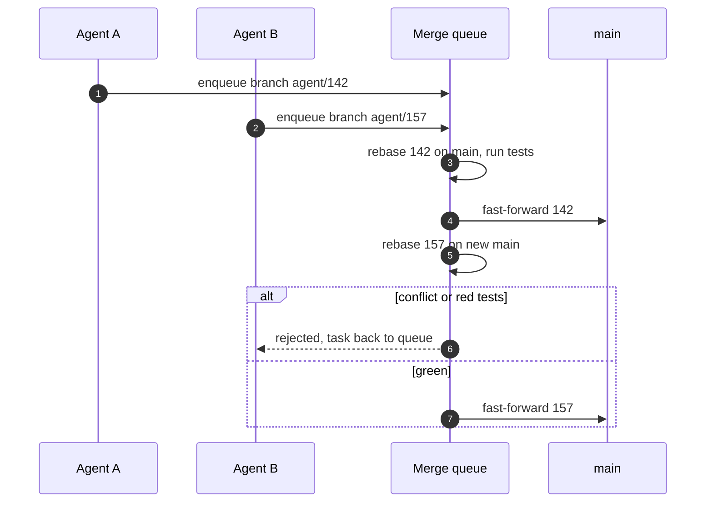
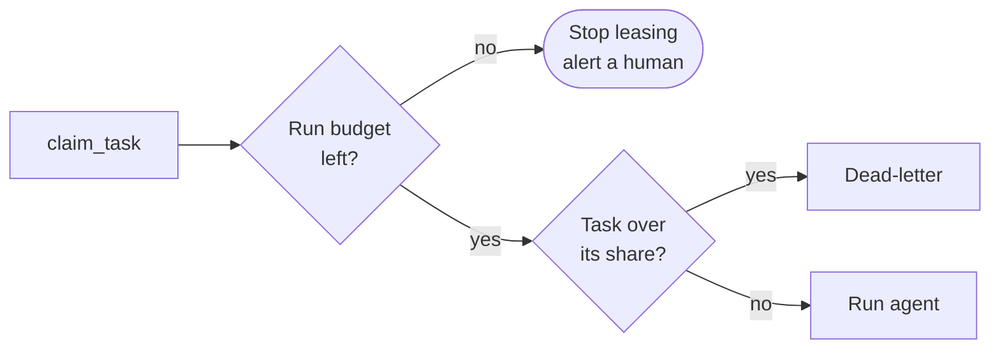

With three agents, coordination is a prompting problem. You write good briefs, you read the summaries, you merge by hand. With a hundred it stops being one. What you have then is a distributed system whose nodes are slow, expensive, non-deterministic and occasionally confidently wrong, all writing to the same Git repository.

The two most detailed public accounts of running agents at that scale read like distributed-systems postmortems. In [Building a C compiler with a team of parallel Claudes](https://www.anthropic.com/engineering/building-c-compiler), Nicholas Carlini ran 16 agents for about two weeks, nearly 2,000 sessions and just under $20,000 in API costs. They coordinated through lock files in a shared Git repo and no orchestrator. In [Scaling long-running autonomous coding](https://cursor.com/blog/scaling-agents), Cursor runs hundreds of concurrent agents on one codebase, and they describe trying locks, then optimistic concurrency, then a hierarchy.

None of their problems were new. They were the ones from any distributed-systems course, with a model where the server used to be. This post goes through them one at a time, each with the classic answer and what changes when the worker is an agent. The [companion post on orchestration patterns](/blog/agent-orchestration-patterns) covers the *shape* of a multi-agent system. This one is about running it at scale.

## The map

| Agent swarm problem | Classic name | Classic answer |
| --- | --- | --- |
| **Who works on what** | Work distribution | A queue with leases, not a shared to-do file |
| **An agent dies mid-task** | Partial failure | Lease expiry, heartbeats, retries with a cap |
| **A task runs twice** | At-least-once delivery | Idempotent tasks, fencing tokens |
| **429s and runaway spend** | Overload | Backpressure, bounded concurrency, jittered backoff |
| **Agents need to share findings** | Shared memory vs. messages | Message passing, one writer per piece of state |
| **Many agents, one repo** | Concurrent writes | Isolation (worktrees) and optimistic merges |
| **Is the result right?** | Consensus | Verification against an oracle, not agreement |
| **What is going on?** | Observability | Traces per task, budgets as circuit breakers |



## Work distribution: a queue with leases

The obvious first design is a shared file: a list of tasks, and agents mark the ones they're working on. Cursor started there and documented exactly how it breaks. Agents held locks too long, forgot to release them, failed while holding them, or edited the file without taking the lock at all. In their words, "Twenty agents would slow down to the effective throughput of two or three."

Carlini's compiler used lock files in `current_tasks/`, and it worked for 16 agents for one reason: Git did the arbitration. If two agents claimed the same task, the second push failed and that agent had to pick something else. That's a compare-and-swap with Git as the register.

The classic answer is a **lease**: a claim that expires on its own. A worker that crashes, hangs or just wanders off stops renewing, and the task goes back to the queue without anyone cleaning up after it.



In Postgres this fits in one statement. `FOR UPDATE SKIP LOCKED` lets many workers poll the same table without blocking each other, and the lease version doubles as a **fencing token**:

```sql title="queue/claim_task.sql" {4,10,12}
UPDATE agent_tasks
SET status        = 'leased',
    lease_owner   = $1,                          -- worker id
    lease_version = lease_version + 1,           -- fencing token
    lease_expires = now() + interval '20 minutes',
    attempts      = attempts + 1
WHERE id = (
  SELECT id FROM agent_tasks
  WHERE attempts < max_attempts
    AND (status = 'pending' OR (status = 'leased' AND lease_expires < now()))
  ORDER BY priority DESC, created_at
  FOR UPDATE SKIP LOCKED
  LIMIT 1
)
RETURNING id, spec, lease_version;
```

The fencing token is what makes leases safe. A worker whose lease expired might still be running. Agents are slow, and a 20-minute lease can run out while one is halfway through a test suite. When it finishes, its result has to be rejected, because someone else now owns the task. So completion is conditional:

```sql title="queue/complete_task.sql"
UPDATE agent_tasks
SET status = 'done', result = $4
WHERE id = $1 AND lease_owner = $2 AND lease_version = $3;
-- 0 rows updated => you lost the lease; discard your result.
```

Martin Kleppmann's [How to do distributed locking](https://martin.kleppmann.com/2016/02/08/how-to-do-distributed-locking.html) is the classic write-up of why the token matters. An agent that pauses for a long tool call is the GC pause from that article, just much longer.

## Partial failure, retries, and idempotent tasks

Leases give you **at-least-once** execution: a task can run twice when a lease expires under a worker that was actually still alive. Distributed systems make that safe with idempotency. Doing it twice has the same effect as doing it once.

For agents, the trick is to write tasks as **outcomes, not actions**. "Add a null check to `parseOrder`" isn't idempotent: run it twice and you might get two checks, or a second agent "improving" the first one's work. "`tests/orders/parse.test.ts` passes and `parseOrder` handles a missing `items` field" is idempotent. A second worker checks, sees it's already true, and stops. Done is a state you can check, not a story the agent tells.

The rest is the usual playbook:

- **Cap retries and dead-letter the rest.** A task that has failed three times is usually a bad task: underspecified, impossible, or blocked on something else. Retrying it forever is how a swarm burns money overnight. A dead-letter queue is a list of things a human needs to read.
- **Heartbeats with progress, not just liveness.** An agent can be alive and stuck in a loop. Renew the lease only when something moved: a commit, a test that changed state, a new file. The Claude Code [workflow runtime](https://code.claude.com/docs/en/workflows.md) does a version of this. An agent whose output stops arriving for long enough is restarted from the same prompt, at most five times.
- **Checkpoints over restarts.** Anthropic's [research system post](https://www.anthropic.com/engineering/multi-agent-research-system) calls this out: a small failure can change an agent's whole trajectory, so they combine retries with checkpoints and resume rather than start over.

> [!IMPORTANT]
> A retry must start from a clean state. The workflow docs note that when a stalled agent restarts, "Files the stalled attempt already changed stay changed." If the second attempt runs in the first one's dirty worktree, it builds on half-finished edits. Throw the worktree away and recreate it from the base commit.

## Rate limits and backpressure

A swarm is a load generator pointed at your model provider. With a hundred agents, each making tool-calling round trips, you'll hit rate limits. The naive response, every agent retrying immediately, is a thundering herd. Every agent backs off for the same interval, they all retry at once, and they all get rejected together again.

The classic answers stack on top of each other:

```steps
Bound concurrency: A semaphore in front of the agents. Throughput is capped by the provider, so more workers past that point only add queueing.
Honour retry-after: When the provider says when to come back, believe it.
Back off with jitter: Exponential, with a random spread, so retries don't synchronise.
Shed load upstream: When the queue grows faster than it drains, the planner stops creating tasks. That's backpressure.
```

```ts title="swarm/run.ts"
import pLimit from "p-limit";

const limit = pLimit(Number(process.env.SWARM_CONCURRENCY ?? 8));

async function withBackoff<T>(fn: () => Promise<T>, maxAttempts = 6): Promise<T> {
  for (let attempt = 1; ; attempt++) {
    try {
      return await fn();
    } catch (err) {
      if (!isRetryable(err) || attempt === maxAttempts) throw err;
      const base = retryAfterMs(err) ?? 1000 * 2 ** attempt;   // trust the server first
      const delay = Math.min(base, 60_000) * (0.5 + Math.random()); // full jitter
      await new Promise((r) => setTimeout(r, delay));
    }
  }
}

// isRetryable: 429 / 5xx / overloaded. retryAfterMs: parse the Retry-After header.
export const runAll = (tasks: Task[]) =>
  Promise.all(tasks.map((t) => limit(() => withBackoff(() => runAgent(t)))));
```

The frameworks are converging on the same knobs. The Claude Agent SDK caps concurrent sub-agents, defaulting to 20, and refuses to spawn more past the cap. The workflow runtime runs up to 16 concurrent agents by default and caps a single run at 1,000 agents in total ([subagent docs](https://code.claude.com/docs/en/agent-sdk/subagents), [workflow docs](https://code.claude.com/docs/en/workflows.md)). Whatever runtime you use, find these numbers before you need them.

## Shared state vs. message passing

Agents need to share what they learn: "the flaky test is a timezone bug", "don't touch `auth/`, someone's migrating it". There are two classic designs.

**Shared memory**, or the *blackboard*: a file or table everyone reads and writes. It's easy to start with, and it has every problem of shared mutable state, with the extra twist that writers are language models that sometimes rewrite a whole file to change one line.

**Message passing**: each agent owns its own state and others send it messages. Claude Code's [agent teams](https://code.claude.com/docs/en/agent-teams.md) do this: each teammate has a mailbox, and the shared task list uses file locking so two teammates can't claim the same task.



My rule is the one from actor systems: **one writer per piece of state**. Append-only logs are fine to share, because concurrent appends don't destroy each other. A shared document that agents rewrite isn't. And keep the volume down. Anthropic lists "distracting each other with excessive updates" among their early failure modes, and Cursor's workers deliberately don't talk to each other at all. Every message is tokens in somebody's context ([/blog/context-engineering](/blog/context-engineering) covers why that matters).

## Many agents, one repository

This is the problem that doesn't exist in most distributed systems and dominates agent swarms. Everyone writes to the same tree.

**Isolation first.** Each agent gets its own working copy, so an agent's half-finished edits never break another agent's build. Git worktrees are the cheap way to get that. They share one object store and each has its own checkout and branch. Carlini went further: each agent in its own Docker container, cloning from a bare repo mounted as the upstream.

```bash title="swarm/worktree.sh"
# One worktree per task, always from a known base.
git fetch origin
git worktree add -b "agent/$TASK_ID" "../wt/$TASK_ID" origin/main

# ...agent works inside ../wt/$TASK_ID ...

# Integrate optimistically: rebase, verify, then a push that fails if main moved.
git -C "../wt/$TASK_ID" fetch origin
git -C "../wt/$TASK_ID" rebase origin/main && npm --prefix "../wt/$TASK_ID" test \
  && git -C "../wt/$TASK_ID" push origin "HEAD:main"   # non-fast-forward => retry

git worktree remove --force "../wt/$TASK_ID"
```

That last push is **optimistic concurrency control**. It succeeds only if `main` hasn't moved since you rebased, and that's the scheme Cursor moved to after locks failed: read freely, and fail the write if the state changed. Under contention, retries pile up. The fix from databases and CI is the same: a **merge queue** that serialises integration and runs the oracle on each candidate.



**Partitioning beats resolving.** The cheapest conflict is the one that can't happen. Give each task a set of files it owns and plan tasks so the sets don't overlap. That's sharding. The C compiler post has the best example of what happens otherwise. When the work turned into building the Linux kernel, all 16 agents hit the same bug, fixed it, and overwrote each other's fixes. The way out was to use GCC as a known-good reference, compile most files with GCC and only a subset with the new compiler, so each agent could chase a *different* failing file. Making the work partitionable mattered more than any amount of merge tooling.

## Consensus is verification

Distributed systems use consensus so replicas agree on a value. Agents don't need agreement. They need **correctness**, and a hundred agents agreeing on a wrong answer is worse than one agent getting it wrong, because it looks like evidence.

Google Research's [scaling study](https://research.google/blog/towards-a-science-of-scaling-agent-systems-when-and-why-agent-systems-work/) put a number on what happens without a check. Independent agents amplified errors 17.2× relative to a single agent, and a centralised orchestrator acting as a validation bottleneck kept it to about 4.4×. In a swarm, the validation can't be a model reading every diff. It has to be an **oracle**: tests, a type-checker, a reference implementation. Carlini's conclusion was that the test harness had to be close to perfect, or the agents would solve the wrong problem. He also designed its output for the agents' limits: logs to files, grep-able error tags, and a fast mode that runs a deterministic sample per agent.

Where you don't have an oracle, the classic tools still apply in a weaker form. **Quorum**: N independent agents, compare their answers, and treat disagreement as the signal to escalate. **Independent verification**: a separate agent, without the author's context, tries to refute each claim. Claude Code's built-in `/deep-research` workflow cross-checks sources and votes on each claim, and it reports claims it couldn't check as unverified rather than refuted. That distinction is worth copying.

> [!CAUTION]
> Majority vote only helps when the voters' errors are independent. Five copies of the same model, with the same prompt, reading the same files, aren't independent. Vary the inputs or the angle, or count it as one vote.

## Observability and cost control

You can't watch a hundred terminals. You need what any distributed system needs: a **trace per task**, covering every model call, tool call, retry, lease renewal and merge attempt, tagged with a task ID that survives across agents. OpenTelemetry's generative-AI semantic conventions give those spans a common vocabulary, and most agent frameworks can export to it. The questions you'll actually ask are: which tasks are retrying, which are stuck, where the tokens are going, and why this one was rejected.

Cost needs **circuit breakers**, not dashboards. A dashboard tells you tomorrow what you spent tonight. Set budgets at three levels: per task (kill the agent past its share), per run (stop handing out leases), and per day. The Claude Agent SDK's `maxBudgetUsd` behaves like a breaker. At the cap it refuses new sub-agents, stops background ones and ends the query. Wire a check like that into your own queue: when the run's budget is spent, `claim_task` returns nothing.



One last number for scale. Carlini's 16 agents used about 2 billion input tokens and 140 million output tokens. Most of what a swarm spends is reading, so prompt caching and small, focused contexts are a cost decision as much as a quality one.

## When not to build a swarm

> [!WARNING]
> Every mechanism in this post is infrastructure you have to build, run and debug before the agents write a single useful line. Leases, fencing, merge queues and budgets are the price of entry, not optional extras.

A swarm pays off when the work is **wide** (many independent pieces), **checkable** (an oracle exists that doesn't need a human), and **big enough** that wall-clock time matters more than tokens. A compiler with a huge test suite fits. A large migration with a type-checker and tests fits. A feature that needs one coherent design doesn't. Neither does anything where the hard part is deciding what to build, because no queue fixes an unclear spec ([/blog/spec-driven-ai-sdlc](/blog/spec-driven-ai-sdlc)). And neither does a codebase without tests, because without an oracle a swarm just produces unverified code in parallel.

Even when it fits, the published results come with caveats. Cursor notes their Solid-to-React migration still needs careful review. Carlini is explicit about where his compiler falls short. The swarm moves the bottleneck to verification and review. That's the right place for it, but it's still a bottleneck, and it's still yours.

## Further reading

- [Building a C compiler with a team of parallel Claudes — Anthropic](https://www.anthropic.com/engineering/building-c-compiler). 16 agents, lock files in Git, no orchestrator, and why the test harness was the real product. The kernel story is the best lesson on partitioning I know.
- [Scaling long-running autonomous coding — Cursor](https://cursor.com/blog/scaling-agents). Hundreds of agents. Locks, then optimistic concurrency, then planners, workers and a judge, with the failure of each step described honestly.
- [How we built our multi-agent research system — Anthropic](https://www.anthropic.com/engineering/multi-agent-research-system). The production section: checkpoints, error compounding, and rainbow deployments for long-running agents.
- [Towards a science of scaling agent systems — Google Research](https://research.google/blog/towards-a-science-of-scaling-agent-systems-when-and-why-agent-systems-work/). Controlled evidence that independent agents amplify errors and centralised validation contains them.
- [How to do distributed locking — Martin Kleppmann](https://martin.kleppmann.com/2016/02/08/how-to-do-distributed-locking.html). Leases and fencing tokens, explained once and properly. Replace "GC pause" with "long tool call".
- [Dynamic workflows — Claude Code docs](https://code.claude.com/docs/en/workflows.md). A concrete runtime for dozens to hundreds of agents: concurrency caps, stall restarts, resumable runs and cost warnings.
- [Agent teams — Claude Code docs](https://code.claude.com/docs/en/agent-teams.md). Mailboxes, a shared task list with file-locked claiming, and practical advice on team size and file ownership.
