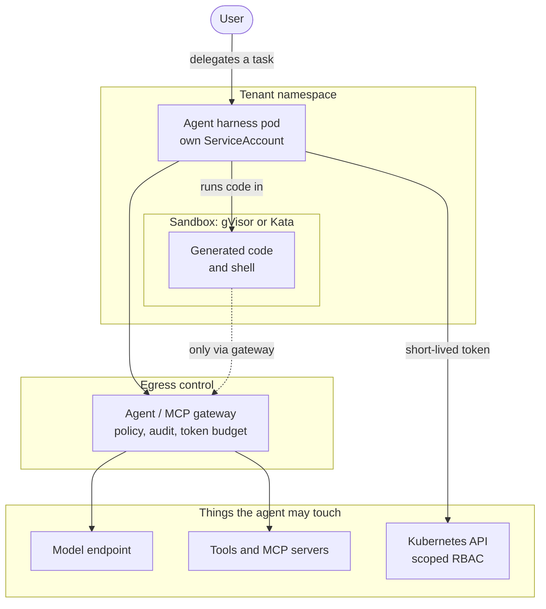
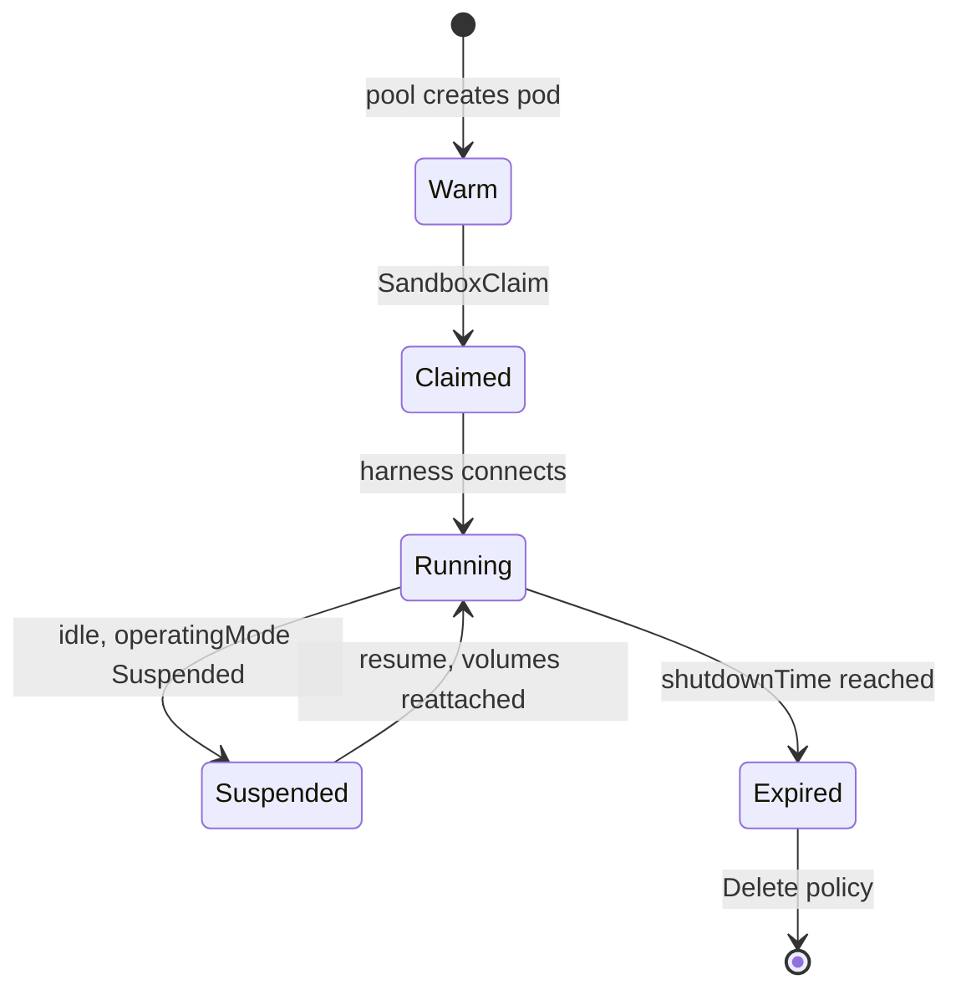
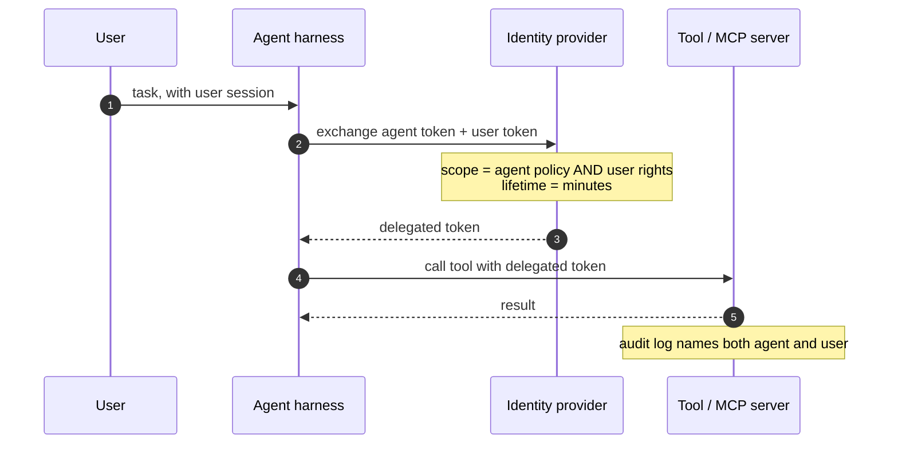
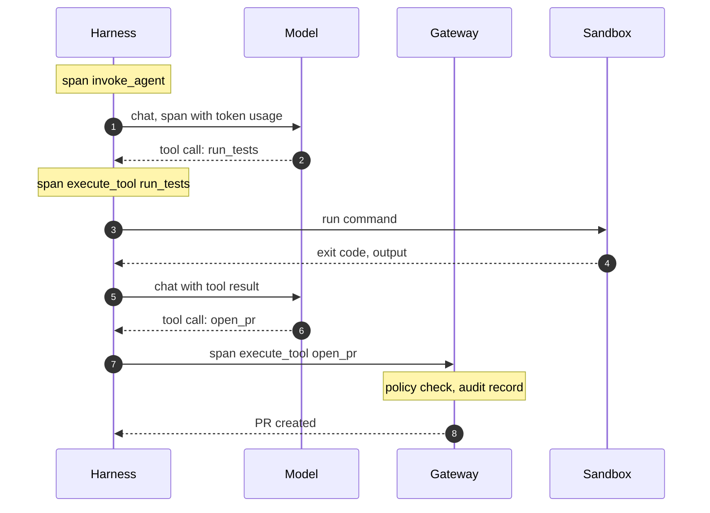

I use coding agents every day, and I work on a Kubernetes AI platform. For a
long time those were two separate things in my head: the agent ran on my
laptop, and the cluster served models. That separation is ending. The agents
are moving into the cluster, next to the models they call and the systems
they act on, and the question stops being "can Kubernetes run this?" and
becomes "what does it take to run this **safely**?"

The CNCF clearly thinks the same. KubeCon + CloudNativeCon North America 2026,
which just finished in Salt Lake City (9–12 November), debuted an
[AI Inference + Agentic track](https://www.cncf.io/announcements/2026/08/10/cncf-reveals-kubecon-cloudnativecon-north-america-2026-schedule-adds-new-ai-inference-agentic-track/),
with "practical patterns for orchestrating autonomous agents" alongside model
serving, and one of its highlighted sessions was Tim Hockin and Dmitry
Berkovich's "Kubernetes Solutions for Agent-Shaped Problems". This post is my
attempt to map that shape: what is different about an agent as a workload,
and which Kubernetes pieces exist today for each difference.

## What Salt Lake City left behind

The keynotes were surprisingly consistent on one point. According to
[Virtualization Review's day-one report](https://virtualizationreview.com/articles/2026/11/12/kubecon-salt-lake-city-day-1-autonomous-agents-sandboxes-bridging-ai-infrastructure-and-kubernetes.aspx),
agents were treated as **untrusted, nondeterministic** workloads that need
isolation before they reach networks or production data. The CNCF's Jonathan
Bryce presented OpenShell and Agent Substrate as ways to wrap agents in
sandboxes built on Kata Containers, gVisor, SPIFFE/SPIRE and Envoy-based
policy gateways, and put enterprises' slow adoption of agents down to not yet
trusting autonomous processes. The article's takeaway sums up the mood:
sandboxing, short-lived identities and policy gateways before an agent
touches shared nodes.

The vendors pointed the same way. Testkube said most of its customers run its
agentic pipelines read-only or with a human in the loop; Komodor launched a
platform that enforces token and cost ceilings and shows the diagnostic
evidence before any automated remediation runs. And
[SiliconANGLE's coverage of Red Hat's announcements](https://siliconangle.com/?p=853338)
— llm-d 1.0 and its work with NVIDIA on OpenShell — carries the caveat I would
print in large type: sandboxing does not make an agent trustworthy; it limits
the damage it can do.

So the conference's four ideas — untrusted by default, a sandbox, short-lived
identity, and an exit through a policy gateway — are exactly the sections of
this post. What follows is what each one looks like in manifests.

It does not repeat two neighbours. The threat model for agents — prompt
injection, the lethal combination of private data, untrusted input and an
exit — is in [Agent security](/blog/agent-security). And the loop around the
model, the part that decides which tool to call, is
[harness engineering](/blog/harness-engineering). Here I care about the pod
that loop runs in.

## What changes when the workload is an agent

| | Web service | Agent |
| --- | --- | --- |
| **Lifetime** | Stateless request, milliseconds | Session of minutes to hours, with memory and files |
| **Code it runs** | Code you reviewed and built | Code a model wrote a moment ago |
| **Who it acts for** | Itself, with a fixed role | A user who delegated a task, often with that user's access |
| **Network** | Calls a known set of dependencies | Decides at runtime which URL or tool to call next |
| **Failure mode** | Crashes, returns 500 | Does the wrong thing successfully |
| **Cost driver** | CPU and memory | Tokens, GPU time and tool calls, per session |

The last two rows are the ones that keep me up. A crashing web service is a
problem your monitoring already understands. An agent that deletes the wrong
branch returns `200 OK`.

So the design principle I keep coming back to is the one the Agent Sandbox
announcement also starts from: treat the agent as **untrusted code with a
legitimate job**. Not malicious, but not something you let near anything it
does not need.



Every arrow in that diagram is a decision. The rest of the post goes through
them in order: the sandbox, the identity, the exits, the permissions, the
record of what happened, and the bill.

## Sandboxes: a second kernel between the agent and the node

A normal container shares the node's kernel. That is an acceptable risk for
code you built; it is a much worse one for code a model generated from a
prompt that might contain someone else's instructions. Kubernetes has had the
answer for years, through `RuntimeClass`: run the pod on a different runtime
that puts another boundary between the workload and the host.

| Runtime | Isolation | What it costs |
| --- | --- | --- |
| **runc** (default) | Namespaces and cgroups on the shared host kernel | Nothing extra; a kernel bug is a node compromise |
| **gVisor** (`runsc`) | A user-space kernel intercepts system calls | Some syscall overhead and compatibility gaps |
| **Kata Containers** | Each pod runs in a lightweight VM with its own kernel | VM start-up and memory overhead; needs virtualisation on the node |

On OpenShift, Kata is what
[OpenShift sandboxed containers](https://docs.redhat.com/en/documentation/openshift_container_platform/4.13/html/openshift_sandboxed_containers_user_guide/understanding-sandboxed-containers)
packages, including a peer-pods mode that creates the VM through the cloud
provider's API instead of needing nested virtualisation.

Choosing a runtime is the easy half. The hard half is the lifecycle: an agent
wants a sandbox **now**, keeps it for a session, may need it back after a
pause, and should never inherit the previous user's files. A Deployment does
not model any of that.

### Agent Sandbox

That gap is what
[Agent Sandbox](https://github.com/kubernetes-sigs/agent-sandbox) fills, a
Kubernetes SIG Apps subproject announced in late 2025 and described on the
[Kubernetes blog](https://kubernetes.io/blog/2026/03/20/running-agents-on-kubernetes-with-agent-sandbox)
in March 2026. Its
[v1.0.0](https://github.com/kubernetes-sigs/agent-sandbox/releases/tag/v1.0.0)
in August 2026 moved both the core and extension APIs to `v1beta1`.

- **`Sandbox`** (`agents.x-k8s.io/v1beta1`): one stateful, singleton pod with
  a stable hostname, optional persistent volumes, a scheduled shutdown and an
  `operatingMode` that can be `Running` or `Suspended` (the pod goes away,
  the object and its volumes stay, and resuming reattaches them).
- **`SandboxTemplate`**, **`SandboxWarmPool`** and **`SandboxClaim`**
  (`extensions.agents.x-k8s.io/v1beta1`): a reusable blueprint, a pool of
  pre-started sandboxes so a session does not pay a cold start, and the
  request an orchestrator makes to check one out.

The template is where the security decisions live. The runtime is just a
field in the pod spec; the network policy is a first-class part of the API:

```yaml title="sandbox-template.yaml" {8-21,25}
apiVersion: extensions.agents.x-k8s.io/v1beta1
kind: SandboxTemplate
metadata:
  name: code-runner
  namespace: team-a-agents
spec:
  networkPolicyManagement: Managed
  networkPolicy:
    ingress:
      - from:
          - podSelector:
              matchLabels:
                app.kubernetes.io/name: agent-harness
    egress:
      # DNS, then the agent gateway and nothing else
      - to:
          - namespaceSelector:
              matchLabels:
                kubernetes.io/metadata.name: kube-system
        ports:
          - { protocol: UDP, port: 53 }
          - { protocol: TCP, port: 53 }
      - to:
          - namespaceSelector:
              matchLabels:
                kubernetes.io/metadata.name: agent-gateway
        ports:
          - { protocol: TCP, port: 8080 }
  podTemplate:
    spec:
      runtimeClassName: gvisor
      automountServiceAccountToken: false
      containers:
        - name: runner
          image: registry.example.com/code-runner:1.4.0
          securityContext:
            allowPrivilegeEscalation: false
            capabilities:
              drop: [ALL]
```

Two details from the source that I think are good defaults. If you leave
`networkPolicy` out entirely, the controller applies a "secure default": only
the sandbox router may connect in, and egress is limited to the public
internet, **blocking private ranges and the cloud metadata server**. And
claims cannot inject environment variables or volumes unless the template
explicitly allows it, so the person writing the claim cannot quietly widen
what the template author decided.

Then a pool keeps sandboxes warm, and each session claims one with an
expiry:

```yaml title="pool-and-claim.yaml" {16-18}
apiVersion: extensions.agents.x-k8s.io/v1beta1
kind: SandboxWarmPool
metadata:
  name: code-runner-pool
  namespace: team-a-agents
spec:
  replicas: 3
  sandboxTemplateRef:
    name: code-runner
---
apiVersion: extensions.agents.x-k8s.io/v1beta1
kind: SandboxClaim
metadata:
  name: session-7f3a
  namespace: team-a-agents
spec:
  warmPoolRef:
    name: code-runner-pool
  lifecycle:
    shutdownTime: "2026-11-13T18:00:00Z"
    shutdownPolicy: Delete
```



> [!IMPORTANT]
> A sandbox limits the **blast radius**; it does not make the agent's
> decisions any better. An agent inside gVisor with a token that can delete
> production namespaces is still an agent that can delete production
> namespaces. The kernel boundary is one layer of several, not the answer.

### Other shapes of the same idea

Agent Sandbox is not the only approach. Two others are worth knowing about,
because they make different trade-offs:

- **[OpenShell](https://www.cncf.io/projects/openshell/)**, developed by
  NVIDIA and accepted into the CNCF Sandbox in September 2026, describes
  itself as policy-enforced sandboxed runtimes for autonomous agents. Red Hat
  [announced in October](https://www.redhat.com/en/about/press-releases/red-hat-ai-factory-nvidia-accelerates-agentic-ai-security-capabilities-across-open-hybrid-cloud)
  that it is a leading contributor alongside NVIDIA and is working to make it
  a native capability in Red Hat AI.
- **Agent Substrate**, from the kagent ecosystem, questions whether a pod is
  the right unit at all. Lin Sun's
  [CNCF post](https://www.cncf.io/blog/2026/07/14/is-a-pod-the-right-deployment-unit-for-an-ai-agent)
  explains the idea: a fixed pool of gVisor worker pods, with many logical
  agents scheduled onto them when work arrives. Pods stay the execution
  environment; they stop being the identity and lifecycle unit.

I find the second argument more interesting than it first looks. A pod per
agent session is clean for isolation and identity, and expensive when most
sessions are idle most of the time. Where the line ends up is genuinely open.

## Identity: who is this agent, for how long

Each agent should have its own identity, and that identity should be
short-lived. In Kubernetes that starts with boring things:

- **One ServiceAccount per agent type**, never `default`, with
  `automountServiceAccountToken: false` on anything that does not need the
  API, as in the sandbox above.
- **Projected, audience-bound tokens** for the things that do. A projected
  token is minted for one audience and expires on its own; the kubelet
  rotates it. It is useless to any service that checks the audience and is not
  the one it was issued for.

```yaml title="agent-harness.yaml (excerpt)" {9-11}
spec:
  serviceAccountName: code-review-agent
  automountServiceAccountToken: false
  volumes:
    - name: tools-token
      projected:
        sources:
          - serviceAccountToken:
              path: token
              audience: tools.internal.example.com
              expirationSeconds: 600
```

From there, the token is exchanged for whatever the agent really calls:
cloud credentials through workload identity federation, SPIFFE identities
through SPIRE, or mTLS certificates. Kubernetes' own
[pod certificates](https://kubernetes.io/blog/2025/12/17/kubernetes-v1-35-release/)
(beta since 1.35) let the kubelet request X.509 credentials for a pod
through a `PodCertificateRequest`, and certificates from the built-in
`kubernetes.io` signers are capped at 24 hours.

The harder problem is **delegation**. The agent acts for a user, so what it
may do should be the intersection of what the agent is allowed and what that
user is allowed — not the union, and certainly not the agent's own broad role
used on everybody's behalf.



There is no Kubernetes primitive for that exchange; it lives in your identity
provider and your gateway. I put it in the diagram anyway, because it is the
piece most often skipped, and it is the one the accountability question at
the end depends on.

## Egress: deny by default, exit through a gateway

The most effective control I know for an agent is the boring one: it cannot
reach what it cannot route to. A model that has been convinced to send your
data somewhere needs a network path to "somewhere".

Plain `NetworkPolicy` gets you default-deny and allowlists by pod, namespace
and IP block. It does not understand domain names, so "allow
`api.github.com`" needs either a CNI with FQDN policies or, better in my view,
a single exit: an egress or agent gateway that every outbound call goes
through. That is where you can apply policy per tool, log every call, strip
credentials and enforce a token budget. The
[Linux Foundation's agentgateway](https://agentgateway.dev/) is one example
built specifically for MCP and agent-to-agent traffic; Envoy-based AI
gateways are another.

The `SandboxTemplate` above encodes exactly that shape: DNS, the gateway, and
nothing else.

> [!TIP]
> Block the cloud metadata endpoint (`169.254.169.254`) for every agent pod,
> even ones you consider harmless. It is the shortest path from "ran some
> code" to "has the node's cloud credentials", and Agent Sandbox's default
> policy blocks it for exactly that reason.

## Per-agent RBAC

If the agent talks to the Kubernetes API — and operations agents do — give it
a Role that matches its job and nothing more. A review agent that reads pod
logs in one namespace does not need `list secrets`, does not need
`pods/exec`, and certainly does not need to create pods, which in most
clusters is a path to every permission the namespace's ServiceAccounts hold.

```yaml title="rbac.yaml"
apiVersion: rbac.authorization.k8s.io/v1
kind: Role
metadata:
  name: log-reader-agent
  namespace: team-a
rules:
  - apiGroups: [""]
    resources: ["pods", "pods/log"]
    verbs: ["get", "list"]
  - apiGroups: ["apps"]
    resources: ["deployments"]
    verbs: ["get", "list"]
```

The pattern I would use to set up a team:

```steps
Namespace: One namespace per team or tenant, with default-deny network policy from day one.
Identity: One service account per agent type, no automounted token unless it needs the API.
Role: A Role written for the job, reviewed like code. No ClusterRoles for agents.
Exits: Egress only to DNS and the agent gateway. The gateway holds the tool credentials.
Quota: A quota on sandboxes and compute, and a token budget at the gateway.
```

## Observability: record the trajectory, not just the latency

For a web service, I want latency, errors and saturation. For an agent I also
need the **trajectory**: what it was asked, which model calls it made, which
tools it called with which arguments, what came back, and what it decided
next. Without that, a bad outcome is impossible to explain.

OpenTelemetry has
[GenAI semantic conventions](https://github.com/open-telemetry/semantic-conventions-genai)
for this, still in *Development* status: `invoke_agent` and `create_agent`
spans for agents, `execute_tool` for tool calls, model inference spans with
token usage, and separate pages for MCP and A2A. If the harness, the gateway
and the model server all propagate the same trace context, one trace tells
the story of a session.



Two practical warnings. Trajectories contain prompts and tool outputs, which
contain user data and sometimes secrets, so the trace store needs the same
access control as the data itself. And storing everything is expensive;
decide early which spans keep full content and which keep only metadata.

## Cost and quotas

An agent's cost is mostly tokens, and tokens are spent by a loop that decides
on its own when to stop. Three places to put a ceiling:

- **The cluster**: a `ResourceQuota` per namespace on compute and on the
  number of sandboxes, so a runaway orchestrator cannot claim the whole
  warm pool.
- **The gateway**: tokens per session, per agent and per tenant, enforced
  where every model call passes anyway.
- **The serving layer**: llm-d's v1.0 multi-tenant flow control sheds load by
  priority and fairness, so one tenant's bursty agents do not starve the
  others' latency (more in
  [the inference post](/blog/llm-inference-kubernetes)).

```yaml title="quota.yaml"
apiVersion: v1
kind: ResourceQuota
metadata:
  name: agent-limits
  namespace: team-a-agents
spec:
  hard:
    requests.cpu: "16"
    requests.memory: 64Gi
    count/sandboxclaims.extensions.agents.x-k8s.io: "20"
```

## The accountability question

Every one of these pieces eventually serves one question: when an agent did
something, **who is responsible**? The user who asked? The team that deployed
the agent? The platform that ran it?

Kubernetes can answer part of it. The audit log records which ServiceAccount
made each API call; the trace records the trajectory; the delegated token
records which user the agent acted for. If you built those three to share an
identifier, you can reconstruct a decision. If you did not, you have three
partial stories.

What Kubernetes cannot answer is whether the action should have happened.
That is a policy decision, and for anything destructive or irreversible I
still want a human approval step, enforced outside the agent — in the gateway
or in admission control — rather than as a polite instruction in the prompt.
Building agents as operators that reconcile declared intent (see
[Kubernetes operators with Kubebuilder](/blog/kubernetes-operators-kubebuilder))
helps here too: a proposed change as an object someone can review is easier
to hold accountable than an imperative command already executed.

## What is still immature

- **The APIs are new.** Agent Sandbox went to `v1beta1` in August 2026 and is
  still releasing almost weekly. OpenShell and the Agent Substrate approach
  are younger. Expect breaking changes and missing features.
- **Delegation has no standard shape** in Kubernetes. Each identity provider
  and gateway does it differently, and most tutorials skip it.
- **Sandboxes have real costs.** gVisor has compatibility gaps for some
  workloads, Kata needs virtualisation support, and warm pools cost money
  while they wait.
- **The GenAI telemetry conventions are in development.** Attribute names
  can change, and not every framework emits them.
- **Density versus isolation is unresolved.** A pod per session is clean
  and expensive; multiplexing agents onto shared workers is efficient and
  moves the isolation problem somewhere new.
- **None of this fixes a bad decision.** It bounds the damage and records
  what happened. Choosing what the agent should be allowed to do at all is
  still on us.

## Further reading

- [Running Agents on Kubernetes with Agent Sandbox](https://kubernetes.io/blog/2026/03/20/running-agents-on-kubernetes-with-agent-sandbox) —
  the Kubernetes blog's introduction: why agents need a new primitive, and
  how Sandbox, templates, claims and warm pools fit together.
- [kubernetes-sigs/agent-sandbox](https://github.com/kubernetes-sigs/agent-sandbox) —
  the source and the `examples/` directory, which has dozens of real
  manifests (coding agents, network policies, warm pools). The API comments
  in `extensions/api/v1beta1` are the best documentation of the defaults.
- [Is a Pod the right deployment unit for an AI agent?](https://www.cncf.io/blog/2026/07/14/is-a-pod-the-right-deployment-unit-for-an-ai-agent) —
  Lin Sun's argument for separating agent lifecycle from pods, and an honest
  list of open questions.
- [OpenTelemetry GenAI semantic conventions](https://github.com/open-telemetry/semantic-conventions-genai) —
  the agent, tool, MCP and A2A span definitions. Read the agent spans page
  before instrumenting a harness.
- [OpenShift sandboxed containers](https://docs.redhat.com/en/documentation/openshift_container_platform/4.13/html/openshift_sandboxed_containers_user_guide/understanding-sandboxed-containers) —
  how Kata is packaged as an operator, including peer pods for clouds without
  nested virtualisation.
- [KubeCon Salt Lake City, day one](https://virtualizationreview.com/articles/2026/11/12/kubecon-salt-lake-city-day-1-autonomous-agents-sandboxes-bridging-ai-infrastructure-and-kubernetes.aspx) —
  a neutral write-up of the keynotes: agents as untrusted workloads, the
  sandbox projects, the new CNCF graduations and certifications.
- [CNCF's KubeCon NA 2026 schedule announcement](https://www.cncf.io/announcements/2026/08/10/cncf-reveals-kubecon-cloudnativecon-north-america-2026-schedule-adds-new-ai-inference-agentic-track/) —
  what the new AI Inference + Agentic track set out to cover; useful for
  finding the session recordings.
- [Red Hat and NVIDIA on OpenShell](https://www.redhat.com/en/about/press-releases/red-hat-ai-factory-nvidia-accelerates-agentic-ai-security-capabilities-across-open-hybrid-cloud) —
  the October 2026 announcement of the joint work on agent sandbox runtimes.
