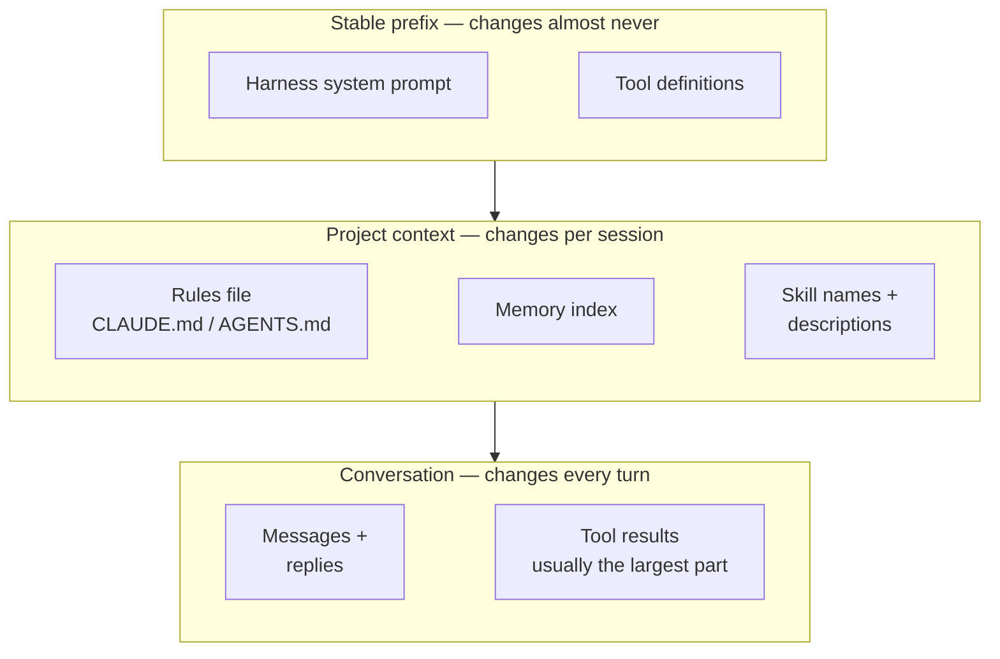
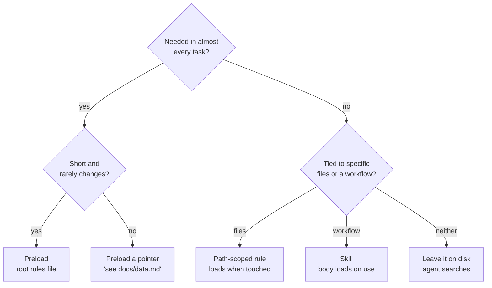
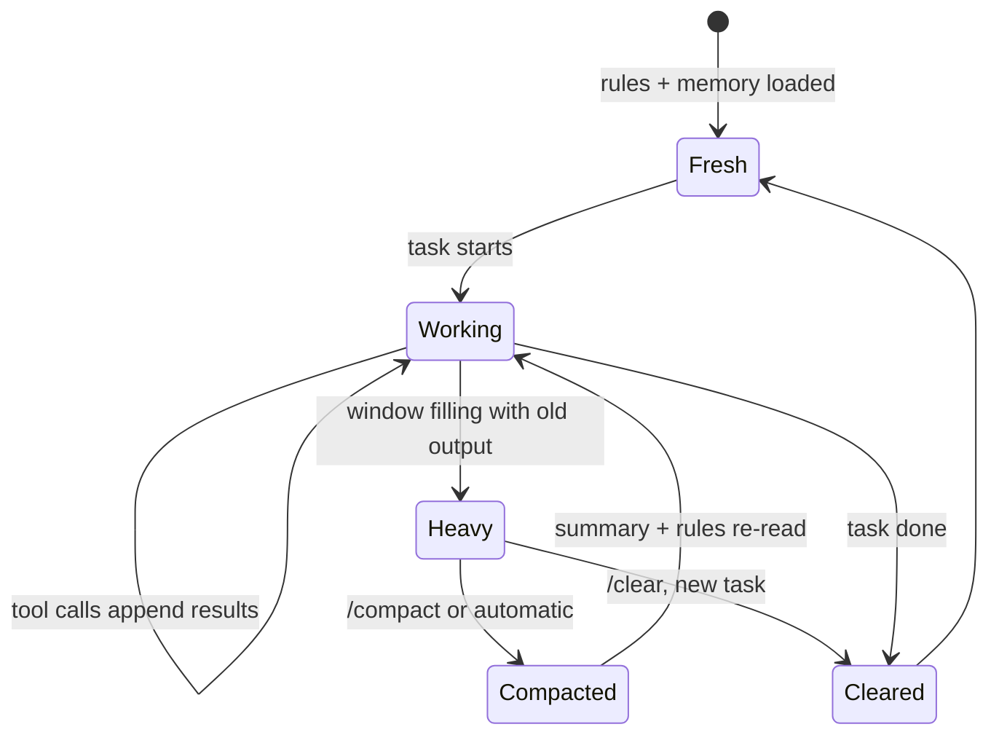
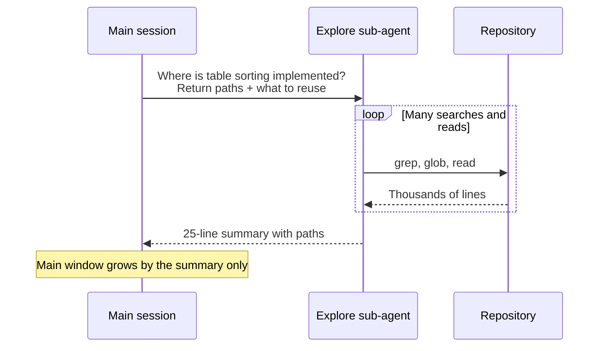

A coding agent at minute five of a session is sharp. It reads the right files, follows the rules file, asks good questions. At hour three, the same agent on the same model starts repeating an approach that already failed, forgets a constraint you stated at the beginning, or confidently cites a function it read and then rewrote. Nothing about the model changed. What changed is what it was looking at.

Anthropic's engineering team calls the discipline of managing that [context engineering](https://www.anthropic.com/engineering/effective-context-engineering-for-ai-agents), and describes it as the natural progression of prompt engineering: not just writing a good instruction, but curating everything that ends up in the window across many turns. This post is how I think about it in practice. It complements [one session per job](/blog/agentic-development-sessions), which is about splitting work into sessions; this one is about keeping a single session healthy while it runs.

## The window is a budget, not a bucket

The tempting mental model is a bucket: bigger windows hold more, so put more in. The research says otherwise.

[Lost in the Middle](https://aclanthology.org/2024.tacl-1.9/) (Liu et al., TACL 2024) showed that models use information at the start and end of a long input better than information in the middle, and that performance drops as inputs grow even for models built for long contexts. Chroma's [Context Rot](https://www.trychroma.com/research/context-rot) report tested 18 models and found the same shape on deliberately simple tasks: reliability falls as input length grows, distractors hurt more the longer the input, and on a realistic memory benchmark models did much better with a focused prompt of a few hundred tokens than with the full one of more than a hundred thousand.

Anthropic frames the consequence as an *attention budget*: every token you add draws on it. The goal stops being "include everything relevant" and becomes finding the smallest set of high-signal tokens that gets the job done.

Drew Breunig's [How Long Contexts Fail](https://dbreunig.com/2025/06/22/how-contexts-fail-and-how-to-fix-them.html) gives the failure modes names, and I find the names useful because each one has a different fix:

| Failure | What it looks like in a coding session | First thing I try |
| --- | --- | --- |
| **Poisoning** | A wrong assumption from turn 4 is treated as fact at turn 40 | Correct it explicitly, or restart from a written plan |
| **Distraction** | The agent repeats its own earlier moves instead of thinking | Compact, or start a fresh session |
| **Confusion** | Irrelevant tools or files pull it towards the wrong action | Fewer tools; delegate exploration |
| **Clash** | Two instructions in the window contradict each other | Fix the source — usually the rules file |

## What's actually in the window

Before deciding what to add, it helps to know what's already there. A coding agent's request has three layers that change at very different rates.



Claude Code documents this layering explicitly in its [prompt caching page](https://code.claude.com/docs/en/prompt-caching): stable content first, because the cache matches the request's prefix exactly and any change recomputes everything after it. Context engineering and cost engineering pull in the same direction here. Keep the top of the window stable and append below it.

Run `/context` in Claude Code at any point and you get the live breakdown by category. It's worth doing in the middle of a long session: what has grown usually isn't the rules file or the tools, it's old tool output that no longer matters.

## Preload or fetch just in time

The core design decision is what to put in the window up front and what to leave on disk for the agent to fetch when it needs it. Anthropic describes Claude Code as a hybrid: `CLAUDE.md` is loaded at the start, and everything else is found with tools like grep and glob *just in time*, using file paths as lightweight references instead of loading contents.



Claude Code gives you three on-demand mechanisms beyond search, all documented in its [memory](https://code.claude.com/docs/en/memory) and [skills](https://code.claude.com/docs/en/skills) pages:

- **Nested rules files** in subdirectories load when the agent reads or edits a file there.
- **Path-scoped rules** in `.claude/rules/` with a `paths:` glob load when a matching file is touched.
- **Skills** use progressive disclosure: only name and description are in the window at the start; the body loads when the skill is invoked; supporting files load only if the body points to them.

The path-scoped rule is the one I reach for most. A trap that only matters in one area of the codebase shouldn't cost tokens in every session:

```md title=".claude/rules/admin-forms.md"
---
paths:
  - "src/components/admin/**/*.tsx"
---

# Admin forms

- Forms are generated from the schemas in `src/data/schema/`.
  Add a field to the schema, never to the component.
- Document IDs come from the schema's `idFrom`. Don't generate them in the UI.
```

The same documentation is blunt about the root file: target under 200 lines, because longer files consume more context and reduce adherence. That's the attention budget again, applied to the one file that's always loaded. The test for what belongs in it is in [Effective rules for AI assistants](/blog/ai-coding-rules).

## Tool output is the biggest line item

In a long coding session the conversation layer ends up dwarfing everything else, and tool results dominate the conversation layer: test runs, build logs, search results, whole files. That makes the tool boundary the cheapest place to save context, and it's a harness decision rather than a model one (more on that in [Harness engineering](/blog/harness-engineering)).

Anthropic's guide to [writing tools for agents](https://www.anthropic.com/engineering/writing-tools-for-agents) recommends pagination, filtering and truncation with sensible defaults, and — the part people skip — telling the agent how to get more when a result was cut. Manus's [context engineering lessons](https://manus.im/blog/Context-Engineering-for-AI-Agents-Lessons-from-Building-Manus) add a principle I like a lot: make compression *restorable*. Drop the contents, keep the path or URL, so the information can come back if it's needed.

Put together, a wrapper for any tool that can produce a lot of output looks like this:

```ts title="src/tools/trim.ts"
import { mkdir, writeFile } from "node:fs/promises";
import { join } from "node:path";

const MAX_CHARS = 12_000;

/** Keep head and tail, save the full output, and tell the model how to get the rest. */
export async function trimOutput(output: string, id: string): Promise<string> {
  if (output.length <= MAX_CHARS) return output;

  await mkdir(".agent/logs", { recursive: true });
  const fullPath = join(".agent/logs", `${id}.log`);
  await writeFile(fullPath, output);

  const head = output.slice(0, 7_000); // errors usually start near the top
  const tail = output.slice(-3_000); // summaries and exit codes are at the end
  const omitted = output.length - head.length - tail.length;
  return `${head}\n\n[${omitted} characters omitted. Full output: ${fullPath}. Search it instead of re-running.]\n\n${tail}`;
}
```

The same idea applies to how I prompt: "run the tests for `UserTable` and tell me only what failed" produces a far smaller tool result than "run the tests".

## Compaction: what survives

Eventually the window fills anyway. Compaction summarises the history so far and continues from the summary. Claude Code does it automatically near the limit; you can also run `/compact` with a focus, like `/compact keep the decisions about the table migration`, so the summary keeps what you choose rather than what the automatic pass guesses.

What matters is what comes back afterwards. Claude Code's [context window page](https://code.claude.com/docs/en/context-window) lists it precisely: the system prompt stays, the project-root `CLAUDE.md` and auto memory are re-read from disk, invoked skills are re-injected up to a cap, and up to five recently edited files are re-read. Instructions you gave only in conversation are summarised with everything else — which is how "it forgot what I told it" usually happens.



> [!IMPORTANT]
> If an instruction must survive compaction, it can't live only in the chat. Put it in the root rules file, or in a file the agent re-reads. "I told it at the start" is not a persistence strategy.

There's a lighter tool than full compaction: clearing old tool results while keeping the conversation. Anthropic's API exposes it as [context editing](https://platform.claude.com/docs/en/build-with-claude/context-editing), currently in beta, which replaces the oldest tool results with a placeholder once input passes a threshold:

```python title="agent.py" {6-13}
response = client.beta.messages.create(
    model=MODEL,
    max_tokens=4096,
    messages=messages,
    tools=tools,
    betas=["context-management-2025-06-27"],
    context_management={
        "edits": [{
            "type": "clear_tool_uses_20250919",
            "trigger": {"type": "input_tokens", "value": 30000},
            "keep": {"type": "tool_uses", "value": 3},
        }]
    },
)
```

One counterweight from Manus: don't scrub every failure. Leaving a failed attempt and its error in the window helps the model avoid repeating it. What I clear is *bulk* — the 4,000-line log — not the one line that says why it failed.

## Sub-agents as context firewalls

The most effective context tool I use is not putting things in the main window at all. A sub-agent runs in its own window, does the noisy exploration there and returns a summary. In Claude Code it starts with the delegation prompt and not the parent's history, and only its final report comes back ([sub-agents docs](https://code.claude.com/docs/en/sub-agents)). Anthropic's context engineering post describes the returned summaries as typically a thousand to two thousand tokens, for exploration that might have used tens of thousands.



The quality of the hand-off depends entirely on the brief, so I define the explorer once and give it an explicit output contract:

```md title=".claude/agents/repo-explorer.md"
---
name: repo-explorer
description: Read-only codebase search. Use when answering means reading many files and only the conclusion matters.
tools: Read, Grep, Glob
---

You locate code; you never change it. Return at most 30 lines:
the files that matter (path:line), existing helpers to reuse instead of
writing new ones, and anything that looks like one thing but is another.
No file dumps. Say what you did not check.
```

The cost is tokens — Anthropic measured multi-agent setups at roughly fifteen times the tokens of a chat in their [research system](https://www.anthropic.com/engineering/multi-agent-research-system) — and a loss of detail: the parent only knows what the summary says.

## Memory outside the window

The window is volatile; files aren't. Anthropic's post lists structured note-taking as one of the three techniques for long-horizon work, next to compaction and sub-agents, and their [long-running agents](https://www.anthropic.com/engineering/effective-harnesses-for-long-running-agents) harness relies on a progress file plus git history so each new session can pick up where the last stopped. Manus does a version of the same with a `todo.md` it rewrites as it goes, which also keeps the plan near the end of the window where attention is strongest.

Claude Code's auto memory is the built-in version: notes the agent writes about your corrections and preferences, with the first 200 lines or 25KB loaded each session. For a multi-session task I prefer an explicit file I can read and edit, shaped roughly like this (illustrative):

```md title="notes/progress.md"
# Migrate the settings tables to the shared Table component

## Done
- [x] Sorting and pagination — `UsersTable` (tests pass)

## Next
- [ ] Empty and error states for `TokensTable`

## Decisions
- Keep the old column IDs: saved user preferences depend on them.

## Traps found
- `TokensTable` is also rendered by the admin page; check both.
```

Decisions and traps are the sections that pay. The plan you can reconstruct; why you chose it, you can't.

## Practical rules

These are the habits that have stuck for me, roughly in the order I apply them during a session:

```steps
Start lean: Root rules file under ~200 lines; everything else on demand — path rules, skills, pointers to docs.
Delegate reads: Any question that needs more than a handful of files goes to an explore sub-agent with an output contract.
Ask for less: Trim at the tool, and ask for "only what failed" rather than the whole run.
Write it down: Decisions and traps go to a file as they happen, not at the end.
Reset on purpose: /compact with a focus at natural breaks; /clear between unrelated tasks; a fresh session when it starts repeating itself.
```

> [!TIP]
> Treat a repeated mistake as a signal about the window, not the model. If the agent keeps forgetting a constraint, check where that constraint lives. Usually the answer is "in turn three of a long chat".

## Limits

Context engineering doesn't make a weak plan good. If the task is underspecified, a clean window gives you a fast, confident version of the wrong thing; the fix for that is upstream, in [the specification](/blog/spec-driven-ai-sdlc). It also has diminishing returns on short tasks: for a twenty-minute fix, a fresh session with a good rules file is all the context engineering you need, and anything more is ceremony.

Every technique here trades something. Compaction loses detail you might have needed. Sub-agents cost tokens and hide their reasoning. Just-in-time retrieval is slower than having the answer already loaded, and depends on the agent knowing what to look for. Memory files go stale and start poisoning sessions themselves if nobody prunes them. The skill is choosing the trade on purpose instead of letting the window fill until it chooses for you.

## Further reading

- [Effective context engineering for AI agents](https://www.anthropic.com/engineering/effective-context-engineering-for-ai-agents) — Anthropic. The attention-budget framing, just-in-time retrieval, compaction, note-taking and sub-agents in one place. Start here.
- [Context Rot](https://www.trychroma.com/research/context-rot) — Chroma. 18 models, simple tasks, and clear evidence that longer inputs degrade reliability.
- [Lost in the Middle](https://aclanthology.org/2024.tacl-1.9/) — Liu et al., TACL 2024. The paper behind "put important things at the start or the end".
- [How Long Contexts Fail](https://dbreunig.com/2025/06/22/how-contexts-fail-and-how-to-fix-them.html) — Drew Breunig. Poisoning, distraction, confusion and clash; useful vocabulary for debugging a session.
- [Context Engineering for AI Agents: Lessons from Building Manus](https://manus.im/blog/Context-Engineering-for-AI-Agents-Lessons-from-Building-Manus) — Yichao "Peak" Ji. Cache-friendly prompts, restorable compression, recitation and keeping errors in.
- [Explore the context window](https://code.claude.com/docs/en/context-window) — Claude Code docs. What loads when, and the exact list of what survives compaction.
- [How Claude Code uses prompt caching](https://code.claude.com/docs/en/prompt-caching) — why the order of the window matters for cost and speed, and which actions break the cache.
