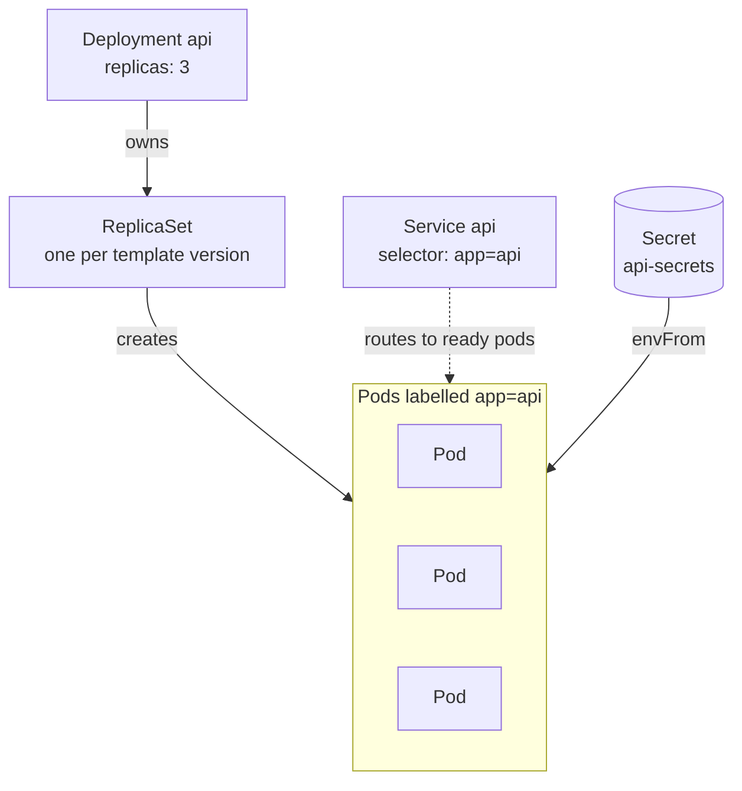
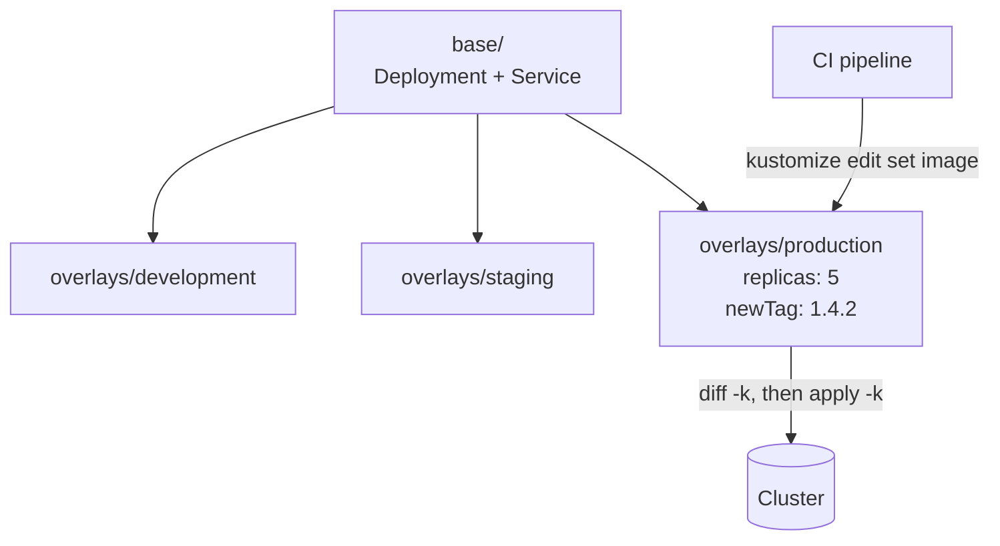

In the workshop, the containers module is where most people get stuck, almost always for the same reason: they try to translate `docker-compose.yml` into Kubernetes YAML line by line. It doesn't translate, because the two tools answer different questions.

## The image first, and make it small

Before Kubernetes, the image. The usual mistake is a single stage that drags every development `node_modules` and the source code into production.

```dockerfile title="api/Dockerfile" {4,18}
# Stage 1: build
FROM node:22-alpine AS build
WORKDIR /app
COPY package*.json ./
RUN npm ci                    # ci, not install: respects the lockfile
COPY . .
RUN npm run build

# Stage 2: only what is needed to run
FROM node:22-alpine AS runtime
WORKDIR /app
ENV NODE_ENV=production
COPY package*.json ./
RUN npm ci --omit=dev && npm cache clean --force
COPY --from=build /app/dist ./dist

# Don't run as root.
USER node
EXPOSE 3000
CMD ["node", "dist/server.js"]
```

Two details matter more than they look. `COPY package*.json` **before** the rest of the code lets the dependency layer be reused while the lockfile is unchanged: a change in your code reinstalls nothing. And `USER node` is the difference between a container-escape vulnerability that hands over root and one that doesn't.

```mermaid title="The build stage is discarded; only the runtime stage ships"
flowchart TB
  subgraph build["build stage"]
    B1["npm ci<br/>all dependencies"] --> B2["COPY source"] --> B3["npm run build"]
  end
  subgraph runtime["runtime stage"]
    R1["npm ci --omit=dev"]
    R2["dist/"]
    R3["node dist/server.js<br/>as USER node"]
    R1 --> R3
    R2 --> R3
  end
  B3 -- "COPY --from=build" --> R2
```

For the front end, the final stage isn't Node: it's a static server.

```dockerfile title="web/Dockerfile"
# … same build stage as above
FROM nginx:alpine AS runtime
COPY --from=build /app/dist /usr/share/nginx/html
COPY nginx.conf /etc/nginx/conf.d/default.conf
```

With a SPA, that `nginx.conf` needs the `try_files` rule returning `index.html` for any path, or refreshing on `/projects` gives a 404.

```nginx title="web/nginx.conf" {6}
server {
  listen 80;
  root /usr/share/nginx/html;

  location / {
    try_files $uri $uri/ /index.html;
  }
}
```

## compose is for development

`docker-compose` answers "start these three processes together on my laptop". That stays useful and doesn't go away:

```yaml title="docker-compose.yml" {7,10-12}
services:
  api:
    build: { context: ./api, target: build }
    command: npm run dev
    volumes: ["./api/src:/app/src"]     # hot reload
    environment: { MONGO_URL: mongodb://db:27017/app }
    depends_on: { db: { condition: service_healthy } }
  db:
    image: mongo:7
    healthcheck:
      test: ["CMD", "mongosh", "--eval", "db.adminCommand('ping')"]
      interval: 5s
```

That `healthcheck` with `condition: service_healthy` avoids the classic: the API starts before Mongo, fails to connect, and crash-loops.

## Kubernetes describes state, not steps

Here's the mental shift. In compose you say "run this". In Kubernetes you declare "I want three healthy replicas of this image, reachable under this name", and the controller keeps making that true — now and in a month.

```mermaid title="The reconcile loop: you edit the desired state, the controller does the rest"
flowchart TB
  D["Desired state<br/>replicas: 3"] --> C{"Controller<br/>compares"}
  O["Observed state<br/>2 pods running"] --> C
  C -- "differs" --> A["Act<br/>create 1 pod"]
  A -- "changes" --> O
  C -- "matches" --> W(["Wait for the next change"])
```

| | docker-compose | Kubernetes |
| --- | --- | --- |
| **The question it answers** | Start these processes together | Keep this state true |
| **Where** | One machine, usually yours | A cluster of nodes |
| **A process dies** | `restart:` policy, if you set one | The controller replaces the pod |
| **Finding a service** | Its name on the compose network | A `Service` and its DNS name |
| **Configuration** | `environment:` and `.env` | `ConfigMap` and `Secret` |

The three minimum pieces — a Deployment, a Service, and the Secret it reads:

```yaml title="base/api.yaml" {12,17-19,21}
apiVersion: apps/v1
kind: Deployment
metadata: { name: api }
spec:
  replicas: 3
  selector: { matchLabels: { app: api } }
  template:
    metadata: { labels: { app: api } }
    spec:
      containers:
        - name: api
          image: registry.example.com/api:1.4.2   # never :latest
          ports: [{ containerPort: 3000 }]
          envFrom:
            - secretRef: { name: api-secrets }
          resources:
            requests: { cpu: 100m, memory: 128Mi }
            limits:   { memory: 256Mi }
          readinessProbe:
            httpGet: { path: /healthz, port: 3000 }
          livenessProbe:
            httpGet: { path: /healthz, port: 3000 }
            initialDelaySeconds: 15
---
apiVersion: v1
kind: Service
metadata: { name: api }
spec:
  selector: { app: api }
  ports: [{ port: 80, targetPort: 3000 }]
```



The Deployment never runs a pod itself: it owns a ReplicaSet per version of the template, and that is what makes a rollback possible. The Service doesn't know about the Deployment at all — it matches pods by label.

Four decisions that save incidents:

**Never `:latest`.** With a moving tag, two replicas of the same Deployment can be running different code, and a rollback has nowhere to go back to.

**Always set `requests`.** Without them the scheduler doesn't know what you need and packs pods until the node runs out of memory.

**Memory limits yes, CPU limits carefully.** Exceeding memory kills the process; exceeding CPU only slows it. A CPU limit set too low produces latency that looks like an application bug.

**`readiness` and `liveness` are not the same.** Readiness decides whether traffic reaches you; liveness decides whether you get restarted. Pointing liveness at an endpoint that queries the database is a recipe for cascading restarts when the database is slow: your application is alive, it's just waiting.

| Probe | Question it asks | When it fails | Point it at |
| --- | --- | --- | --- |
| **readiness** | Can this pod take traffic now? | Removed from the Service, not restarted | Something that checks dependencies |
| **liveness** | Is this process stuck for good? | Container restarted | Something that only the process itself answers |

## Configuration and secrets

Whatever differs between environments lives outside the image. The same image should deploy to development and production by changing only the `ConfigMap` and the `Secret`. The moment you build a different image per environment, you've lost the guarantee that what you tested is what you deploy.

> [!WARNING]
> A Kubernetes `Secret` is Base64, not encryption. For the repository you need something like Sealed Secrets or an external manager.

## Kustomize before copy-paste

With three environments comes the temptation of three copies of the YAML. Kustomize prevents the divergence: one common base and a patch per environment.

```text
k8s/
├── base/
│   ├── api.yaml
│   └── kustomization.yaml
└── overlays/
    ├── development/kustomization.yaml
    ├── staging/kustomization.yaml
    └── production/kustomization.yaml
```

```yaml title="overlays/production/kustomization.yaml" {10}
resources: ["../../base"]
patches:
  - patch: |
      - op: replace
        path: /spec/replicas
        value: 5
    target: { kind: Deployment, name: api }
images:
  - name: registry.example.com/api
    newTag: 1.4.2
```

The CI pipeline only has to update that `newTag` and apply. Everything else lives in git, and `kubectl diff -k` tells you exactly what will change before it changes.



```bash title="CI deploy step"
cd k8s/overlays/production
kustomize edit set image registry.example.com/api:1.4.3
kubectl diff -k .   # review exactly what changes
kubectl apply -k .
```

## The order I recommend

```steps
Image: A multi-stage build that runs locally, small and not as root.
Compose: The whole stack on your laptop, with healthchecks and hot reload.
Kubernetes: The same image, described as desired state.
Overlays: One base and a patch per environment, deployed by CI.
```

A multi-stage image that works locally, compose for developing, and only then Kubernetes. Jumping straight to YAML without a solid image means debugging two problems at once, from the place where you have the least information.
