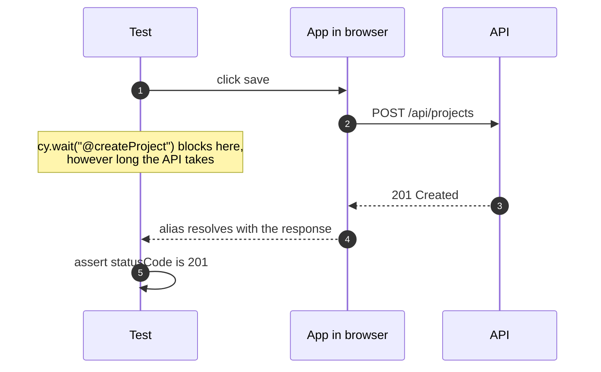
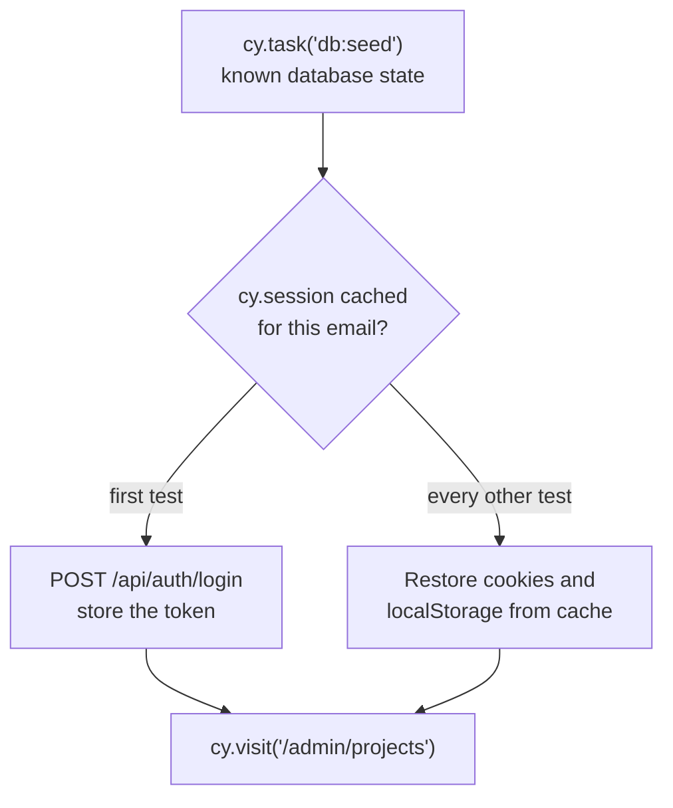
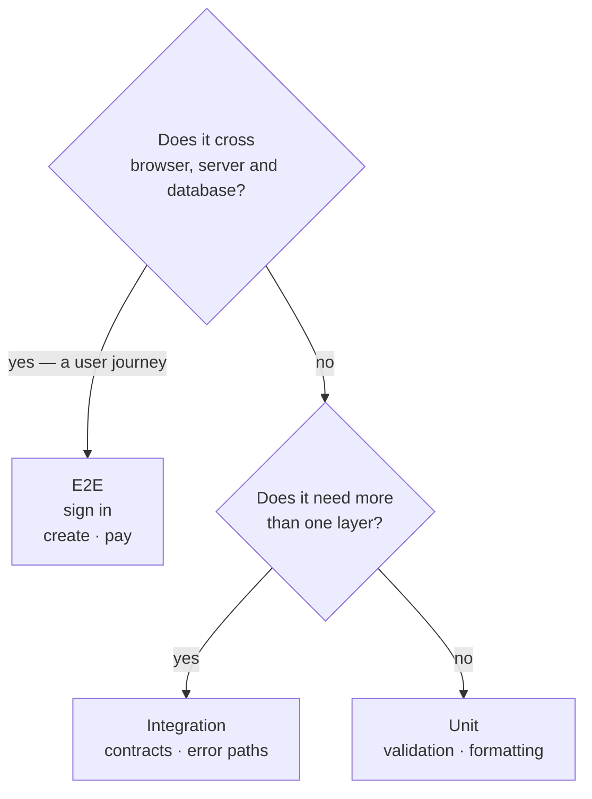

Almost every team I know has had an E2E suite and abandoned it. The pattern repeats:

```steps
Written: With enthusiasm, a test per screen.
Flaky: It starts failing intermittently.
Retry: Someone adds a retry.
Wait: Then a wait.
Disabled: Six months later it's off in CI, “temporarily”.
```

Brittleness isn't inherent to E2E. It comes from four specific decisions.

## 1 · Waiting on time instead of state

The original sin.

```diff
  cy.get("[data-cy=save]").click();
- cy.wait(500); // brittle: 500 ms is enough until one day it isn't
- cy.get("[data-cy=toast]").should("contain", "Saved");
+ // robust: wait for the condition, not the clock
+ cy.contains("[data-cy=toast]", "Saved").should("be.visible");
```

Cypress already retries assertions until they pass or the timeout expires. The `wait` adds nothing but slowness and a random failure when CI is loaded.

When you genuinely need to wait on the network, wait on the **request**, not a number:

```js {1,3}
cy.intercept("POST", "/api/projects").as("createProject");
cy.get("[data-cy=save]").click();
cy.wait("@createProject").its("response.statusCode").should("eq", 201);
```



## 2 · Selectors coupled to the design

`cy.get(".btn-primary")` works until someone renames a Tailwind class. A selector should describe **what something is**, not how it's painted.

```js
// Breaks on any styling refactor
cy.get(".flex > div:nth-child(2) button.btn-primary");

// Survives refactors
cy.get("[data-cy=project-save]");
```

My order of preference: an accessible role and name where one exists (`cy.contains("button", "Save")`), and `data-cy` where it doesn't. The dedicated attribute exists precisely so nobody changes it for visual reasons.

| Selector | Example | Breaks when |
| --- | --- | --- |
| **CSS structure** | `.flex > div:nth-child(2) button` | Anyone touches the layout |
| **Styling class** | `.btn-primary` | Someone renames a class |
| **Role and name** | `cy.contains("button", "Save")` | The visible text changes — which a user would notice too |
| **`data-cy`** | `[data-cy=project-save]` | Someone deletes it on purpose |

## 3 · Tests that depend on each other

The most expensive design mistake. A test that creates a project and another that edits it are a 400-line test disguised as two, and when the first fails the second lies.

Each test should build its own state, and build it the fast way:

```js title="cypress/e2e/projects.cy.js"
beforeEach(() => {
  cy.task("db:seed");              // known state
  cy.loginByApi("admin@test.dev"); // without the login form
  cy.visit("/admin/projects");
});
```

That `loginByApi` matters more than it looks. If every test goes through the login form, you're testing login a hundred times and paying its latency a hundred times. Test it **once**, in its own test, and use the service entrance everywhere else:

```js title="cypress/support/commands.js" {2}
Cypress.Commands.add("loginByApi", (email) => {
  cy.session(email, () => {
    cy.request("POST", "/api/auth/login", { email, password: Cypress.env("pw") })
      .its("body.token")
      .then((token) => window.localStorage.setItem("token", token));
  });
});
```

`cy.session` caches the result between tests, so the cost is paid once per suite.



> [!TIP]
> The login form still gets its own test — exactly one. Every other test goes in through the API.

## 4 · Testing everything at this level

An E2E costs seconds; a unit test, milliseconds. Test every form validation end to end and you get a forty-minute suite nobody waits for.

The rule I use: **E2E only for journeys that cross systems**. Sign in, create something and see it in the list, complete a payment, recover a password. Five or six well-chosen journeys catch nearly everything a suite of two hundred would, and run in three minutes.

Everything else — validation permutations, error states, formatting — is cheaper and more precise one layer down.



## What is worth the investment

Two Cypress capabilities that change your relationship with the tool:

**The runner's time travel.** Every command is recorded with a DOM snapshot at that instant. When a test fails you don't guess what was on screen: you look at it.

**Videos and screenshots in CI.** A failure that only happens on the runner is impossible to fix blind. With a video of the failing attempt it's usually minutes.

```js title="cypress.config.js" {6}
import { defineConfig } from "cypress";

export default defineConfig({
  video: true,
  screenshotOnRunFailure: true,
  retries: { runMode: 2, openMode: 0 },
});
```

> [!WARNING]
> That `retries` deserves a caveat. Retrying in CI hides flakiness rather than fixing it, and it is debt. I use it as a safety net while a suite matures, on the condition of looking at *which* test is retrying: if one retries consistently, it is broken, not flaky.

## The value test

An E2E test isn't there to cover lines. It's there to answer one question: *can a user do what this application promises?* If a test doesn't contribute to that answer, it probably belongs in another layer.
