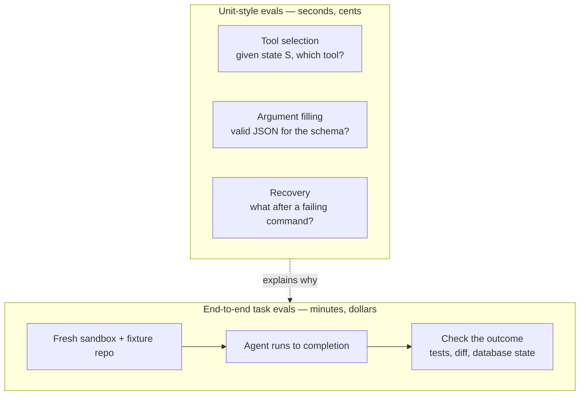
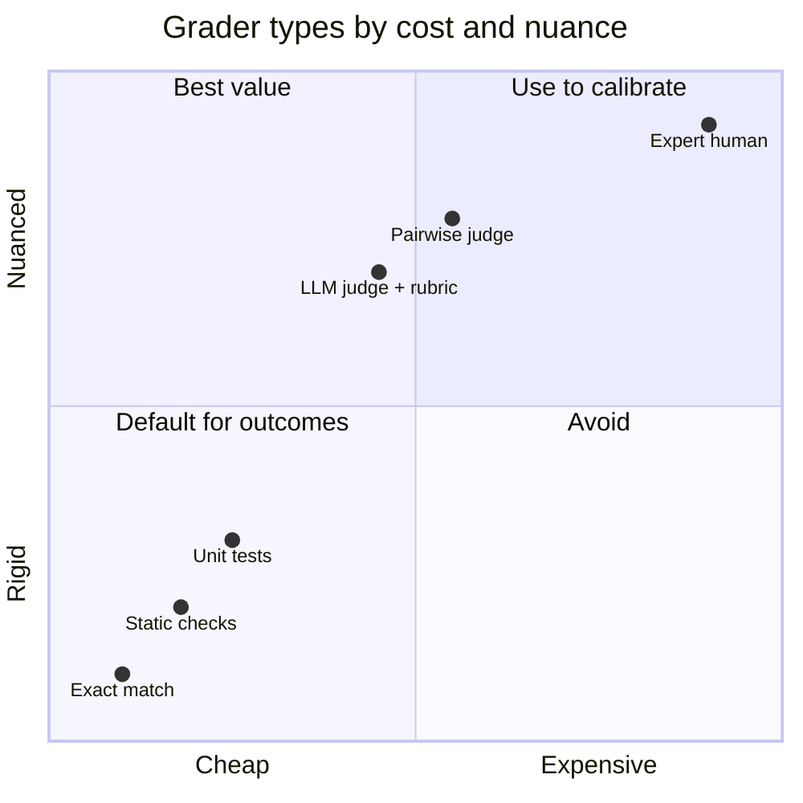
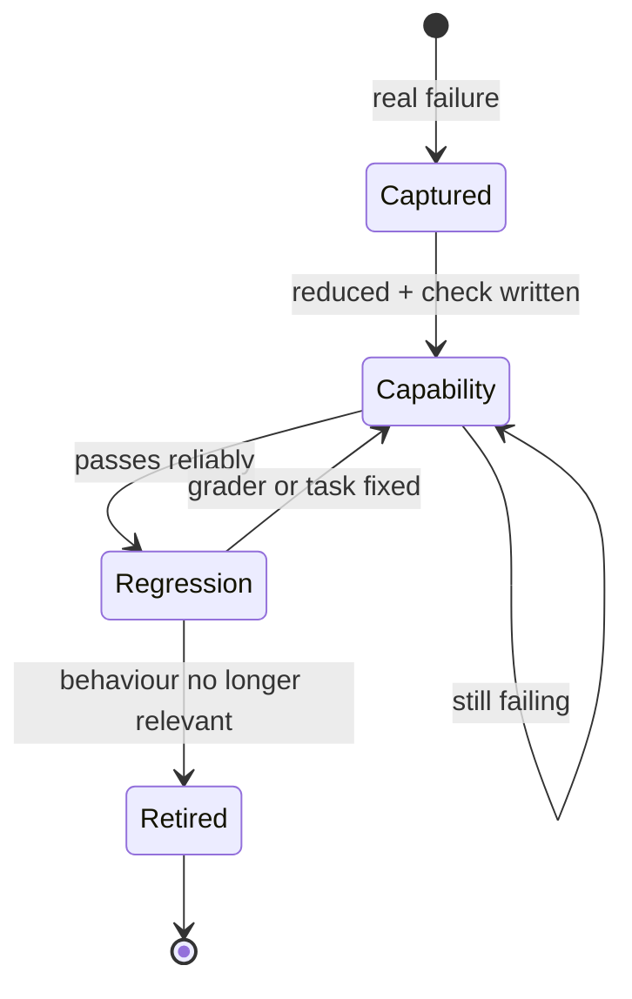
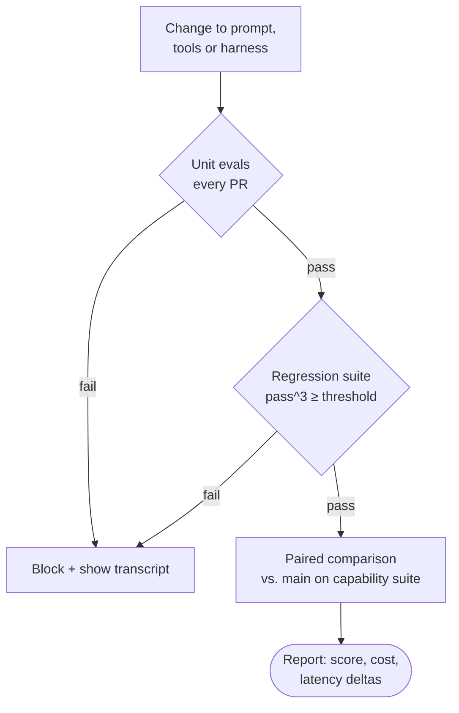

Every change to an agent starts with the same ritual. You tweak the system prompt, rename a tool, add a line to the harness, run the task that was failing, and it works. You try a second one and it works too. It *feels* better, so you ship it.

Then a week later something that used to work stops working, and nobody can say when it broke, because the only test was a person trying two things in a terminal.

That's the problem evals solve. Not "is this model smart?" — leaderboards answer that, badly — but a much narrower and more useful question: **did this change to my prompt, my tools or my harness make my agent better at my tasks, or did it just move the failures somewhere I wasn't looking?**

This post is about building that answer. If you want the background on what the harness is and why it matters as much as the model, that's in [harness engineering](/blog/harness-engineering); here I assume you have one and want to measure it.

## The vocabulary, briefly

Anthropic's engineering team published a good guide, [Demystifying evals for AI agents](https://www.anthropic.com/engineering/demystifying-evals-for-ai-agents), and I'll borrow its terms because they're precise:

| Term | What it means |
| --- | --- |
| **Task** | One test case: an input plus success criteria |
| **Trial** | One attempt at a task. You run several, because outputs vary |
| **Grader** | Logic that scores some aspect of a trial |
| **Transcript** | The full record of a trial: messages, tool calls, intermediate results |
| **Outcome** | The final state of the environment after the trial |
| **Eval harness** | The thing that runs tasks, records transcripts, grades and aggregates |

The distinction that matters most is **transcript versus outcome**. The guide's example is an agent that says "your flight is booked". The transcript says booked. The outcome is whether a reservation actually exists in the database. Grade the outcome whenever you can.

The other one worth keeping in mind: when you evaluate "an agent", you are evaluating the model *and* the harness together. Swap either and you have a different system.

## Unit evals and end-to-end evals

I find it useful to split evals the way I'd split ordinary tests.

**Unit-style evals** check one decision in isolation. Given this conversation state, does the agent pick the right tool? Given this tool description, does it fill the arguments correctly? Given this error output, does it retry or give up? They're cheap — often a single model call — and the grader is usually exact.

**End-to-end task evals** give the agent a real task in a real (sandboxed) environment and check the final state. Fix this failing test. Add this field to the API and its form. They're slow, expensive and noisy, and they're the only thing that tells you whether the whole system works.



Most changes I make touch a narrow behaviour — a tool description, a line in the instructions — so I want the unit layer to tell me quickly whether the behaviour moved, and the end-to-end layer to tell me whether anything else broke. When an end-to-end task fails, the unit evals are where I look for *why*.

## Graders: exact, code, judge, human

A grader is where most evals quietly go wrong, so it's worth being deliberate about which kind you use.



**Exact and code-based graders** — string match, running the test suite, checking that a file exists, parsing the diff, counting tool calls. Fast, cheap, reproducible, and easy to debug. Their weakness is brittleness: a correct answer phrased differently fails. For coding agents this is the default, because "the tests pass" is a code-based grader that also happens to be close to the truth.

**LLM-as-judge** — a model grades the output against a rubric. Flexible, handles open-ended output (a PR description, an explanation, a plan), and scales. It's also non-deterministic, costs money per grade, and has known biases: the [MT-Bench paper](https://arxiv.org/abs/2306.05685) documented position bias, verbosity bias and self-enhancement bias in judges years ago, and those failure modes haven't gone away.

**Human graders** — the gold standard and the bottleneck. You don't use them to grade every run; you use them to **calibrate** the judge.

Two practices make judges trustworthy. The first is to ask for binary verdicts per criterion instead of a 1–10 score; Hamel Husain and Shreya Shankar's [evals FAQ](https://hamel.dev/blog/posts/evals-faq/) argues this well — nobody agrees on the difference between a 6 and a 7. The second is to give the judge an explicit way out ("unknown"), so it doesn't invent a verdict when the transcript doesn't contain the evidence.

Here's a rubric I'd use for grading the pull request description an agent writes after a change:

```md title="evals/judges/pr-description.md"
You are grading a pull request description written by a coding agent.
You get the task, the final diff and the description. Judge only what is there.

For each criterion answer "pass", "fail" or "unknown" and quote the evidence.

1. accurate   — Every change the description claims is present in the diff.
2. complete   — Every behavioural change in the diff is mentioned.
3. verifiable — It names how the change was checked (command, test, screenshot).
4. honest     — Anything not done or not verified is stated, not implied done.
5. scoped     — No changes outside the task are made or claimed.

Answer "unknown" when the diff does not contain enough to decide.
Respond with JSON only:
{"accurate": {"verdict": "...", "evidence": "..."}, ...}
```

And the part people skip: before trusting that judge, I label 30–50 transcripts by hand and measure how often it agrees with me — separately for failures it catches (true positive rate) and good outputs it passes (true negative rate). A judge that passes everything has a great agreement score on a mostly-good dataset and is useless.

> [!WARNING]
> Never let the model under test also be the only judge of its own output without calibration against human labels. Self-enhancement bias is documented, and you'll measure your judge's taste instead of your agent's quality.

## Build the eval set from real failures

The most common reason teams don't have evals is that they imagine needing a benchmark: hundreds of carefully curated tasks. You don't. The Anthropic guide suggests that **20–50 simple tasks drawn from real failures** is a strong start, because early changes tend to have large effects that a small set can detect.

Where do the tasks come from? From the places the agent already failed:

```steps loop="Every new failure becomes a task"
Capture: A session goes wrong. Save the transcript and the starting state (commit, fixture, prompt).
Diagnose: Read the transcript. Name the failure: wrong tool, missed instruction, gave up, hallucinated a file.
Reduce: Cut it to the smallest task that still fails. Write the check that would have caught it.
Verify the task: Confirm a reference solution passes the grader — otherwise the task is broken, not the agent.
Add: Into the capability suite. When it passes reliably, it graduates to regression.
```

Two rules from the guide that I've found matter. A good task is one where **two experts would independently agree on pass or fail** — if you can't write the check, the task is ambiguous. And balance the set: include cases where the behaviour *should* happen and cases where it *shouldn't*. An eval that only tests "does it use the search tool when needed" produces an agent that searches for everything.



**Capability evals** should start with a low pass rate; that's the point, they measure what you're trying to improve. **Regression evals** should sit near 100%, and any drop means something broke. A task moves from one to the other when it becomes reliable.

## Trajectories are data

When an end-to-end task fails, the score tells you *that* it failed. The transcript tells you *why*. "Read the transcripts" is the guide's most repeated advice, and it's the one I'd underline: a 0% pass rate across many trials is more often a broken task or grader than an incapable agent, and only the transcript tells you which.

Store every trial's transcript next to its grade. Then they become queryable data, not logs:

- **Steps and tool calls per task** — a change that keeps the pass rate but doubles the steps is a regression in cost and latency.
- **Tool error rate** — a renamed tool that the agent keeps calling with the old arguments shows up here before it shows up in pass rates.
- **Where trials diverge** — run the same task five times and diff the trajectories; the first point where successful and failed runs differ is usually the bug.

What I avoid is **grading the path**. Asserting that the agent must call `read_file` before `edit_file` feels rigorous and penalises valid solutions. Grade the outcome; use the path to diagnose.

## pass@k, pass^k and variance

Agents are non-deterministic, so one trial per task tells you very little. Two metrics summarise multiple trials, and they answer opposite questions:

- **pass@k** — the probability that **at least one** of k trials succeeds. It rises with k. It's the right metric when one success is enough: you'll review the output anyway and keep the good one.
- **pass^k** (pass-hat-k) — the probability that **all** k trials succeed. It falls with k. Introduced in [τ-bench](https://arxiv.org/abs/2406.12045), it's the right metric when consistency is what matters: a user-facing agent, a CI bot, anything that runs unattended.

With a per-trial success rate of 75% on a task, and assuming independent trials:

| k | pass@k | pass^k |
| --- | --- | --- |
| **1** | 75% | 75% |
| **3** | 98.4% | 42.2% |
| **5** | 99.9% | 23.7% |
| **10** | ~100% | 5.6% |

Same agent, same task, two completely different stories. If someone reports one number without saying which, ask.

The other trap is sample size. With 50 tasks and a pass rate around 70%, the standard error is about 6.5 points, so a rough 95% interval is ±13 points. A change from 68% to 73% on that set is noise. Anthropic's [statistical approach to model evals](https://www.anthropic.com/research/statistical-approach-to-model-evals) covers the remedies; the two I actually use are **multiple trials per task** (to reduce within-task variance) and **paired comparisons** — run baseline and candidate on the same tasks and look at per-task differences, not two independent averages.

## A small harness you can run

You don't need a framework to start. This is the whole loop in plain Python: copy a fixture into a fresh directory, run the agent, run the check, record everything. The agent is any CLI that reads a prompt on stdin — set `AGENT_CMD` to yours.

```jsonl title="evals/tasks/regression.jsonl"
{"id": "fix-date-locale", "fixture": "evals/fixtures/blog", "prompt": "Dates on /es/blog render in English. Fix it.", "check": "npx vitest run tests/unit/date.test.ts"}
{"id": "no-new-deps", "fixture": "evals/fixtures/blog", "prompt": "Add a reading-time label to posts.", "check": "git diff --quiet HEAD -- package.json && npx vitest run tests/unit/readingTime.test.ts"}
```

```python title="evals/harness.py" {10-15}
import json, os, shlex, shutil, subprocess, sys, tempfile, time
from math import comb
from pathlib import Path

AGENT = shlex.split(os.environ["AGENT_CMD"])  # e.g. "my-agent --headless"

def run_trial(task: dict) -> dict:
    with tempfile.TemporaryDirectory() as tmp:
        work = Path(tmp) / "repo"
        # Fresh copy per trial: leftover state from a previous run inflates scores.
        shutil.copytree(task["fixture"], work)
        subprocess.run(["git", "init", "-q"], cwd=work, check=True)
        subprocess.run(["git", "add", "-A"], cwd=work, check=True)
        subprocess.run(["git", "-c", "user.name=eval", "-c", "user.email=eval@localhost",
                        "commit", "-qm", "fixture"], cwd=work, check=True)
        start = time.monotonic()
        try:
            agent = subprocess.run(AGENT, input=task["prompt"], cwd=work, text=True,
                                   capture_output=True, timeout=task.get("timeout", 900))
            transcript = agent.stdout
        except subprocess.TimeoutExpired:
            transcript = "TIMEOUT"
        seconds = time.monotonic() - start
        check = subprocess.run(task["check"], shell=True, cwd=work,
                               capture_output=True, text=True)
        return {"id": task["id"], "passed": transcript != "TIMEOUT" and check.returncode == 0,
                "seconds": round(seconds, 1), "transcript": transcript,
                "check_output": (check.stdout + check.stderr)[-4000:]}
```

The `git` lines make the fixture a repository, so a check like `git diff --quiet HEAD -- package.json` can assert that the agent *didn't* touch something. The metrics are the unbiased estimators from the Codex and τ-bench papers, computed from `n` trials with `c` successes:

```python title="evals/harness.py (continued)"
def pass_at_k(n: int, c: int, k: int) -> float:
    return 1.0 if n - c < k else 1 - comb(n - c, k) / comb(n, k)

def pass_hat_k(n: int, c: int, k: int) -> float:
    return comb(c, k) / comb(n, k)  # comb(c, k) is 0 when c < k

def main(suite: str, trials: int, k: int, min_pass_hat: float) -> int:
    tasks = [json.loads(l) for l in Path(suite).read_text().splitlines() if l.strip()]
    worst = 1.0
    with open("eval-results.jsonl", "w") as out:
        for task in tasks:
            results = [run_trial(task) for _ in range(trials)]
            for r in results:
                out.write(json.dumps(r) + "\n")  # transcripts are data: keep them
            c = sum(r["passed"] for r in results)
            ph = pass_hat_k(trials, c, k)
            worst = min(worst, ph)
            print(f"{task['id']:<24} {c}/{trials}  pass@{k}={pass_at_k(trials, c, k):.2f}  pass^{k}={ph:.2f}")
    return 0 if worst >= min_pass_hat else 1

if __name__ == "__main__":
    suite, trials, k, threshold = sys.argv[1], int(sys.argv[2]), int(sys.argv[3]), float(sys.argv[4])
    sys.exit(main(suite, trials, k, threshold))
```

Run it with `AGENT_CMD="my-agent --headless" python evals/harness.py evals/tasks/regression.jsonl 5 3 0.9`. It runs trials sequentially for clarity; parallelise with `concurrent.futures` once it's slow enough to annoy you. Swap the shell `check` for a judge call when the output is prose instead of code.

## Regressions in CI

Once the regression suite exists, it should run on every change that can affect the agent — and only those, because it costs real money.



```yaml title=".github/workflows/agent-evals.yml"
name: agent-evals
on:
  pull_request:
    paths: ["agent/prompts/**", "agent/tools/**", "agent/harness/**", "evals/**"]
permissions:
  contents: read
jobs:
  regression:
    runs-on: ubuntu-latest
    timeout-minutes: 60
    steps:
      - uses: actions/checkout@v4
      - uses: actions/setup-python@v5
        with: { python-version: "3.12" }
      - run: python evals/harness.py evals/tasks/regression.jsonl 3 3 0.9
        env:
          AGENT_CMD: ./agent/bin/run --headless
          AGENT_API_KEY: ${{ secrets.EVAL_API_KEY }}
      - uses: actions/upload-artifact@v4
        if: always()
        with: { name: eval-transcripts, path: eval-results.jsonl }
```

Uploading the transcripts on failure is the most useful line in that file. A red check with no transcript sends someone to reproduce it locally; a red check with the transcript usually explains itself in a minute.

> [!TIP]
> Use a dedicated API key for evals with its own spending limit. A regression suite that loops on a broken task will happily spend a month's budget in an afternoon.

## Cost and latency are metrics too

A change that raises the pass rate by three points and doubles the tokens per task is not obviously an improvement. I report three numbers per suite, side by side with the baseline: **pass rate** (with the metric named), **cost per task** and **time per task** — median and the slow tail, because the slow tail is what users feel.

Steps per task is a good proxy when you can't get cost directly: more steps means more tokens and more latency, and it often means the agent is flailing. A prompt change that cuts median steps from 14 to 9 at the same pass rate is a real win, even if no score moved.

## Benchmark caveats

Public benchmarks are useful for picking a model and nearly useless for evaluating your changes. Two reasons.

**Contamination.** SWE-bench draws its tasks from public GitHub repositories, which are also training data. In February 2026 OpenAI [stopped reporting SWE-bench Verified](https://openai.com/index/why-we-no-longer-evaluate-swe-bench-verified/), citing tests that reject correct solutions and evidence that gains increasingly reflect exposure to the benchmark during training. Your own tasks, built from your own failures, can't have leaked into anyone's training set.

**Grading validity.** The [Agentic Benchmark Checklist](https://arxiv.org/abs/2507.02825) paper audited popular agentic benchmarks and found problems in task setup and reward design that substantially distort reported scores. The Anthropic guide has a similar story about a benchmark whose score jumped once grading bugs were fixed. If the people who build benchmarks for a living get graders wrong, so will you — which is why reading transcripts isn't optional.

> The benchmark tells you which model to try. Only your eval set tells you whether your change helped.

## What evals don't fix

Being honest about this: evals measure what you thought to test. A suite built from past failures is, by construction, a record of the problems you've already met; the next one will be new. Evals reduce the chance of regressing; they don't certify correctness.

They also cost something real. Every end-to-end trial is tokens and minutes, judges need human calibration that someone has to do, and an eval set rots — fixtures drift from the real codebase, and tasks that made sense six months ago test behaviour nobody needs. I treat the suite like any test suite: delete tasks that no longer earn their run time.

And small sets have wide error bars. Twenty tasks are enough to catch a change that breaks things badly, and not enough to distinguish two decent prompts. When the difference you're trying to measure is smaller than the noise, the honest answer is "I can't tell", and the right move is more tasks or more trials — not a confident decimal.

## Further reading

- [Demystifying evals for AI agents](https://www.anthropic.com/engineering/demystifying-evals-for-ai-agents) — Anthropic's engineering guide; the vocabulary in this post, grader trade-offs, pass@k vs. pass^k and how to start from 20–50 tasks.
- [A statistical approach to model evaluations](https://www.anthropic.com/research/statistical-approach-to-model-evals) — standard errors, clustering, paired differences and power analysis, applied to evals. Read before trusting a two-point difference.
- [AI Evals FAQ](https://hamel.dev/blog/posts/evals-faq/) — Hamel Husain and Shreya Shankar on error analysis, binary judges and validating a judge against human labels.
- [τ-bench](https://arxiv.org/abs/2406.12045) — the paper that introduced pass^k, with a concrete demonstration of how fast consistency drops across repeated trials.
- [Judging LLM-as-a-Judge with MT-Bench and Chatbot Arena](https://arxiv.org/abs/2306.05685) — where the classic judge biases (position, verbosity, self-enhancement) were measured.
- [Establishing Best Practices for Building Rigorous Agentic Benchmarks](https://arxiv.org/abs/2507.02825) — the Agentic Benchmark Checklist; useful as a checklist for your own graders, not just public benchmarks.
- [Why we no longer evaluate SWE-bench Verified](https://openai.com/index/why-we-no-longer-evaluate-swe-bench-verified/) — OpenAI on contamination and flawed tests in the most cited coding benchmark.
