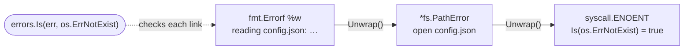
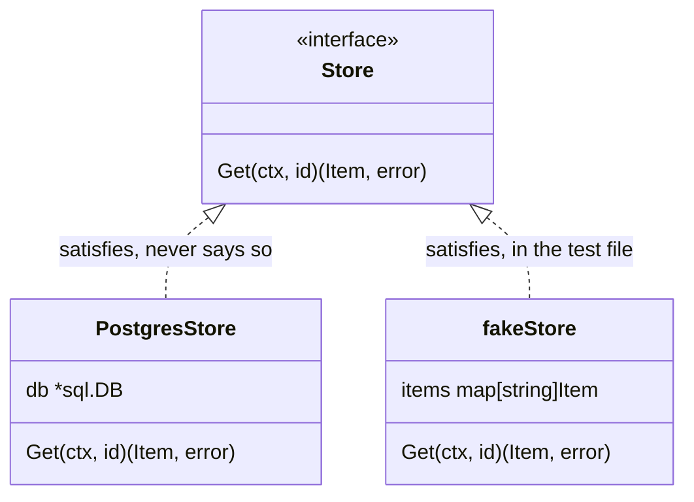
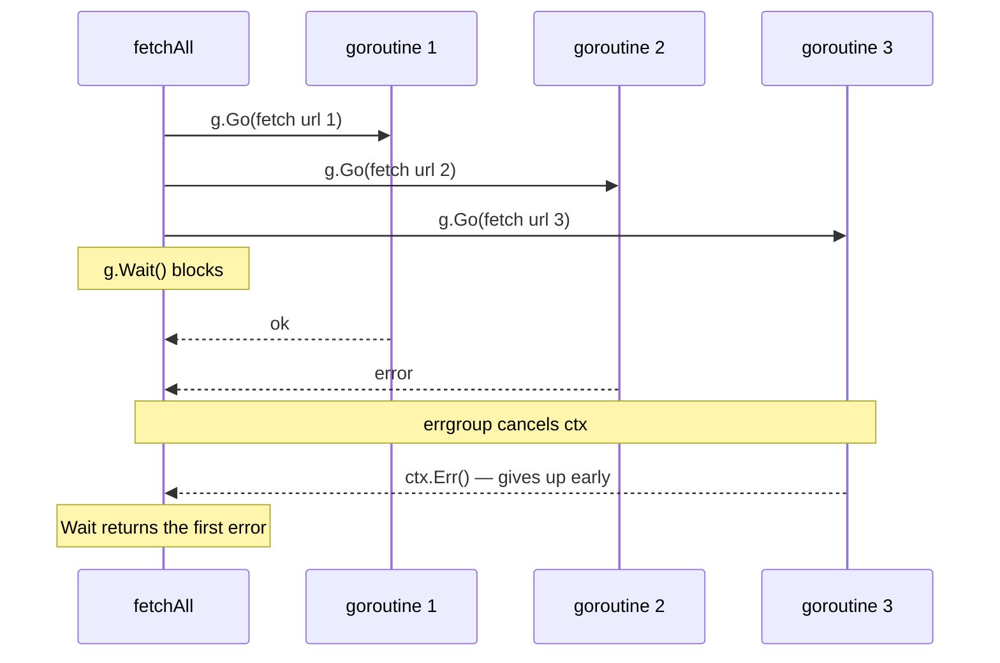

Coming from TypeScript, Go will look like an incomplete language at first. No exceptions, no classes, no safe `null`, and a package manager nothing like npm. Almost all of those absences are decisions, and understanding them is what makes the language click.

| In TypeScript | In Go | Section |
| --- | --- | --- |
| **`throw` / `try…catch`** | A returned `error` and `if err != nil` | 1 |
| **`class Foo implements Bar`** | Nothing: having the methods is enough | 2 |
| **`Promise.all`** | Goroutines plus `errgroup` | 3 |
| **`AbortController`** | `context.Context`, first parameter by convention | 3 |
| **`undefined` vs `0`** | The zero value, or a pointer when "absent" matters | 4 |
| **`finally`** | `defer`, next to the acquisition | — |

## 1 · Errors are values

The first jolt. Go doesn't throw: it returns.

```go {3-5,8-10}
func readConfig(path string) (Config, error) {
    data, err := os.ReadFile(path)
    if err != nil {
        return Config{}, fmt.Errorf("reading %s: %w", path, err)
    }

    var cfg Config
    if err := json.Unmarshal(data, &cfg); err != nil {
        return Config{}, fmt.Errorf("parsing %s: %w", path, err)
    }

    return cfg, nil
}
```

Yes, there's a lot of `if err != nil`. In exchange, **every failure point is visible where it happens**. In TypeScript a function that can throw has exactly the same signature as one that can't; you only find out by reading the implementation, or in production.

`fmt.Errorf`'s `%w` wraps the original error, and `errors.Is` and `errors.As` let you walk it later:

```go
if errors.Is(err, os.ErrNotExist) {
    // fallback path
}
```



It's the equivalent of checking an exception's type, without the control-flow jump.

## 2 · Interfaces satisfy themselves

In TypeScript you declare `class Foo implements Bar`. Go has no such declaration: if a type has the methods, it satisfies the interface.

```go
type Store interface {
    Get(ctx context.Context, id string) (Item, error)
}

// No "implements". Having the method is enough.
type PostgresStore struct{ db *sql.DB }

func (s *PostgresStore) Get(ctx context.Context, id string) (Item, error) {
    // ...
}
```

The cultural consequence: **interfaces are defined where they're consumed, not where they're implemented**. The package that needs to read declares the small interface it needs, and any implementation fits without knowing. It's the opposite of the Java habit of exporting the interface next to the service.



In practice this makes tests trivial: a five-line struct in the test file itself is a valid double.

> [!TIP]
> Keep consumer-side interfaces to the one or two methods the consumer calls. The smaller the interface, the more types satisfy it by accident — which is the point.

## 3 · Concurrency with channels

A goroutine isn't an OS thread: it's a coroutine the runtime multiplexes onto a handful of real threads. Starting ten thousand is unremarkable.

```go {2,6,16}
func fetchAll(ctx context.Context, urls []string) ([]Result, error) {
    g, ctx := errgroup.WithContext(ctx)
    results := make([]Result, len(urls))

    for i, url := range urls {
        g.Go(func() error {
            r, err := fetch(ctx, url)
            if err != nil {
                return err
            }
            results[i] = r
            return nil
        })
    }

    if err := g.Wait(); err != nil {
        return nil, err
    }
    return results, nil
}
```

> [!NOTE]
> Older code has an `i, url := i, url` line inside the loop to give each goroutine its own copy. Since Go 1.22 every iteration gets fresh loop variables, so it is no longer needed.

That's `Promise.all` with cancellation: if one goroutine returns an error, `errgroup` cancels the context and the rest give up.



And that's the piece a JavaScript developer is missing without knowing it: **`context.Context` is a cancellation mechanism that threads through the entire stack**. JavaScript has `AbortController`, but almost nobody propagates it. In Go, `ctx` is the first parameter by convention precisely so that it always is.

## 4 · The zero value is always useful

Go has no constructors. Every type has a valid zero value, and well-designed libraries make that zero value work:

```go
var buf bytes.Buffer     // ready to use
buf.WriteString("hello")

var mu sync.Mutex        // ready to use
mu.Lock()
```

The uncomfortable corollary: there's no distinction between "zero" and "not provided". An `int` at 0 might be a legitimate value or a field nobody filled in. When that difference matters — typically when deserialising JSON — you reach for a pointer:

```go
type Settings struct {
    Retries *int `json:"retries"` // nil means "not provided"
}
```

It's the same problem as `undefined` versus `0` in TypeScript, solved more explicitly and more noisily.

## What translates directly

Not everything is different. `slices` and `maps` behave like arrays and objects; `defer` is a `finally` that reads better because it sits next to the resource acquisition; and generics, since Go 1.18, work about as you'd expect:

```go
func Map[T, U any](items []T, fn func(T) U) []U {
    out := make([]U, len(items))
    for i, item := range items {
        out[i] = fn(item)
    }
    return out
}
```

## Where to start

A small HTTP service. The standard library is enough — `net/http` with Go 1.22's routing covers most of it — and in a backend-for-frontend you'll hit exactly the four ideas above: errors as values at every call, interfaces for the clients you need to fake, goroutines to parallelise requests, and `context` to propagate cancellation when the user closes the tab.

After a couple of weeks, `if err != nil` stops looking like noise and starts looking like information.
