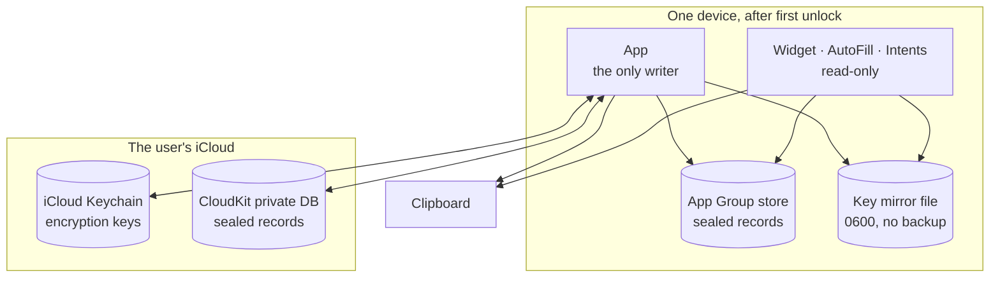
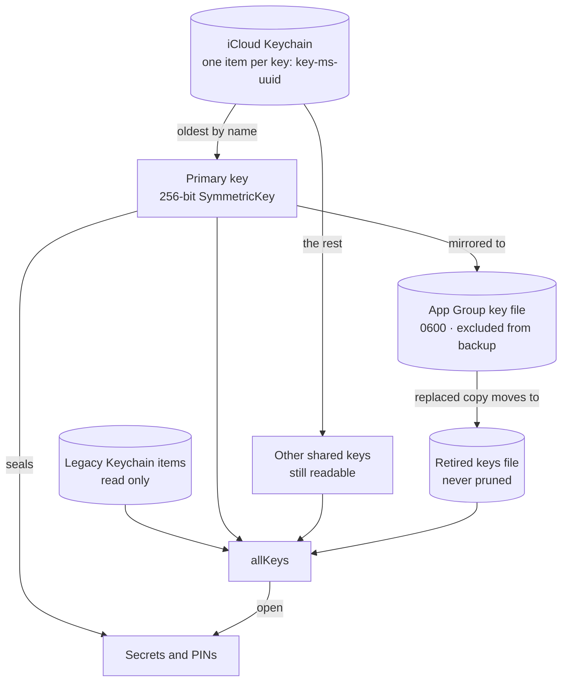
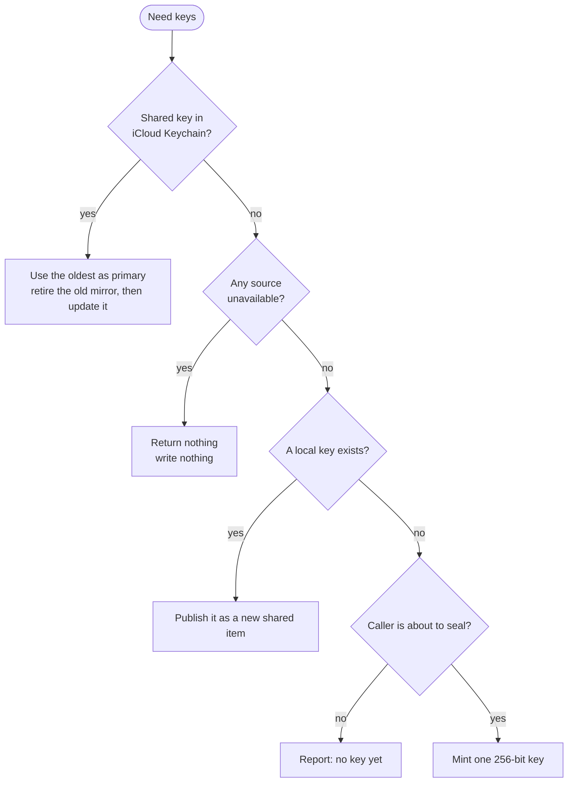
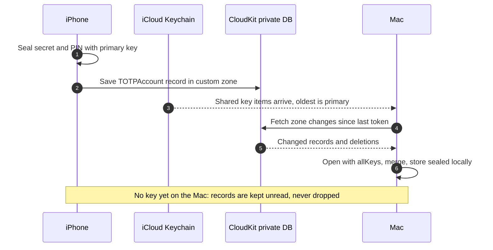
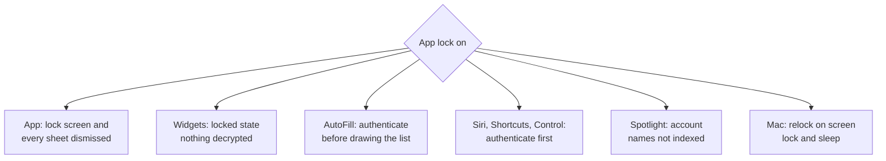

TOTP Password lived in TestFlight for about three years. It was the authenticator I used every day, and that was the problem: an app that works for its author is not the same as an app you can hand to people who will put their bank's second factor in it and forget about it.

What finally got it onto the App Store, for iPhone, iPad and Mac, was not a feature. It was a round of security audits and the hardening that came out of them. This post covers that work: what the app protects, where the keys live, how sync stays encrypted, and the findings I had to fix before I was comfortable shipping. The code is [open on GitHub](https://github.com/lucferbux/TOTP), so every snippet here is real, trimmed.

## What an authenticator has to protect

A TOTP app holds very little data, but all of it is sensitive. There are three kinds:

- **The secrets.** The shared key behind each account ([RFC 6238](https://datatracker.ietf.org/doc/html/rfc6238)). Whoever has it can generate your codes forever.
- **The PIN prefix.** Some services expect a fixed PIN typed before the code. The app stores it and prepends it every time it copies or fills a code. That makes it half of the credential, not a preference.
- **The codes.** Short-lived, but a code on the clipboard or a Lock Screen widget is a code someone else can read.

Then there's where they travel. The secrets don't stay in one process: the app, a widget extension, an AutoFill extension, App Intents for Siri and Shortcuts, a Control Center control, the Mac menu bar, and the user's other devices over iCloud. Each one is a door.



The diagram is also the threat model in miniature. Everything that crosses a box boundary is sealed, except the codes going to the clipboard, which get their own rules further down. And there is no box for me: the app has no server, no analytics and no third-party code, and makes no network requests of its own. Its only network traffic is the user's own iCloud.

## Sealing secrets with ChaChaPoly

Every secret and every PIN is sealed with CryptoKit's [`ChaChaPoly`](https://developer.apple.com/documentation/cryptokit/chachapoly) before it touches any store, local or remote. The helper is deliberately boring:

```swift title="Shared/Model/AccountStore.swift"
public enum AccountCrypto {
    public static func seal(_ data: Data, using key: SymmetricKey) throws -> Data {
        try ChaChaPoly.seal(data, using: key).combined
    }

    /// Tries every key in order; throws the last failure when none works.
    public static func open(_ data: Data, usingAny keys: [SymmetricKey]) throws -> Data {
        guard !keys.isEmpty else { throw CryptoKitError.authenticationFailure }
        var lastError: Error = CryptoKitError.authenticationFailure
        for key in keys {
            do { return try open(data, using: key) } catch { lastError = error }
        }
        throw lastError
    }
}
```

`combined` is the [nonce, ciphertext and tag](https://developer.apple.com/documentation/cryptokit/chachapoly/sealedbox/combined) in one blob, so each stored field is self-contained, and because it's authenticated encryption, a tampered record fails to open instead of decrypting to garbage. `open(_:usingAny:)` exists because there can be more than one key, which is where most of the hardening ended up.

The stored record keeps metadata (issuer, account name, digits, period) in the clear and the secret material sealed. Until 4.4 that split was wrong: the PIN prefix sat in a plaintext `prefix` field, locally and in CloudKit. Now it goes into `encryptedPrefix`, sealed with the same key, and the plaintext field is still read for older data but never written again:

```swift title="Shared/Model/AccountStore.swift" {6,9}
public init(model: OtpModel, key: SymmetricKey, createdDate: Date = .now) throws {
    let sealedPrefix = try model.prefix.flatMap { prefix -> Data? in
        prefix.isEmpty ? nil : try AccountCrypto.seal(Data(prefix.utf8), using: key)
    }
    self.init(
        // …
        prefix: nil,   // never written in the clear from 4.4 on
        encryptedKey: try AccountCrypto.seal(model.entry.key, using: key),
        // …
        encryptedPrefix: sealedPrefix
    )
}
```

## Where the key lives

Encryption only moves the problem to the key. Mine lives in two places, and the reasons for each are in the types:



**iCloud Keychain** is the source of truth. The item is [synchronizable](https://developer.apple.com/documentation/security/ksecattrsynchronizable), so a record uploaded by my iPhone can be opened by my Mac. Its accessibility class is [`kSecAttrAccessibleAfterFirstUnlock`](https://developer.apple.com/documentation/security/ksecattraccessibleafterfirstunlock): unreadable after a restart until the first unlock, then available, which Apple recommends for items that background processes need. Widgets and AutoFill are exactly that. A `ThisDeviceOnly` class would be stricter, but those classes don't migrate, and a key that can't reach your other devices can't open your synced records there. On macOS every query also sets [`kSecUseDataProtectionKeychain`](https://developer.apple.com/documentation/security/ksecusedataprotectionkeychain), so the Mac uses the iOS-style keychain instead of the legacy file keychain, where accessibility and sync behaved inconsistently.

**A mirror file in the App Group container** exists so the extensions can read the key without Keychain round trips. It is written owner-only, excluded from backups (iCloud Keychain can always restore it, so there's no reason for it to sit next to the ciphertext in an unencrypted backup) and, on iOS, protected until the first unlock.

Two details came straight out of the review. First, Apple's documentation says that [updating or deleting a synchronizable item affects every copy](https://developer.apple.com/documentation/security/ksecattrsynchronizable), not just the local one. So the app never updates or deletes one. Every key gets its own item, named with its creation time in milliseconds and a UUID, and the oldest by name is primary on every device. Two devices that each mint a key before iCloud Keychain has synced end up with two items, agree on which one wins, and keep both readable.

Second, a key is never thrown away. When a different shared key replaces the mirror, the old one moves to a retired-keys file first, and if that write fails the mirror isn't touched.

## Keys are never minted on read

This is the finding that worried me most, and it's worth telling precisely. The old code looked up the key, and if the lookup failed, created a new one. On a locked device the Keychain read fails, and that failure looked exactly like a first run. So the app would mint a fresh key, delete the synchronizable item (which, as above, propagates the deletion to every device) and overwrite the file mirror. Every existing record was now sealed with a key that no longer existed anywhere.

The fix is a type that refuses to conflate "there is nothing" with "I can't look right now":

```swift title="Shared/Model/EncryptionKeyManager.swift"
/// Result of looking for a key in one place.
enum Lookup: Equatable {
    /// A key is there and was read.
    case found(SymmetricKey)
    /// There is definitely no key here (and writing one is safe).
    case absent
    /// A key may exist but can't be read right now — never overwrite on this.
    case unavailable
}
```

Every source reports one of the three, and `errSecItemNotFound` is the only Keychain status that maps to `absent`. Everything else, including `errSecInteractionNotAllowed` on a locked device, is `unavailable`. Resolution then follows a strict order:



The last branch is the second half of the fix. Only `primaryKey`, which is what sealing asks for, may create a key. `allKeys`, used for decryption, Settings and every extension, never does. On a brand-new device the first sync reads iCloud records before iCloud Keychain has delivered the shared key; minting there would race the key that was about to arrive. The extensions go further and use `existingKey()`, which has no code path that writes anything.

The same principle applies to data. Records that can't be decrypted used to be dropped silently on the next save. Now they're kept byte for byte and written back on every save, and a store that's only partly readable is never re-sealed. A record you can't open today might open tomorrow, when the right key arrives.

> [!IMPORTANT]
> The most dangerous line in an encrypted app is the one that creates a key. Make "absent" something a source has to prove, not something you infer from an error.

## Sync through the private database

Accounts sync through the CloudKit **private** database, in a custom zone, one record per account named by its UUID. Records in a private database are [readable and writable only by their owner and not visible to the developer](https://developer.apple.com/documentation/cloudkit/ckdatabase/scope/private). On top of that the secret and the PIN in each record are the same ChaChaPoly ciphertext the local store holds, so the record is useless without a key from the user's iCloud Keychain.



Two sync rules came from bugs rather than reviews. Reads use [zone change tokens](https://developer.apple.com/documentation/cloudkit/ckdatabase/recordzonechanges(inzonewith:since:desiredkeys:resultslimit:)) and never `CKQuery`: a query needs a queryable index that an auto-created schema doesn't have, so before 4.2 every fetch failed and the app concluded iCloud was empty. And conflicts are resolved per account, last write wins on `modifiedDate`, with one exception for HOTP:

```swift title="Shared/Model/OtpModel.swift"
public static func resolved(_ mine: OtpModel, _ theirs: OtpModel) -> OtpModel {
    var winner = theirs.modifiedDate > mine.modifiedDate ? theirs : mine
    let loser = winner == theirs ? mine : theirs
    if case let .hotp(key, digits, counter, algorithm) = winner.entry,
       loser.entry.key == key, let other = loser.entry.counter, other > counter {
        winner.entry = .hotp(key: key, digits: digits, counter: other, algorithm: algorithm)
    }
    return winner
}
```

A counter never moves backwards for the same secret, because a reused HOTP code is a rejected login. The same hardening pass found that `modifiedDate` was being re-stamped on every save, which made "last write" meaningless. Now only an edit or an HOTP use changes it. A server-side save conflict resolves through the same function instead of overwriting the server's copy, and deletions wait in a pending list until CloudKit confirms them, so an offline delete can't be resurrected by the next sync.

## One lock, every surface

The optional app lock (Face ID, Touch ID or passcode, through [`deviceOwnerAuthentication`](https://developer.apple.com/documentation/localauthentication/lapolicy/deviceownerauthentication)) used to be an overlay on the main view. The review pointed out what that means: a sheet presented above it, like the Add sheet with a revealed secret, stayed readable. And the lock didn't exist at all outside the app.



Each surface needed its own answer. A widget can't ask for Face ID, so when the lock is on the widget checks that preference before loading anything and shows a locked state; the secrets are never decrypted in the widget process. AutoFill used to draw every live code and then ask; now it authenticates before drawing, and when the system asks for a credential silently from the QuickType bar it declines, so the system has to show the extension's UI. `AppIntent.authenticationPolicy` has to be a compile-time constant, so every intent that hands out a code declares `.requiresAuthentication` (no codes to Siri on a locked device) and then runs the app-lock check on top.

Three more findings sit in the same family. HOTP never leaves the app: AutoFill used to fill HOTP codes without advancing the counter, so it would fill the same code next time. AutoFill's issuer fallback only matches the label that names the site, so a host like `github.evil.example` isn't offered GitHub's code. And a `totp://copy` URL handler, which let any web page write to the clipboard, is gone.

## The clipboard

Copying is where a code leaves the app's control, so every copy, from any surface, goes through one function:

```steps
Local only: The pasteboard item is marked localOnly, so Universal Clipboard doesn't send it to nearby devices unless the user opts in.
Expires: It carries an expirationDate (60 seconds by default; 30, 120 or never are options), so the system removes it.
Concealed on Mac: macOS marks it with the ConcealedType convention so clipboard managers skip it, and clears it on a timer.
Never someone else's: On the Mac the timer clears only if nothing else was copied since, so it can't wipe what the user copied next.
```

On iOS both rules are just [`UIPasteboard` options](https://developer.apple.com/documentation/uikit/uipasteboard/optionskey/localonly), [`localOnly`](https://developer.apple.com/documentation/uikit/uipasteboard/optionskey/localonly) and [`expirationDate`](https://developer.apple.com/documentation/uikit/uipasteboard/optionskey/expirationdate), set in one call. Keeping copies on the device is the default because a second factor shouldn't drift to every Mac and iPad on the same account.

## The review findings, in one table

Most of the above came out of the security review of 4.3 and the hardening pass that followed it, before 4.5 shipped. Collected:

| Finding | Fix |
| --- | --- |
| A locked device looked like a first run, so a new key was minted and the shared one deleted | `absent` vs `unavailable`; mint only when every source is provably absent, and only to seal |
| Undecryptable records were dropped on save | Kept byte for byte and written back; partial stores never re-sealed |
| The PIN prefix was stored and synced in plaintext | Sealed as `encryptedPrefix`; old data migrates on load |
| Replacing the key mirror lost the old key | Old key moves to a retired-keys file first |
| The lock was an overlay; sheets and extensions ignored it | Sheets dismissed; widgets, AutoFill, intents and Control gated |
| AutoFill showed codes before authenticating and filled HOTP | Authenticates first; no HOTP outside the app |
| A URL handler let any page write to the clipboard | Removed |
| Key file world-readable and in backups | `0600`, excluded from backup |
| `@Published` state mutated off the main thread during sync | `SyncManager`, `SharedDataManager` and `CloudKitDataManager` are `@MainActor` |

The last row deserves a sentence. The data managers' async mutations used to hop to the global executor and mutate published state off the main thread while sync was also touching it: a data race in the code that decides which copy of a secret wins. Moving the whole data layer to the main actor, plus one sync pass at a time and a rule never to carry a snapshot of the account list across an `await`, made the ordering something I could reason about.

> [!NOTE]
> None of these were exploits someone used. They were things the review found by asking "what happens when this fails?" of every storage call. The answers were rarely what I'd assumed.

## Privacy, declared

Shipping also meant declaring all of this. Each bundle — the app, the widget and the AutoFill extension — carries its own [privacy manifest](https://developer.apple.com/documentation/bundleresources/privacy-manifest-files), because an extension isn't covered by the app's: no tracking, no collected data, and the one required-reason API it uses, `UserDefaults`, declared for the App Group and for the app's own defaults. Without them, uploads failed validation. The App Store listing says *Data Not Collected*, which is easy to say truthfully when there is nothing to collect it with.

## What it doesn't fix

Honest limits, because an authenticator that overclaims is worse than one that doesn't:

- **Metadata isn't sealed.** Issuer and account name are stored as-is in CloudKit, so the record is usable for sync and matching. They live in the user's private database, but they're not ciphertext. CloudKit has its own [`encryptedValues`](https://developer.apple.com/documentation/cloudkit/ckrecord/encryptedvalues), which only applies to new fields; moving the metadata there is what I'd look at next.
- **Last write wins is not a merge.** Edit the same account on two offline devices and one edit is lost. For an authenticator that's an acceptable trade, but it is a trade.
- **The key is as safe as the user's iCloud Keychain and device passcode.** If someone has both, they have the codes. The lock protects a phone left unlocked on a table, not a compromised account.
- **After first unlock, the key is readable in the background.** That's what lets widgets and AutoFill work, and it's the main thing a stricter design would give up.

What I'd do differently is mostly a matter of order. The "never mint on read" rule and the three-state lookup should have been the first version of the key manager, not the fourth. Everything I fixed was a case where a failure was treated as an answer.

## Further reading

- [RFC 6238: TOTP](https://datatracker.ietf.org/doc/html/rfc6238) — the algorithm, short and readable, with the test vectors every implementation should pass.
- [ChaChaPoly (CryptoKit)](https://developer.apple.com/documentation/cryptokit/chachapoly) — the authenticated cipher used for every secret and PIN here.
- [kSecAttrSynchronizable](https://developer.apple.com/documentation/security/ksecattrsynchronizable) — read the caveats: updating or deleting a synced item affects every device.
- [kSecAttrAccessibleAfterFirstUnlock](https://developer.apple.com/documentation/security/ksecattraccessibleafterfirstunlock) — the accessibility class for items that background extensions must read.
- [kSecUseDataProtectionKeychain](https://developer.apple.com/documentation/security/ksecusedataprotectionkeychain) — why a Mac app should opt into the iOS-style keychain.
- [CKRecord.encryptedValues](https://developer.apple.com/documentation/cloudkit/ckrecord/encryptedvalues) — CloudKit's own field encryption, and its limits (new fields only, no indexes).
- [Privacy manifest files](https://developer.apple.com/documentation/bundleresources/privacy-manifest-files) — what goes in `PrivacyInfo.xcprivacy`, per bundle.
- [TOTP Password on GitHub](https://github.com/lucferbux/TOTP) — the full source, including the key manager and its tests.
