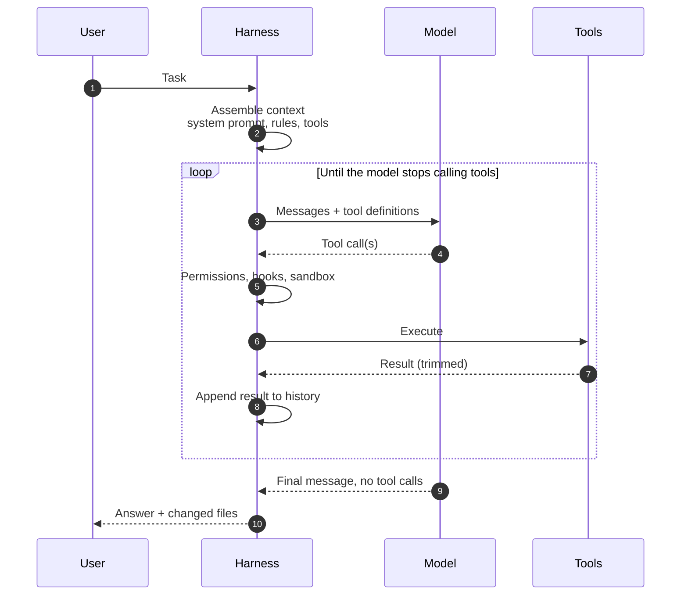
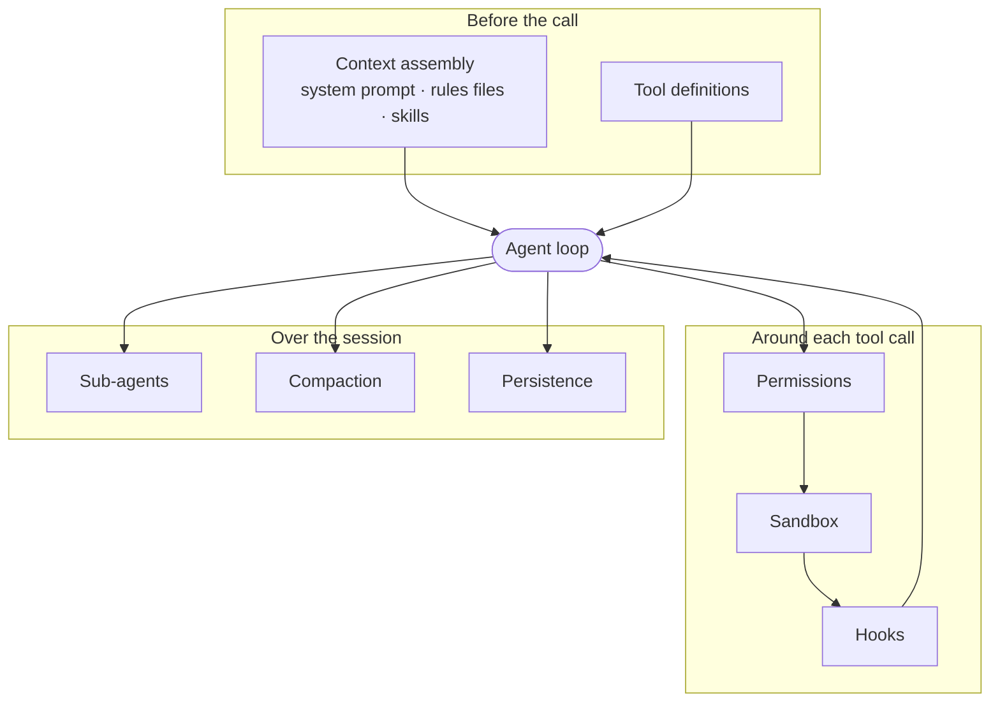
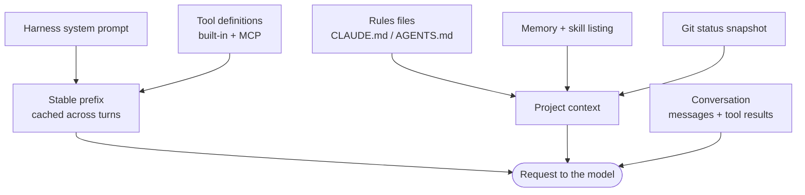
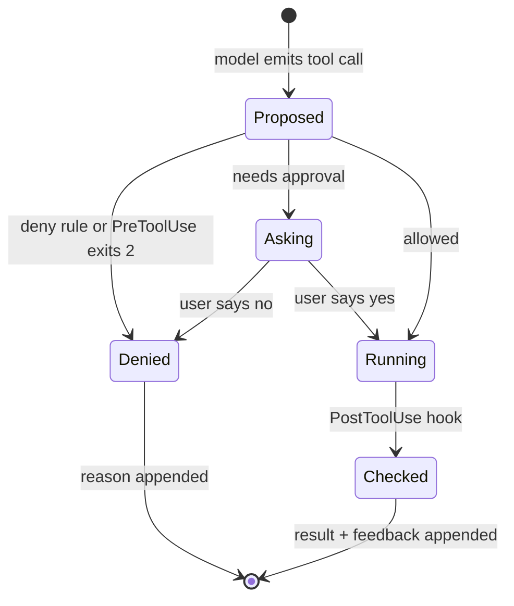

When a coding agent does something brilliant or something stupid, the first reflex is to credit or blame the model. Most of the time I've found that the more useful question is about everything around the model: which tools it had, what was in its context when it decided, what it was allowed to touch, and what told it that it was wrong.

That "everything around" has a name now. Birgitta Böckeler's [article on martinfowler.com](https://martinfowler.com/articles/harness-engineering.html) puts it in one line: a harness is everything in a coding agent except the model. Claude Code, Codex CLI and the rest are harnesses. So is the `AGENTS.md`, the linter config and the CI pipeline you add on top. This post is my map of that territory: what the parts are, how two popular harnesses make different choices, and which harness-level changes move results more than swapping the model.

## The loop is the small part

Strip a coding agent down and what remains is a loop. The harness sends the model a prompt and a list of tools. The model answers either with text or with one or more tool calls. The harness executes the calls, appends the results and asks again. When the model answers without calling a tool, the turn is over. OpenAI's [walkthrough of the Codex agent loop](https://openai.com/index/unrolling-the-codex-agent-loop/) describes exactly this: the cycle repeats until the model stops making tool calls and writes a message for the user.



In code, against the Anthropic SDK, that loop is short enough to read in one go:

```ts title="agent-loop.ts" {16,24}
import Anthropic from "@anthropic-ai/sdk";
import { tools, execute } from "./tools"; // definitions + an executor you own

const client = new Anthropic();

export async function runAgent(task: string, system: string) {
  const messages: Anthropic.MessageParam[] = [{ role: "user", content: task }];

  for (let turn = 0; turn < 50; turn++) {
    const response = await client.messages.create({
      model: process.env.AGENT_MODEL!,
      max_tokens: 8192,
      system,
      tools,
      messages,
    });
    messages.push({ role: "assistant", content: response.content });
    if (response.stop_reason !== "tool_use") return response; // the model is done

    const results: Anthropic.ToolResultBlockParam[] = [];
    for (const block of response.content) {
      if (block.type !== "tool_use") continue;
      // Permissions, hooks, sandboxing and output trimming all live in here.
      const { output, isError } = await execute(block.name, block.input);
      results.push({ type: "tool_result", tool_use_id: block.id, content: output, is_error: isError });
    }
    messages.push({ role: "user", content: results });
  }
  throw new Error("Turn budget exhausted");
}
```

Two lines carry the whole design. The `stop_reason` check is the termination condition. The `execute` call is where every interesting decision hides. The rest of this post is, in a sense, about what goes into `system`, `tools` and `execute`, and about what happens to `messages` when it gets long.

## Anatomy of a harness

When I look at any coding agent now I check for the same eight parts. They have different names in different products, but they are always there, even if some of them are empty.



| Part | What it decides | What goes wrong without it |
| --- | --- | --- |
| **Tools** | What the agent can do, and how results come back | Ten overlapping tools and the model picks the wrong one |
| **Context assembly** | What the model knows before it acts | It rediscovers the repo every session, or drowns in it |
| **Permissions** | Whether an action needs a human yes | Approval fatigue, or no brake at all |
| **Sandbox** | What an action can reach once it runs | A "harmless" script reads `~/.ssh` |
| **Hooks** | Deterministic code at fixed points of the loop | Rules that exist only as polite requests |
| **Sub-agents** | Work done in a separate context window | Exploration noise fills the main session |
| **Compaction** | What survives when the window fills | The session dies, or forgets its instructions |
| **Persistence** | What carries over between sessions | Every session starts from zero |

### Tools

Tools are the harness's vocabulary. Anthropic's post on [writing tools for agents](https://www.anthropic.com/engineering/writing-tools-for-agents) is the best primary source I know on this, and its advice runs against the instinct to wrap every API endpoint: fewer tools that match real workflows, clear namespacing, results in natural language instead of opaque IDs, and token-efficient output with pagination and truncation by default. It also notes that Claude Code caps tool responses at 25,000 tokens by default — a harness decision, not a model one.

The description is part of the prompt, so I write it as if for a new colleague who has never seen the repository:

```json title="tools/search_code.json"
{
  "name": "search_code",
  "description": "Search the repository with a regular expression. Returns matching lines as path:line: text, at most `limit` matches. Use it before reading whole files. If the result says it was truncated, narrow `path` instead of raising `limit`.",
  "input_schema": {
    "type": "object",
    "properties": {
      "pattern": { "type": "string", "description": "Regular expression, ripgrep syntax." },
      "path": { "type": "string", "description": "Directory or file relative to the repo root. Defaults to the root." },
      "limit": { "type": "integer", "minimum": 1, "maximum": 200, "default": 50 }
    },
    "required": ["pattern"]
  }
}
```

The other half of a tool is its error messages. "ENOENT" teaches the model nothing; "No file at `src/hooks/useAuth.tsx` — did you mean `src/hooks/useAuth.ts`?" ends the detour in one step.

### Context assembly

Before the first call, the harness builds the request. In Claude Code that means its own system prompt and tool definitions, then the project's `CLAUDE.md` (or `AGENTS.md` when there's no `CLAUDE.md`), auto memory, the names and descriptions of available skills, and a git status snapshot. Nested rules files in subdirectories load later, on demand, when the agent touches files there ([memory docs](https://code.claude.com/docs/en/memory)).



The order isn't arbitrary. Both [Claude Code](https://code.claude.com/docs/en/prompt-caching) and Codex put what rarely changes first, because prompt caching matches the start of the request exactly: change anything in the prefix and everything after it is recomputed. That is why Claude Code doesn't apply an edited `CLAUDE.md` mid-session, and why connecting an MCP server can make the next turn slow. What goes *into* that budget — and when — is big enough to be its own post: [Context engineering](/blog/context-engineering). What goes into the rules file is covered in [Effective rules for AI assistants](/blog/ai-coding-rules).

### Permissions and sandboxing: two different questions

This is the part I see conflated most often. A permission system answers *should the agent ask before doing this?* A sandbox answers *what can this action reach once it runs?* Claude Code's docs state it plainly: the [permission modes](https://code.claude.com/docs/en/permission-modes) and the [Bash sandbox](https://code.claude.com/docs/en/sandboxing) are independent and can be combined.

- **Permission modes** in Claude Code range from asking before every edit (`default`), through `acceptEdits` and read-only `plan`, to `auto` (a separate classifier reviews risky actions) and `bypassPermissions`, which the docs reserve for isolated containers and VMs. Deny rules block in every mode.
- **The sandbox** wraps shell commands using OS primitives — Seatbelt on macOS, bubblewrap on Linux and WSL2. Writes are limited to the working directory; network traffic goes through a proxy with an allowlist that starts empty.

Anthropic reported that sandboxing [cut permission prompts by 84%](https://www.anthropic.com/engineering/claude-code-sandboxing) in their internal use. That matches the intuition: once the blast radius is bounded, most prompts are asking a question nobody needed to answer.

> [!WARNING]
> A rules file is advice. "Never run `git push --force`" in `AGENTS.md` is a request the model will usually honour. A deny rule, a `PreToolUse` hook or a sandbox is enforcement. Anything whose failure you can't afford belongs in the second group.

### Hooks: guides and sensors you can run

Hooks are shell commands the harness runs at fixed points: before a tool call, after it, when the agent tries to stop, before compaction, and many more ([hooks reference](https://code.claude.com/docs/en/hooks)). They are the bridge between Böckeler's two kinds of control: **guides** that steer before the agent acts, and **sensors** that observe afterwards so it can correct itself.



The one I would add to any TypeScript repo is a sensor: lint the file the agent just edited and hand the errors straight back, instead of letting them pile up until CI.

```json title=".claude/settings.json"
{
  "hooks": {
    "PostToolUse": [
      {
        "matcher": "Edit|Write",
        "hooks": [
          { "type": "command", "command": "\"$CLAUDE_PROJECT_DIR\"/.claude/hooks/lint-edited.sh" }
        ]
      }
    ]
  }
}
```

```bash title=".claude/hooks/lint-edited.sh"
#!/bin/bash
# PostToolUse: lint the file the agent just edited and return the errors to it.
input=$(cat)
file=$(jq -r '.tool_input.file_path // empty' <<<"$input")
[[ "$file" =~ \.(ts|tsx)$ ]] || exit 0

if ! out=$(npx eslint --max-warnings=0 "$file" 2>&1); then
  jq -n --arg r "ESLint failed on $file. Fix it before moving on:
$out" '{decision: "block", reason: $r}'
fi
exit 0
```

The `decision: "block"` JSON adds the reason next to the tool result, so the next model call sees both the edit and what's wrong with it. The message is written for the agent, not for a human: what failed, where, and what to do.

### Sub-agents

A sub-agent is the loop run again with a fresh context window, its own system prompt and usually a narrower tool set. In Claude Code, it gets the delegation prompt and not the parent's history, and only its final summary comes back ([sub-agents docs](https://code.claude.com/docs/en/sub-agents)). That's its value: a thousand lines of grep output stay in the child's window, and the parent receives thirty lines of conclusion.

It isn't free. Anthropic's write-up of their [multi-agent research system](https://www.anthropic.com/engineering/multi-agent-research-system) measured agents at about four times the tokens of a chat, and multi-agent setups at about fifteen, and called out coding as a domain with fewer truly parallelisable tasks than research. My rule from [one session per job](/blog/agentic-development-sessions) still holds: parallelise reads, serialise writes.

### Compaction and persistence

Long sessions eventually fill the window. Compaction summarises the history and starts again from the summary; Codex does it through a dedicated Responses API endpoint once a token threshold is crossed, and Claude Code does it automatically near the limit or on `/compact`. Persistence is what lets work outlive a session: transcripts you can resume, memory files, and — the part I lean on most — artifacts in the repository.

Anthropic's post on [harnesses for long-running agents](https://www.anthropic.com/engineering/effective-harnesses-for-long-running-agents) is a good illustration: compaction alone wasn't enough, so they had an initial agent set up the environment and later sessions make incremental progress, leaving a progress file and git commits for the next one to read. The harness made the hand-off a file instead of a memory.

## Same parts, different choices

Comparing harnesses is mostly comparing defaults. Here are two I use, limited to what their documentation states:

| | Claude Code | Codex CLI |
| --- | --- | --- |
| **Rules file** | `CLAUDE.md`; reads `AGENTS.md` when there's no `CLAUDE.md` | `AGENTS.md` |
| **Approval** | Permission modes: `default`, `acceptEdits`, `plan`, `auto`, `dontAsk`, `bypassPermissions` | `approval_policy`: `on-request`, `never` |
| **Sandbox** | Opt-in for shell commands; Seatbelt / bubblewrap; network allowlist | `sandbox_mode`: `read-only`, `workspace-write`, `danger-full-access`; Seatbelt / bubblewrap / native Windows |
| **Extension points** | Hooks, skills, sub-agents, MCP, plugins | MCP servers, `AGENTS.md`, `config.toml` |
| **Compaction** | Automatic near the limit, or `/compact` with a focus | Compaction endpoint above a token threshold |

The philosophies differ in a way that matters day to day. Codex's [sandboxing docs](https://learn.chatgpt.com/docs/sandboxing) make the sandbox the primary boundary and approval the exception for leaving it. Claude Code started from per-action approval and layered the sandbox and an auto mode on top. Neither is wrong; they fail differently. A sandbox-first harness can still do a lot of damage *inside* the workspace; an approval-first harness can train you to press "yes" without reading.

## Harness changes that beat a model swap

The most convincing evidence I've seen that the harness matters comes from LangChain. In [Improving Deep Agents with harness engineering](https://www.langchain.com/blog/improving-deep-agents-with-harness-engineering) they kept the model fixed and moved their coding agent from 52.8% to 66.5% on Terminal Bench 2.0 by changing only the prompt, tools and middleware. One benchmark, one team, and no breakdown per change — but the changes themselves are the interesting part, because none of them is exotic:

- **A verification pass before stopping.** Their most common failure was an agent that wrote a solution, re-read its own code, decided it looked fine and stopped. A middleware intercepts the exit and asks for a check against the task.
- **Loop detection.** Count edits per file; after N, tell the agent to reconsider the approach.
- **Local context up front.** Map the working directory and available tooling at the start, so the agent doesn't spend its first turns discovering them.
- **Time budget warnings**, which push the agent from building towards verifying.

OpenAI's [harness engineering post](https://openai.com/index/harness-engineering/) reaches similar conclusions from the other side. As [InfoQ summarises it](https://www.infoq.com/news/2026/02/openai-harness-engineering-codex), their team treated a structured `docs/` directory as the agent's system of record and enforced architectural boundaries with linters and structural tests in CI rather than with prose.

What I take from both is a loop of my own, one level up from the agent's:

```steps loop="The harness gets one failure smaller each time"
Notice: The agent made the same mistake twice. That's a harness bug, not bad luck.
Classify: Did it lack information (a guide) or lack a signal that it was wrong (a sensor)?
Encode: Prefer the cheapest deterministic form: a lint rule, a test, a hook. Prose only if nothing else fits.
Re-run: Same task, fresh session. Did the failure go away without a new one appearing?
```

> [!TIP]
> Write every sensor's output for the agent. "Rule `no-restricted-syntax`: don't read `item.title_en` directly, call `pick()` from `src/utils/localized.ts`" fixes itself; a red ✗ in a CI log doesn't.

## What my outer harness looks like

I don't build harnesses for a living; I configure them. On a large React and TypeScript monorepo, the outer harness I maintain is unglamorous: a short `AGENTS.md` that works as a map and points to deeper docs rather than containing them; type-check, lint and the relevant tests as the agent's verification commands, named explicitly so it doesn't guess; a few path-scoped rules for areas with traps; a post-edit lint hook; and a read-only exploration sub-agent so the main session stays clean.

```md title="AGENTS.md (excerpt)"
## Verify before you say done
- `npm run type-check` and `npm run lint` — both must pass.
- Tests for what you touched: `npx vitest run <path>`.

## Where things are explained
- Data access and query descriptors: `docs/data.md`
- Breakpoints are redefined — read `docs/styling.md` before any responsive class.
```

None of it is clever. It's the same thing good teams have always done for new hires — make the right thing easy and the wrong thing loud — aimed at a colleague who reads very fast and forgets everything at the end of the session.

## Limits, and when not to bother

The harness can't supply judgement the model doesn't have, and it can't make a vague task precise. Böckeler is candid that behaviour — does the application actually do what's needed — is the least solved area, and that AI-written tests aren't yet enough to close it. A green suite the agent wrote for its own code is a weak sensor.

Harness work also has a cost curve. Every hook adds latency to every tool call, every rule adds tokens to every request, and every sub-agent multiplies spend. For a one-off script or an exploratory spike, the built-in harness with sensible defaults is plenty; I'd only start encoding rules once I've watched the same failure happen twice. And the inner harness keeps changing under you: features move between releases, so anything you build on a specific hook or flag deserves a quick re-check after upgrades.

The model is the part you rent. The harness is the part you own — which is exactly why it's worth the attention.

## Further reading

- [Harness engineering for coding agent users](https://martinfowler.com/articles/harness-engineering.html) — Birgitta Böckeler on martinfowler.com. The guides/sensors and computational/inferential vocabulary used here; the clearest conceptual framing I've found.
- [Unrolling the Codex agent loop](https://openai.com/index/unrolling-the-codex-agent-loop/) — Michael Bolin (OpenAI). How a real harness builds requests, keeps the prefix cacheable and compacts.
- [Harness engineering: leveraging Codex in an agent-first world](https://openai.com/index/harness-engineering/) — OpenAI's account of a product built with agents, and the environment they built around them.
- [Writing effective tools for agents — with agents](https://www.anthropic.com/engineering/writing-tools-for-agents) — Anthropic. Tool design, descriptions, token-efficient results and how to evaluate them.
- [Effective harnesses for long-running agents](https://www.anthropic.com/engineering/effective-harnesses-for-long-running-agents) — Anthropic. Progress files, initial setup and incremental sessions when one context window isn't enough.
- [Improving Deep Agents with harness engineering](https://www.langchain.com/blog/improving-deep-agents-with-harness-engineering) — LangChain. A fixed model, a better harness and a measurable difference, with the middleware described.
- [Claude Code hooks reference](https://code.claude.com/docs/en/hooks) — every event, the input each hook receives and how to block or add feedback.
