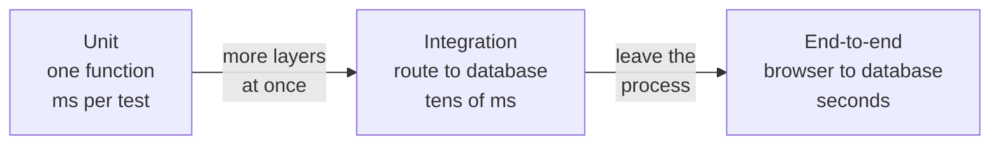
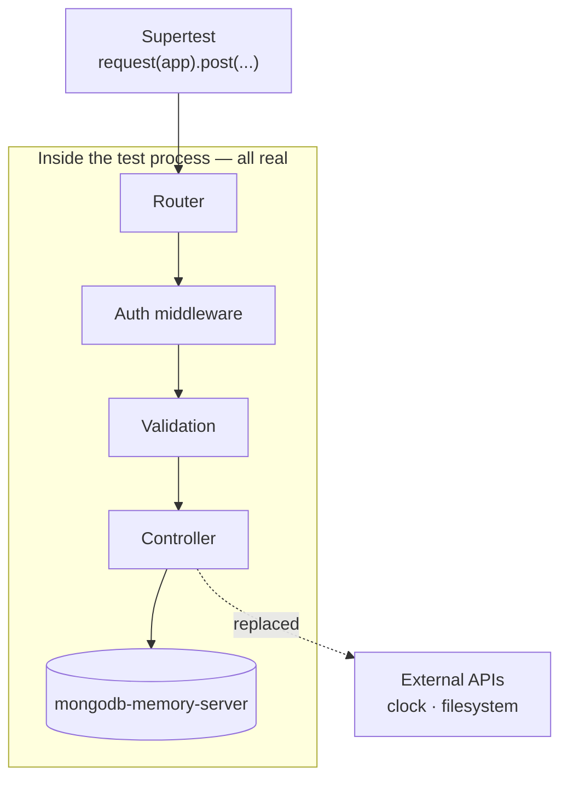
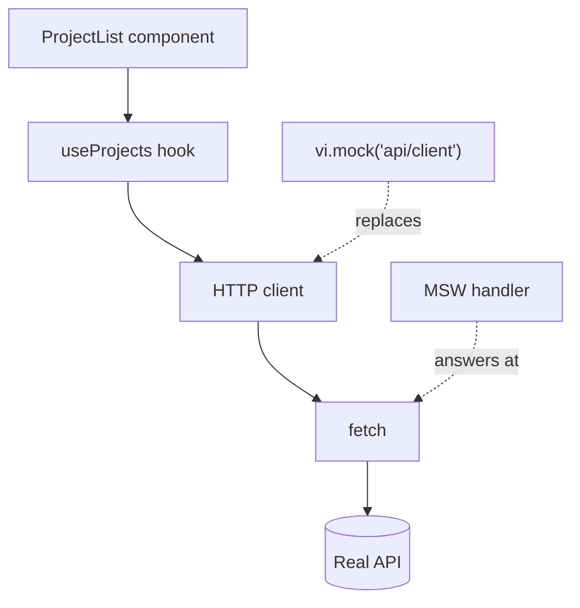

The testing pyramid is usually drawn with a huge base of unit tests and a thin band of integration. In my experience that thin band is where most of the bugs that reach production actually live, because the typical failure isn't a wrong function: it's two correct functions holding different ideas about the contract between them.



## What an integration test is here

Not "a slow test". It's a test that exercises **more than one layer at once** without leaving the process: the HTTP route, validation, the controller and data access. What gets replaced is what lives outside the process — the external network, the clock, the filesystem.



In an Express backend, that's Supertest.

```js title="tests/projects.test.js" {6-9}
import request from "supertest";
import { app } from "../src/app.js";

describe("POST /api/projects", () => {
  it("rejects a body with no title", async () => {
    const res = await request(app)
      .post("/api/projects")
      .set("Authorization", `Bearer ${token}`)
      .send({ description: "no title" });

    expect(res.status).toBe(400);
    expect(res.body.error).toMatch(/title/i);
  });

  it("creates the project and returns it with an id", async () => {
    const res = await request(app)
      .post("/api/projects")
      .set("Authorization", `Bearer ${token}`)
      .send({ title: "New", description: "..." });

    expect(res.status).toBe(201);
    expect(res.body).toMatchObject({ title: "New" });
    expect(res.body.id).toEqual(expect.any(String));
  });
});
```

Supertest brings the server up in memory and makes a real request: through the real router, the real middleware and the real validation. No unit test of the controller would have caught that the auth middleware was registered *after* the route:

```diff title="src/app.js"
- app.use("/api/projects", projectsRouter);
- app.use(requireAuth); // too late: Express already answered
+ app.use(requireAuth);
+ app.use("/api/projects", projectsRouter);
```

The controller's unit tests pass either way. The Supertest request without a token gets a 201 instead of a 401, and that is the whole point.

## The database: neither mocked nor production

The most-argued point. Three options and their real consequences:

| Option | Speed | Catches a missing unique index? | Cost |
| --- | --- | --- | --- |
| **Mock the model** | Fastest | No | Blind to the errors that matter |
| **Real database in Docker** | Slow to start | Yes | A nuisance locally |
| **In-memory database** | Fast | Yes | One dev dependency |

**Mock the model.** Fast, and completely blind to the errors that matter: a missing unique index, a schema validation that never fires, a query that returns `null` in Mongo rather than throwing.

**A real database in Docker.** Faithful, but slow to start and a nuisance locally.

**An in-memory database.** For MongoDB, `mongodb-memory-server` starts a real `mongod` against a temporary directory. That's the balance I use:

```js title="tests/setup/db.js" {11-15}
import { MongoMemoryServer } from "mongodb-memory-server";
import mongoose from "mongoose";

let mongod;

beforeAll(async () => {
  mongod = await MongoMemoryServer.create();
  await mongoose.connect(mongod.getUri());
});

afterEach(async () => {
  // Isolation between tests without restarting the server.
  const { collections } = mongoose.connection;
  await Promise.all(Object.values(collections).map((c) => c.deleteMany({})));
});

afterAll(async () => {
  await mongoose.disconnect();
  await mongod.stop();
});
```

```steps
beforeAll: Start one mongod and connect. Paid once per file.
Test: Writes whatever it needs.
afterEach: Empty every collection. The next test starts clean.
afterAll: Disconnect and stop mongod.
```

> [!IMPORTANT]
> That `afterEach` is what prevents the most frustrating failure mode in an integration suite: tests that pass alone and fail together because they share state.

## On the front end: MSW

Client-side, the equivalent is intercepting the network rather than mocking the module that calls it. Mock Service Worker intercepts at the `fetch` level, so the component, the hook and the HTTP client all really run.



With `vi.mock` the client never runs; with MSW everything above `fetch` is your real code.

```jsx title="tests/ProjectList.test.jsx" {10,15-17}
import { http, HttpResponse } from "msw";
import { setupServer } from "msw/node";

const server = setupServer(
  http.get("/api/projects", () =>
    HttpResponse.json([{ id: "1", title: "One" }])
  )
);

beforeAll(() => server.listen({ onUnhandledRequest: "error" }));
afterEach(() => server.resetHandlers());
afterAll(() => server.close());

it("shows an error state when the API fails", async () => {
  server.use(
    http.get("/api/projects", () => new HttpResponse(null, { status: 500 }))
  );

  render(<ProjectList />);
  expect(await screen.findByRole("alert")).toBeInTheDocument();
});
```

Two details make the difference. `onUnhandledRequest: "error"` turns a request you didn't expect into a loud failure rather than a silent `undefined`. And `server.use` inside a test overrides a handler for that case only, which is how you exercise error paths without polluting the rest.

> [!WARNING]
> MSW intercepts HTTP. If your client uses a different transport — the Firestore SDK, for instance, speaks WebChannel — there is nothing to intercept, and you have to mock the module instead. Worth checking before building a whole layer of handlers that never fire.

## What to test here, and what not to

Integration is expensive per test, so be selective. What pays off:

- **Contracts**: response shape, status codes, error shape.
- **Authorization**: that someone else's resource returns 404 rather than 200, with a real user through real middleware.
- **Error paths**: database down, invalid input, expired token. Nobody exercises these by hand.
- **Schema migrations**: that an old document still reads.

The authorization case is the one I'd write first, because it's the one a unit test can't express:

```js
it("returns 404 for another user's project", async () => {
  const theirs = await Project.create({ title: "Theirs", ownerId: "someone-else" });

  const res = await request(app)
    .get(`/api/projects/${theirs.id}`)
    .set("Authorization", `Bearer ${token}`);

  expect(res.status).toBe(404);
});
```

What doesn't: permutations of pure logic. That's a unit test, it costs milliseconds, and it tells you exactly what broke.

## The sign that it's working

When an internal refactor — renaming a service, splitting a controller, swapping the ORM — breaks not a single integration test, but changing a response's status code breaks one immediately. That means you're testing the contract rather than the implementation, which is exactly what lets a suite survive a year of change.
