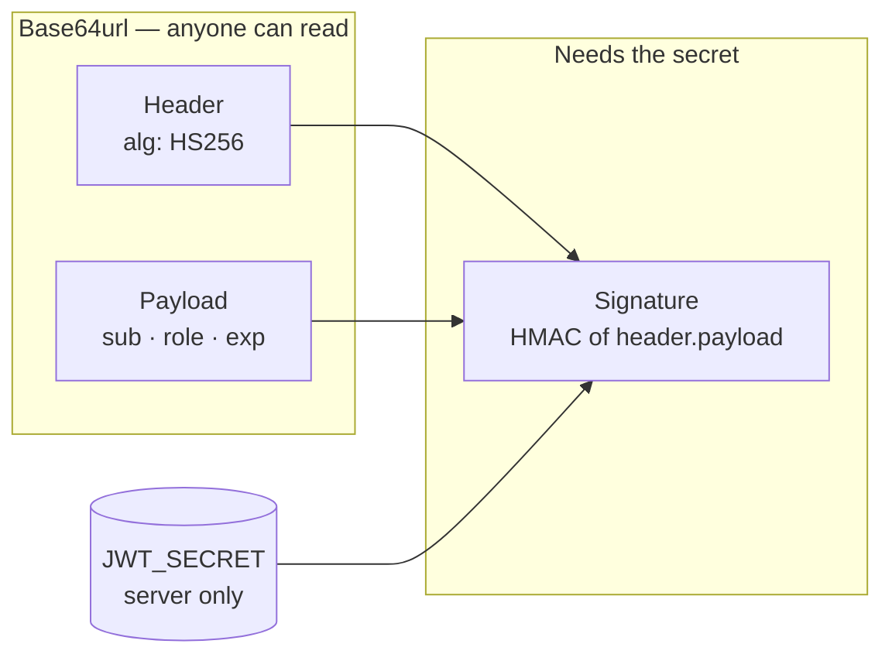
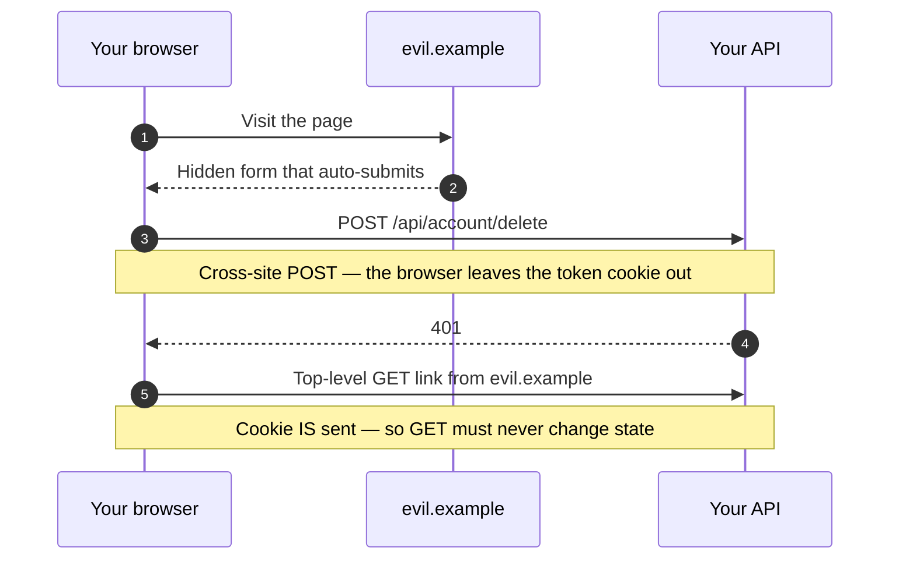
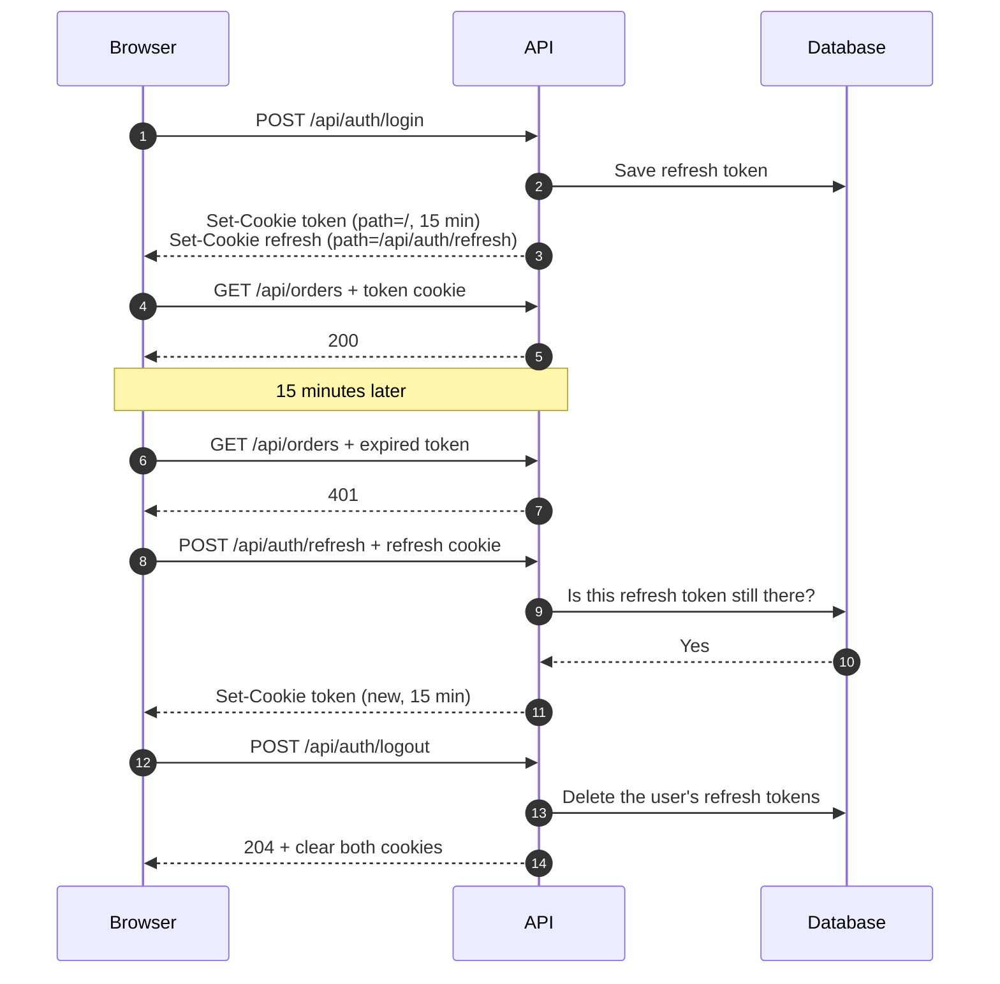

In the full-stack workshop this is the part that generates the most argument, and rightly so: it's the security decision with the widest consequences in the whole application, and the two usual options expose you to different things.

## What a JWT is and isn't

A JSON Web Token is three Base64 parts separated by dots: header, payload and signature. The surprising part is that **the payload is not encrypted**. It's encoded, which is not the same thing.



```js {3}
// Anyone holding the token can read this
const [, payload] = token.split(".");
console.log(JSON.parse(Buffer.from(payload, "base64url").toString()));
// { sub: "user_123", role: "admin", exp: 1790000000 }
```

What the signature guarantees is **integrity**, not confidentiality: nobody can modify the payload without invalidating it, because they don't have the key. Hence the rule: a JWT carries what identifies, never what is secret.

> [!WARNING]
> No full email addresses unless you need them, and certainly no sensitive personal data. Whatever goes in the payload, every holder of the token can read.

```js title="src/auth/tokens.js" {4}
import jwt from "jsonwebtoken";

const token = jwt.sign(
  { sub: user.id, role: user.role },   // the bare minimum
  process.env.JWT_SECRET,
  { expiresIn: "1h", algorithm: "HS256" }
);
```

And when verifying, **pin the algorithm**. Omitting it opens a whole family of attacks where an attacker sets the header to `alg: "none"` and the library accepts an unsigned token:

```js
jwt.verify(token, process.env.JWT_SECRET, { algorithms: ["HS256"] });
```

## The two options, and what each exposes you to

**`localStorage`** is convenient: read it with JavaScript, send it in an `Authorization` header. The problem is exactly that — JavaScript reads it. **All** the JavaScript on the page, including whatever arrives through a compromised dependency or an XSS. One malicious script and the token is gone.

**An `httpOnly` cookie** is not reachable from JavaScript, so XSS cannot steal it. In exchange, the browser sends it automatically on every request to your domain, including ones another site originated — which is the door CSRF walks through.

| | `localStorage` | `httpOnly` cookie |
| --- | --- | --- |
| **Readable by page scripts** | Yes | No |
| **Sent automatically** | No — you add the header | Yes, on every request to your domain |
| **Exposed to** | XSS steals the token | CSRF rides on it |
| **Mitigation** | Have no XSS, ever, including in dependencies | `sameSite`, plus an anti-CSRF token if you need `none` |

My default is the cookie, because XSS is far more common than CSRF and CSRF has a one-line mitigation:

```js title="src/routes/auth.js" {2,4}
res.cookie("token", token, {
  httpOnly: true,                       // out of JavaScript's reach
  secure: process.env.NODE_ENV === "production",
  sameSite: "lax",                      // not sent on cross-site requests
  maxAge: 60 * 60 * 1000,
  path: "/",
});
```

`sameSite: "lax"` stops the cookie being sent on requests originated by another site, except top-level GET navigation. That covers classic form-based CSRF.



> [!CAUTION]
> If you need `sameSite: "none"` because the front end is on another domain, then you do need an explicit anti-CSRF token. `lax` also assumes no `GET` endpoint changes anything.

## Refresh, and actually signing out

A one-hour token with no renewal forces a fresh login every hour. A thirty-day token is a stolen token that works for thirty days. The usual answer is two tokens:

- **Access token**, short (15 minutes), sent on every request.
- **Refresh token**, long, in its own `httpOnly` cookie scoped with `path: "/api/auth/refresh"` so it never travels on any other request, and **stored in the database**.

That last point is what makes a real sign-out possible. A JWT is valid until it expires: there's no way to invalidate it, because the server keeps nothing. If the refresh token *is* in the database, signing out is deleting that row, and the access token expires on its own in fifteen minutes.



The refresh endpoint is where the database earns its place: a token that isn't in the table gets nothing.

```js title="src/routes/auth.js" {2-3}
app.post("/api/auth/refresh", async (req, res) => {
  const stored = await RefreshToken.findOne({ token: req.cookies?.refresh });
  if (!stored || stored.expiresAt < new Date()) return res.sendStatus(401);

  const user = await User.findById(stored.userId);
  const token = jwt.sign({ sub: user.id, role: user.role }, process.env.JWT_SECRET, {
    expiresIn: "15m",
    algorithm: "HS256",
  });
  res.cookie("token", token, { httpOnly: true, secure: true, sameSite: "lax", path: "/" });
  res.sendStatus(204);
});
```

And signing out is deleting the rows:

```js title="src/routes/auth.js" {2}
app.post("/api/auth/logout", requireAuth, async (req, res) => {
  await RefreshToken.deleteMany({ userId: req.user.sub });
  res.clearCookie("token", { path: "/" });
  res.clearCookie("refresh", { path: "/api/auth/refresh" });
  res.sendStatus(204);
});
```

## The middleware, and the mistake nearly everyone makes

```js title="src/middleware/requireAuth.js" {6}
export function requireAuth(req, res, next) {
  const token = req.cookies?.token;
  if (!token) return res.sendStatus(401);

  try {
    req.user = jwt.verify(token, process.env.JWT_SECRET, {
      algorithms: ["HS256"],
    });
    next();
  } catch {
    // Don't distinguish "expired" from "bad signature" to the outside.
    res.sendStatus(401);
  }
}
```

> [!IMPORTANT]
> **Authentication is not authorization.** `requireAuth` tells you who someone is, not what they're entitled to.

An endpoint that checks the token but not ownership lets any valid user read any other user's data:

```diff title="src/routes/orders.js"
- // Wrong
- app.get("/api/orders/:id", requireAuth, async (req, res) =>
-   res.json(await Order.findById(req.params.id))
- );
+ // Right: ownership is part of the query
+ app.get("/api/orders/:id", requireAuth, async (req, res) => {
+   const order = await Order.findOne({ _id: req.params.id, userId: req.user.sub });
+   if (!order) return res.sendStatus(404);
+   res.json(order);
+ });
```

Returning 404 rather than 403 is deliberate: a 403 confirms the resource exists.

## The minimum

Pinned signing algorithm, no secrets in the payload, `httpOnly` + `secure` + `sameSite` cookie, refresh token in the database so you can revoke, and resource ownership inside the query. That covers most of what breaks in an ordinary application, and none of the five takes more than ten minutes.
