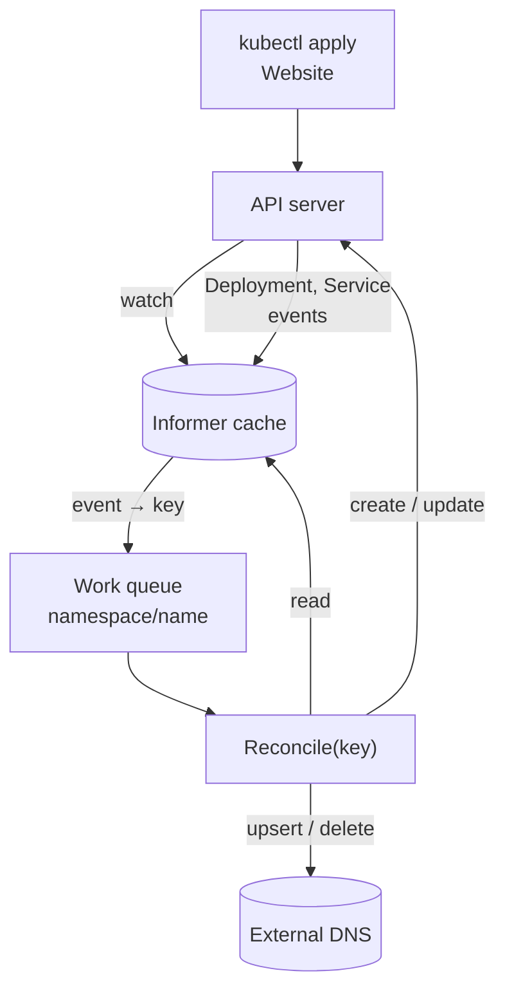
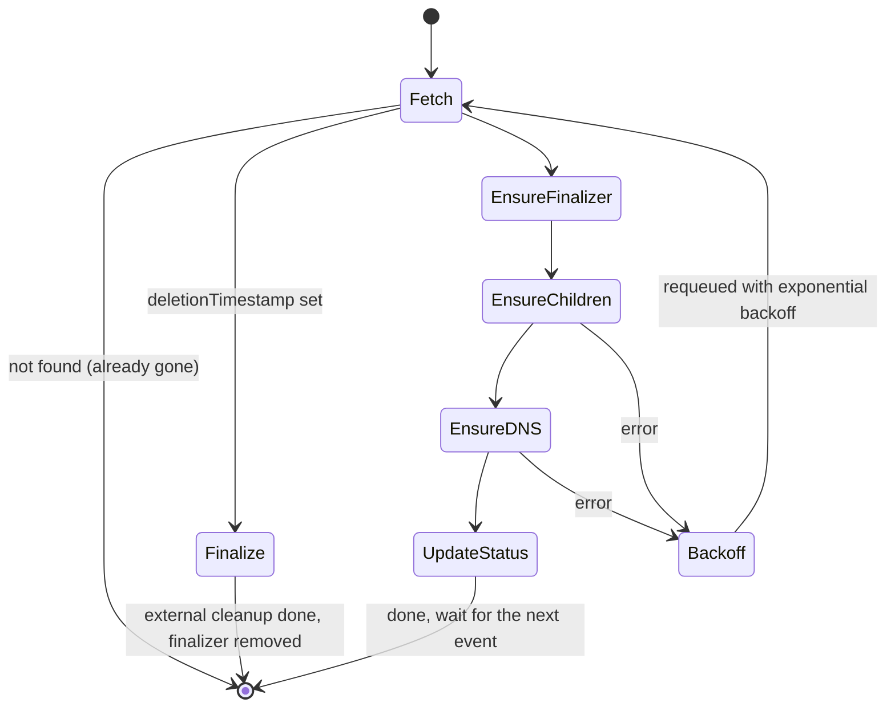
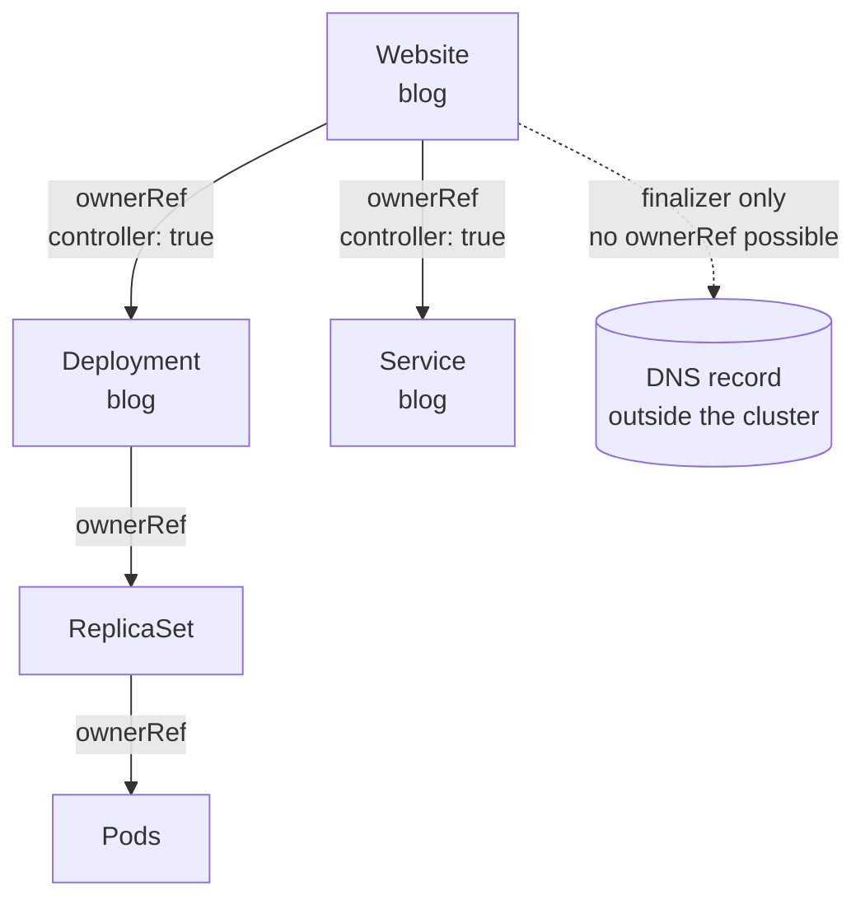
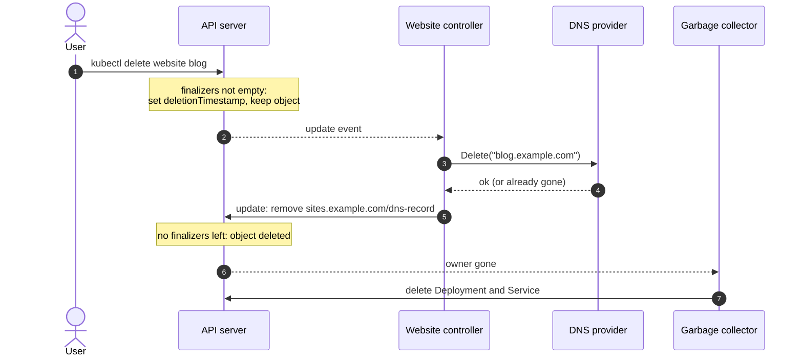

Most of what I ship at work runs on top of operators. The Open Data Hub
dashboard is deployed by one, and the components around it are custom resources
that some controller, somewhere, is busy reconciling. For a long time I read
operator code far more often than I wrote it, and it took writing one from
scratch for the rules to stop feeling like folklore.

This post builds a small but complete operator with
[kubebuilder](https://book.kubebuilder.io/): a `Website` resource that runs a
container, exposes it with a Service, and registers a DNS record in a provider
outside the cluster. That last part is there on purpose — it is what forces a
finalizer into the design. On the way I want to pin down the handful of ideas
that decide whether an operator behaves or slowly fills a cluster with
surprises.

I checked the APIs against kubebuilder v4.16 and controller-runtime v0.25, the
[latest releases](https://github.com/kubernetes-sigs/controller-runtime/releases)
when I wrote this. The concepts are much older than either.

## The operator pattern in one picture

Kubernetes' [own definition](https://kubernetes.io/docs/concepts/extend-kubernetes/operator/)
is short: an operator is a custom resource plus a controller that encodes the
operational knowledge to manage it. You declare what you want in the `spec`, a
controller makes the world match and reports what it saw in the `status`.



Two details in that diagram matter more than they look:

- **Reconcile receives a key, not an event.** controller-runtime collapses
  whatever happened — a create, five updates, a change to an owned Deployment —
  into `namespace/name` and puts it on a queue. Duplicate keys merge while they
  wait.
- **Reads come from a cache.** `r.Get` does not hit the API server by default;
  it reads the informer's local copy, which can lag a moment behind your own
  writes.

Both push you towards the same way of thinking.

## Level-triggered, not edge-triggered

An edge-triggered system reacts to *changes*: "the replicas went from 2 to 3,
so add one pod". A level-triggered system reacts to *state*: "the spec says 3,
I see 2, create one". Kubernetes controllers are level-triggered, and the whole
API is designed around it — you never get told *what* changed, only *that*
something about this object might have.

That has a liberating consequence. If your controller crashes, misses events,
or gets restarted during an upgrade, nothing is lost: on startup it lists
everything and reconciles each object against what it sees now. The
[kubebuilder good practices](https://book.kubebuilder.io/reference/good-practices)
put it bluntly: the reconciliation loop needs to be idempotent, and logic that
branches on the *kind* of event breaks the pattern.

> Reconcile is a function from "what the world looks like now" to "the next
> step towards what the spec asks for". Run it twice and the second run should
> find nothing to do.

## Scaffolding the project

```steps
Init: kubebuilder init creates the Go module, the manager and the Makefile.
Create the API: kubebuilder create api scaffolds the types and an empty controller.
Design the types: Spec, status and validation markers.
Generate: make manifests generate writes the CRD, the RBAC and the DeepCopy code.
Run: make install run loads the CRD and runs the manager on your machine.
```

```bash title="terminal"
kubebuilder init --domain example.com --repo github.com/example/website-operator
kubebuilder create api --group sites --version v1alpha1 --kind Website \
  --resource --controller
make manifests generate
make install   # CRDs into the cluster in your kubeconfig
make run       # the manager runs on your machine against that cluster
```

The result is a `sites.example.com/v1alpha1` API, types in
`api/v1alpha1/website_types.go`, a controller in
`internal/controller/website_controller.go` and an envtest suite next to it.

## Designing the CRD: spec is intent, status is observation

The [API conventions](https://github.com/kubernetes/community/blob/master/contributors/devel/sig-architecture/api-conventions.md#spec-and-status)
draw a hard line: the `spec` is what the user wants and only the user writes it;
the `status` is what the controller observed and only the controller writes it.
The `+kubebuilder:subresource:status` marker enforces that line in the API: an
update to the main resource ignores status, and an update to `/status` ignores
everything else.

```go title="api/v1alpha1/website_types.go" {12-14,20,24-27,31}
type WebsiteSpec struct {
	// Container image that serves the site.
	// +kubebuilder:validation:MinLength=1
	Image string `json:"image"`

	// Public hostname registered in the external DNS provider.
	// +kubebuilder:validation:Pattern=`^[a-z0-9]([-a-z0-9.]*[a-z0-9])?$`
	Hostname string `json:"hostname"`

	// +kubebuilder:validation:Minimum=0
	// +kubebuilder:validation:Maximum=10
	// +kubebuilder:default=1
	// +optional
	Replicas *int32 `json:"replicas,omitempty"`
}

type WebsiteStatus struct {
	// The spec generation this status describes.
	// +optional
	ObservedGeneration int64 `json:"observedGeneration,omitempty"`
	// +optional
	ReadyReplicas int32 `json:"readyReplicas,omitempty"`

	// +listType=map
	// +listMapKey=type
	// +optional
	Conditions []metav1.Condition `json:"conditions,omitempty"`
}

// +kubebuilder:object:root=true
// +kubebuilder:subresource:status
// +kubebuilder:printcolumn:name="Available",type=string,JSONPath=`.status.conditions[?(@.type=="Available")].status`
type Website struct {
	metav1.TypeMeta   `json:",inline"`
	metav1.ObjectMeta `json:"metadata,omitempty"`

	Spec   WebsiteSpec   `json:"spec,omitempty"`
	Status WebsiteStatus `json:"status,omitempty"`
}
```

Three decisions in there are worth defending:

- **`Replicas` is a pointer with a default.** A plain `int32` cannot tell "the
  user asked for zero" from "the user said nothing" — the same zero-value
  problem I described in [Go for TypeScript developers](/blog/go-for-typescript-developers).
  The `+kubebuilder:default` marker makes the API server fill it in, so the
  controller sees a value either way.
- **Validation lives in the CRD.** The markers become OpenAPI schema, which the
  API server enforces before your controller ever sees the object. Every rule
  you push there is one less error path in Go.
- **Conditions are `metav1.Condition`, as a map keyed by `type`.** That is the
  shape every built-in resource uses, which means `kubectl wait
  --for=condition=Available` works on your resource for free. The `listType=map`
  markers let Server-Side Apply merge the list by type instead of replacing it.

`observedGeneration` is the field people skip and later miss. `metadata.generation`
increases every time the spec changes; copying it into the status (and into each
condition) tells a reader whether "Available=True" refers to the spec they just
applied or to the previous one.

## The reconcile loop

Here is the shape of the controller, before any code:



And the entry point. Notice that it never asks what happened — it reads the
object and decides from its current state:

```go title="internal/controller/website_controller.go" {16-23}
const websiteFinalizer = "sites.example.com/dns-record"

type WebsiteReconciler struct {
	client.Client
	Scheme *runtime.Scheme
	DNS    DNSProvider // external, injected from cmd/main.go
}

func (r *WebsiteReconciler) Reconcile(ctx context.Context, req ctrl.Request) (ctrl.Result, error) {
	var site sitesv1alpha1.Website
	if err := r.Get(ctx, req.NamespacedName, &site); err != nil {
		// Deleted between the event and now: nothing left to do.
		return ctrl.Result{}, client.IgnoreNotFound(err)
	}

	if !site.DeletionTimestamp.IsZero() {
		return r.finalize(ctx, &site)
	}
	if controllerutil.AddFinalizer(&site, websiteFinalizer) {
		if err := r.Update(ctx, &site); err != nil {
			return ctrl.Result{}, err
		}
	}

	deploy, err := r.reconcileDeployment(ctx, &site)
	if err != nil {
		return ctrl.Result{}, err
	}
	// … reconcileService follows the same shape
	if err := r.DNS.Upsert(ctx, site.Spec.Hostname, site.Name+"."+site.Namespace); err != nil {
		return ctrl.Result{}, fmt.Errorf("registering %s: %w", site.Spec.Hostname, err)
	}
	return ctrl.Result{}, r.updateStatus(ctx, &site, deploy)
}
```

`DNSProvider` is a two-method interface — `Upsert(ctx, hostname, target)` and
`Delete(ctx, hostname)` — so the tests can swap in a map. Both methods have to
be idempotent: upserting a record that already exists, or deleting one that is
already gone, must succeed. That is the same rule as Reconcile, pushed one level
down.

### Children: create or update, and own them

```go title="internal/controller/website_controller.go"
func (r *WebsiteReconciler) reconcileDeployment(ctx context.Context, site *sitesv1alpha1.Website) (*appsv1.Deployment, error) {
	deploy := &appsv1.Deployment{ObjectMeta: metav1.ObjectMeta{Name: site.Name, Namespace: site.Namespace}}
	labels := map[string]string{"app.kubernetes.io/name": "website", "app.kubernetes.io/instance": site.Name}

	_, err := controllerutil.CreateOrUpdate(ctx, r.Client, deploy, func() error {
		deploy.Spec.Replicas = site.Spec.Replicas
		deploy.Spec.Selector = &metav1.LabelSelector{MatchLabels: labels}
		deploy.Spec.Template.Labels = labels
		if len(deploy.Spec.Template.Spec.Containers) == 0 {
			deploy.Spec.Template.Spec.Containers = []corev1.Container{{Name: "web"}}
		}
		web := &deploy.Spec.Template.Spec.Containers[0]
		web.Image = site.Spec.Image
		web.Ports = []corev1.ContainerPort{{Name: "http", ContainerPort: 8080}}
		return controllerutil.SetControllerReference(site, deploy, r.Scheme)
	})
	return deploy, err
}
```

`CreateOrUpdate` reads the object, runs the mutate function, and only sends an
update if the result differs from what it read. That last part is why the
function edits fields *in place* instead of assigning a fresh container list: a
new `corev1.Container{}` lacks the fields the API server defaults
(`imagePullPolicy`, `terminationMessagePath`…), so the comparison would always
see a difference and you would send a pointless update on every pass.

`SetControllerReference` is the line that turns a Deployment into *the Website's*
Deployment.

## Owner references and garbage collection

An owner reference is a pointer from a dependent to its owner: kind, name and,
crucially, UID. The garbage collector in `kube-controller-manager` uses it to
delete dependents when the owner disappears.



The arrows point from dependent to owner in the API, but read the diagram as
"deleting the top removes everything below it with a solid line". The rules
from the [owners and dependents](https://kubernetes.io/docs/concepts/overview/working-with-objects/owners-dependents/)
page that bite in practice:

| Rule | Consequence |
| --- | --- |
| **Owners must be in the same namespace** | A namespaced Website cannot own something in another namespace. The reference is treated as absent and the dependent can be collected. |
| **Cluster-scoped dependents need cluster-scoped owners** | A ClusterRole cannot be owned by your namespaced resource. |
| **Only one owner can be the `controller`** | `SetControllerReference` fails if another controller already claims the object — that is a feature, it stops two operators fighting over one Deployment. |
| **References carry the UID** | Delete and recreate a Website with the same name and the old children are orphans, not adopted. |
| **Nothing outside the API server can be owned** | A DNS record, a bucket, a row in a database: the garbage collector has never heard of them. |

The `controller: true` flag is also what `Owns()` uses to map events back: when
the Deployment's status changes, controller-runtime follows the controller
reference and enqueues the owning Website. That is why the reconciler never
polls for "is the Deployment ready yet?".

## Finalizers: the cleanup that the garbage collector cannot do

That last row is the reason for the finalizer. A
[finalizer](https://kubernetes.io/docs/concepts/overview/working-with-objects/finalizers/)
is a string in `metadata.finalizers`. While the list is not empty, a delete
request does not remove the object: the API server only sets
`deletionTimestamp`, and the object stays readable until every finalizer has
been removed by whoever added it.



```go title="internal/controller/website_controller.go"
func (r *WebsiteReconciler) finalize(ctx context.Context, site *sitesv1alpha1.Website) (ctrl.Result, error) {
	if !controllerutil.ContainsFinalizer(site, websiteFinalizer) {
		return ctrl.Result{}, nil // someone else's finalizer is holding it
	}
	if err := r.DNS.Delete(ctx, site.Spec.Hostname); err != nil {
		// Keep the finalizer: the error requeues and we try again.
		return ctrl.Result{}, fmt.Errorf("deleting DNS record %s: %w", site.Spec.Hostname, err)
	}
	controllerutil.RemoveFinalizer(site, websiteFinalizer)
	return ctrl.Result{}, r.Update(ctx, site)
}
```

> [!WARNING]
> A finalizer is a promise that your controller will be there to keep it. Uninstall
> the operator before its resources and every `kubectl delete` hangs forever in
> `Terminating`; the same happens to the namespace that contains them. Delete the
> custom resources first, and only add a finalizer when there really is something
> outside the cluster to clean up — owned children do not need one.

Two smaller rules from the same page: once `deletionTimestamp` is set you can
remove finalizers but not add new ones, and the name should be domain-qualified
(`sites.example.com/dns-record`) so it cannot collide with someone else's.

## Status updates, and the conflict you will see on day one

```go title="internal/controller/website_controller.go" {3,11,13}
func (r *WebsiteReconciler) updateStatus(ctx context.Context, site *sitesv1alpha1.Website, deploy *appsv1.Deployment) error {
	desired := ptr.Deref(site.Spec.Replicas, 1)
	base := site.DeepCopy()

	cond := metav1.Condition{Type: "Available", ObservedGeneration: site.Generation,
		Status: metav1.ConditionFalse, Reason: "ReplicasUnavailable",
		Message: fmt.Sprintf("%d/%d replicas available", deploy.Status.AvailableReplicas, desired)}
	if deploy.Status.AvailableReplicas >= desired {
		cond.Status, cond.Reason = metav1.ConditionTrue, "MinimumReplicasAvailable"
	}
	meta.SetStatusCondition(&site.Status.Conditions, cond)
	site.Status.ObservedGeneration, site.Status.ReadyReplicas = site.Generation, deploy.Status.AvailableReplicas
	return r.Status().Patch(ctx, site, client.MergeFrom(base))
}
```

Sooner or later your logs show *"the object has been modified; please apply your
changes to the latest version and try again"*. That is optimistic concurrency:
an `Update` carries the `resourceVersion` you read, and if anyone wrote the
object since — including your own previous reconcile, still not reflected in the
cache — the API server rejects it with a 409.

It is not a bug, and the right reaction is usually to do nothing: return the
error, the key is requeued, and the next pass starts from a fresh read. Two
choices in this code make it rarer:

- **Status goes through `Status().Patch` with `MergeFrom`.** A merge patch sends
  only the diff and no `resourceVersion`, so it does not conflict. It does
  replace the whole `conditions` array, which is fine here because this
  controller is the only writer of status.
- **The finalizer goes through `Update`, on purpose.** `finalizers` is a list
  other controllers may touch too. A plain merge patch would overwrite theirs; a
  conflicting `Update` fails safely and retries.

`meta.SetStatusCondition` only changes `lastTransitionTime` when the status
actually flips, so writing the same condition on every pass does not make it
look as if something happened.

## Requeue strategies

`ctrl.Result` and the returned error are your only levers on *when* the next pass
happens. The [reconcile package docs](https://pkg.go.dev/sigs.k8s.io/controller-runtime/pkg/reconcile)
are precise about what each combination does:

| Return | What happens | Use it for |
| --- | --- | --- |
| **`Result{}, nil`** | Nothing until the next watch event | The normal case: you are waiting on something you watch |
| **`Result{}, err`** | Requeued with exponential backoff; the result is ignored | Transient failures: API errors, conflicts, the DNS provider timing out |
| **`Result{}, reconcile.TerminalError(err)`** | Logged and counted, not retried | Errors no retry will fix, such as an invalid configuration |
| **`Result{RequeueAfter: d}, nil`** | Requeued after `d` | Polling something you cannot watch: an external API, a certificate expiry |
| **`Result{Requeue: true}, nil`** | Rate-limited requeue | Nothing — it is deprecated in favour of `RequeueAfter` |

The mistake I see most is `RequeueAfter: 5 * time.Second` as a way of waiting for
a Deployment to become ready. You already watch it: its status change will
enqueue you. Polling on top only adds load and hides missing watches.

## Watches and predicates

```go title="internal/controller/website_controller.go"
// +kubebuilder:rbac:groups=sites.example.com,resources=websites,verbs=get;list;watch;update;patch
// +kubebuilder:rbac:groups=sites.example.com,resources=websites/status,verbs=get;update;patch
// +kubebuilder:rbac:groups=sites.example.com,resources=websites/finalizers,verbs=update
// +kubebuilder:rbac:groups=apps,resources=deployments,verbs=get;list;watch;create;update;patch;delete
// +kubebuilder:rbac:groups="",resources=services,verbs=get;list;watch;create;update;patch;delete

func (r *WebsiteReconciler) SetupWithManager(mgr ctrl.Manager) error {
	return ctrl.NewControllerManagedBy(mgr).
		For(&sitesv1alpha1.Website{}, builder.WithPredicates(predicate.GenerationChangedPredicate{})).
		Owns(&appsv1.Deployment{}).
		Owns(&corev1.Service{}).
		Named("website").
		Complete(r)
}
```

`For` watches the primary resource, `Owns` watches children and maps them to
their controller owner, and `Watches` with a handler covers anything else — a
ConfigMap referenced by name, say. The RBAC markers become the ClusterRole on
`make manifests`; forget one and the informer logs "forbidden" errors and never syncs at
startup, which is at least loud.

The `GenerationChangedPredicate` drops update events on the Website that do not
change `metadata.generation` — which includes our own status patches, so the
controller does not wake itself up every time it reports. Deletion still gets
through, because the API server bumps the generation when it sets the deletion
timestamp. The price: label and annotation changes are filtered too. If your
controller reacts to an annotation, combine predicates or leave this one out.

> [!TIP]
> Predicates are an optimisation, not a correctness tool. A level-triggered
> reconciler must still produce the right result if every event got through —
> filter only what you are sure changes nothing.

## Testing with envtest

[envtest](https://book.kubebuilder.io/reference/envtest) starts a real etcd and
kube-apiserver — nothing else. The scaffolded suite in
`internal/controller/suite_test.go` boots it with your CRDs and hands you a
`k8sClient`; `make test` downloads the binaries through `setup-envtest`. The
generated controller test calls `Reconcile` directly, which keeps tests
deterministic:

```go title="internal/controller/website_controller_test.go"
It("owns its Deployment and cleans DNS up on delete", func(ctx SpecContext) {
	dns := &fakeDNS{records: map[string]string{}}
	r := &WebsiteReconciler{Client: k8sClient, Scheme: k8sClient.Scheme(), DNS: dns}
	site := &sitesv1alpha1.Website{
		ObjectMeta: metav1.ObjectMeta{Name: "blog", Namespace: "default"},
		Spec:       sitesv1alpha1.WebsiteSpec{Image: "nginx:1.27", Hostname: "blog.example.com"},
	}
	key := client.ObjectKeyFromObject(site)
	Expect(k8sClient.Create(ctx, site)).To(Succeed())

	_, err := r.Reconcile(ctx, reconcile.Request{NamespacedName: key})
	Expect(err).NotTo(HaveOccurred())

	var deploy appsv1.Deployment
	Expect(k8sClient.Get(ctx, key, &deploy)).To(Succeed())
	Expect(metav1.IsControlledBy(&deploy, site)).To(BeTrue())
	Expect(dns.records).To(HaveKey("blog.example.com"))

	Expect(k8sClient.Delete(ctx, site)).To(Succeed())
	_, err = r.Reconcile(ctx, reconcile.Request{NamespacedName: key})
	Expect(err).NotTo(HaveOccurred())
	Expect(dns.records).To(BeEmpty())
	Expect(apierrors.IsNotFound(k8sClient.Get(ctx, key, site))).To(BeTrue())
})
```

What envtest does *not* run is just as instructive. There is no
controller-manager, so the garbage collector never deletes the Deployment after
the Website is gone — you assert the owner reference instead, as above. There is
no Deployment controller either, so `AvailableReplicas` stays at zero and the
condition is always `Available=False`. And deleted namespaces stay `Terminating`
forever, so use a fresh namespace per test rather than recreating one.

> [!NOTE]
> Add a second `Reconcile` call right after the first and assert nothing changed.
> It is the cheapest idempotency test there is, and it catches the
> always-different mutate function from earlier.

## Common mistakes

Most of these I have either made or reviewed:

- **Branching on what happened.** "On create, do X; on update, do Y" breaks the
  first time an event is missed. Read state, compute the next step.
- **Polling what you could watch.** `RequeueAfter` while waiting for a child is a
  missing `Owns`.
- **Writing status from a stale object.** Build status from what you observed in
  *this* pass, and set `observedGeneration`.
- **Generating names.** `GenerateName` children are not idempotent: every retry
  after a failure creates another one. Derive names from the owner.
- **Finalizers for in-cluster children.** Owner references already handle those.
  A finalizer you do not need is just one more way to get stuck in `Terminating`.
- **Forgetting that the spec can change under you.** If `hostname` changes from
  `a.example.com` to `b.example.com`, this operator registers `b` and never deletes
  `a`. The fix is to record what you published — a `status.publishedHostname` —
  and clean up the difference.
- **Long blocking calls in Reconcile.** Workers are limited (one by default,
  `MaxConcurrentReconciles` to change it). A thirty-second HTTP call stalls every
  other Website behind it.

## Limits and honest gotchas

A few things this example glosses over, because they deserve their own post:

- **`CreateOrUpdate` is a client-side merge.** It works when your operator is the
  only writer of the fields it sets. When an HPA or another controller shares the
  object, Server-Side Apply with your own field manager is the better tool — and
  it comes with its own trap, which I wrote up in
  [the field I renamed and the probe that broke](/blog/server-side-apply-field-manager).
- **The cache is eventually consistent.** Right after a write, a `Get` may return
  the old object. Idempotency is what makes that harmless; a reconcile that
  depends on reading its own write will flake. controller-runtime v0.25 added an
  experimental read-your-writes client, but I have not used it, so I am not
  relying on it here.
- **Multi-version CRDs need conversion.** The day you go from `v1alpha1` to `v1`
  with a schema change, you need a conversion webhook. Kubebuilder scaffolds it,
  but it is real work and real operational surface.
- **An operator is software you now run.** It needs RBAC reviews, upgrades,
  metrics and someone on call for it. If a Helm chart and a CronJob do the job,
  that is less to maintain.

What I took from writing one is mostly a habit of mind: a controller is not a
script that runs when something happens, it is a function that keeps being
called until the world agrees with the spec. Once you write every line with that
in mind — "what if this runs again, right now, from a stale read?" — the rest of
the framework stops being magic.

## Further reading

- [The Kubebuilder Book — Getting started](https://book.kubebuilder.io/getting-started) —
  the official tutorial builds a Memcached operator with the same pieces as this
  post: conditions, owned Deployments, RBAC markers.
- [Kubebuilder — Using finalizers](https://book.kubebuilder.io/reference/using-finalizers) —
  the canonical finalizer pattern, short and worth copying exactly.
- [Kubebuilder — Configuring envtest](https://book.kubebuilder.io/reference/envtest) —
  what envtest runs, what it does not (no garbage collection, no namespace
  deletion) and how to install its binaries.
- [controller-runtime `reconcile` package](https://pkg.go.dev/sigs.k8s.io/controller-runtime/pkg/reconcile) —
  the precise semantics of `Result`, `RequeueAfter`, `TerminalError` and the
  deprecation of `Requeue`.
- [Kubernetes — Owners and dependents](https://kubernetes.io/docs/concepts/overview/working-with-objects/owners-dependents/) —
  the namespace rules for owner references and how `blockOwnerDeletion` works.
- [Kubernetes — Finalizers](https://kubernetes.io/docs/concepts/overview/working-with-objects/finalizers/) —
  how deletion with finalizers proceeds, from the API server's point of view.
- [Kubernetes API conventions](https://github.com/kubernetes/community/blob/master/contributors/devel/sig-architecture/api-conventions.md) —
  the source for spec vs. status, conditions and `observedGeneration`; long, but
  the sections on status are the ones to read.
- [Kubebuilder — Good practices](https://book.kubebuilder.io/reference/good-practices) —
  idempotency, one controller per kind, and why not to branch on event types.
