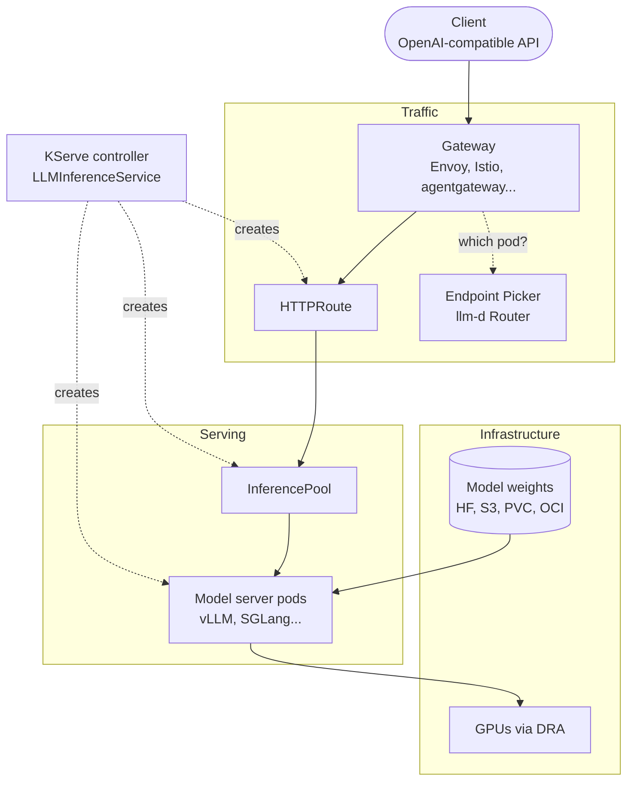
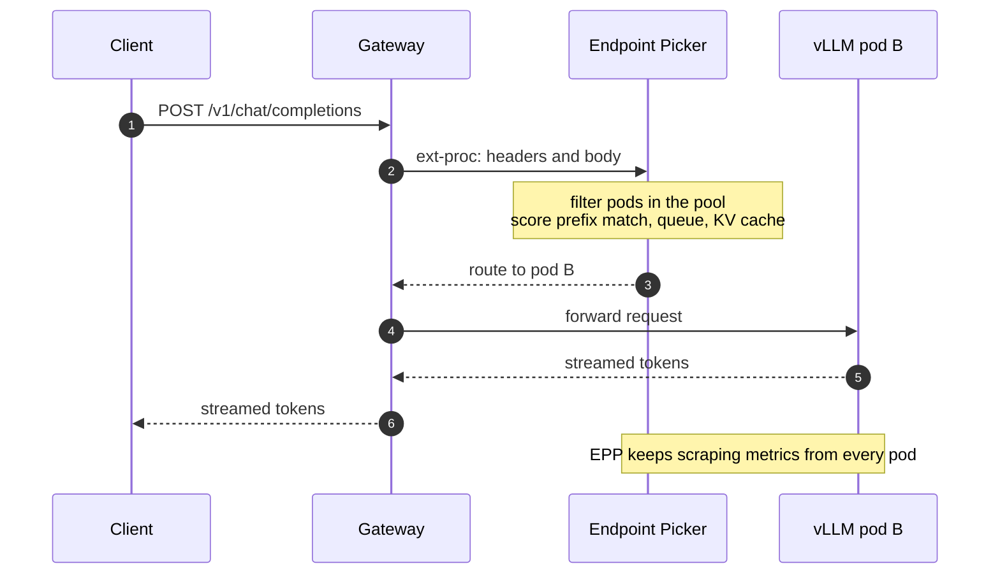
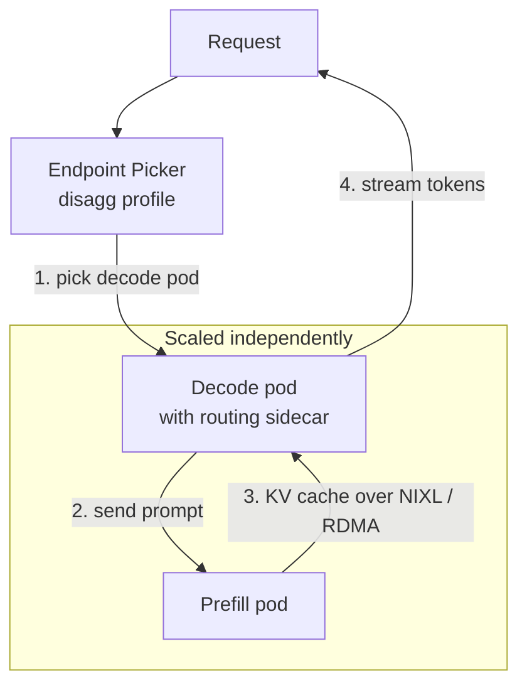
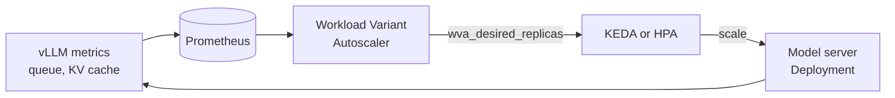
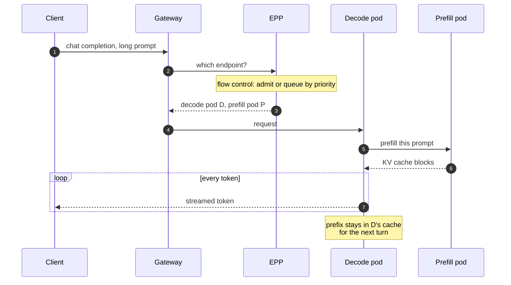

I work on the Open Data Hub / OpenShift AI dashboard, which means I mostly see
model serving from the top: a form where someone picks a model, a size and a
number of replicas, and a status that eventually turns green. Underneath that
form there is a stack of projects that changed a lot in the last year and a
half, and I wanted one page where I could see the whole thing, layer by layer,
with the manifests as they are **today** rather than as they were in the
tutorial I read in 2024.

This is that page. Everything below is checked against the projects' own
docs and source as of November 2026: KServe v0.21, llm-d v1.0, the Gateway API
Inference Extension v1.6 and Kubernetes 1.37.

## Why an LLM is not a web service

The first instinct is to treat a model server like any other HTTP backend: a
Deployment, a Service, an HPA on CPU, done. It works for a demo and falls over
quickly after that, for reasons that are worth stating precisely because every
layer of the stack exists to fix one of them.

A request to an LLM has **two phases** with very different costs. *Prefill*
reads the whole prompt in one parallel pass and is compute-bound. *Decode*
produces one token at a time and is memory-bandwidth-bound. A 20,000-token
prompt with a 50-token answer and a 50-token prompt with a 2,000-token answer
are both "one request", and they load the GPU in completely different ways.

Prefill leaves behind a **KV cache**: the attention keys and values for every
token seen so far, held in GPU memory. If the next request shares a prefix
with a previous one (the same system prompt, the same document, the previous
turns of a conversation), a server that still holds that prefix can skip most
of the prefill. That makes the cache **state**, and it lives in one specific
replica.

And the resource that runs out is not CPU. It is GPU memory for the KV cache,
and the queue of requests waiting for a slot in the running batch.

| Assumption from web services | What actually happens with LLMs |
| --- | --- |
| **Requests cost roughly the same** | Cost depends on prompt length and output length, and varies by orders of magnitude |
| **Any replica is as good as another** | The replica that holds your prefix in its KV cache can answer much faster |
| **CPU tells you when to scale** | The GPU saturates while CPU sits idle; queue depth and KV cache usage are the signals |
| **Pods start in seconds** | Pulling tens of gigabytes of weights and loading them onto a GPU takes minutes |
| **One node per pod** | Large models span several GPUs, and sometimes several nodes |

## The stack at a glance



From the bottom up: a model server turns a GPU into an OpenAI-compatible
endpoint; KServe turns "I want this model served" into the Kubernetes
objects; the Gateway API Inference Extension and the llm-d Router decide which
replica gets each request; llm-d adds the distributed tricks; DRA hands out
the GPUs. Let's go through them.

## The model server: vLLM and its peers

[vLLM](https://docs.vllm.ai/) is the default model server in this ecosystem.
Its two ideas that matter here are *continuous batching* (new requests join
the running batch at every step instead of waiting for it to finish) and
*paged attention* (the KV cache is managed in fixed-size blocks, like virtual
memory pages, so it can be shared and reused). It also does automatic prefix
caching, which is what makes "send this request to the replica that already
has the prefix" worth doing.

vLLM is not the only option. The llm-d v1.0 release lists vLLM, SGLang and
TensorRT-LLM images among the engines its guides use, across NVIDIA, AMD, TPU,
Intel XPU and CPU. What they share is the contract the rest of the stack
depends on: an OpenAI-compatible HTTP API, and **metrics** about their own
internal state.

Those metrics are the most important thing the model server gives the
platform. From [vLLM's metrics design doc](https://docs.vllm.ai/en/latest/design/metrics.html):

| Metric | What it tells the platform |
| --- | --- |
| **`vllm:num_requests_waiting`** | Requests queued, not yet in the batch. The clearest saturation signal |
| **`vllm:num_requests_running`** | Requests in the current batch |
| **`vllm:kv_cache_usage_perc`** | Fraction of KV cache blocks in use, from 0 to 1 |
| **`vllm:time_to_first_token_seconds`** | Histogram of TTFT, dominated by queueing and prefill |
| **`vllm:inter_token_latency_seconds`** | Histogram of the gap between streamed tokens, dominated by decode |
| **`vllm:prefix_cache_hits`** | Counter; divide by `vllm:prefix_cache_queries` for a hit rate |

Keep this table in mind. The router and the autoscaler further down are both,
at heart, consumers of these numbers.

## KServe: from intent to objects

[KServe](https://kserve.github.io/website/) is the control plane that turns a
single resource into Deployments, Services, routes and pools. It has two
resources for LLMs today, and the difference matters.

The **`InferenceService`** (`serving.kserve.io/v1beta1`) is the original,
general-purpose one. It serves scikit-learn models and LLMs alike, and for an
LLM it uses the Hugging Face runtime with vLLM as backend:

```yaml title="inferenceservice.yaml"
apiVersion: serving.kserve.io/v1beta1
kind: InferenceService
metadata:
  name: qwen-chat
spec:
  predictor:
    model:
      modelFormat:
        name: huggingface
      storageUri: hf://Qwen/Qwen2.5-7B-Instruct
      args:
        - --backend=vllm
        - --max_model_len=8192
      resources:
        requests:
          cpu: "2"
          memory: 16Gi
          nvidia.com/gpu: "1"
        limits:
          cpu: "4"
          memory: 32Gi
          nvidia.com/gpu: "1"
```

That is fine for one replica behind a normal Service. It knows nothing about
prefixes, queues or prefill.

The **`LLMInferenceService`** is the newer, LLM-specific resource, built
around llm-d. Its storage version in KServe v0.21 is `v1alpha2` (older docs
and products show `v1alpha1`, which is still served). The
[KServe samples](https://github.com/kserve/kserve/tree/master/docs/samples/llmisvc)
look like this:

```yaml title="llminferenceservice.yaml" {8,10-13}
apiVersion: serving.kserve.io/v1alpha2
kind: LLMInferenceService
metadata:
  name: qwen-chat
spec:
  model:
    uri: hf://Qwen/Qwen2.5-7B-Instruct
    name: Qwen/Qwen2.5-7B-Instruct
  replicas: 3
  router:
    scheduler: {}  # create an InferencePool and an Endpoint Picker
    route: {}      # generate the HTTPRoute
    gateway: {}    # attach to the managed Gateway
  template:
    containers:
      - name: main
        resources:
          requests:
            cpu: "2"
            memory: 16Gi
            nvidia.com/gpu: "1"
          limits:
            cpu: "4"
            memory: 32Gi
            nvidia.com/gpu: "1"
```

The `router` block is the interesting part. Three empty objects mean "make
the defaults for me": KServe creates the InferencePool, deploys the Endpoint
Picker, generates the HTTPRoute and attaches it to a Gateway. Each one can
instead point at something you already have (`gateway.refs`,
`route.http.refs`, `scheduler.pool.ref`). The
[configuration docs](https://kserve.github.io/website/docs/model-serving/generative-inference/llmisvc/llmisvc-configuration)
also explain how the shape of the spec picks the topology: a `worker` section
means multi-node, a `prefill` section means disaggregated prefill/decode, and
neither means a plain single-node deployment.

> [!NOTE]
> `LLMInferenceService` is still an alpha API. The version moved from
> `v1alpha1` to `v1alpha2` within 2026, and product documentation lags
> upstream. Check what your cluster serves with
> `kubectl get crd llminferenceservices.serving.kserve.io -o yaml` before
> copying a manifest from anywhere, including this post.

## The gateway that knows about models

This is the layer that changed the most, and the one I think is worth
understanding even if you never touch the others.

The [Gateway API Inference Extension](https://gateway-api-inference-extension.sigs.k8s.io/)
adds one resource to Gateway API: the **`InferencePool`**. It is GA at
`inference.networking.k8s.io/v1` (since v1.0.0 in September 2025). An
InferencePool looks like a Service with an opinion: it selects model server
pods by label, and it names an **Endpoint Picker** (EPP) that the gateway must
ask before it forwards each request.

```yaml title="inferencepool.yaml"
apiVersion: inference.networking.k8s.io/v1
kind: InferencePool
metadata:
  name: qwen-chat
spec:
  selector:
    matchLabels:
      app: qwen-chat
  targetPorts:
    - number: 8000
  endpointPickerRef:
    name: qwen-chat-epp   # a Service in front of the EPP
    port:
      number: 9002
    failureMode: FailOpen # default is FailClose
```

An `HTTPRoute` then uses the pool as a backend, exactly where you would
normally put a Service:

```yaml title="httproute.yaml" {12-14}
apiVersion: gateway.networking.k8s.io/v1
kind: HTTPRoute
metadata:
  name: qwen-chat
spec:
  parentRefs:
    - name: inference-gateway
  rules:
    - matches:
        - path:
            type: PathPrefix
            value: /v1
      backendRefs:
        - group: inference.networking.k8s.io
          kind: InferencePool
          name: qwen-chat
```

The mechanism is Envoy's
[external processing](https://www.envoyproxy.io/docs/envoy/latest/configuration/http/http_filters/ext_proc_filter)
(ext-proc). Any gateway that supports Gateway API and ext-proc can become an
"inference gateway": it streams the request to the EPP, the EPP answers with
the pod to use, and the gateway sends it there.



One thing that is easy to miss if your mental model is from 2025: as of
[GIE v1.6.0](https://github.com/kubernetes-sigs/gateway-api-inference-extension/releases/tag/v1.6.0)
(August 2026), the full-featured EPP, and the `InferenceObjective` and
`InferenceModelRewrite` APIs, **moved out of the Kubernetes SIG repository and
into [llm-d/llm-d-router](https://github.com/llm-d/llm-d-router)**. The SIG
project now hosts the InferencePool API, the protocol between gateway and
picker, a lightweight reference picker for conformance, and the conformance
tests. The same release made `endpointPickerRef` optional. I like the split:
the standard is the small, stable part, and the scheduling intelligence can
move at its own speed somewhere else.

### What the picker actually decides

The llm-d Router's EPP runs a chain of **filters** (which pods are eligible)
and weighted **scorers** (which eligible pod is best), then a **picker**. It is
configured with an `EndpointPickerConfig`, whose API graduated to
`llm-d.ai/v1` in llm-d v1.0. This one, from the
[router's architecture doc](https://github.com/llm-d/llm-d-router/blob/main/docs/architecture.md),
scores pods by how much of the prompt's prefix they already hold:

```yaml title="epp-config.yaml" {4-9}
apiVersion: llm-d.ai/v1
kind: EndpointPickerConfig
plugins:
  - type: precise-prefix-cache-producer
    parameters:
      tokenProcessorConfig:
        blockSizeTokens: 5
  - type: prefix-cache-scorer
    parameters:
      prefixMatchInfoProducerName: precise-prefix-cache-producer
  - type: decode-filter
  - type: max-score-picker
  - type: single-profile-handler
schedulingProfiles:
  - name: default
    plugins:
      - pluginRef: decode-filter
      - pluginRef: max-score-picker
      - pluginRef: prefix-cache-scorer
        weight: 50
```

Prefix affinity alone would send everything with the same system prompt to
one pod, so in practice it is weighed against load: queue depth and KV cache
utilisation. That trade-off — cache locality versus spreading the load — is
the whole job of the scheduler, and it is why this cannot be a round-robin
Service.

## llm-d: distributing the work

[llm-d](https://llm-d.ai/) is the project that ties this together. It was
started by Red Hat, Google and IBM Research among others,
[joined the CNCF as a Sandbox project](https://www.cncf.io/blog/2026/03/24/welcome-llm-d-to-the-cncf-evolving-kubernetes-into-sota-ai-infrastructure/)
in March 2026, and released
[v1.0.0](https://github.com/llm-d/llm-d/releases/tag/v1.0.0) on 20 October
2026. It is less a single binary than a set of well-lit paths: the router, the
model server images and guides, the autoscaler and a few supporting pieces,
all versioned together from 1.0 onwards.

Its headline feature is **disaggregated prefill and decode**. Since the two
phases want different things from hardware, you run them on different pods:
prefill workers process prompts and hand the resulting KV cache to decode
workers over a fast interconnect (NVIDIA's NIXL library, over RDMA where
available), and decode workers stream the tokens.



In KServe, this is the `prefill` section of an `LLMInferenceService`: a second
workload spec with its own replicas and resources. The KServe sample for it is
mostly vLLM flags for the KV transfer connector and RDMA resources, which is a
good hint about where the complexity lives. llm-d v1.0 also manages the two
pools as one unit through LeaderWorkerSet's new `DisaggregatedSet`, so a
rollout upgrades prefill and decode in lockstep instead of leaving a window
where they disagree about the transfer protocol.

> [!WARNING]
> Disaggregation pays off for long prompts, large models and high traffic. For
> a 7B model with short prompts, the KV transfer can cost more than it saves,
> and you have doubled the number of things that can be misconfigured. The
> release notes say it plainly: the P/D guides need specific LeaderWorkerSet
> versions and RDMA networking. Start aggregated and measure first.

The v1.0 release also leans towards agents: session-aware routing that keeps
a multi-turn conversation near its cached context, turn-priority scheduling,
and multi-tenant flow control with load shedding, so that a burst from one
tenant's agents does not starve everyone else's latency-sensitive traffic.
That is the bridge to [the next post](/blog/agents-on-kubernetes).

## Autoscaling on the right signal

A GPU-bound model server can be completely saturated while its CPU usage is
flat, so an HPA on CPU scales at the wrong moment or not at all. The signals
that matter are the ones in the vLLM table: how many requests are waiting,
and how full the KV cache is.



KServe's `LLMInferenceService` wires this through the `scaling` field (which
is mutually exclusive with `replicas`). With `wva`, the llm-d **Workload
Variant Autoscaler** reads inference metrics such as KV cache utilisation and
queue depth, computes a desired replica count and publishes it as
`wva_desired_replicas`; KEDA or an HPA then acts on it. The source's comments
are worth reading: with the HPA actuator you need a Prometheus Adapter, and
if it is missing "the HPA will fail to read the metric and stop scaling
silently". KEDA talks to Prometheus directly, which is one less moving part.

```yaml title="llminferenceservice.yaml (scaling)"
spec:
  # replicas: omitted, scaling owns the count
  scaling:
    minReplicas: 1
    maxReplicas: 4
    wva:
      keda:
        pollingInterval: 30
        cooldownPeriod: 300
```

If you prefer your own triggers, `scaling.keda` (without `wva`) creates a
KEDA ScaledObject from whatever triggers you specify, for example a Prometheus
query on `vllm:num_requests_waiting`.

Scale-out is the cheap direction. Scale-in is where the money is, and also
where it hurts: a new replica takes minutes to become ready, so a cooldown
that is too short turns every traffic dip into a cold start a few minutes
later. Which brings us to the bottom of the stack.

## GPUs: Dynamic Resource Allocation

For years, GPUs reached pods through device plugins: the node advertises
`nvidia.com/gpu: 8` and a pod asks for a count. That is all the scheduler
knows: no memory size, no model, no topology, no sharing.

[Dynamic Resource Allocation](https://kubernetes.io/docs/concepts/scheduling-eviction/dynamic-resource-allocation/)
replaces the count with a claim. Drivers publish `ResourceSlice` objects that
describe the actual devices and their attributes, admins define
`DeviceClass`es, and workloads request devices through `ResourceClaim`s or
`ResourceClaimTemplate`s, optionally filtered with CEL expressions. The
scheduler allocates real devices that satisfy the claim. The core API
[graduated to GA in Kubernetes 1.34](https://kubernetes.io/blog/2025/09/01/kubernetes-v1-34-dra-updates/)
as `resource.k8s.io/v1`.

KServe has an experimental shortcut for the common case: an annotation on the
`LLMInferenceService` that makes the controller create the
`ResourceClaimTemplate` and wire it into the pod for you.

```yaml title="llminferenceservice.yaml (DRA)"
metadata:
  name: qwen-chat
  annotations:
    # experimental: KServe creates <name>-managed-dra and injects the claim
    serving.kserve.io/exp-dra-device-class: gpu.nvidia.com
```

For anything beyond "N devices of class X", you write the claim yourself.
llm-d v1.0 ships a DRA guide for topology-aware placement, which matters when
the KV transfer between prefill and decode should go over a specific NIC.

## Getting the weights to the GPU

The last layer is the one that dominates cold starts. A `hf://` URI is
convenient: KServe's storage initializer downloads the model when the pod
starts. For a model of tens of gigabytes, that is minutes per replica, every
time, from a source outside your cluster.

```steps
Pull the image: The vLLM image alone is several gigabytes. Pre-pull it or keep it warm on GPU nodes.
Fetch the weights: From Hugging Face, S3, a PVC, or an OCI artifact. Usually the longest step.
Load onto the GPU: Read the weights into GPU memory and initialise the engine.
Warm up: Allocate the KV cache, compile, and pass the readiness probe.
```

The options, roughly in order of effort:

- **A PVC** with the weights already on it (`pvc://`), shared across
  replicas. Simple, and the download happens once.
- **OCI images as model carriers**, so weights move through the same
  registries and caching as everything else. Kubernetes
  [image volumes](https://kubernetes.io/blog/2025/04/29/kubernetes-v1-33-image-volume-beta/)
  mount an OCI artifact read-only into a pod, which fits this well.
- **KServe's `LocalModelCache`** pre-downloads models onto the local disk of a
  group of nodes; v0.18 added a namespace-scoped `LocalModelNamespaceCache`
  so a team can manage its own cache without cluster-admin.

None of this is glamorous, and in my experience it is where most "the model
takes forever to come up" questions end. The router and the autoscaler can
only be as responsive as the slowest of these four steps.

## The whole request, end to end



## What is still immature

I would not want anyone to read this as "solved". Some honest caveats:

- **The APIs are young and moving.** InferencePool is GA, but
  `LLMInferenceService` is alpha, the EPP and its APIs changed repository in
  2026, and llm-d's 1.0 is weeks old. Documentation, products and blog posts
  disagree with each other about versions; I hit that repeatedly while
  writing this one.
- **Disaggregation is demanding.** RDMA networking, matching versions across
  LeaderWorkerSet, the model server and the router, and a real benchmark to
  prove it helps. Check the support status in whatever product you run it
  on: upstream presents it as a core feature, but vendors tend to label it
  more cautiously, and that is a fair summary of where it stands for most
  teams.
- **Cold starts are still minutes.** Caching narrows it; nothing removes it.
  Scale-to-zero for a large model is a cost decision with a latency bill.
- **Observability across layers is hard.** A slow response can be the queue
  in the EPP, the prefill pod, the KV transfer or the decode batch. Each layer
  has its metrics; joining them into one story per request is still work you
  do yourself.
- **It is a lot of moving parts for one model.** If you serve one small model
  to a handful of users, a single vLLM Deployment behind a Service is a
  perfectly reasonable answer. The stack earns its keep with many replicas,
  many models, shared prefixes and expensive GPUs.

## Further reading

- [Gateway API Inference Extension docs](https://gateway-api-inference-extension.sigs.k8s.io/) —
  the InferencePool API, the Endpoint Picker protocol and the list of
  conforming gateways. Start with the InferencePool page.
- [llm-d Router architecture](https://github.com/llm-d/llm-d-router/blob/main/docs/architecture.md) —
  how filters, scorers and pickers combine, and the full
  `EndpointPickerConfig` reference. The clearest explanation of what "KV
  cache-aware routing" means in code.
- [llm-d v1.0.0 release notes](https://github.com/llm-d/llm-d/releases/tag/v1.0.0) —
  what the project considers stable, the component versions that are tested
  together, and the prerequisites for the P/D guides.
- [KServe LLMInferenceService configuration](https://kserve.github.io/website/docs/model-serving/generative-inference/llmisvc/llmisvc-configuration) —
  every field of the `router`, `prefill`, `worker` and `scaling` sections.
  The [samples directory](https://github.com/kserve/kserve/tree/master/docs/samples/llmisvc)
  is the best place to copy from.
- [vLLM metrics design](https://docs.vllm.ai/en/latest/design/metrics.html) —
  what each metric means and how it is computed; read it before you build an
  autoscaling rule on one.
- [Kubernetes DRA documentation](https://kubernetes.io/docs/concepts/scheduling-eviction/dynamic-resource-allocation/) —
  ResourceSlices, DeviceClasses and claims, with the
  [1.34 GA post](https://kubernetes.io/blog/2025/09/01/kubernetes-v1-34-dra-updates/)
  for the history.
- [Welcome llm-d to the CNCF](https://www.cncf.io/blog/2026/03/24/welcome-llm-d-to-the-cncf-evolving-kubernetes-into-sota-ai-infrastructure/) —
  the project's own framing of why inference needs Kubernetes-native
  primitives.
