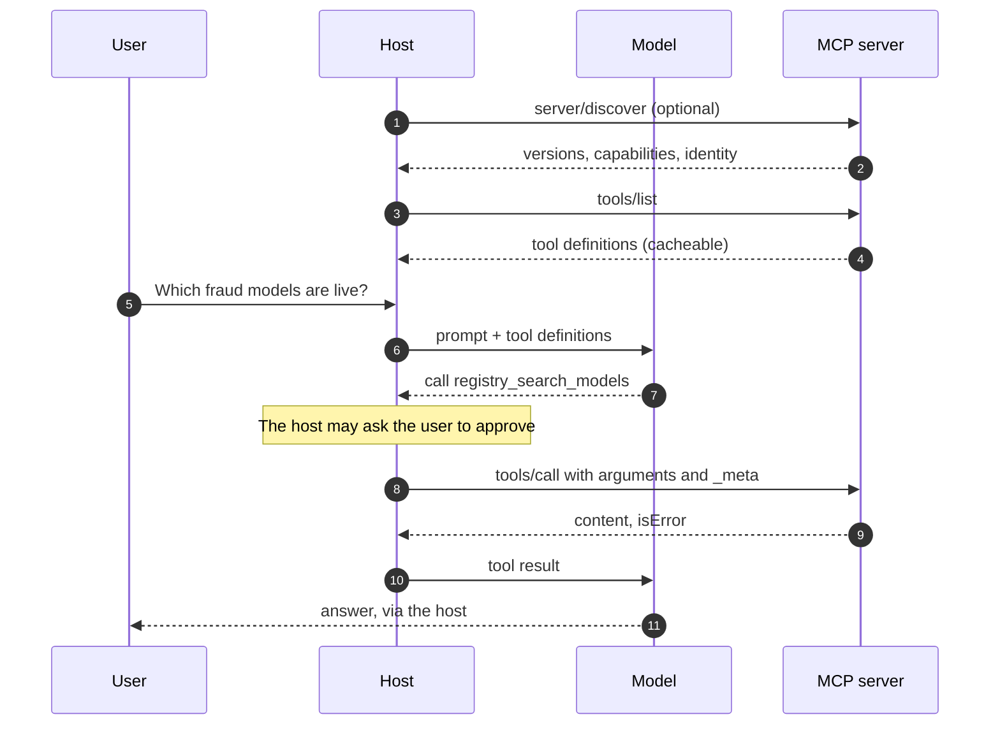
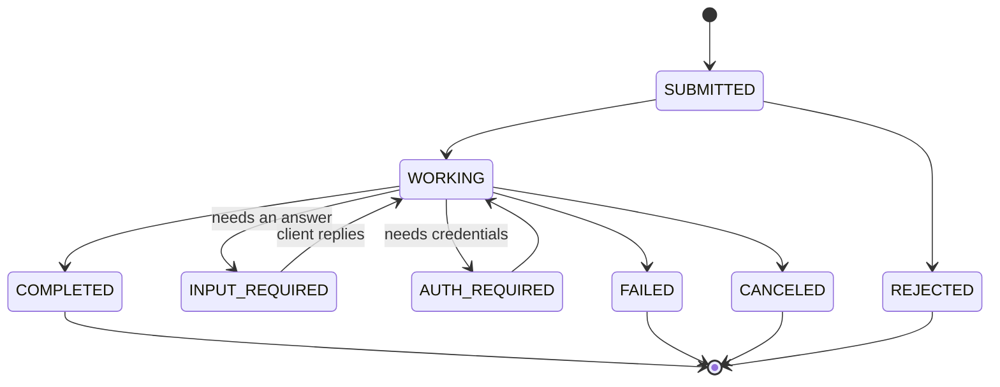
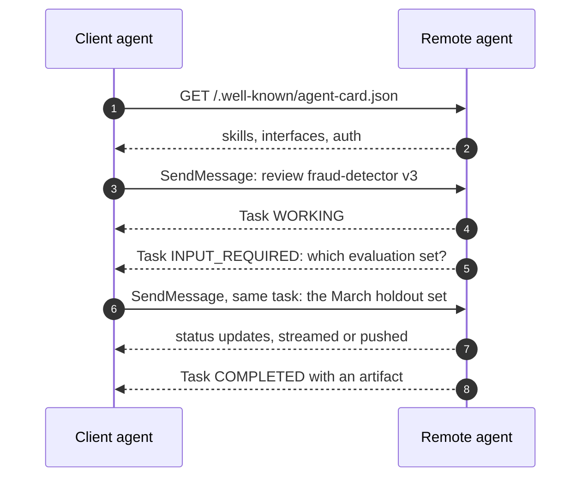
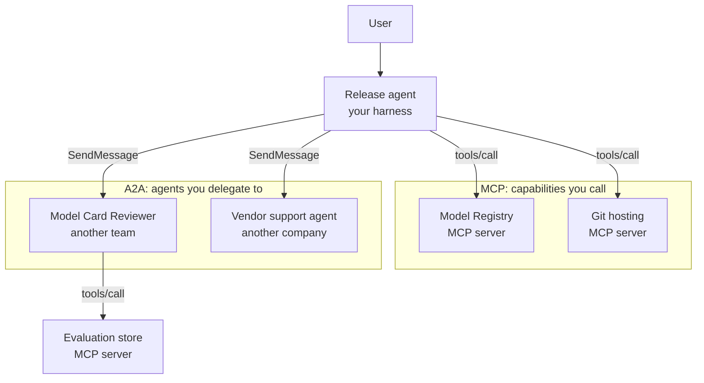
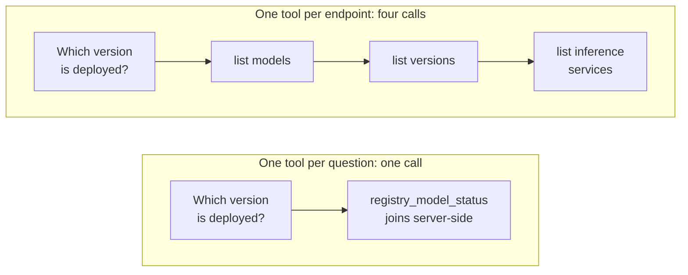

Every few weeks somebody asks me which one will win, MCP or A2A, as if they were two
browsers fighting for the same users. They aren't competing. They answer two different
questions, and the confusion comes from both having the word "agent" somewhere near them.

- The **Model Context Protocol** answers: _how does an agent use something?_ A database, an
  API, a file system, a registry of models.
- **Agent2Agent** answers: _how does an agent hand work to another agent that it can't see
  inside?_ Someone else's agent, with its own model, its own tools and its own idea of how
  to do the job.

The difference is **opacity**. An MCP tool shows you its schema and does exactly one thing
when you call it. An A2A agent shows you a list of skills and keeps everything else private:
you ask for an outcome, it decides how to get there, and it may come back an hour later with
a question.

This post covers what each one actually standardises, as of the specifications published
this year, how they fit together, and the part I think matters most day to day: how to
design an MCP server that a model can use well.

## What MCP standardises

MCP is JSON-RPC 2.0 between three roles. The **host** is the application the user talks to
(Claude Code, an IDE, your own harness). Inside it, one **client** per connection talks to
one **server**, which is the thing that exposes capabilities. The design borrows openly from
the Language Server Protocol: write the integration once, use it from every host.

A server can offer three primitives, and the useful way to tell them apart is _who decides
when they are used_:

| Primitive     | Controlled by   | What it is                                                  | Example                               |
| ------------- | --------------- | ----------------------------------------------------------- | ------------------------------------- |
| **Tools**     | The model       | Functions with a JSON Schema the model can choose to call   | `registry_search_models`              |
| **Resources** | The application | Data addressed by URI that the host can read into context   | `registry://models/fraud-detector`    |
| **Prompts**   | The user        | Templated messages, usually surfaced as slash commands      | `/release-notes`                      |

Most servers in the wild are tools-only, and that is fine. Resources earn their place when the
host has a good UI for attaching context; prompts when there is a workflow users trigger by
name.

There are two standard [transports](https://modelcontextprotocol.io/specification/2026-07-28/basic/transports):
**stdio**, where the host launches the server as a subprocess and exchanges newline-delimited
JSON-RPC, and **Streamable HTTP**, where every message is a POST to a single endpoint and the
reply is either a JSON object or a request-scoped SSE stream.

### What changed in the 2026-07-28 revision

The current revision is [2026-07-28](https://modelcontextprotocol.io/specification/2026-07-28/changelog),
and it is the biggest change to the protocol's shape since it appeared. If you learnt MCP a
year ago, these are the points to relearn:

- **It is stateless.** The `initialize` handshake and the `Mcp-Session-Id` header are gone.
  Every request carries its protocol version and client capabilities in `_meta`, and servers
  implement a `server/discover` method for clients that want to negotiate up front.
- **State is explicit.** A server that needs to remember something across calls (a cart, a
  browser context, a transaction) returns a handle from one tool and accepts it as an
  argument on the next. The spec's [guidance on stateful tools](https://modelcontextprotocol.io/specification/2026-07-28/server/tools)
  asks you to state the handle's lifetime in the tool description, so the model can see it.
- **Servers no longer send requests to the client.** When a tool needs more from the user, it
  returns an `input_required` result and the client retries the original call with the
  answers: the multi round-trip pattern.
- **Roots, Sampling and Logging are deprecated**, and long-running work moved to an optional
  **Tasks extension**.

That last point matters for this post: MCP now has its own idea of a long-running task, which
overlaps with A2A a little. I'll come back to it.

### Authorization

For HTTP servers, the [authorization spec](https://modelcontextprotocol.io/specification/2026-07-28/basic/authorization)
makes the MCP server an **OAuth 2.1 resource server**. It publishes Protected Resource
Metadata (RFC 9728) so the client can discover which authorization server to use; the client
asks for a token bound to that specific server with a resource indicator (RFC 8707); and the
server must check that every token was issued _for it_. It must not accept tokens meant for
someone else, and must not pass the client's token through to an upstream API. Client ID
Metadata Documents are now the preferred way for a client to register, and Dynamic Client
Registration is deprecated.

For stdio servers the answer is simpler: don't do OAuth, read credentials from the
environment.



Notice what the server never sees: the model, the conversation, the other servers. It gets a
name and some arguments. That narrowness is the whole point of a tool.

## What A2A standardises

[Agent2Agent](https://a2a-protocol.org/latest/specification/) started at Google, was given to
the Linux Foundation in 2025, and now sits in the Agentic AI Foundation next to MCP. Its
**1.0** specification is the first stable one. Where MCP describes a function call, A2A
describes a conversation about a piece of work between two agents that don't share memory,
tools or implementation.

It standardises four things.

**Discovery: the Agent Card.** A JSON document, conventionally served at
`/.well-known/agent-card.json`, that says who the agent is, which skills it offers, which
protocol bindings it speaks (JSON-RPC, gRPC or HTTP+JSON), and how to authenticate. It is
closer to an OpenAPI document for a person than to a tool schema: skills have descriptions,
tags and example requests, not parameter types.

```json title=".well-known/agent-card.json"
{
  "name": "Model Card Reviewer",
  "description": "Reviews a model version's card and evaluation results against the publishing checklist, and explains what is missing.",
  "version": "0.4.0",
  "provider": { "organization": "ML Platform team", "url": "https://platform.example.com" },
  "supportedInterfaces": [
    { "url": "https://reviewer.example.com/a2a/v1", "protocolBinding": "JSONRPC", "protocolVersion": "1.0" },
    { "url": "https://reviewer.example.com/a2a/json", "protocolBinding": "HTTP+JSON", "protocolVersion": "1.0" }
  ],
  "capabilities": { "streaming": true, "pushNotifications": true },
  "securitySchemes": {
    "oidc": {
      "openIdConnectSecurityScheme": {
        "openIdConnectUrl": "https://sso.example.com/.well-known/openid-configuration"
      }
    }
  },
  "securityRequirements": [{ "schemes": { "oidc": { "list": ["openid", "reviews"] } } }],
  "defaultInputModes": ["text/plain", "application/json"],
  "defaultOutputModes": ["text/markdown", "application/json"],
  "skills": [
    {
      "id": "review-model-card",
      "name": "Review a model card",
      "description": "Checks intended use, limitations, evaluation data and licence. Asks for missing information instead of guessing it.",
      "tags": ["model-registry", "governance", "review"],
      "examples": ["Review version 3 of fraud-detector before we publish it."]
    }
  ]
}
```

**Tasks.** Sending a message can create a **Task**, a stateful unit of work with an id, a
`contextId` that groups related tasks into one conversation, a status and a history. The
lifecycle is where A2A is most different from a tool call: a task can stop and ask.



**Messages and parts.** A message has a role (user or agent) and a list of **parts**, each of
which is text, raw bytes, a URL or arbitrary JSON data. The results of a task go into
**artifacts**, which are also made of parts. The spec is explicit that outputs belong in
artifacts, not in chat messages, which is a small rule that saves a lot of parsing.

**Operations and delivery.** `SendMessage`, `SendStreamingMessage`, `GetTask`, `ListTasks`,
`CancelTask` and `SubscribeToTask`, plus push-notification configs for tasks that take long
enough that holding a stream open is silly.



Over the HTTP+JSON binding, the first message is about as plain as it looks:

```http title="POST /a2a/json/message:send"
POST /a2a/json/message:send HTTP/1.1
Host: reviewer.example.com
Authorization: Bearer <token for reviewer.example.com>
A2A-Version: 1.0
Content-Type: application/json

{
  "message": {
    "messageId": "9f0c6a1e-3c1d-4f43-9a55-0b7f4d2e8c11",
    "role": "ROLE_USER",
    "parts": [{ "text": "Review version 3 of fraud-detector before we publish it." }]
  },
  "configuration": { "acceptedOutputModes": ["text/markdown"] }
}
```

## How they fit together

The spec itself has a section on this, and its framing is the one I use: MCP connects an
agent to tools and data; A2A connects agents to each other. A remote A2A agent will very
often be using MCP internally to do its job. You end up with a tree where the edges change
protocol depending on whether the thing at the other end is a capability or a colleague.



|                          | MCP                                          | A2A                                             |
| ------------------------ | -------------------------------------------- | ----------------------------------------------- |
| **Connects**             | An agent to tools, data and prompts          | An agent to another agent                       |
| **The other side shows** | Its full schema                              | Skills and examples; internals stay private     |
| **Who decides how**      | Your model picks the call; the tool executes | The remote agent plans its own steps            |
| **Unit of work**         | One call, usually seconds                    | A task that can run for hours and ask questions |
| **State**                | None in the protocol; explicit handles       | Tasks and contexts are first-class              |
| **Discovery**            | `tools/list` on a server you configured      | An Agent Card at a well-known URL               |
| **Auth**                 | OAuth 2.1 resource server; env vars on stdio | Security schemes declared in the card           |

> [!NOTE]
> The overlap is real. MCP's Tasks extension gives tools durable handles and mid-flight
> input, and nothing stops you wrapping a whole sub-agent as one MCP tool. If you own both
> ends, that is often simpler. A2A earns its place when the other agent belongs to someone
> else: another team, another vendor, another release cadence.

My rule of thumb: if I could write the tool's schema myself, it's MCP. If what I want to say
is "here is the goal, tell me when you're done or stuck", and someone else owns the thing that
does it, it's A2A. The patterns for wiring several agents together are a topic of their own,
in [agent orchestration patterns](/blog/agent-orchestration-patterns).

---

## Designing an MCP server a model can use

This is where most of the effort should go, and where most servers I've tried fall short. The
protocol is the easy part. The hard part is that your user is a language model reading your
tool list cold, every session, with a limited budget of attention.

Anthropic's engineering posts on [building effective agents](https://www.anthropic.com/engineering/building-effective-agents)
and [writing tools for agents](https://www.anthropic.com/engineering/writing-tools-for-agents)
are the best practical guidance I know. What follows is how I apply them.

### Shape tools around tasks, not endpoints

The tempting first version of an MCP server is a generator: point it at an OpenAPI document
and get one tool per endpoint. For the Kubeflow Model Registry REST API that would be dozens of
tools (`get_registered_models`, `get_registered_model`, `get_model_versions`,
`get_model_version_artifacts`…) and the model would have to learn the data model from their
names before it could answer "which version of fraud-detector is in production?".

A better server has a few tools shaped like the questions people ask, and does the joins
itself.



### Don't expose 80 tools

Every tool definition is paid for in context, on every turn, whether it is used or not. In
Anthropic's [advanced tool use](https://www.anthropic.com/engineering/advanced-tool-use) post,
a GitHub server with 35 tools takes around 26K tokens before the conversation starts. Hosts
are adapting (deferred loading and tool search let a model fetch definitions on demand) but
that doesn't make a bloated server good; it makes it searchable.

What I do instead:

- **Start with three to eight tools** and add one only when a real session shows it missing.
- **Namespace them** (`registry_search_models`, `registry_list_versions`), because hosts mix
  tools from several servers and two servers will both have a `search`.
- **Split read and write servers** when the write side is dangerous, so a user can install
  the read-only one without thinking about it.
- **Return tools in a deterministic order.** The new revision recommends it, and it keeps the
  prompt cache warm.

How much of the context window your tools should be allowed to take is part of
[context engineering](/blog/context-engineering).

### The description is a prompt

The model does not read your code. It reads the name, the description and the schema, and
that is all it will ever know about the tool. Write the description for a capable new colleague
who has never seen your system: what it does, when to use it instead of the tool next to it,
what the arguments mean, what comes back, and how to get the next page. Every `.describe()` on
a field ends up in the JSON Schema the model sees, so use them.

### Errors are instructions

The spec separates two kinds of failure. **Protocol errors** (unknown tool, malformed request)
are JSON-RPC errors the model rarely recovers from. **Tool execution errors** are ordinary
results with `isError: true`, and the client is expected to show them to the model so it can
correct itself. That makes the error text part of your interface. "Error 400" teaches nothing;
"`query` can't contain quotes; search for a shorter fragment of the name" gets you a correct
second call.

The same goes for empty results. "No LIVE models match 'frud'. Try a shorter fragment, or
`state: ARCHIVED`" is a better answer than `[]`.

### Paginate, and keep responses small

A tool that returns 4,000 rows has used up the model's attention on 3,990 rows it didn't need.
Default to a small `limit`, return a `cursor` when there is more, and say in the description
how to use it. Return the fields that help the next decision (names, states, owners), not
every column. Anthropic's tools post suggests a `response_format` argument with `concise` and
`detailed` modes for the cases where the model genuinely needs the long form.

### Auth: the server can't do more than the user

On HTTP, the server validates tokens issued for it and calls upstream APIs with credentials it
obtained itself, never by forwarding the client's token. On stdio, it reads a token from the
environment and so acts with the permissions of whoever launched it. Either way, the property I
want is the one from [a BFF per module](/blog/bff-per-module-go): the tool can't do anything
the user couldn't do directly. Tool annotations like `readOnlyHint` help the host decide what
to auto-approve, but the spec says to treat them as untrusted unless the server is, and
descriptions are a well-known place to hide instructions. More on that in
[agent security](/blog/agent-security).

> [!WARNING]
> A tool description is text that goes straight into the model's context. Installing an MCP
> server is closer to installing a dependency that writes part of your prompt than to adding
> an API key. Read it before you trust it.

### A small, real server

Here is the search tool of a read-only Model Registry server, written against the v2
TypeScript SDK (`@modelcontextprotocol/server`), which implements the 2026-07-28 revision. The
REST calls are the registry's real `v1alpha3` API. First, a thin client and the two result
helpers:

```ts title="src/registry.ts"
const API = `${process.env.MODEL_REGISTRY_URL}/api/model_registry/v1alpha3`;
const TOKEN = process.env.MODEL_REGISTRY_TOKEN; // stdio: credentials come from the environment

export class RegistryError extends Error {
  constructor(readonly status: number) {
    super(`Model Registry returned HTTP ${status}`);
  }
}

export async function registry<T>(
  path: string,
  params: Record<string, string>,
): Promise<T> {
  const url = new URL(API + path);
  for (const [key, value] of Object.entries(params)) url.searchParams.set(key, value);
  const res = await fetch(url, {
    headers: TOKEN ? { Authorization: `Bearer ${TOKEN}` } : {},
  });
  if (!res.ok) throw new RegistryError(res.status);
  return (await res.json()) as T;
}

export const ok = (data: unknown) => ({
  content: [{ type: "text" as const, text: JSON.stringify(data) }],
});
export const fail = (text: string) => ({
  content: [{ type: "text" as const, text }],
  isError: true,
});
```

Then the tool definition. Everything the model will know is in this block:

```ts title="src/server.ts" {8-13,20}
import { McpServer } from "@modelcontextprotocol/server";
import { serveStdio } from "@modelcontextprotocol/server/stdio";
import * as z from "zod/v4";
import { registry, RegistryError, ok, fail } from "./registry.js";

const searchModels = {
  title: "Search registered models",
  description: [
    "Find registered models whose name contains `query` (case-insensitive).",
    "Returns at most `limit` models, newest first, and a `cursor`",
    "when there are more: pass it back unchanged for the next page.",
    "To see a model's versions, call registry_list_versions with its `id`.",
  ].join(" "),
  inputSchema: z.object({
    query: z.string().min(2).describe("Part of the model name, e.g. 'fraud'"),
    state: z.enum(["LIVE", "ARCHIVED"]).default("LIVE"),
    limit: z.number().int().min(1).max(25).default(10),
    cursor: z.string().optional().describe("The cursor from a previous call"),
  }),
  annotations: { readOnlyHint: true, openWorldHint: false },
};
```

And the handler, where most of the lines are about failing usefully:

```ts title="src/server.ts" {5-7,27-32}
type Model = { id: string; name: string; owner?: string; state?: string };
type Args = z.infer<typeof searchModels.inputSchema>;

async function handleSearch({ query, state, limit, cursor }: Args) {
  if (query.includes("'")) {
    return fail("`query` cannot contain quotes. Search a shorter part of the name.");
  }
  try {
    const page = await registry<{ items: Model[]; nextPageToken: string }>(
      "/registered_models",
      {
        filterQuery: `name ILIKE '%${query}%' AND state='${state}'`,
        pageSize: String(limit),
        orderBy: "LAST_UPDATE_TIME",
        sortOrder: "DESC",
        ...(cursor ? { nextPageToken: cursor } : {}),
      },
    );
    const models = page.items.map(({ id, name, owner }) => ({ id, name, owner }));
    if (models.length === 0) {
      const hint = `No ${state} models match '${query}'. Try a shorter fragment.`;
      return ok({ models, hint });
    }
    return ok({ models, cursor: page.nextPageToken || null });
  } catch (err) {
    if (!(err instanceof RegistryError)) throw err;
    if (err.status === 401 || err.status === 403) {
      return fail(`Registry refused the request (HTTP ${err.status}). ` +
        "Retrying will not help: tell the user their token lacks access.");
    }
    return fail(`Registry unavailable (HTTP ${err.status}). ` +
      "Retry once; if it fails again, tell the user.");
  }
}
```

Wiring it up is the short part:

```ts title="src/server.ts"
function createServer() {
  const server = new McpServer({ name: "model-registry", version: "0.1.0" });
  server.registerTool("registry_search_models", searchModels, handleSearch);
  // registry_list_versions and registry_model_status follow the same shape.
  return server;
}

serveStdio(createServer, { onerror: (error) => console.error(error) });
```

A few details are deliberate. `createServer` is a factory because `serveStdio` builds a new
instance when it needs one, which is how the same binary answers both current clients and
older ones that still open with `initialize`. The schema caps `limit` at 25, and if the model
asks for 999 the SDK returns an `isError` result explaining the bound before my handler runs.
The quote check exists because the filter is a SQL-like string; a real server would escape
rather than refuse, but refusing with a reason is still better than a 400. And the two error
messages say whether a retry can help, because that is the decision the model has to make
next.

To check it, the MCP Inspector's CLI lists tools against both protocol eras
(`--protocol-era modern` and `legacy`), which catches the classic mistake of a server that only
works with last year's clients.

## When not to

Neither protocol is a reason to build something.

**You may not need MCP.** If one application calls one API with three fixed functions, the
model provider's native tool calling is less machinery. MCP pays off when the same
integration has to work in several hosts, or when you want users to install it themselves.

**You probably don't need A2A yet.** Inside one codebase, owned by one team, a sub-agent is a
function call, or at most an MCP tool. A2A adds discovery, a task lifecycle and another
authentication boundary, which is exactly what you want between organisations and pure
overhead within one.

> [!IMPORTANT]
> Neither protocol makes a remote party trustworthy. An Agent Card is a claim, a tool
> description is untrusted text, and a remote agent's artifact is input you didn't write.
> Validate what comes back as you would any other external data.

And both are moving. MCP changed its shape this year and deprecated features with a
twelve-month window; A2A only reached 1.0 this year. Pin the protocol version you test
against, and read the changelog before you upgrade the SDK.

## Further reading

- [MCP specification, 2026-07-28](https://modelcontextprotocol.io/specification/2026-07-28): the
  current revision. Start with the [changelog](https://modelcontextprotocol.io/specification/2026-07-28/changelog)
  if you knew the 2025 versions; the stateless redesign changes a lot of tutorials.
- [MCP tools specification](https://modelcontextprotocol.io/specification/2026-07-28/server/tools):
  short and worth reading in full, especially the sections on stateful tools and error handling.
- [MCP authorization](https://modelcontextprotocol.io/specification/2026-07-28/basic/authorization):
  the OAuth flow, audience validation and the ban on token passthrough, with a full sequence
  diagram.
- [A2A specification](https://a2a-protocol.org/latest/specification/): the 1.0 spec. The Agent
  Card example and the appendix on how A2A relates to MCP are the parts to read first.
- [TypeScript SDK](https://github.com/modelcontextprotocol/typescript-sdk): the v2 SDK used in
  the example, with guides for tools, errors and testing a server in memory.
- [Writing effective tools for agents](https://www.anthropic.com/engineering/writing-tools-for-agents):
  Anthropic's guide to tool design: consolidation, namespacing, response size and error
  messages. Most of the design section above is applied from here.
- [Building effective agents](https://www.anthropic.com/engineering/building-effective-agents):
  the appendix on prompt-engineering tools (the agent-computer interface) is the shortest
  argument I know for treating tool descriptions as seriously as prompts.
