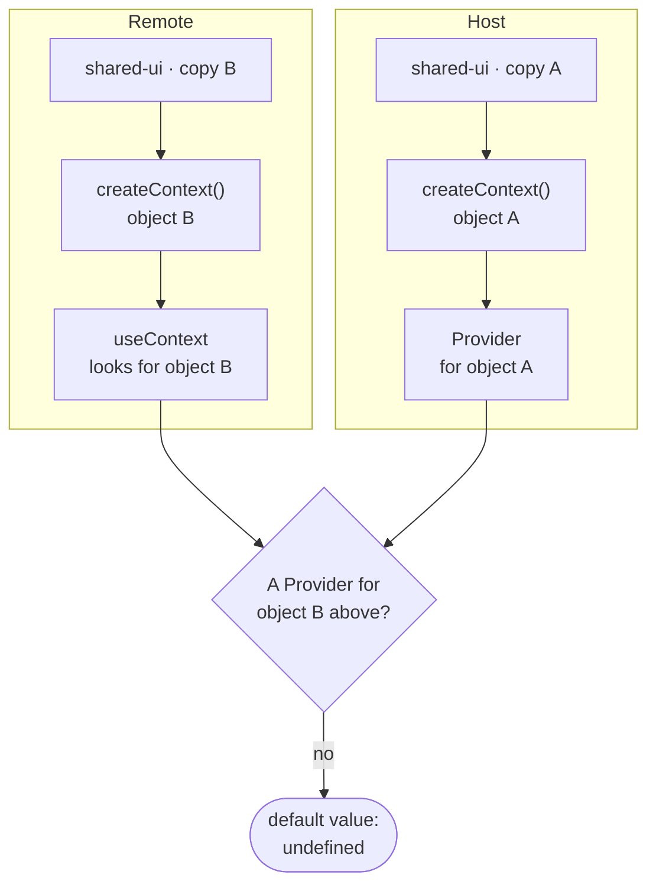
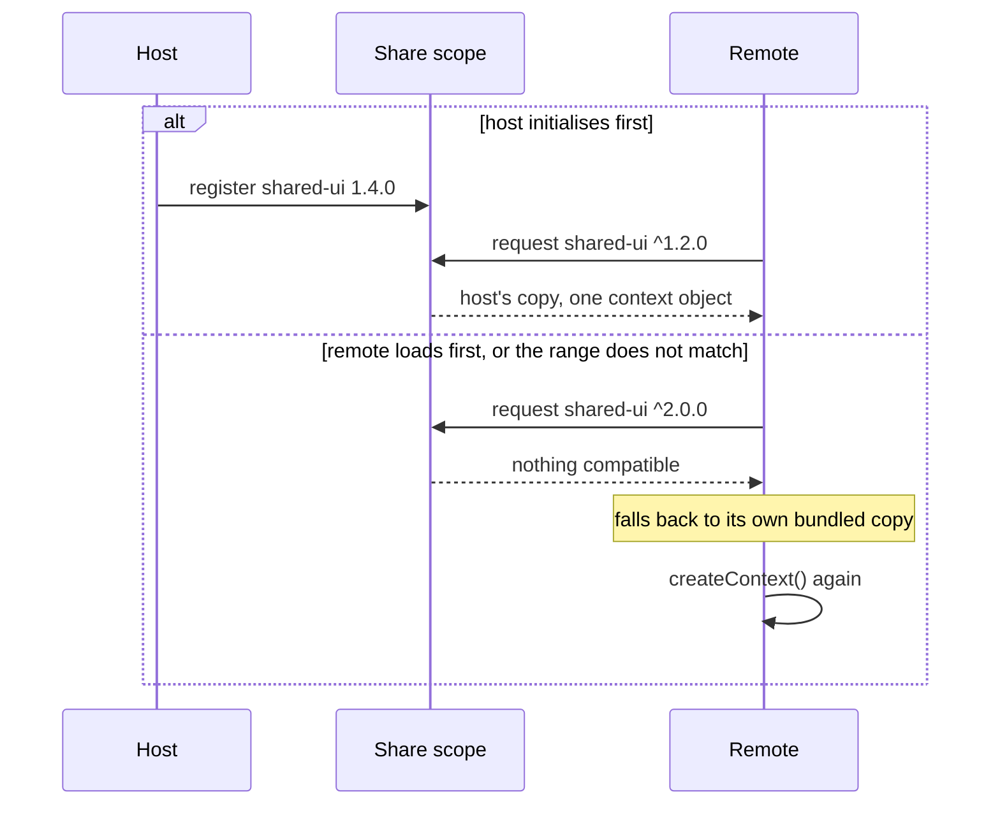

This is from early 2026 and follows on from
[Module Federation](/blog/module-federation-kubernetes).

## The symptom

The user picks a project in the navigation. They enter a federated module and
the module does not know which project they picked: its selector is empty, or
worse, shows something else.

What makes it disorienting is that everything else works. Same React, same page,
apparently one component tree. The `Provider` is clearly above the component
reading it. And `useContext` still returns the default.

## Why it happens

React context is not looked up by name: it is looked up by **object identity**.
`createContext()` returns an object, and `useContext(MyContext)` walks up the
tree looking for a `Provider` whose context is *that exact object*.

```tsx title="shared-ui/src/ProjectContext.tsx"
// Identity, not name: every copy of this file makes a new object.
export const ProjectContext = React.createContext<Project | undefined>(undefined);
```

With Module Federation, the host and the remote can end up loading separate
copies of the module that defines the context. Two calls to `createContext()`,
two objects, and the remote's `useContext` looks for a provider that, from where
it stands, does not exist.

> [!WARNING]
> It does not throw. It returns the default value, which is almost always
> `undefined` or an empty object. That is why the symptom looks like a data
> problem rather than a module-loading one.



## The first thing to rule out

That the package is genuinely shared. In the federation config, both React and
the library defining the context have to be declared `singleton`. If that is
missing, there really are two copies and the rest of the investigation is moot.

```js {3}
shared: {
  react: { singleton: true, requiredVersion: "^18.0.0" },
  "@scope/shared-ui": { singleton: true },
}
```

But sharing correctly is **not always enough**. If the remote loads before the
host has initialised the share scope, or if versions do not satisfy the declared
range, federation silently resolves to its own copy. The same code works in
development and fails deployed, which is the most irritating way to fail.



## The stopgap, and why it is not enough

The first thing we did was take the value out of context and put it in
`localStorage`, with an event to notify changes. It works, it unblocks, and it
has three problems worth saying out loud:

```ts
// The stopgap: global to the origin, text only, no owner.
localStorage.setItem("selectedProject", projectName);
window.dispatchEvent(new Event("selectedProject:changed"));
```

- **It is global to the origin.** Two tabs share the value, even when the user
  wants to be looking at two different projects.
- **It is text.** Everything passing through is serialised, and live objects —
  functions, instances — do not fit.
- **It has no owner.** Any module can write any key. A few months in, nobody
  knows who sets what.

It is an honest sticking plaster. The mistake would be calling it architecture.

## Where it goes

What actually resolves this is an explicit store for crossing boundaries: a
small object, created once by the host, hung somewhere every module can reach
without going through the module system. With a deliberately poor API — read,
write, subscribe — and a closed set of keys that are documented.

```ts
// A sketch of the shape, not a library.
type SharedKeys = {
  selectedProject: string | undefined;
  namespace: string;
};

interface BoundaryStore {
  get<K extends keyof SharedKeys>(key: K): SharedKeys[K];
  set<K extends keyof SharedKeys>(key: K, value: SharedKeys[K]): void;
  subscribe<K extends keyof SharedKeys>(key: K, fn: () => void): () => void;
}

// Created once by the host, reached without going through the module system.
window.__boundaryStore ??= createBoundaryStore();
```

| | Context | `localStorage` + event | Explicit store |
| --- | --- | --- | --- |
| **Survives two copies of the library** | No | Yes | Yes |
| **Scope** | One React tree | Whole origin, every tab | One page |
| **Live objects** | Yes | No, text only | Yes |
| **Who may write** | The provider | Anyone, any key | Anyone, documented keys |

> [!IMPORTANT]
> The important part is not technical. It is that **what crosses the boundary has
> to be a short, written-down list**. The moment any module can share anything,
> you have rebuilt the global state micro-frontends set out to avoid, only now
> distributed and untyped.

## What I take from it

That a module boundary is not only a deployment boundary. It is an identity
boundary: two copies of the same code are two different things to JavaScript,
even when they are byte-identical.

And that failures returning a default instead of throwing cost the most time. A
loud error takes you to the place; a silent `undefined` takes you to search in
the wrong place for two days.
