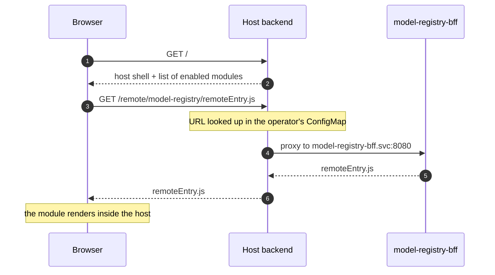
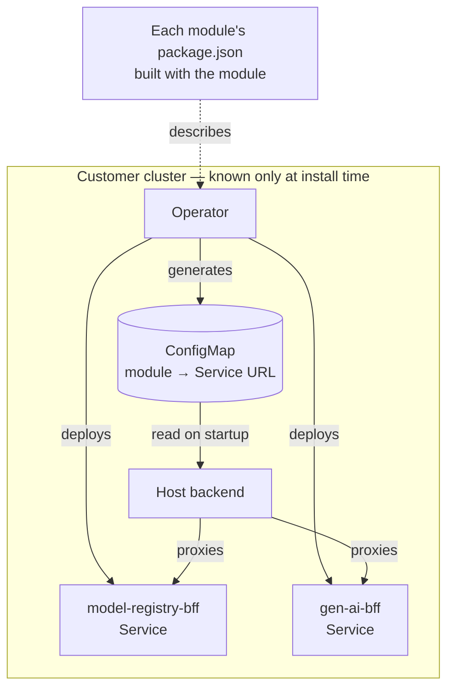

This describes 2025 work on the Open Data Hub dashboard, which is public:
[`odh-dashboard`](https://github.com/opendatahub-io/odh-dashboard).

## What it solves, and what it does not

Module Federation lets an application load, at runtime, code compiled by another
one. The host does not know the remote module at build time; it discovers it on
startup, fetches its `remoteEntry.js`, and from then on can render its
components as if they were its own.

That solves an **organisational** problem, not a technical one: ten teams
wanting to ship their part of a console without coordinating on a shared
release. If what you have is one team and a monolith that works, Module
Federation adds complexity in exchange for nothing. Worth saying up front,
because it is the decision I have most often seen made for the wrong reason.

## The familiar part

The host declares which remotes it expects and which dependencies it shares:

```js {5-6}
new ModuleFederationPlugin({
  name: "host",
  remotes: { modelRegistry: "modelRegistry@/remote/model-registry/remoteEntry.js" },
  shared: {
    react: { singleton: true, requiredVersion: "^18.0.0" },
    "react-dom": { singleton: true, requiredVersion: "^18.0.0" },
  },
});
```

`singleton: true` on React is not optional. Two copies of React on one page
means two hook trees and errors that appear unrelated to anything. It is
everybody's first stumble.

## The part nobody mentions

In that example the remote's URL is written into the code. In a product that
deploys into somebody else's cluster, that URL **cannot be known at build
time**. It depends on which modules that customer installed, which namespace
they are in, and what their services are called.

Two pieces resolve it.

**First, discovery.** Each module declares what it is in its own `package.json`,
under a `module-federation` field: its name, its entry point, what it exposes.
Putting it there rather than in a separate registry means the module's
description travels with the module and cannot go stale relative to it.
Roughly:

```json
{
  "name": "@odh-dashboard/model-registry",
  "module-federation": {
    "name": "modelRegistry",
    "remoteEntry": "/remoteEntry.js",
    "exposes": { "./extensions": "./extensions.ts" }
  }
}
```

**Second, runtime resolution.** The operator that installs the modules knows
which ones are enabled in this cluster and what `Service` each one has. From
that it generates a ConfigMap the host reads on startup:

```yaml
# generated by the operator, never hand-written
modelRegistry: "http://model-registry-bff.redhat-ods-applications.svc:8080"
genAi:         "http://gen-ai-bff.redhat-ods-applications.svc:8080"
```

The host does not resolve those URLs in the browser: it uses them to proxy from
its own backend. The browser talks to one origin, and internal cluster addresses
never leave the cluster.



> [!IMPORTANT]
> What makes this work is that **whoever knows the topology is whoever generates
> the configuration**. The operator is the only component with that information,
> so the config is produced where the knowledge lives instead of asking every
> module team to maintain it.



## What it actually costs

**Shared dependencies are a contract.** The moment you declare `shared`, you
have coupled every module's versions. A team wanting to move from React 18 to 19
cannot do it alone.

> [!WARNING]
> Module Federation buys you deployment independence, not dependency
> independence, and conflating the two hurts later.

**Debugging crosses a boundary.** A stack trace that starts in the host and ends
in a remote passes through code built by another pipeline with different source
maps. It pays to invest early in making module names show up in errors.

**Failure has to be designed.** If a `remoteEntry.js` does not answer, the
default outcome is that the whole console fails to load. That is worse than the
monolith you set out to fix. Every remote needs its own error boundary: the
failing module disappears from navigation and the rest carries on.

```tsx
const ModelRegistry = React.lazy(() => import("modelRegistry/extensions"));

// One boundary per remote: if it fails, only it disappears.
<ErrorBoundary fallback={null} onError={() => hideFromNav("modelRegistry")}>
  <React.Suspense fallback={<Spinner />}>
    <ModelRegistry />
  </React.Suspense>
</ErrorBoundary>
```

## When it is worth it

When the number of teams that need to ship without colliding is the problem
keeping you up. If your problem is something else — performance, bundle size,
organising the code — there are cheaper answers, and starting with those is
almost always the right call.
