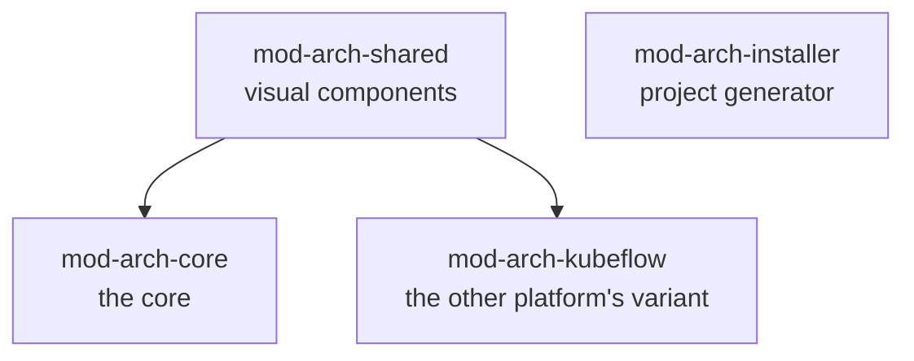
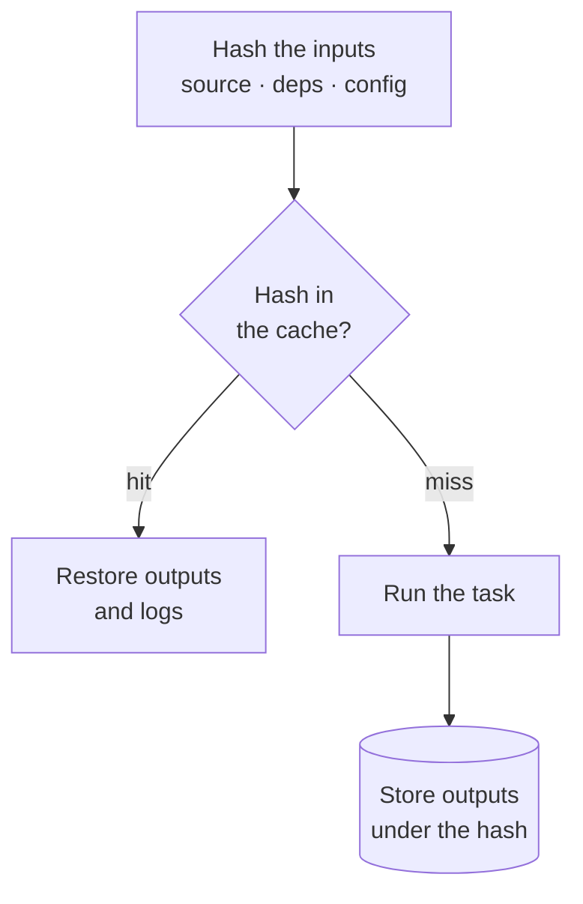
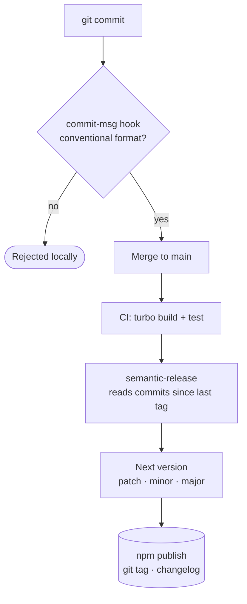
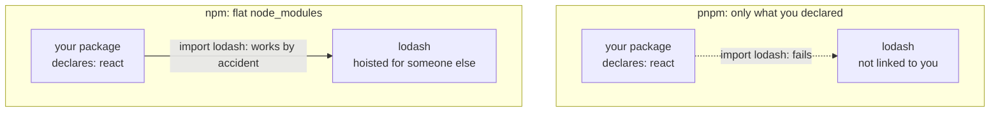

This is from 2025 and lives in the open in
[`mod-arch-library`](https://github.com/opendatahub-io/mod-arch-library).

## Why a monorepo and not four repositories

The shared library ended up as four packages: the core, the visual components,
the variant for another platform, and a project generator. They use each other.



With four repositories, changing something in the core and finding out whether
it breaks the others means publishing a test version, updating it in the other
three, running their tests and unwinding if it fails. Half an hour for a
question that should cost thirty seconds.

In a monorepo that question is one command. That is the entire justification:
**the monorepo exists so that a change and its consequence are visible
together.** Everything else — shared config, one lint setup — is pleasant and
would not have been enough.

## Turbo, and what it is actually for

Turbo orchestrates tasks while understanding the dependency graph between
packages. You declare that building a package depends on building the ones it
depends on:

```json title="turbo.json" {3}
{
  "tasks": {
    "build": { "dependsOn": ["^build"], "outputs": ["dist/**"] },
    "test":  { "dependsOn": ["build"] },
    "lint":  {}
  }
}
```

That `^build` does the work: it builds dependencies first, in order, and
parallelises whatever depends on nothing.

```mermaid title="turbo run build: dependencies first, the rest in parallel"
flowchart LR
  subgraph w1["Wave 1 — in parallel"]
    CO["core"]
    KF["kubeflow"]
    IN["installer"]
  end
  subgraph w2["Wave 2"]
    SH["shared"]
  end
  CO --> SH
  KF --> SH
```

But the main value is not parallelism. It is the **cache**: if a package's
inputs have not changed, its task does not run again and the previous result is
restored. On a change touching one package, the difference between rebuilding
everything and rebuilding one thing is the difference between a pipeline people
wait for and a pipeline people avoid.



> [!WARNING]
> For that to work you have to declare `outputs` correctly. Miss a generated
> directory and the cache restores it incomplete, producing failures that only
> happen in CI. It is the classic mistake, and it is worth distrusting the cache
> the first time something does not add up.

## Publishing without thinking about versions

The second half is semantic-release. The version is not decided by a person: it
is decided by the commit history.

| Commit | Release | Version |
| --- | --- | --- |
| **`fix: correct the client on retry`** | Patch | 1.2.3 → 1.2.4 |
| **`feat: add the project selector`** | Minor | 1.2.4 → 1.3.0 |
| **`feat!: change the createClient signature`** | Major | 1.3.0 → 2.0.0 |



The effect was not what I expected. What I thought I was gaining was time; what
I gained was **honesty**. When a person sets the version at the end, breaking
changes slip through as minor ones, because nobody wants to be the one shipping
a major on a Thursday. When the commit sets it, the moment you decide whether
something breaks is while you are writing it, which is when you know.

> [!IMPORTANT]
> The cost is that commit format stops being style and becomes contract. It has to
> be validated in a pre-commit hook, or the day somebody writes "various fixes"
> nothing publishes and nobody understands why.

## The move to pnpm, and what it taught

Late in 2025 we moved from npm to pnpm with Corepack. The usual reasons — faster
installs, less disk through hard links — were true and were not the point.

The point is that **pnpm does not flatten the dependency tree**. With npm, a
package can import something it never declared and it works, because the thing
happens to be hoisted. That mistake stays invisible until you publish and
somebody installs without that coincidence. pnpm breaks locally what npm broke
at the user's house.



The migration found three undeclared dependencies. Three time bombs that were
already published.

And Corepack, which is the dull part: it pins the exact package manager version
in `package.json`:

```json title="package.json"
{
  "packageManager": "pnpm@10.0.0"
}
```

Without it, the lockfile depends on which pnpm each person has
installed, and you have "works on my machine" back in a new place.

## What I take from it

That these tools do not make you faster: they take decisions away. Which version
number is next, what order to build in, whether a rebuild is needed. Decisions
that add nothing and that, made by hand a hundred times, get made wrong at least
once.
