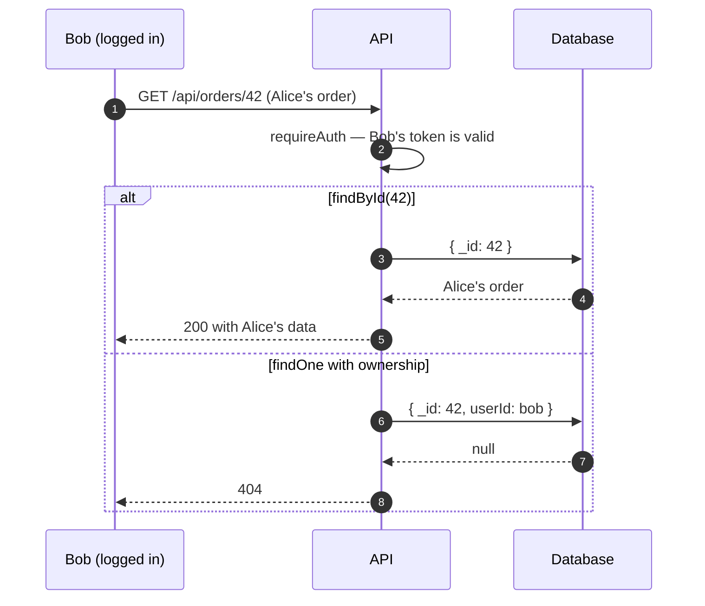
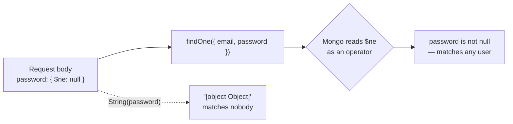
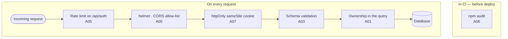

The OWASP Top 10 often reads as a list of abstractions. In an ordinary Node and React application, nearly every category boils down to a few very recognisable lines of code.

## A01 · Broken access control

The number one category by frequency, and it almost always has the same shape: the server checks **that you're authenticated** but not **that the resource is yours**.



```diff title="src/routes/orders.js"
  app.get("/api/orders/:id", requireAuth, async (req, res) => {
-   // Vulnerable: any authenticated user reads any order
-   const order = await db.orders.findById(req.params.id);
+   // Fixed: ownership is part of the query
+   const order = await db.orders.findOne({
+     _id: req.params.id,
+     userId: req.user.id,
+   });
+   if (!order) return res.sendStatus(404);
    res.json(order);
  });
```

Returning 404 rather than 403 is deliberate: a 403 confirms the resource exists.

> [!WARNING]
> **Hiding a button in the front end is not access control.** The client is the attacker's territory. Any check that matters belongs on the server.

## A03 · Injection

SQL, NoSQL and shell commands all share a root cause: concatenating user input into something that will later be interpreted.

```diff
- // Vulnerable
- db.query(`SELECT * FROM users WHERE email = '${email}'`);
+ // Fixed: query and data travel separately
+ db.query("SELECT * FROM users WHERE email = ?", [email]);
```

MongoDB has a variant that surprises people, because no strange string is needed. If the body arrives as `{"password": {"$ne": null}}`, this authenticates anyone:



```diff
- // Vulnerable
- const user = await User.findOne({ email, password });
+ // Fixed: coerce the type before querying
+ const user = await User.findOne({
+   email: String(email),
+   password: String(password),
+ });
```

The structural defence is validating the schema at the edge, with Zod or Joi, and rejecting what doesn't fit instead of trying to clean it up:

```js title="src/routes/auth.js" {3-6}
import { z } from "zod";

const Login = z.object({
  email: z.email(),
  password: z.string().min(1).max(200),
});

app.post("/api/auth/login", async (req, res) => {
  const parsed = Login.safeParse(req.body);
  if (!parsed.success) return res.sendStatus(400); // { $ne: null } stops here
  const { email, password } = parsed.data;
  // …
});
```

### XSS in React

React escapes content by default, so classic XSS doesn't apply. Two gaps remain:

```jsx
// 1. dangerouslySetInnerHTML — the name is the warning
<div dangerouslySetInnerHTML={{ __html: comment }} />
// If you must render HTML, sanitise first:
<div dangerouslySetInnerHTML={{ __html: DOMPurify.sanitize(comment) }} />

// 2. User-controlled URLs
<a href={userUrl}>Profile</a>
// javascript:alert(1) executes on click
```

For the second case, validate the protocol:

```js title="src/utils/safeUrl.js" {4}
function safeUrl(value) {
  try {
    const url = new URL(value);
    return ["http:", "https:"].includes(url.protocol) ? url.href : "#";
  } catch {
    return "#";
  }
}
```

## A02 · Cryptographic failures

Two mistakes that keep appearing: storing passwords with a fast hash, and comparing secrets with `===`.

```diff
- // Vulnerable: SHA-256 is designed to be fast, which is exactly what you don't want
- const hash = crypto.createHash("sha256").update(password).digest("hex");
+ // Fixed: an algorithm with an adjustable cost
+ const hash = await bcrypt.hash(password, 12);
+ const ok = await bcrypt.compare(password, hash);
```

`bcrypt.compare` is also constant-time. Comparing tokens with `===` leaks information through response timing; that's what `crypto.timingSafeEqual` is for:

```js
import { timingSafeEqual } from "node:crypto";

function sameSecret(a, b) {
  const x = Buffer.from(a);
  const y = Buffer.from(b);
  // timingSafeEqual throws on different lengths, so check that first
  return x.length === y.length && timingSafeEqual(x, y);
}
```

## A05 · Security misconfiguration

The cheap and effective part, in three lines:

```js title="src/app.js" {4-6}
import helmet from "helmet";
import rateLimit from "express-rate-limit";

app.disable("x-powered-by");             // stop advertising the stack
app.use(helmet());                        // security headers
app.use("/api/auth", rateLimit({ windowMs: 15 * 60_000, max: 10 }));
```

Rate limiting the authentication endpoints is the difference between a weak password that holds and one that falls to an afternoon of brute force.

And `cors()` with no arguments allows any origin. List yours:

```diff
- app.use(cors());
+ app.use(cors({ origin: ["https://myapp.com"], credentials: true }));
```

## A07 · Identification and authentication failures

The eternal argument about where to keep the JWT has a reasonable answer: in a cookie, not in `localStorage`.

```js {2,4}
res.cookie("token", jwt, {
  httpOnly: true,   // JavaScript can't read it, so XSS can't steal it
  secure: true,     // HTTPS only
  sameSite: "lax",  // mitigates CSRF
  maxAge: 3600_000,
});
```

`localStorage` is readable by any script on the page, including one that arrives through a compromised dependency. `httpOnly` puts the cookie out of JavaScript's reach, at the cost of having to think about CSRF — which is what `sameSite` addresses. The [JWT article](/blog/jwt-auth-cookies) walks through both attacks.

## A06 · Vulnerable components

The easiest category to handle and the most neglected:

```bash
npm audit
npm audit fix
```

On this very site, `npm audit` went from 39 vulnerabilities to zero, and one of them came from an `overrides` entry pinning a **vulnerable** version of a transitive dependency.

> [!CAUTION]
> Look at what's in `overrides` before trusting the result: a dependency chain is only as secure as the oldest pin somebody left in it.

## The minimum viable set

If you can only do five things: validate input with a schema at the edge, put resource ownership in the query, add `helmet` and rate limiting on auth, use `httpOnly` `sameSite` cookies, and run `npm audit` in CI. That covers most of the real risk in an ordinary web application, and all of it fits in an afternoon.


