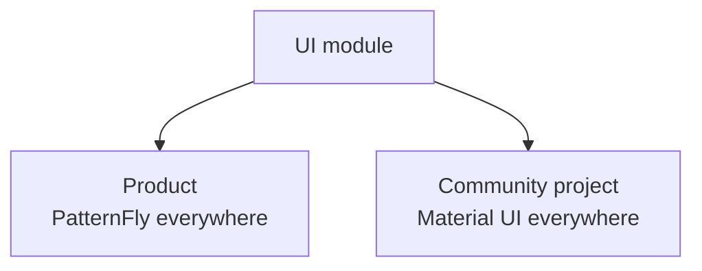
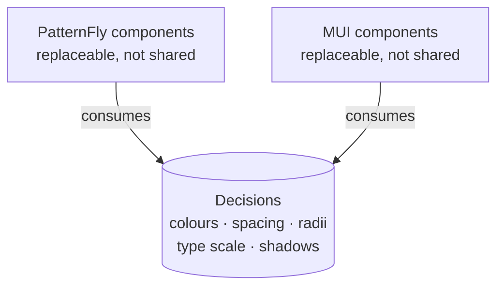
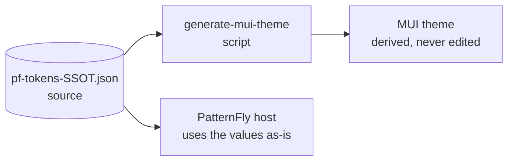
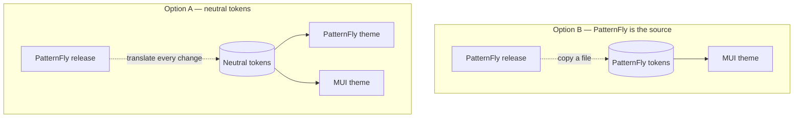
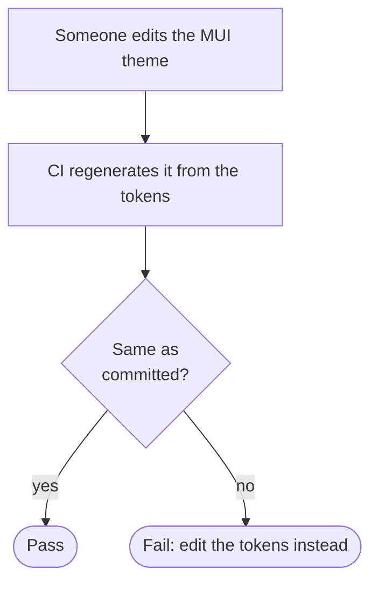

This work is from late 2024 and lives in the open in
[`mod-arch-library`](https://github.com/opendatahub-io/mod-arch-library).

## The problem

A UI module that deploys into two places. In one, the product uses PatternFly
and everything around it is PatternFly. In the other, the community project uses
Material UI and everything around it is MUI. The module is the same in both, and
in both it has to look like it always belonged there.



The obvious ways out are all bad:

- **Maintain two branches of the module.** They diverge in week two.
- **Wrap everything in your own components.** You end up with a third design
  system that resembles neither and that you now maintain.
- **Pick one and let it show in the other.** The honest option, and the one
  everybody wants to avoid, because a module that clashes reads as lower quality
  even when it works better.

## What we did

Separate the design **decisions** from their **implementation**.

A design system has two layers we tend to conflate. Underneath are the
decisions: which grey a secondary text uses, how much a medium spacing
separates, what radius a card has, how the type scale steps. On top are the
components that consume them. The lower layer is what actually defines how a
product looks, and it is surprisingly small.



So that layer becomes a file: a token JSON holding PatternFly's values, declared
as the single source. A script generates the theme object MUI expects from it.



The source is just PatternFly's own variables, captured as data:

```json title="mod-arch-kubeflow/style/pf-tokens-SSOT.json"
{
  "components": {
    "_index": {
      "--pf-v6-c-about-modal-box--BackgroundColor": "var(--pf-t--global--background--color--floating--default)",
      "--pf-v6-c-about-modal-box__brand--PaddingBlockStart": "var(--pf-t--global--spacer--2xl)",
      "--pf-v6-c-about-modal-box__brand--PaddingInlineEnd": "var(--pf-t--global--spacer--xl)"
    }
  }
}
```

The MUI theme is never edited. It is an artifact, like a bundle. If someone
wants to change a colour they change the token and regenerate; if they change
the theme, the next `generate` wipes it, which is exactly what should happen.

## Why this direction and not the other

It could have been done the other way: neutral tokens with two derived themes.
That is more elegant on paper and worse in practice, for a dull reason — one of
the two systems belongs to the product, and the product wins. If the tokens are
neutral, every PatternFly release makes you translate its changes into your
intermediate vocabulary. If the tokens *are* PatternFly's, updating is copying
a file.



> Choosing an asymmetric source when reality is asymmetric saves a permanent
> translation layer. Pretty symmetry has a monthly bill.

## What does not translate

This is the part people expect to work and that does not, so it is worth saying
early.

**Tokens travel well.** Colours, spacing, radii, type weights, shadows: they are
values, and a value is portable.

**Components do not.** PatternFly and MUI do not have the same catalogue, and
where they overlap they do not overlap exactly. A `Select` behaves differently,
a table does not have the same densities, dialogs handle focus in their own way.
Trying to map component to component is the universal-wrapper option coming back
in through the side door.

**Density decisions do not either.** The two systems assume different things
about how much information fits on a screen, and that lives in no token: it is
spread across the default padding of thirty components.

| Layer | Travels between the two? | Why |
| --- | --- | --- |
| **Tokens** | Yes | They are values, and a value is portable |
| **Components** | No | Different catalogues; where they overlap, behaviour differs |
| **Density** | No | Lives in the default padding of thirty components, not in a token |

So the rule settled as: share the values, not the pieces. The module is written
once against the library of the platform it sits in, and what travels between
the two is the visual vocabulary.

## The detail that makes it survivable

A script that generates a file needs a check that fails when the generated file
no longer matches its source. Without that, somebody edits the derived file —
with the best intentions, fixing something on a Friday — and the system quietly
stops having a single source until someone notices months later.



In CI it is two lines — regenerate, then fail if the tree changed:

```bash title="CI step"
node scripts/generate-mui-theme.mjs
git diff --exit-code   # non-zero if the derived file was hand-edited
```

> [!IMPORTANT]
> It is the same pattern as `npm ci` versus `npm install`, or a `--check` flag on
> a formatter: **what matters is not being able to generate, it is being able to
> detect that the generated thing is stale.**

## What I take from it

That "a design system" is not a component library. The library is the visible,
replaceable part; the system is the decisions, and those fit in a JSON file.
When we had to cross a border between two products, the only thing that could
cross it was precisely that.
