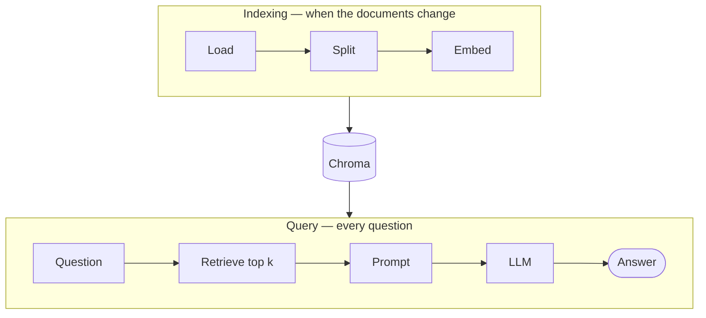
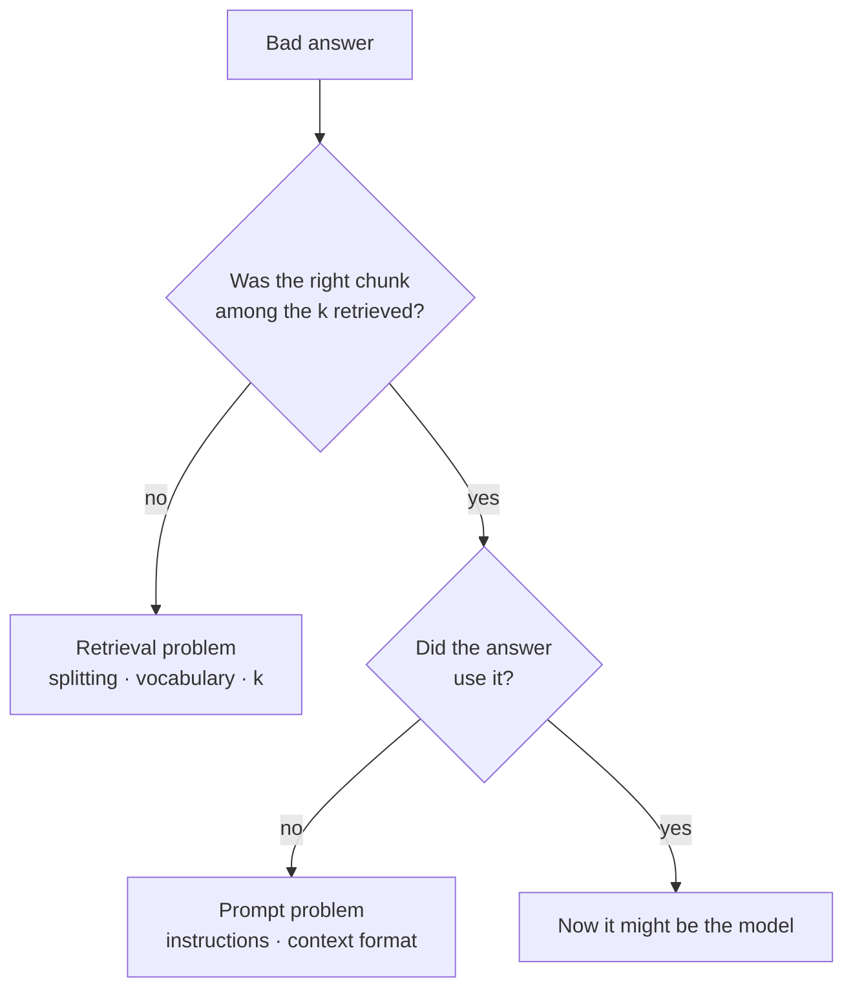
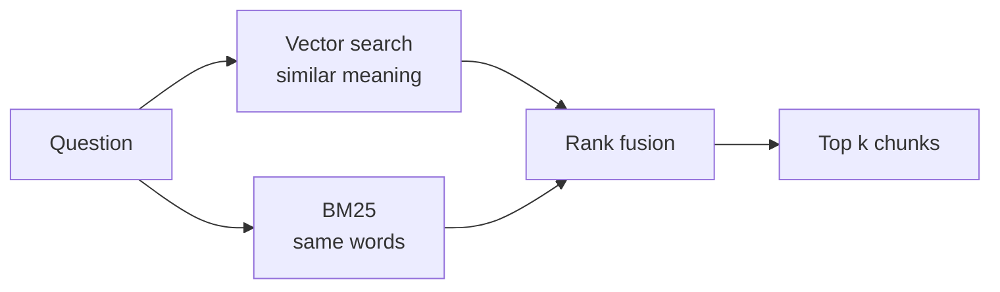

RAG — retrieval-augmented generation — has a deceptively simple description: find relevant fragments and pass them to the model as context. The hard part isn't that pipeline; it's that the quality of the output depends almost entirely on retrieval, and retrieval is a search problem, not a model problem.

## Why RAG and not fine-tuning

It's the first decision and the one most often got wrong. Fine-tuning teaches a model *how to behave*: a tone, a format, a task. RAG gives it *what to know*.

If your problem is "the model doesn't know our internal documentation", fine-tuning is an expensive, slow way to solve it — and you have to redo it every time the documentation changes. RAG solves that by changing one document in an index.

| | Fine-tuning | RAG |
| --- | --- | --- |
| **Changes** | How the model behaves: tone, format, task | What the model knows right now |
| **When the documentation changes** | Train again | Re-index one document |
| **Can cite where an answer came from** | No | Yes, the retrieved chunk |
| **Cost of one iteration** | Hours of GPU | Seconds |

## The four pieces



```python
# pip install langchain langchain-community langchain-chroma langchain-ollama
from langchain_community.document_loaders import DirectoryLoader, TextLoader
from langchain_text_splitters import RecursiveCharacterTextSplitter
from langchain_ollama import OllamaEmbeddings, ChatOllama
from langchain_chroma import Chroma
```

**1 · Load.** Get the documents into plain text.

```python
docs = DirectoryLoader("./docs", glob="**/*.md", loader_cls=TextLoader).load()
```

**2 · Split.** This is where the system is won or lost.

```python
splitter = RecursiveCharacterTextSplitter(
    chunk_size=1000,
    chunk_overlap=200,
)
chunks = splitter.split_documents(docs)
```

`RecursiveCharacterTextSplitter` tries paragraphs first, then sentences, and only falls back to characters, so it respects structure. The 200-character overlap isn't decorative: without it, a sentence that lands exactly on a boundary loses its context and stops being retrievable.

**3 · Index.** Turn each chunk into a vector and store it.

```python
embeddings = OllamaEmbeddings(model="nomic-embed-text")
store = Chroma.from_documents(chunks, embeddings, persist_directory="./chroma")
```

The embedding model doesn't have to be the one generating answers, and usually shouldn't be: a small specialised one is faster and typically retrieves better.

**4 · Retrieve and generate.**

```python {8-9,12-13,22}
from langchain_core.prompts import ChatPromptTemplate
from langchain_core.runnables import RunnablePassthrough
from langchain_core.output_parsers import StrOutputParser

retriever = store.as_retriever(search_kwargs={"k": 4})
llm = ChatOllama(model="llama3.1")

def format_docs(docs):
    return "\n\n".join(f"[{d.metadata['source']}]\n{d.page_content}" for d in docs)

prompt = ChatPromptTemplate.from_template("""
Answer using only the context. If the context does not contain the answer,
say you don't know. Cite the source for each claim.

Context:
{context}

Question: {question}
""")

chain = (
    {"context": retriever | format_docs, "question": RunnablePassthrough()}
    | prompt
    | llm
    | StrOutputParser()
)

print(chain.invoke("How is the service deployed?"))
```

That "if the context does not contain the answer, say you don't know" instruction does more to reduce hallucination than any model tuning. > [!TIP]
> Without it, the model fills the gap with whatever seems plausible.

`format_docs` is there for the same reason: if the source path isn't in the context, the model has nothing to cite.

## Where it actually breaks

When a RAG system gives bad answers, the reflex is to swap the model. It's almost never the model.



**The splitting doesn't respect meaning.** If a table is cut in half, neither half answers anything. For structured documentation, splitting by section (`MarkdownHeaderTextSplitter`) works far better than by character count.

```python
from langchain_text_splitters import MarkdownHeaderTextSplitter

splitter = MarkdownHeaderTextSplitter(
    headers_to_split_on=[("#", "h1"), ("##", "h2"), ("###", "h3")],
)
sections = splitter.split_text(markdown_text)  # one chunk per section, headers kept as metadata
```

**The question and the document don't use the same words.** Vector search captures semantic similarity but struggles with proper nouns, error codes and acronyms. The practical fix is hybrid search: combine vectors with BM25 and fuse the results.



```python {9}
from langchain_community.retrievers import BM25Retriever  # pip install rank_bm25

bm25 = BM25Retriever.from_documents(chunks, k=10)
vector = store.as_retriever(search_kwargs={"k": 10})

def hybrid(question: str, k: int = 4) -> list:
    scores, docs = {}, {}
    for results in (vector.invoke(question), bm25.invoke(question)):
        for rank, doc in enumerate(results):  # reciprocal rank fusion
            docs[doc.page_content] = doc
            scores[doc.page_content] = scores.get(doc.page_content, 0) + 1 / (60 + rank)
    best = sorted(scores, key=scores.get, reverse=True)[:k]
    return [docs[text] for text in best]
```

Wrap `hybrid` in a `RunnableLambda` and it drops into the chain in place of `retriever`.

**`k` is too low or too high.** At `k=2` you're missing context; at `k=20` the good chunk is lost in noise and you're paying latency for it. Four to six is usually the sensible range, and if you need more, re-rank rather than widening the window.

**You don't know whether it's working.** This is the most expensive failure. Without a set of questions with expected answers, every change is an opinion. Twenty hand-written question-answer pairs, measuring "was the right chunk among those retrieved?", already tells you more than any impression.

```python
def recall_at_k(questions, expected_sources, k=4):
    hits = 0
    for q, expected in zip(questions, expected_sources):
        got = [d.metadata["source"] for d in retriever.invoke(q)[:k]]
        hits += expected in got
    return hits / len(questions)
```

> [!IMPORTANT]
> If that number is low, the problem is retrieval, and changing LLM will not fix it.

## Why run it locally

All of the above runs on a laptop with Ollama. That matters for three practical reasons: the data never leaves your machine, you can iterate on chunking dozens of times without watching a bill, and when you move to production the pipeline is identical — you only swap the model provider.

Starting locally and measuring retrieval before touching anything else is by a wide margin the shortest path to a RAG system that works.
