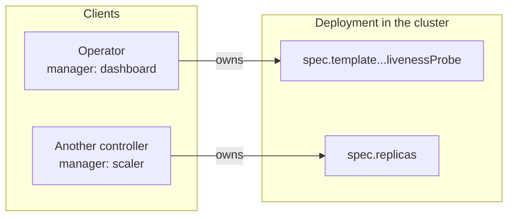
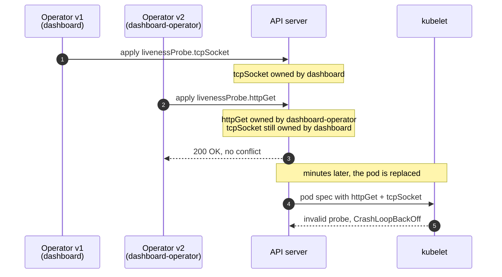

This happened in early 2026. I am telling it without a ticket or names because
the mechanism is generic Kubernetes and can happen to anyone.

## The symptom

An operator deployed its component and the pod went into `CrashLoopBackOff`. Not
always: a clean install was fine. It only failed when upgrading over an existing
installation, and it failed late — some minutes after the upgrade.

The kubelet error said the liveness probe was invalid: it had both `httpGet` and
`tcpSocket` defined. Which is impossible, because the manifest only has one.

## What a field manager is

Server-Side Apply changes who decides an object's contents. Instead of sending
the whole object and overwriting, each client declares **only the fields it
cares about** and identifies itself with a name, the field manager. The API
records, inside the object itself, which manager owns which field:

```yaml {3,13}
metadata:
  managedFields:
    - manager: dashboard
      operation: Apply
      fieldsV1:
        f:spec:
          f:template:
            f:spec:
              f:containers:
                k:{"name":"main"}:
                  f:livenessProbe:
                    f:tcpSocket: {}
```

That bookkeeping is what lets two controllers touch the same object without
fighting: each can only change what is theirs, and when one drops a field, the
API removes it.



The ownership rule is what matters for the rest of the story:

| A manager's apply… | What the API does |
| --- | --- |
| **Sets a field nobody owns** | Sets it and records the manager as owner |
| **Sets a field it already owns** | Updates it |
| **Sets a field another manager owns, with a different value** | Rejects it as a conflict, unless the apply is forced |
| **Stops declaring a field it owned** | Removes the field |
| **Never mentions a field another manager owns** | Leaves it alone |

## What I did

I renamed the manager. The operator stopped identifying as `dashboard` and
started identifying as `dashboard-operator`, because the old name came from when
the component was something else and had become confusing.

A one-line change. No visible effect on the manifest.

## What actually happened

To the API, a manager with a different name is **a different manager**.

The object already in the cluster had its probe recorded under `dashboard`, with
`tcpSocket`. My apply arrived as `dashboard-operator` declaring `httpGet`. The
API did exactly what it is asked to do: it had no reason to remove another
owner's field, so it kept `tcpSocket` and added `httpGet`.



This is what the object looked like after the upgrade, trimmed:

```yaml {3,8,19-20}
metadata:
  managedFields:
    - manager: dashboard            # the old name, still holding its field
      operation: Apply
      fieldsV1:
        # … f:livenessProbe:
        #     f:tcpSocket: {}
    - manager: dashboard-operator   # the new name, a stranger to the API
      operation: Apply
      fieldsV1:
        # … f:livenessProbe:
        #     f:httpGet: {}
spec:
  template:
    spec:
      containers:
        - name: main
          livenessProbe:
            httpGet: { path: /healthz, port: 8080 }
            tcpSocket: { port: 8080 }   # nobody asked for both
```

The result is an object **no client asked for** and that no validation rejects,
because each field on its own is legal. Only the kubelet, trying to run the
probe, discovers the combination is nonsense.

And the delay explains itself: the old pod was still running. The failure
surfaced when something triggered a replacement and the new one tried to start
with the impossible probe.

## The lesson

> [!IMPORTANT]
> **A field manager's name is part of your API, even though it does not look like
> it.** It is written inside every object your controller has touched. Changing
> it is not renaming a variable: it is telling the API a new client has arrived,
> and the previous one's bookkeeping stays where it is.

Three ways out, least to most aggressive:

1. **Do not rename.** Dull and correct. The ugly name costs less than the
   migration.
2. **Rename and clean up.** Before the first apply under the new name, strip the
   old manager's entries from the affected objects.
3. **Take ownership.** Apply with `force: true` from the new name, which
   transfers the conflicting fields. That is what we ended up doing, and it
   works as long as you understand you are deliberately overriding what another
   client decided.

## Why I like this bug

Because nothing was broken. The API did the right thing, the manifest was valid,
the operator was too. The error lived in an assumption of mine: I thought the
manager name was a label, and it was an identity.

The most expensive failures I have seen have this shape. They are not components
behaving badly, they are components behaving correctly under a mental model that
does not match the real one. And no test finds those, because the test is
written by the same person holding the wrong model.
