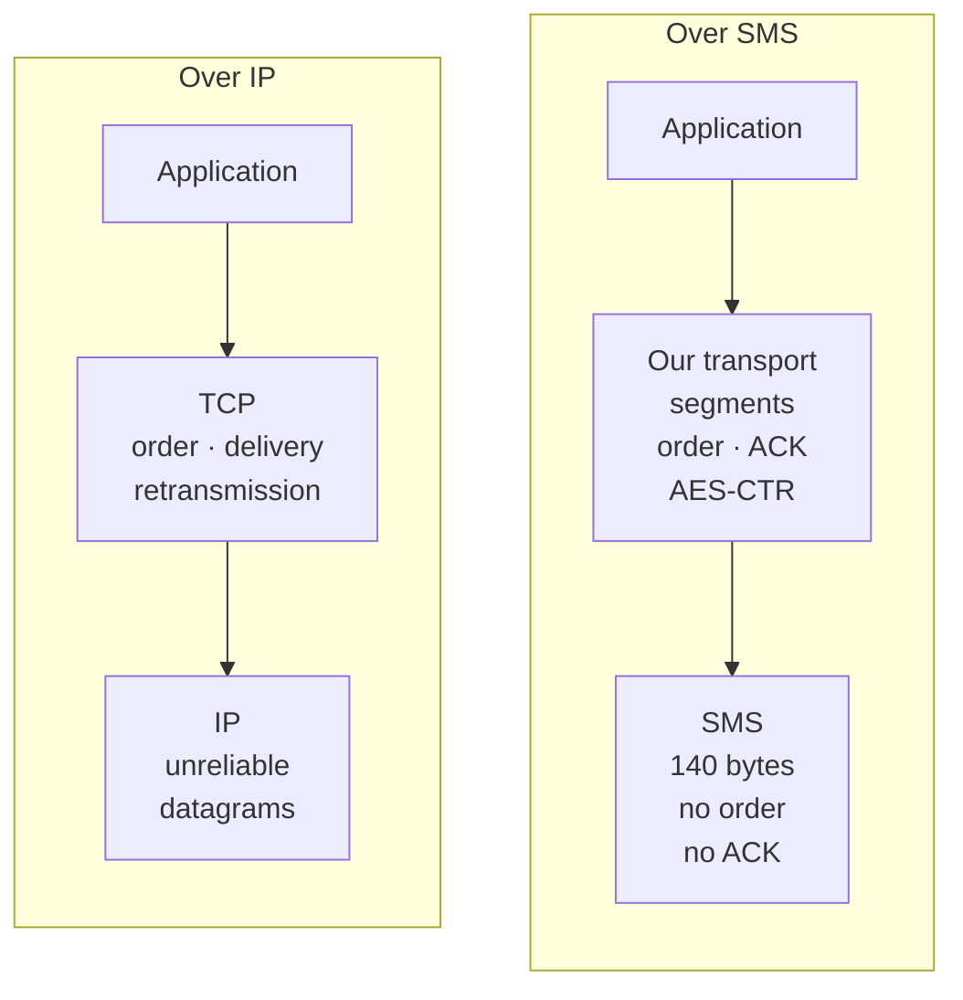
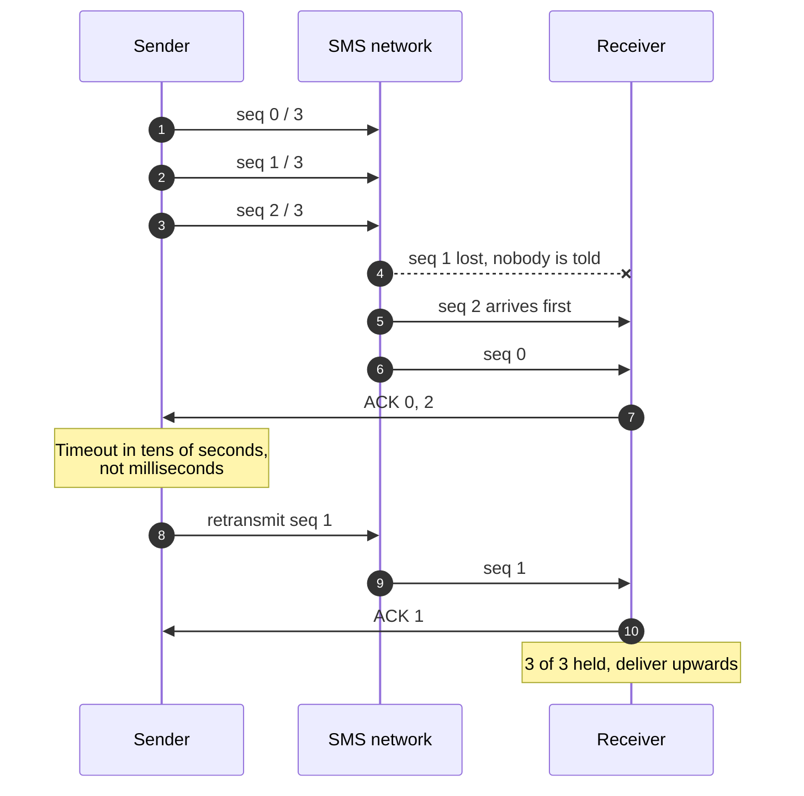
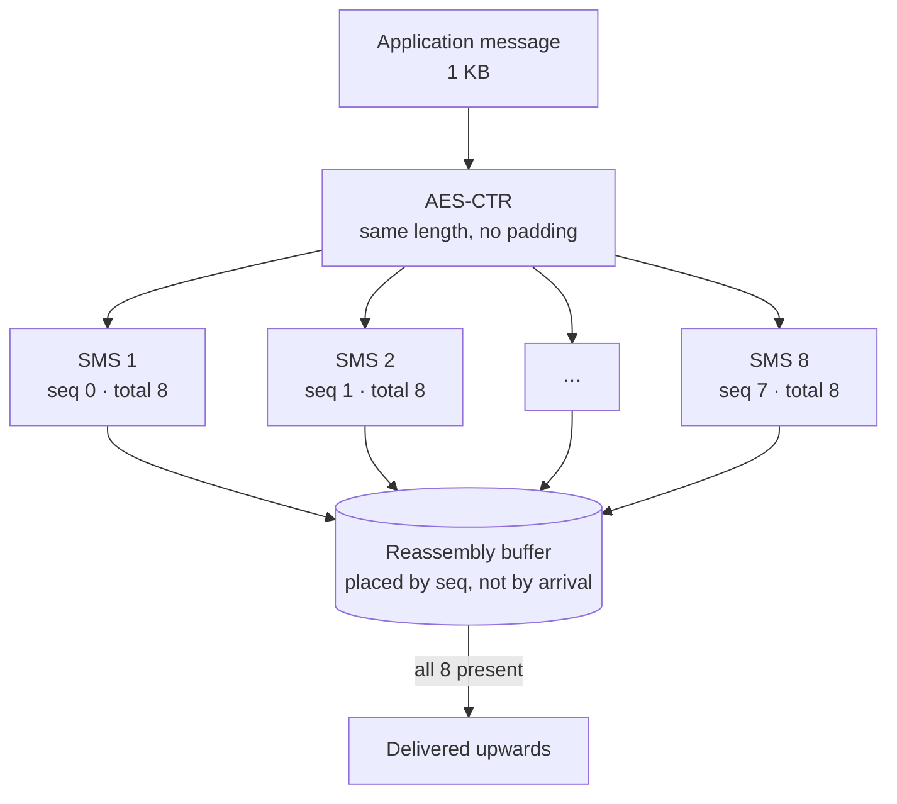
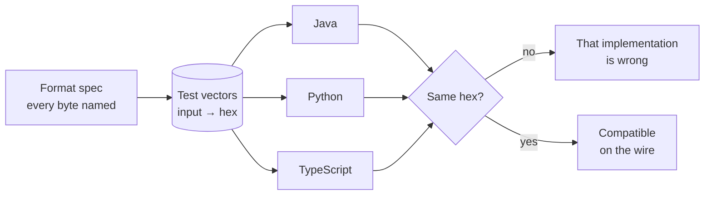

This is from 2018, on Telefónica's innovation team. The code is still public and
archived at [`Telefonica/SDK-SMS-Stack`](https://github.com/Telefonica/SDK-SMS-Stack),
with a whitepaper alongside it. I am writing it up now because it is the project
I learned the most from and explained the worst at the time.

## The problem

There are places with no data. Not slow 2G — no IP at all. A valley, a basement,
a country where the prepaid card ran out of data allowance but still has
messages. In all of those, one thing almost always survives: SMS.

The question we asked was whether SMS could be treated as what it is — a channel
— with the rest of the stack put on top. If the transport were reliable and
ordered, an application could speak over SMS without knowing that it was.



## Why SMS is a hostile channel

An SMS is 140 bytes. With the 7-bit GSM alphabet that is 160 characters; the
moment you type an "ñ" or an emoji it switches to UCS-2 and drops to 70. That is
the first constraint and the silliest: your packet size depends on what you
write.

| Encoding | Bits per character | Characters in 140 bytes | Triggered by |
| --- | --- | --- | --- |
| **GSM-7** | 7 | 160 | Plain Latin text |
| **UCS-2** | 16 | 70 | A single "ñ", emoji or non-Latin character |

The other three are worse:

- **No ordering.** Two messages sent back to back can arrive reversed. The
  network promises nothing about sequence.
- **No guaranteed delivery.** An SMS can vanish with nobody telling you. The
  carrier's delivery report says the network accepted it, not that it arrived.
- **No integrity, no privacy.** The message travels in the clear through
  equipment you do not control.

That is, almost literally, a datagram. And building on unreliable datagrams is a
solved problem — it is exactly what TCP addressed in 1974.

## What we built

A transport layer with the minimum pieces needed for the thing above it to trust
it.

**Segmentation.** An application message is split into chunks that fit in an
SMS, leaving room for the header. The header occupies the first bytes of each
message and carries a conversation id, the sequence number and the segment
count.

**Sequencing and reassembly.** The receiver places each segment by sequence
number, not by arrival order. Until it holds all of them, it delivers nothing
upwards.

**Acknowledgement and retransmission.** The sender keeps unacknowledged segments
and retries them. This is where the constants matter far more than they do over
IP: an aggressive retry does not congest a network, it drains the user's credit.
The timeout is measured in tens of seconds, not milliseconds.



> [!WARNING]
> Every retransmission is a message the user pays for. Over SMS, a timeout tuned
> the way you would tune one over IP is a billing bug, not a performance setting.

**Encryption.** AES in CTR mode. CTR rather than CBC for a practical reason: CTR
is a stream cipher, so the ciphertext is exactly as long as the plaintext and
there is no padding. When every byte costs you a fraction of a message, padding
stops being a cosmetic detail.

| Field | Size | What it is for |
| --- | --- | --- |
| **Conversation id** | 2 bytes | Which application message this segment belongs to |
| **Sequence number** | 1 byte | Where the segment goes, whatever order it arrived in |
| **Total** | 1 byte | How many segments to wait for before delivering |
| **Payload** | ~130 bytes | The encrypted chunk itself |



That header is 3% of every message. It sounds negligible until you work out that
a 1 KB payload is eight texts, and eight texts cost eight times one text.

## The part that actually hurt

You can understand the protocol in an afternoon. What we did not anticipate was
the cost of having it **three times**.

We implemented it in Java for Android, in Python and in TypeScript, because the
three sides we wanted to connect lived in different environments. And the moment
you have three implementations of a binary format, you have three chances to
read it differently.

The failures were never logic. They were representation:

- Python packs integers with `struct`, and you have to state the byte order
  explicitly or it takes the machine's.
- Java has no unsigned integers. A sequence number from 0 to 255 reads as −128
  to 127 the moment it passes 127, and reassembly starts discarding segments
  that were perfectly fine.
- JavaScript had no 64-bit integers when we wrote this, and any bitwise
  operation hands you back a signed 32-bit value.

| Language | Reasonable default | How it broke the wire format |
| --- | --- | --- |
| **Python** | `struct` uses native byte order unless told otherwise | Header fields swapped bytes between machines |
| **Java** | `byte` is signed | Sequence numbers above 127 became negative |
| **JavaScript** | Bitwise operators work on signed 32-bit ints | Masks and shifts returned negative numbers |

The fixes are one character each, which is exactly why they are easy to miss:

```diff
  # Python: say the byte order, every time
- header = struct.pack("HBB", conv_id, seq, total)
+ header = struct.pack(">HBB", conv_id, seq, total)

  // Java: read the byte as unsigned
- int seq = buf[2];
+ int seq = buf[2] & 0xFF;

  // JavaScript: force the result back to unsigned
- const word = (buf[0] << 24) | (buf[1] << 16) | (buf[2] << 8) | buf[3];
+ const word = ((buf[0] << 24) | (buf[1] << 16) | (buf[2] << 8) | buf[3]) >>> 0;
```

None of the three was "wrong". Each did the reasonable thing for its language.
The mistake was ours, for not having written down first what each byte means.

What fixed it was dull and effective: a document specifying the format, and a
set of test vectors — known input, expected binary output in hex — that all
three implementations run. If the Python test passes and the Java one does not,
there is no argument about who is wrong: there is a hex string that does not
match.



> If you are implementing a format in more than one language, shared test
> vectors are not an optional good practice. They are the only place the truth
> lives.

## What I would do differently

**Start from the specification, not the code.** We wrote the first
implementation and then described it. The other way round would have cost two
more days and saved two weeks.

**Measure before optimising for size.** We spent time shaving bits off the
header. The real saving was marginal next to choosing the alphabet well: a
single non-GSM-7 character in a message costs you more than half the usable
space, and that is decided by the user typing, not by us designing.

**I would not call it "TCP over SMS".** It was a good line for telling the story
and a poor description: there is no congestion control, no real sliding window,
no three-way handshake. It is a reliability and ordering layer, which is rather
less and quite enough. Analogies that oversell end up creating expectations you
then have to walk back.

## Why I still tell it

Because it is the cleanest example I know of something that keeps recurring: the
interesting problem is almost never where you think. We believed the challenge
was the protocol and the challenge was interoperability. And interoperability is
not solved with more code, but by writing down first what everybody assumes and
nobody states.
