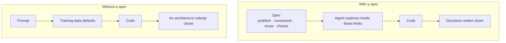
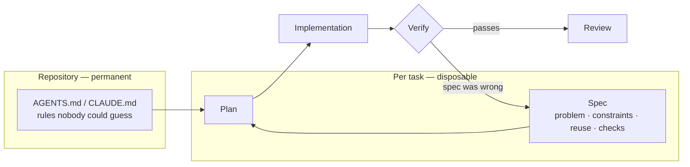
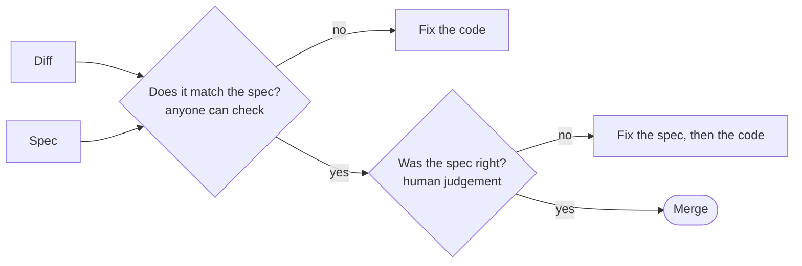

There's a pattern that repeats when a team starts using agents seriously: velocity goes up, and two months later nobody knows why the code is the way it is. The commit says "implement X". The PR links a two-line ticket. The conversation where the important things were decided no longer exists.

The problem isn't the AI. It's that **the prompt became the specification**, and a prompt isn't an artifact: it's an ephemeral conversation.

## Why the specification phase stops being optional

With manual development, design is implicit in the code and can be reconstructed by reading it, because whoever wrote it was making decisions line by line. With an agent, that reconstruction fails for two reasons.

The agent generates a lot of coherent code very fast, so volume no longer marks where the hard decision was. And it defaults to whatever is most common in its training distribution, which needn't be right for your repository. Without a specification, those defaults become the architecture, and nobody decided anything.



## What a useful specification contains

Not a twenty-page design document. One page, with four things an agent cannot invent:

**What problem this solves and for whom.** One sentence. If it doesn't fit in one sentence, it's probably two tasks.

**The constraints that aren't negotiable.** Backwards compatibility, a performance budget, accessibility requirements, the library you must use because the rest of the repository uses it.

**What already exists and should be reused.** This is the highest-return item. An agent that doesn't know you already have a translation resolver will write another one.

**How to check it's right.** Concrete commands, and what should happen when you run them.

For a small feature on this site, the whole thing fits in a screen:

```md title="specs/reading-time.md"
# Reading time on blog posts

**Problem.** Readers can't tell a two-minute note from a twenty-minute guide.

**Constraints.**
- Both locales. The label goes through `useT()`, never a string literal.
- Computed at build time: no extra work in the visitor's browser.

**Reuse.** `parseFrontmatter` already strips the YAML; count words after it.

**Check.**
- `npx vitest run tests/unit/content` passes.
- `/en/blog/<slug>` and `/es/blog/<slug>` show the time next to the date.
```

And what it deliberately **doesn't** carry: how to implement it. If the specification dictates the implementation, you've written the code in prose and lost the one thing the agent does better than you, which is exploring the solution space quickly.

## The cycle

```steps loop="Implementation corrects the spec"
Specify: One page — the problem, the constraints, what to reuse, how to check it.
Plan: The agent proposes an approach. You correct the plan, not the code.
Implement: The agent writes the code against the plan and the repository rules.
Verify: Tests, type-check and the commands the spec named. Executable, not vibes.
Review: Did it do what the spec said? Was the spec right?
```



| Lives in | Changes | Example |
| --- | --- | --- |
| `AGENTS.md` | Rarely | `md:` means 650px here, not 768px |
| Spec | Per task | "Keep the v1 endpoint working" |
| Code | Constantly | How it is actually done |

The return arrow is the part everyone skips and the part that pays. Almost always, implementing reveals the specification was wrong: a constraint that doesn't hold, a case nobody considered, a false assumption. If that discovery only lives in the diff, the next person rediscovers it.

> [!TIP]
> In practice the discipline is simple: when the plan turns out to be wrong halfway through implementation, stop and correct the document rather than improvising onward.

## The repository as a permanent specification

Part of the specification doesn't change per task: how this particular repository works. That lives in `AGENTS.md` or `CLAUDE.md`, and the test for including something is exact: **could it be discovered by reading the code?** If yes, leave it out.

What earns a place is whatever looks like one thing and is another. On this very site, the Tailwind breakpoints are redefined — `md:` is 650px, not 768 — so any snippet copied from the docs targets the wrong viewport. No model will guess that, because in 99% of projects `md:` is 768.

That distinction — permanent specification in the repository, per-task specification in a document — is what stops the rules file growing until nobody reads it.

## What changes in review

With a written specification, review answers two separable questions instead of one vague one:

1. **Does it do what the specification said?** Checkable by anyone, including another agent, by comparing diff and document.
2. **Was the specification right?** Requires human judgement, and is the question that actually matters.



Without a specification, both collapse into "does this code look fine to me?", which is the form of review that lets the most through.

## What it doesn't fix

Being honest about this matters.

> [!IMPORTANT]
> A specification doesn't stop an agent writing incorrect code; it stops it writing *unexpected* code. You still need tests, adversarial review and executable verification.

And it has a real cost: writing the specification takes time, and for a five-line change it's pure ceremony. The threshold I use is simple: if I'll have to explain this decision in six months, I write it down now.
