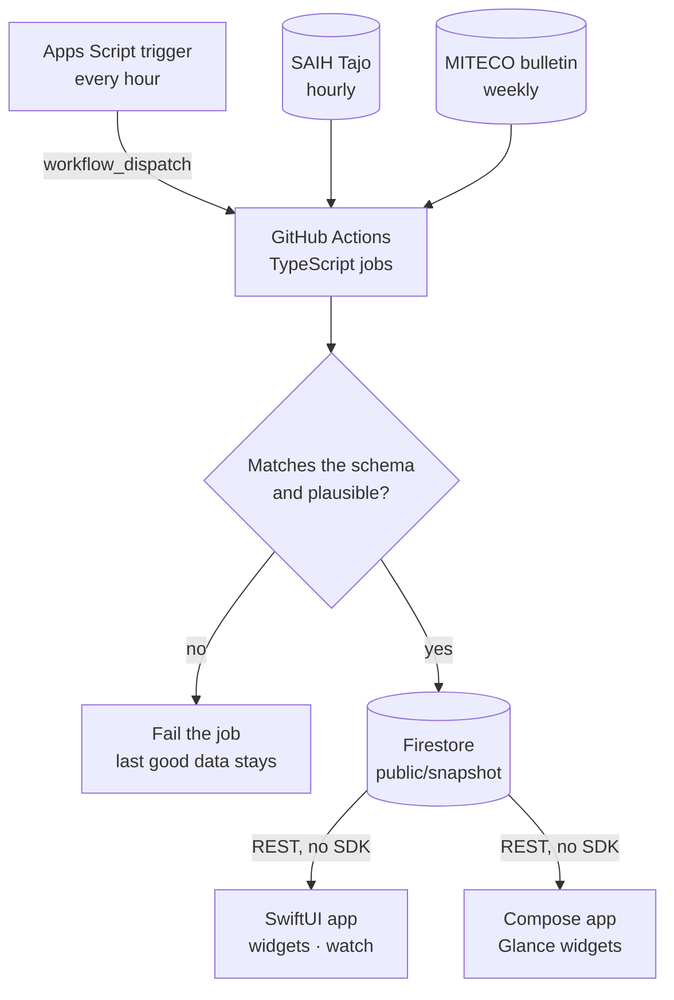
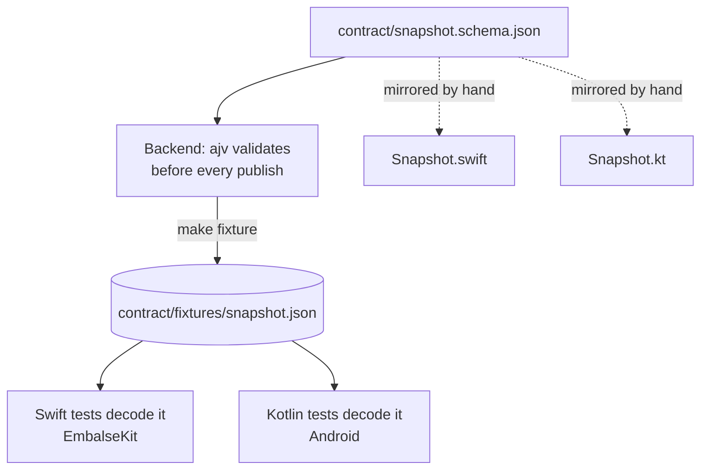
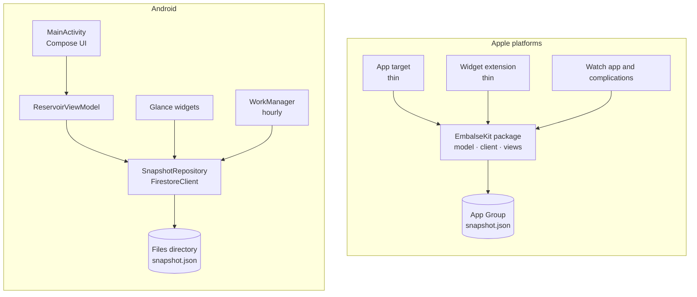

Embalse San Juan answers one question: how much water is in the San Juan reservoir, on the Alberche river in Madrid, right now? It's on the App Store for iPhone, iPad and Apple Watch, with widgets whose water rises and falls with the real level, and the Android version is in testing on Google Play.

There are two apps, written twice: SwiftUI on Apple platforms, Jetpack Compose on Android. They share no Swift, no Kotlin and no framework. What they share is a **data contract**, and this post is about why that turned out to be the right thing to share for this app, how each platform models the same screen, and what was easy and hard on each side. The code is [open on GitHub](https://github.com/lucferbux/embalse-san-juan); snippets are real and trimmed.

## The shape of the system

The official figures were already public, scattered across two technical websites: SAIH Tajo, the river basin authority's hourly telemetry, and MITECO's weekly hydrological bulletin. The app's whole backend is a way to collect them on a schedule, check them, and publish one document for the apps to read. It runs on free tiers and costs nothing.



Two things in that diagram weren't the first version.

**The trigger.** The first design was a scheduled GitHub Actions workflow writing to Firestore on the Spark plan, because Cloud Functions need the Blaze plan, which requires a card and could produce charges if something went wrong. On Spark, going over a quota returns errors, not a bill. But GitHub's `schedule` trigger turned out to be irregular on this repo: GitHub [documents that scheduled runs can be delayed under load, and some dropped](https://docs.github.com/en/actions/reference/workflows-and-actions/events-that-trigger-workflows), and in practice the hourly job ran twice where about ten runs were expected, with a gap of six and a half hours. Now an hourly Google Apps Script trigger calls `workflow_dispatch` for each job and emails me, at most once a day, if the published data is more than three hours old. Both decisions are ADRs in the repo, with the numbers.

**The guard.** Before anything is written, `validate.ts` checks the snapshot against the JSON Schema and against physics: volume within what the dam's sensor can report, percent between 0 and 100, no readings from the future, no implausible jump since the previous hour, and volume and percent agreeing with each other, since SAIH publishes them as separate signals. If any check fails, nothing is written and the job fails. The apps never see bad data; they see slightly old good data, marked as stale after six hours.

## The contract is the shared code

`contract/snapshot.schema.json` describes everything the apps and widgets need for a normal refresh: the live reading, the last hours, 90 daily points, the weather at the dam, the weekly MITECO block, the neighbouring reservoirs and the sources. Three parties read it, and none of them owns it.



The fixture is the trick. It's generated by the backend and validated by the same code that guards production, and then both apps' unit tests decode that exact file. If someone changes the backend's output, the schema has to change too (it has `additionalProperties: false`), and if the schema changes in a way the Swift or Kotlin model doesn't follow, a test fails on that side. The two models are written by hand, and they look almost identical:

```swift title="ios/EmbalseKit/Sources/EmbalseKit/Model/Snapshot.swift"
/// Swift view of `contract/snapshot.schema.json`. Tests decode the same fixture the backend validates.
public struct Snapshot: Codable, Sendable, Equatable {
    public var schemaVersion: Int
    public var generatedAt: Date
    public var live: Live
    public var weekly: Weekly
    // …
    /// AEMET's forecast, added in 2.0 and absent whenever AEMET is unavailable (ADR 4).
    public var forecast: Forecast?
}
```

```kotlin title="android/app/src/main/java/…/data/Snapshot.kt"
/** Kotlin view of contract/snapshot.schema.json. Tests decode the same fixture the backend validates. */
@Serializable
data class Snapshot(
    val schemaVersion: Int,
    val generatedAt: String,
    val live: Live,
    val weekly: Weekly,
    // …
    /** AEMET's forecast, optional in the contract (ADR 0004). */
    val forecast: Forecast? = null,
)

val contractJson = Json { ignoreUnknownKeys = true }
```

That `ignoreUnknownKeys`, and Swift's `Codable` ignoring unknown keys by default, is what makes the contract evolvable. Version 1.0 is installed on phones that won't all update, and both 1.0 apps reject any `schemaVersion` other than 1. So the rule, written down as an ADR, is that while 1.0 is in the stores the schema only grows by **optional fields**: nothing removed, renamed, made nullable or changed in meaning. New data that doesn't belong in the snapshot goes in new documents that 1.0 never reads. The AEMET forecast was the first addition; old apps don't know it exists and keep working.

> [!TIP]
> A shared fixture decoded by every client is the cheapest contract test I know. It doesn't need a framework, and it fails on the side that drifted.

## Reading Firestore without Firestore

The apps don't link the Firebase SDK. The repo's rule gives the reason: widgets have tight memory limits, and a widget extension is exactly the process that reads this data most often. Firestore has a [REST API](https://firebase.google.com/docs/firestore/use-rest-api) that unauthenticated clients can call, with security rules deciding what they may read; here the rules make `public/*` readable by anyone and everything else closed.

The REST API's document format is verbose (every value wrapped in a typed object), so the backend stores the contract JSON as a single string field called `payload`. Each client unwraps one field and decodes plain JSON:

```swift title="ios/EmbalseKit/Sources/EmbalseKit/Data/FirestoreClient.swift"
/// Documents hold the contract JSON in one string field, `payload`.
static func decodePayload<T: Decodable>(_ data: Data) throws -> T {
    let envelope = try JSONDecoder().decode(Envelope.self, from: data)
    guard let payload = envelope.fields?.payload?.stringValue?.data(using: .utf8) else {
        throw ClientError.missingPayload
    }
    return try makeDecoder().decode(T.self, from: payload)
}
```

The Kotlin `FirestoreClient` does the same with `HttpURLConnection` and kotlinx.serialization: about forty lines on each side, no dependency. Both keep the last good snapshot on disk (on iOS in the App Group container, so the app and widgets share it) and fall back to it when the network fails. They only throw when there is nothing at all to show.

## Same screen, two state models

This is where the platforms differ in syntax and agree in shape. Both apps have one object that owns the reservoir state, starts from the cached snapshot, refuses to refetch more often than every 15 minutes (new data arrives hourly), and reloads the widgets only when `generatedAt` changed.

On iOS it's an [`@Observable`](https://developer.apple.com/documentation/observation) class on the main actor, held in `@State` by the `App`:

```swift title="ios/EmbalseKit/Sources/EmbalseKit/Data/ReservoirModel.swift" {1-2,9}
@MainActor
@Observable
public final class ReservoirModel {
    public enum State {
        case loading
        case loaded(Snapshot, SnapshotRepository.Origin)
        case failed
    }
    public private(set) var state: State = .loading

    public func refresh(force: Bool = false) async {
        // … skip if refreshed in the last 15 minutes
        do {
            let result = try await repository.load()
            state = .loaded(result.snapshot, result.origin)
            if result.snapshot.generatedAt != previous {
                WidgetCenter.shared.reloadAllTimelines()
            }
        } catch {
            if case .loaded = state { return }
            state = .failed
        }
    }
}
```

On Android it's a `ViewModel` exposing a `StateFlow` of a sealed interface, collected in Compose with `collectAsStateWithLifecycle()`, which the docs [recommend for collecting flows on Android](https://developer.android.com/develop/ui/compose/state):

```kotlin title="android/app/src/main/java/…/ui/ReservoirViewModel.kt" {1-5,12}
sealed interface UiState {
    data object Loading : UiState
    data object Failed : UiState
    data class Loaded(val snapshot: Snapshot, val origin: SnapshotRepository.Origin) : UiState
}

class ReservoirViewModel(application: Application) : AndroidViewModel(application) {
    private val _state = MutableStateFlow<UiState>(UiState.Loading)
    val state: StateFlow<UiState> = _state

    fun refresh(force: Boolean = false) {
        viewModelScope.launch {
            try {
                val (snapshot, origin) = repository.load()
                _state.value = UiState.Loaded(snapshot, origin)
                if (snapshot.generatedAt != previous) ReservoirWidget.refreshAll(getApplication())
            } catch (_: IOException) {
                if (_state.value !is UiState.Loaded) _state.value = UiState.Failed
            }
        }
    }
}
```

The same three states, the same "a failure never replaces data we already have", the same widget nudge. The difference is where the observation lives. In SwiftUI the `@Observable` macro makes the model itself observable, and a view [updates only when a property its `body` reads changes](https://developer.apple.com/documentation/swiftui/managing-model-data-in-your-app). In Compose the ViewModel publishes a stream and the composable converts it to `State` at the edge, so the UI code only ever sees values. Side by side:

| Concept | SwiftUI | Jetpack Compose |
| --- | --- | --- |
| **State owner** | `@Observable` class, `@MainActor` | `AndroidViewModel` |
| **Holding it** | `@State` in the `App` | `viewModel()` in the root composable |
| **Exposing state** | A `private(set)` property | `StateFlow<UiState>` |
| **UI reads it** | Directly; tracked per property | `collectAsStateWithLifecycle()` |
| **Async work** | `async` method, `.task` / scene phase | `viewModelScope.launch` |
| **Loading states** | `enum State` | `sealed interface UiState` |
| **Shared with widgets** | App Group file, `EmbalseKit` package | App files directory, same process |
| **Adaptive layout** | Size classes and window size | Window width, `NavigationSuiteScaffold` |
| **Widgets** | WidgetKit, SwiftUI views | Glance, rendered to RemoteViews |
| **Background refresh** | Timeline reload policy | WorkManager, hourly |



The iOS side has one more structural rule: all logic and views live in the `EmbalseKit` Swift package, and the app, widget and watch targets stay thin. That's what lets the Home Screen widget, the Lock Screen widget and the watch complication draw the water from the same code as the app's main card.

## Widgets on both

Widgets are the app's real front door: most of the time nobody opens it, they glance at the Home Screen. On both platforms the widget draws the reservoir's water at the real level, with the figure placed wholly in the water (in white) or wholly in the sky (in the label colour), never split by the waterline. That one rule is implemented twice. I wrote about WidgetKit itself, and App Intents, in [the sibling post on widgets](/blog/widgets-app-intents), so here only the parts that differ.

**iOS.** The widgets are SwiftUI views from `EmbalseKit`, in Home Screen sizes up to extra large on iPad, Lock Screen accessories, watch complications and a Control Center control. Each timeline has one entry and asks to be reloaded at a fixed minute past the next hour. That's a request: the system decides, and Apple describes a [daily refresh budget](https://developer.apple.com/documentation/widgetkit/keeping-a-widget-up-to-date) that works out to roughly every 15 to 60 minutes for a frequently viewed widget. For hourly data, that's enough.

**Android.** Glance looks like Compose but [translates its composables into RemoteViews](https://developer.android.com/develop/ui/compose/glance/build-ui), which comes with RemoteViews' limits. Glance can't draw freely, so the sky and the water are a bitmap the widget renders at its own size, with text on top. And it uses `SizeMode.Exact`, which recreates the content each time the size changes, because the gap that keeps the figure off the waterline is measured in dp of the real widget:

```kotlin title="android/app/src/main/java/…/widget/ReservoirWidget.kt"
object WidgetPlacement {
    fun decide(usable: Float, water: Float, full: Float, compact: Float): Pair<Boolean, Boolean> {
        fun fitsWater(block: Float) = water >= block + 12f + 4f + 10f
        fun fitsSky(block: Float) = usable - water - 12f - 4f >= block
        return when {
            fitsWater(full) -> true to false
            fitsSky(full) -> false to false
            fitsWater(compact) -> true to true
            fitsSky(compact) -> false to true
            else -> (water >= usable - water) to true
        }
    }
}
```

Refresh is a `PeriodicWorkRequest` every hour while a widget is placed, cancelled when the last one is removed. WorkManager's [minimum interval is 15 minutes](https://developer.android.com/topic/libraries/architecture/workmanager/how-to/define-work), and an hour is comfortably above it.

## What was easy, what was hard

Not a scorecard, just where the time went on each side, as recorded in the repo's audits and ADRs.

**Easy on iOS:** one package feeding the app, widgets, Lock Screen and watch, so a design change to the water card reached every surface at once. The App Group cache meant the widgets could show the last snapshot without a request of their own. The watch app fetches on its own, without the phone, from the same client.

**Hard on iOS:** background work you can't promise. The alerts I'm building for the next version (the level crossing a threshold the user chose) are local notifications, because push would need device tokens and a server to hold them, which would break the privacy promise. On iOS the check runs in `BGAppRefreshTask`, which is best effort: the system may skip it for hours. The ADR says plainly that the app must tell users alerts can be late. Large text was the other one: the design review found the source and date truncated at the largest sizes, which breaks the rule that every figure shows both.

**Easy on Android:** WorkManager. Hourly work while a widget is placed is reliable enough to promise "within about an hour" for alerts, which iOS can't. Material 3's `NavigationSuiteScaffold` switches between a bottom bar and a rail by window size without hand-written breakpoints.

**Hard on Android:** Glance's drawing limits (hence the bitmap), and dynamic colour. Material You takes the chrome's colours from the wallpaper, which is right for the app, but the first build's water took the dynamic `primary` too and came out lavender. Now the water is the one fixed colour, like the data it shows. And distribution: Google Play production needs a closed test with at least 12 testers for 14 days first, which is why Android is still in testing.

> [!NOTE]
> The Android audit had a finding that captures the whole approach: the layout switched on a hardcoded screen width. Both apps now decide layout by window size or size class, never by device type, which is what made iPad split views and foldables work without special cases.

## Why not Kotlin Multiplatform or Flutter

I never wrote an ADR rejecting them, so I won't invent one after the fact. What the repo does say adds up to the decision.

The spec's principles say **native**: system components on each platform, Dynamic Type, dark mode and Material You. The rules say **no Firebase SDK in the apps**, because of widget memory, which already pushed the data layer down to a small REST client. And the product's surface area is mostly platform surface: WidgetKit families, Lock Screen accessories, watch complications, a Control Center control, Glance widgets, WorkManager. Those are exactly the parts a shared layer wouldn't write for me.

What would have been shared is the part that is already small: decoding one JSON document and a handful of rules. Instead I share the definition of that document, and both sides are tested against the same file.

## What it costs

The honest list:

- **Logic exists twice.** The six-hour staleness rule, the trend wording, number formatting and the figure-placement rule are written in Swift and in Kotlin and tested separately. They agree because I keep them agreeing, not because a compiler checks it.
- **Features ship unevenly.** iOS has the MITECO comparison and river widgets; Android doesn't yet. Tips are iOS only, because Android would need Google Play Billing. A shared UI layer wouldn't fix that, but it does mean every feature is two pieces of work.
- **The models are mirrored by hand.** The fixture catches drift in what's decoded, not a field one side forgot to declare as optional. Generating the Swift and Kotlin types from the schema is the next thing I'd try.
- **The backend depends on a source with no published contract.** SAIH's JSON is undocumented; `make live-check` is what tells me it still works.

For a one-screen app with heavy platform surfaces, sharing a contract instead of code was the right size. For an app with a lot of business logic and thin platform integration, I'd weigh it differently.

## Further reading

- [Using the Cloud Firestore REST API](https://firebase.google.com/docs/firestore/use-rest-api) — how unauthenticated reads work and how security rules apply to them.
- [Observation](https://developer.apple.com/documentation/observation) — the framework behind `@Observable`.
- [Managing model data in your app](https://developer.apple.com/documentation/swiftui/managing-model-data-in-your-app) — how SwiftUI tracks only the properties a view reads.
- [State and Jetpack Compose](https://developer.android.com/develop/ui/compose/state) — state hoisting, state holders and `collectAsStateWithLifecycle()`.
- [Build UI with Glance](https://developer.android.com/develop/ui/compose/glance/build-ui) — `SizeMode`, and what translating to RemoteViews means for layout.
- [Keeping a widget up to date](https://developer.apple.com/documentation/widgetkit/keeping-a-widget-up-to-date) — WidgetKit's refresh budget, in Apple's words.
- [Define work requests (WorkManager)](https://developer.android.com/topic/libraries/architecture/workmanager/how-to/define-work) — periodic work, intervals and constraints.
- [Embalse San Juan on GitHub](https://github.com/lucferbux/embalse-san-juan) — the contract, the backend, both apps and the ADRs quoted here.
