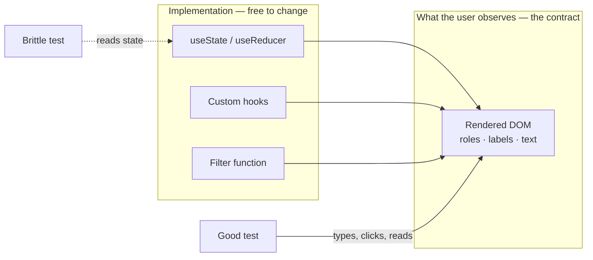
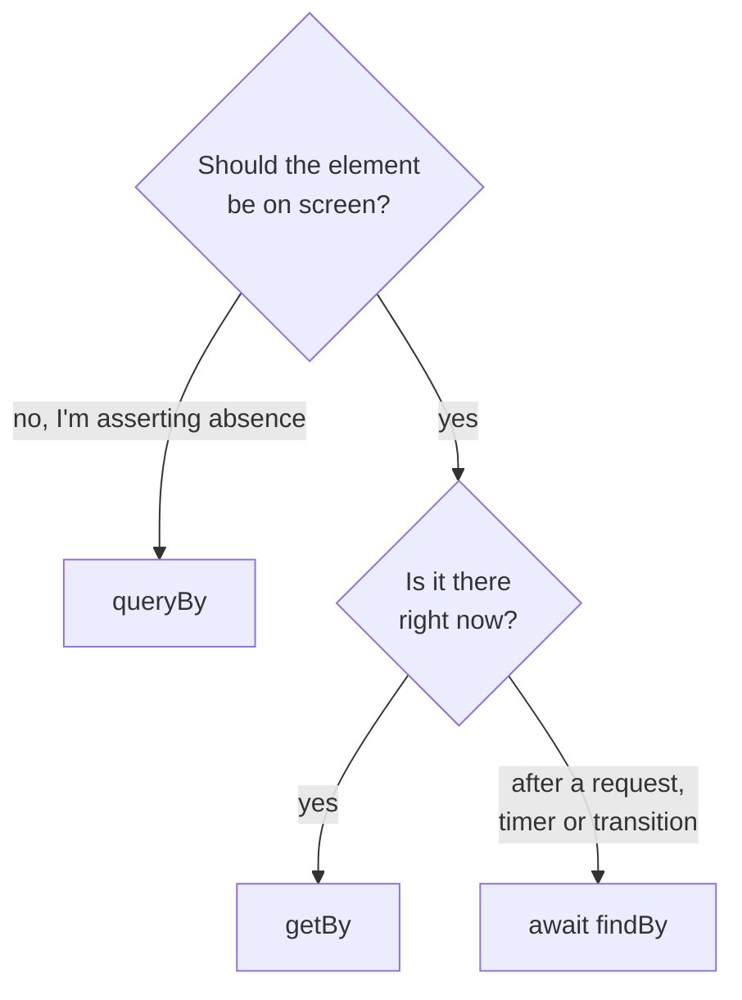
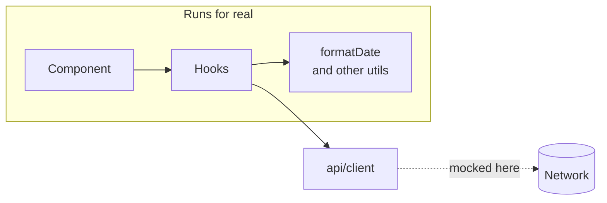

Almost everyone who complains that "tests slow us down" has the same suite: tests coupled to implementation. They break when you rename an internal function, and they stay quiet when the button stops working. That's the worst of both worlds.

## The rule that changes everything

> The more your tests resemble the way your software is used, the more confidence they can give you.

That's Testing Library's guiding principle, and it isn't a motivational slogan — it has a direct operational consequence. Test **what the user observes**, not how it's built.



An example. This component renders a list and lets you filter it:

```tsx title="src/components/UserList.tsx"
export function UserList({ users }: { users: User[] }) {
  const [query, setQuery] = useState("");
  const visible = users.filter((u) =>
    u.name.toLowerCase().includes(query.toLowerCase())
  );

  return (
    <>
      <label htmlFor="q">Search</label>
      <input id="q" value={query} onChange={(e) => setQuery(e.target.value)} />
      <ul>
        {visible.map((u) => <li key={u.id}>{u.name}</li>)}
      </ul>
    </>
  );
}
```

The bad test looks at state:

```tsx
// Don't do this
const { result } = renderHook(() => useState(""));
expect(result.current[0]).toBe("");
```

The good test does what a person would:

```tsx title="tests/UserList.test.tsx" {5,7-8}
it("filters by name", async () => {
  const user = userEvent.setup();
  render(<UserList users={[{id:"1",name:"Ana"},{id:"2",name:"Luis"}]} />);

  await user.type(screen.getByLabelText("Search"), "an");

  expect(screen.getByText("Ana")).toBeInTheDocument();
  expect(screen.queryByText("Luis")).not.toBeInTheDocument();
});
```

Swap `useState` for `useReducer` tomorrow, or move the filtering into a hook, and this test still passes. Break the filtering and it fails. That is exactly what you want from a test.

## `getBy`, `queryBy`, `findBy`

The three query families aren't interchangeable, and picking wrong produces tests that fail confusingly:

| Family | When it's missing | Async | Use it for |
| --- | --- | --- | --- |
| **`getBy`** | Throws, with a genuinely useful DOM dump | No | I expect it now and it must exist |
| **`queryBy`** | Returns `null` | No | It may not exist. **The only valid one for asserting absence** |
| **`findBy`** | Rejects after the timeout | Yes — retries | It will appear shortly. Anything asynchronous |



```tsx {2}
expect(screen.queryByText("Error")).not.toBeInTheDocument();  // right
expect(screen.getByText("Error")).not.toBeInTheDocument();    // never passes: getBy already threw

expect(await screen.findByText("Saved")).toBeInTheDocument(); // after a request
```

> [!CAUTION]
> `getBy` inside a `.not` assertion can never pass: when the element is absent, `getBy` throws before `expect` ever sees it. Absence is always `queryBy`.

## The query priority order

Testing Library orders its queries deliberately, and that order is an accessibility tool dressed as a testing API:

1. `getByRole` — what a screen reader uses. `getByRole("button", { name: /save/i })`.
2. `getByLabelText` — for form fields.
3. `getByText` — for non-interactive content.
4. `getByTestId` — last resort.

When you can't select a button by its role and accessible name, the test is telling you that button isn't reachable for someone using a screen reader either. Fixing the test fixes the accessibility. That's why `getByTestId` is a small defeat: it works, but you've silenced the signal.

A typical case: an icon-only button. `getByRole("button", { name: /delete/i })` fails, and the fix is in the component, not the test:

```diff
- <button onClick={onDelete}><TrashIcon /></button>
+ <button onClick={onDelete} aria-label="Delete"><TrashIcon /></button>
```

## What to mock and what not to

The rule I use: **mock the boundary of the system, not the pieces inside it**.



```tsx
// Good: the network is a boundary
vi.mock("@/api/client", () => ({ fetchUsers: vi.fn() }));

// Bad: formatDate is yours, it's pure, it's fast
vi.mock("@/utils/formatDate");
```

Mocking your own utilities turns the test into a description of your own code, and then a refactor breaks it without anything having stopped working.

## Coverage: a signal, not a target

Coverage can only answer "did this line run?". It can't tell whether you checked anything. This test gives 100% coverage and verifies nothing:

```tsx
it("renders", () => {
  render(<Checkout total={100} />);
});
```

Which is why a global 90% threshold tends to produce junk tests written to move a number. A global 70%, with high thresholds where the logic actually lives — utilities, hooks, reducers — says far more. The useful part of coverage isn't the percentage: it's opening the report and finding the error branch nobody ever exercised.

In Vitest that split is a few lines of config:

```ts title="vitest.config.ts" {5-6}
export default defineConfig({
  test: {
    coverage: {
      thresholds: {
        lines: 70,
        "src/utils/**": { lines: 95, branches: 90 },
      },
    },
  },
});
```

## A test that fails when it should

The last check, and the one almost nobody does: **break the code on purpose and confirm the test fails**. A test that has never failed has proved nothing.

```steps
Write the test: Run it and watch it go green.
Break the code: Comment out the line the test is about.
Watch it fail: Red, with a message that points at the cause.
Restore: Put the line back. Now the green means something.
```

With the filter above, the sabotage is one line:

```diff title="src/components/UserList.tsx"
  const visible = users.filter((u) =>
-   u.name.toLowerCase().includes(query.toLowerCase())
+   true // sabotage: the "filters by name" test must now fail
  );
```

> [!TIP]
> I do it whenever I write the first test for a module, and it has saved me from more than one green suite that was checking absolutely nothing.
