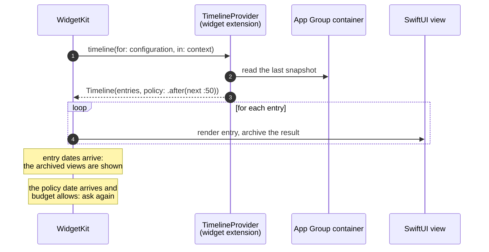
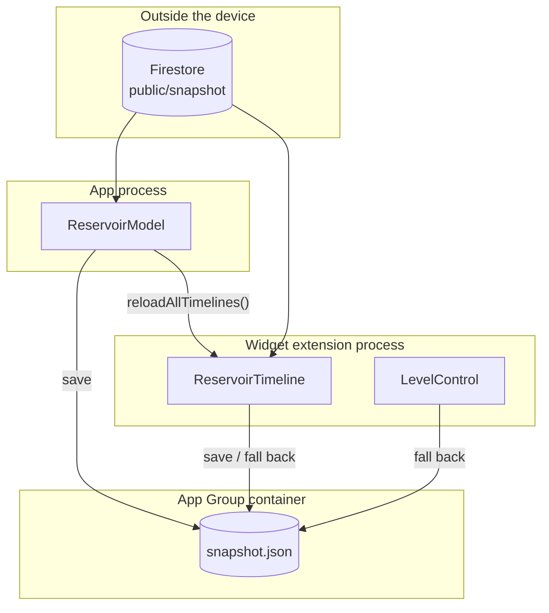
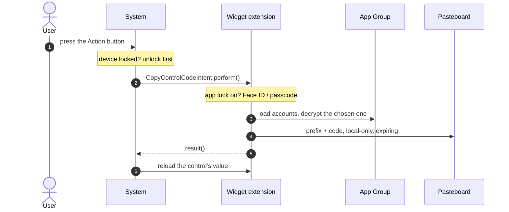
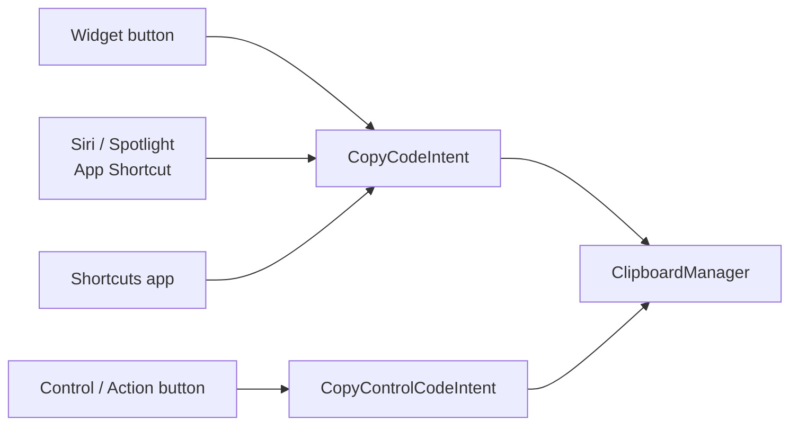

I have two iOS apps on the App Store whose most-used screen is not inside the
app.

**Embalse San Juan** shows the live state of the San Juan reservoir, on the
Alberche river near Madrid. A collector publishes official data every hour, and
the widgets draw the water at the real level: when the reservoir is at 48 %,
the blue fills 48 % of the widget, with a wave on top. **TOTP Password** is a
two-factor authenticator: its widgets show codes with a countdown, a tap copies
the code (including a fixed PIN prefix, if the account has one), and a Control
Center control does the same from anywhere, including the Action button.

Both sit on the same three frameworks — WidgetKit, App Intents and App Groups —
and both taught me that a widget is a very different thing from a small view.
This post walks through how the two apps actually use them, with trimmed code
from the real projects.

## A widget is a timeline, not a running view

The first thing to unlearn: your widget's code does not run while it is on
screen. WidgetKit asks your extension for a **timeline** — an array of entries,
each with a date — renders the SwiftUI view for each entry ahead of time, and
archives the result. When an entry's date arrives, the system swaps in the
pre-rendered view. Your process can be long gone.



Everything else follows from that model. You cannot run a timer, you cannot
animate on your own schedule, and you cannot fetch data at the moment the user
looks. What you can do is predict.

## Sharing data: the App Group is the contract

The app and the widget extension are separate processes with separate sandboxes.
An [App Group](https://developer.apple.com/documentation/xcode/configuring-app-groups)
gives them a shared container — a directory, plus a shared `UserDefaults` suite —
and that container is the only interface between them.



In Embalse San Juan the contract is one file. Both processes go through the same
repository, which fetches from Firestore and keeps the last good snapshot in the
group container, so a widget with no network still shows the last figure (with
its date, and a stale notice after six hours):

```swift title="ios/EmbalseKit/Sources/EmbalseKit/Data/SnapshotRepository.swift" {8,21-22}
/// Keeps the last good snapshot in the App Group, so the app and widgets share it and work offline.
public struct SnapshotCache: Sendable {
    public static let appGroup = "group.…" // identifier trimmed
    let fileURL: URL

    public init(directory: URL? = nil) {
        let root = directory
            ?? FileManager.default.containerURL(forSecurityApplicationGroupIdentifier: Self.appGroup)
            // Unsigned test builds have no App Group.
            ?? FileManager.default.urls(for: .cachesDirectory, in: .userDomainMask)[0]
        fileURL = root.appending(path: "snapshot.json")
    }
    // … load() and save(_:) read and write JSON atomically
}

public struct SnapshotRepository: Sendable {
    // …
    /// Falls back to the last saved snapshot. Only throws when there is nothing to show at all.
    public func load() async throws -> Result {
        do {
            let snapshot = try await fetch()
            cache.save(snapshot)
            return Result(snapshot: snapshot, origin: .network)
        } catch {
            guard let cached = cache.load() else { throw error }
            return Result(snapshot: cached, origin: .cache)
        }
    }
}
```

TOTP's contract is more delicate, because what it shares is secret. The accounts
live in the group's `UserDefaults`, each secret sealed with ChaChaPoly. The key
lives in iCloud Keychain, and a copy is mirrored into a file in the group
container so the widget and the AutoFill extension can read it. The rule written
at the top of `EncryptionKeyManager` is the one I care most about: extensions
only ever *read* the key. Minting a new one because the old one was temporarily
unreadable would orphan every existing account. So the widget's loader is
read-only, and it has states for the cases where it cannot read:

```swift title="TOTP Widget/TOTP_Widget.swift"
static func load() -> (accounts: [OtpModel], state: CodesEntry.State) {
    // Checked first, so a locked app's secrets aren't even decrypted in the widget process
    guard !AppPreferences.appLockEnabled else { return ([], .locked) }
    guard EncryptionKeyManager.existingKey() != nil else { return ([], .unavailable) }
    let accounts = AccountQuery.models()
    return (accounts, accounts.isEmpty ? .noAccounts : .ready)
}
```

`.unavailable` is the state after a restart, before the first unlock, when data
protection keeps the container closed. `.locked` is the user's own app lock: a
widget cannot ask for Face ID, so with the lock on it shows no codes at all.

> [!IMPORTANT]
> App Groups, CloudKit and Keychain sharing need a signing team and provisioned
> identifiers. In an unsigned simulator build the group container is `nil` —
> which is why `SnapshotCache` falls back to the caches directory instead of
> crashing. Don't debug "the widget is empty" until you know the group is
> actually there.

## Timelines and the reload budget

Apple's article on [keeping a widget up to date](https://developer.apple.com/documentation/widgetkit/keeping-a-widget-up-to-date)
is unusually concrete. Each widget the user adds has its own budget over a
24-hour window. For a widget the user looks at often, that is typically 40 to 70
reloads a day — roughly one every 15 to 60 minutes. Some reloads are free: when
the app is in the foreground, when the widget runs an app intent from a button,
and when locale or accessibility settings change.

The timeline's policy tells WidgetKit when to come back:

| Policy | Meaning | Who uses it |
| --- | --- | --- |
| **`.atEnd`** | Ask again after the last entry's date | TOTP, when it has codes to show |
| **`.after(date)`** | Ask again at, or after, `date` | Embalse (next :50); TOTP while data is protected (15 min) |
| **`.never`** | Only when the app calls `WidgetCenter` | TOTP when locked or empty: only the app can change that |

Embalse's data has a rhythm, so the policy follows it. The collector runs at
minute 41 of each hour; the new snapshot lands a few minutes later. Instead of
"every hour from now", every widget aims at the next :50:

```swift title="ios/EmbalseKit/Sources/EmbalseKit/Views/WidgetViews.swift"
/// New data lands a few minutes after the collector's :41 run, so aim for just after that.
public static func nextRefresh(after date: Date) -> Date {
    Calendar(identifier: .gregorian).nextDate(after: date, matching: DateComponents(minute: 50), matchingPolicy: .nextTime)
        ?? date.addingTimeInterval(3600)
}
```

The timeline is a single entry with `.after(nextRefresh(after: .now))`. And the
app helps without wasting anything: when it refreshes, it calls
`WidgetCenter.shared.reloadAllTimelines()` only if the snapshot's `generatedAt`
actually changed. A reload from the foreground app does not count against the
budget, but a reload that changes nothing is still work.

TOTP is the opposite case: its content changes every 30 seconds, completely
predictably. So it does exactly what the timeline model is for — it computes
the future. Entries are aligned to code periods, ten of them ahead, each showing
the code that is valid for its whole lifetime:

```swift title="TOTP Widget/TOTP_Widget.swift" {9-11,17-21}
enum CodesTimeline {
    /// Number of code periods rendered ahead; WidgetKit reloads at the end.
    static let periods = 10

    static func entries(for accounts: [OtpModel], state: CodesEntry.State, now: Date = .now) -> [CodesEntry] {
        guard state == .ready, !accounts.isEmpty else {
            return [CodesEntry(date: now, accounts: accounts, state: state)]
        }
        return CodeTimeline.refreshDates(for: accounts.map(\.entry), now: now, count: periods).map { date in
            CodesEntry(date: date, accounts: accounts, state: state)
        }
    }

    /// Codes need a new timeline once the last period ends; a locked or empty widget only
    /// changes when the app says so; protected data is retried after a while.
    static func policy(for state: CodesEntry.State, now: Date = .now) -> TimelineReloadPolicy {
        switch state {
        case .ready: .atEnd
        case .unavailable: .after(now.addingTimeInterval(15 * 60))
        case .noAccounts, .locked: .never
        }
    }
}
```

The countdown ring between codes does not need entries at all.
`ProgressView(timerInterval:countsDown:)` and `Text(timerInterval:)` are views the
system animates by itself, so the ring drains smoothly with no reloads.

> [!WARNING]
> The same Apple article says timeline entries should be at least about five
> minutes apart. TOTP's are 30 seconds apart, because that is how long a code
> lives. It is a deliberate trade against the guidance, not something the docs
> promise will be honoured to the second — which is why every widget also shows
> the countdown, so a late swap is visible rather than silently wrong.

## Configuration: AppEnum or AppEntity

Both apps let the user configure a widget, and both do it with a
`WidgetConfigurationIntent`. The difference is where the options come from.

Embalse's choices are fixed — San Juan or its two neighbours on the river — so
they are an `AppEnum`:

```swift title="ios/Shared/ReservoirIntents.swift"
enum ReservoirChoice: String, AppEnum {
    case sanJuan, burguillo, picadas
    static let typeDisplayRepresentation: TypeDisplayRepresentation = "Embalse"
    static let caseDisplayRepresentations: [ReservoirChoice: DisplayRepresentation] = [
        .sanJuan: "San Juan", .burguillo: "Burguillo", .picadas: "Picadas",
    ]
    // …
}

struct SelectReservoirIntent: WidgetConfigurationIntent {
    static let title: LocalizedStringResource = "Embalse"
    @Parameter(title: "Embalse", default: .sanJuan)
    var reservoir: ReservoirChoice
}
```

TOTP's choices are the user's own accounts, so they are an `AppEntity` with a
query that reads the App Group. The entity carries only non-secret metadata —
issuer and account name — and the query leaves HOTP accounts out entirely,
because generating one of those outside the app would mean persisting the
counter from an extension. The multi-account widget uses a nice detail of
`@Parameter`: the maximum number of items depends on the family.

```swift title="TOTP Widget/TOTP_Widget.swift"
struct MultiAccountConfigurationIntent: WidgetConfigurationIntent {
    static let title: LocalizedStringResource = "Accounts"
    static let description = IntentDescription("Choose the accounts to show.")

    @Parameter(title: "Accounts", size: [.systemMedium: 3, .systemLarge: 6])
    var accounts: [AccountEntity]?
}
```

The same `AccountEntity` then serves Shortcuts, Siri and the control. Defining
the entity once is most of the work of supporting every surface.

## Interactive widgets: a Button that runs an intent

Since iOS 17 a widget can contain a `Button(intent:)` or a `Toggle`. Tapping it
runs the intent's `perform()` — by default in the widget extension's process —
and when `perform()` returns, the system reloads the timeline. In TOTP every code
is wrapped in one:

```swift title="TOTP Widget/TOTP_Widget.swift"
/// Wraps content in a tap-to-copy button when an account is available.
struct CopyButton<Label: View>: View {
    let account: OtpModel
    @ViewBuilder let label: Label

    var body: some View {
        Button(intent: CopyCodeIntent(account: AccountEntity(model: account))) {
            label
        }
        .buttonStyle(.plain)
    }
}
```

`CopyCodeIntent` reads the account from the group, builds prefix + code and hands
it to a `ClipboardManager` that every copy in the app goes through. That
manager marks the pasteboard item local-only (no Universal Clipboard unless the
user opts in) and gives it an expiry date, so a copied code clears itself.

There is a small story in the app's history here. Versions up to 3.x copied from
the widget by opening a `totp://copy?code=…` URL. Any app or web page could call
that URL and put text on the user's clipboard, so 4.0 removed it — the comment
that replaced it is still in `TOTPApp.swift`. An intent is not just nicer API;
it is a narrower door.

## Controls: Control Center, the Lock Screen and the Action button

A [control](https://developer.apple.com/documentation/widgetkit/creating-controls-to-perform-actions-across-the-system)
is a `ControlWidget` that lives in the same widget extension and bundle. It is
either a button or a toggle, its look is a label and an SF Symbol, and its action
is an app intent. The two apps use the two flavours.

TOTP's is configurable: the user picks an account when adding it.

```swift title="TOTP Widget/CopyCodeControl.swift" {6,11}
struct CopyCodeControl: ControlWidget {
    static let kind = "<bundle id>.CopyCodeControl" // trimmed

    var body: some ControlWidgetConfiguration {
        AppIntentControlConfiguration(kind: Self.kind, provider: Provider()) { value in
            ControlWidgetButton(action: CopyControlCodeIntent(accountID: value.accountID)) {
                Label(value.title, systemImage: "key.viewfinder")
            }
        }
        .displayName("Copy Code")
        .promptsForUserConfiguration()
    }
    // … Provider maps the chosen AccountEntity to an id and a title
}
```

The control's intent declares `isDiscoverable = false`, so it does not show up
as a separate action in Shortcuts, and `authenticationPolicy =
.requiresAuthentication`, so it never hands out a code on a locked device:



The app-lock check deserves a word. `authenticationPolicy` is a static constant, so it cannot
follow a user preference. TOTP solves it with a small shared gate,
`IntentAuthentication.requireIfLocked()`, that every code-handing intent calls
first: if the user turned the app lock on, it runs a `LAContext` evaluation; if
not, it returns immediately.

Embalse's control is the static kind. Its value is the current percentage —
fetched in `currentValue()` with the same repository and cache fallback as the
widgets — and tapping it opens the app:

```swift title="ios/Widgets/EmbalseWidgets.swift"
struct LevelControl: ControlWidget {
    var body: some ControlWidgetConfiguration {
        StaticControlConfiguration(kind: "LevelControl", provider: LevelValueProvider()) { value in
            ControlWidgetButton(action: OpenReservoirIntent()) {
                Label(value, systemImage: "drop.fill")
            }
        }
        .displayName("San Juan")
    }
}
```

Apple's documentation notes that an intent that opens the app from a control
must be a member of both the app and the widget extension targets, which is why
`OpenReservoirIntent` lives in `ios/Shared/`. I will come back to that intent in
the gotchas.

## App Shortcuts: the same intents, with a voice

An `AppShortcutsProvider` turns intents into phrases Siri and Spotlight know
from the moment the app is installed — no setup by the user. TOTP exposes "Copy
code" and "Get code" (the second returns the value, so a Shortcut can paste or
type it). Embalse answers a question without opening the app at all:

```swift title="ios/App/Intents.swift"
struct ReservoirLevelIntent: AppIntent {
    static let title: LocalizedStringResource = "Nivel del embalse"

    func perform() async throws -> some IntentResult & ReturnsValue<Double> & ProvidesDialog {
        let snapshot = try await SnapshotRepository().load().snapshot
        let live = snapshot.live
        let answer = String(localized: "San Juan está al \(Format.percent(live.percent)): …") // trimmed
        return .result(value: live.percent, dialog: IntentDialog(stringLiteral: answer))
    }
}

struct EmbalseShortcuts: AppShortcutsProvider {
    static var appShortcuts: [AppShortcut] {
        AppShortcut(intent: ReservoirLevelIntent(),
                    phrases: ["¿Cuánta agua hay en \(.applicationName)?", "How much water is in \(.applicationName)?"],
                    shortTitle: "Nivel del embalse", systemImageName: "drop.fill")
    }
}
```

Every phrase must include `\(.applicationName)`; that is how Siri knows which app
you mean. The value and the dialog serve two audiences: Siri reads the sentence,
a Shortcut gets the number.



## Lock Screen families and rendering modes

| Family | Where | Interactive | TOTP | Embalse |
| --- | --- | --- | --- | --- |
| **systemSmall / Medium / Large** | Home Screen, StandBy | Yes | Code(s), tap to copy | Water at the real level |
| **systemExtraLarge** | iPad Home Screen | Yes | — | Level, year, comparison |
| **accessoryCircular** | Lock Screen, watch | Yes (iPhone, iPad) | Code inside a countdown ring | Level gauge |
| **accessoryRectangular** | Lock Screen, watch | Yes (iPhone, iPad) | Issuer, code, countdown | Percent, trend, level bar |
| **accessoryInline** | Above the clock | No | Issuer and code | Name, percent, trend |
| **accessoryCorner** | Watch faces only | — | — | Curved gauge |

The interactive column comes from Apple's list of
[families that support buttons and toggles](https://developer.apple.com/documentation/widgetkit/adding-interactivity-to-widgets-and-live-activities),
and inline is not on it. TOTP wraps its inline view in the same `CopyButton` as
the others, but on that family the tap will not run the intent.

The other half of the Lock Screen is rendering. On the Lock Screen, and on Home
Screens set to tinted or clear, widgets are not drawn in full colour:
the system [renders them in accented or vibrant mode](https://developer.apple.com/documentation/widgetkit/optimizing-your-widget-for-accented-rendering-mode-and-liquid-glass),
removes the background and tints content. Embalse's water is a gradient over a
sky, which would turn into a white slab. So the background checks
`widgetRenderingMode`: in full colour it draws two wave layers with the real
palette; otherwise it draws one translucent white wave marked
`widgetAccentable()`, and the colour belongs to the system. TOTP, on the other
hand, marks every code `privacySensitive()`, so it is redacted on a locked device.

On the watch, Embalse's complications use the same views and the same intent.
One extra method, `recommendations()`, offers one preconfigured complication per
reservoir, because watch faces suggest complications without asking the user to
configure them first.

## Limits and gotchas

- **The budget is not yours.** 40–70 reloads a day is typical, not promised.
  Embalse aims at :50, but "after" means after: a widget can show the previous
  hour's figure for a while. The stale notice after six hours exists because
  sooner or later it will.
- **Widgets can't measure.** Embalse places its figure either in the water (white)
  or in the sky just above the waterline. A widget renders once and cannot
  re-layout, so the text block heights are estimated constants, and there is a
  compact fallback when neither fits.
- **No Face ID in a widget.** TOTP's only honest option with the app lock on is to
  show nothing.
- **I ship a deprecated API.** `OpenReservoirIntent` uses `openAppWhenRun = true`,
  which is [deprecated since iOS 26](https://developer.apple.com/documentation/appintents/appintent/supportedmodes)
  in favour of `supportedModes`, and Apple's control docs suggest `OpenIntent` for
  controls that open the app. It still works; it is on the list.
- **Nothing in the widget runs on a schedule you control.** If something has to
  happen at an exact second, the answer is a countdown view the system animates —
  not more entries.
- **Unsigned builds lie.** Without a team, App Groups, Keychain sharing and
  CloudKit quietly do nothing, and both apps have code paths just to survive that.

What I like about this set of frameworks, after two apps, is that they reward
the same discipline: decide what your data is, put it somewhere every process
can read, and describe actions as intents rather than screens. Once that is done,
a widget, a control, a Siri phrase and a Shortcut are mostly declarations.

## Further reading

- [Keeping a widget up to date](https://developer.apple.com/documentation/widgetkit/keeping-a-widget-up-to-date) —
  Apple's own numbers on the reload budget, what does not count against it, and
  the reload policies.
- [Adding interactivity to widgets and Live Activities](https://developer.apple.com/documentation/widgetkit/adding-interactivity-to-widgets-and-live-activities) —
  which families can host buttons, where the intent runs, and the guaranteed
  reload after `perform()`.
- [Creating controls to perform actions across the system](https://developer.apple.com/documentation/widgetkit/creating-controls-to-perform-actions-across-the-system) —
  buttons, toggles, value providers and opening the app from a control.
- [Optimizing your widget for accented rendering mode and Liquid Glass](https://developer.apple.com/documentation/widgetkit/optimizing-your-widget-for-accented-rendering-mode-and-liquid-glass) —
  what the system does to your widget on tinted and clear Home Screens.
- [App Shortcuts](https://developer.apple.com/documentation/appintents/app-shortcuts) —
  how `AppShortcutsProvider` makes intents available to Siri and Spotlight
  without any setup.
- [WWDC24: Extend your app's controls across the system](https://developer.apple.com/videos/play/wwdc2024/10157/) —
  the session that introduced controls; good on reloading and state.
- [WWDC23: Bring widgets to life](https://developer.apple.com/videos/play/wwdc2023/10028/) —
  animations and interactivity, the origin of `Button(intent:)` in widgets.
- [WWDC26: WidgetKit foundations](https://developer.apple.com/videos/play/wwdc2026/277/) —
  this year's from-scratch tour of timelines, configuration and rendering modes;
  a good refresher even if you have shipped widgets before.
