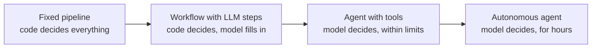
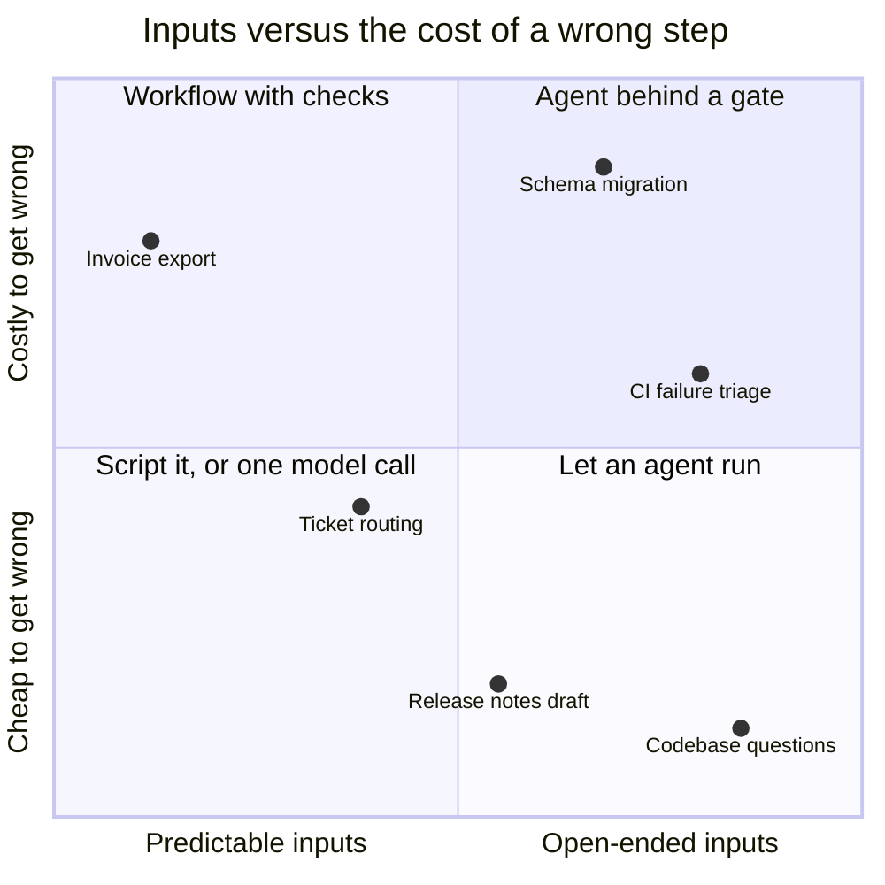
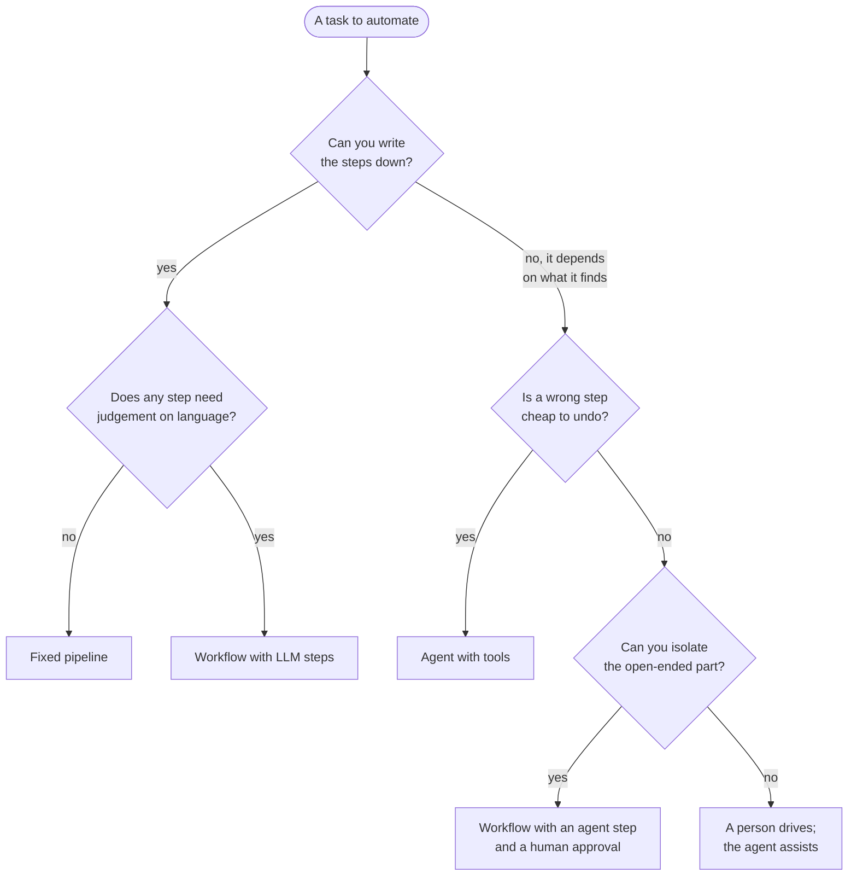
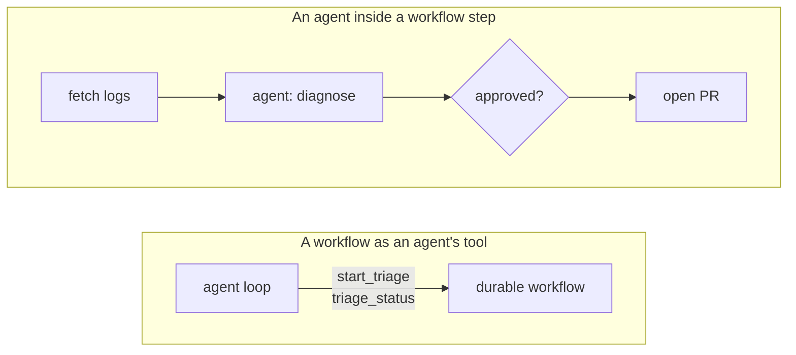
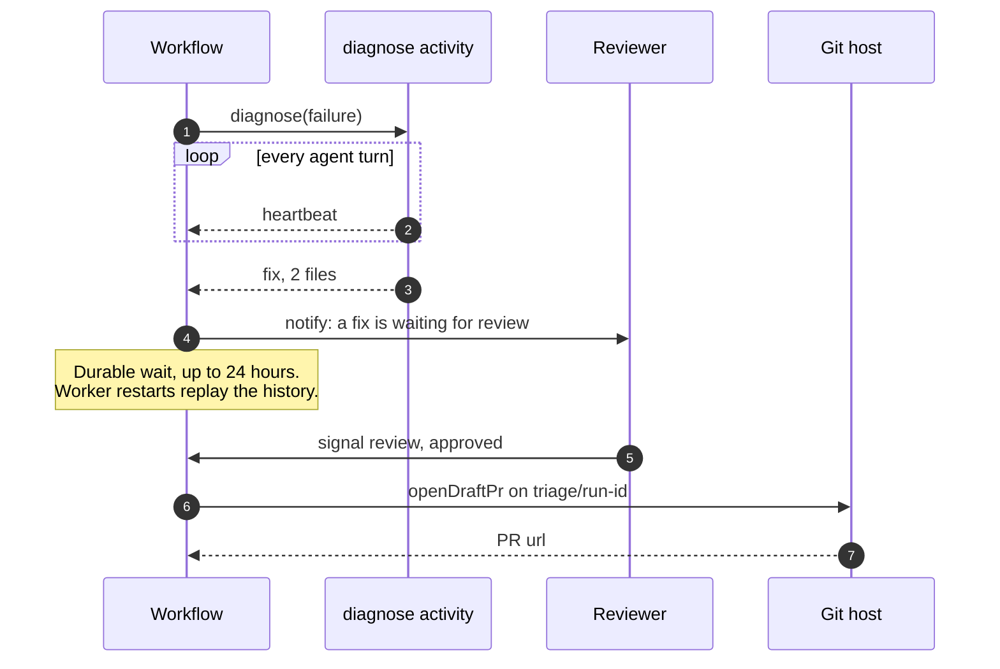

"Should this be an agent?" gets asked about almost everything now. Triaging a failed build,
drafting release notes, routing a support ticket, migrating a config format across forty
repositories. The question is usually framed as yes or no, and that framing is most of the
problem.

Anthropic's [Building effective agents](https://www.anthropic.com/engineering/building-effective-agents)
draws the line I find most useful. **Workflows** are systems where models and tools are
orchestrated through code paths you wrote in advance. **Agents** are systems where the model
directs its own process: it decides which tool to call next, and when it's done. Both are
"agentic systems". The difference is _who owns the control flow_.

Once you see it that way, the question stops being "agent or not?" and becomes "for this step,
who should decide what happens next: my code, or the model?" A single system can answer
differently for different steps, and the good ones usually do.

## The spectrum



**A fixed pipeline** has no model in the control flow at all. It may not have a model anywhere.
A nightly job that exports invoices, a CI pipeline, a cron that rotates certificates. If you can
write it this way, you should, and the arrival of LLMs didn't change that.

**A workflow with LLM steps** is still a pipeline: the order of steps is in your code, but some
steps call a model to do something only a model can do, like classifying a ticket, summarising a
diff or extracting fields from an email. Anthropic's post names the common shapes: _prompt
chaining_ (one call feeds the next, with checks in between), _routing_ (classify, then send to a
specialised path), _parallelisation_ (split the work, or ask several times and vote),
_orchestrator-workers_ and _evaluator-optimiser_ loops. All of them keep the overall path in
code.

**An agent with tools** runs a loop: the model looks at the state, picks a tool, reads the
result, and repeats until it decides to stop. You choose the tools, the instructions and the
limits (turns, time, budget); the model chooses the path. This is what coding agents do when you
ask them to fix a failing test.

**An autonomous agent** is the same loop with a longer leash: it runs for hours, decides its own
sub-goals within a mandate, and may never have a human look at an intermediate step. It needs
everything the previous level needs, plus much better evaluation and much better recovery.

| Level                       | Who picks the next step | What failure looks like                     | How you test it                         |
| --------------------------- | ----------------------- | ------------------------------------------- | --------------------------------------- |
| **Fixed pipeline**          | Your code               | An exception at a known line                | Unit and integration tests              |
| **Workflow with LLM steps** | Your code               | A plausible but wrong output from one step  | Tests, plus evals on each model step    |
| **Agent with tools**        | The model, per turn     | A reasonable-looking path to the wrong place | Evals on whole trajectories             |
| **Autonomous agent**        | The model, per goal     | Drift that nobody sees until the end        | Evals, monitoring, and audits after the fact |

The table is the argument in miniature. Every step to the right buys flexibility and pays for
it in how hard it is to know whether the thing works.

## Four questions that decide it

I don't use a scoring rubric. I ask four questions about the task, and usually one of them
settles it.

**How variable are the inputs?** If the next step depends on what you find (a stack trace
pointing somewhere unexpected, a repository with a layout you didn't anticipate), you can't write
the path down in advance, and that is the real case for an agent. If inputs vary in _content_ but
not in _shape_ (every ticket needs classifying, then routing), a workflow with one model step
handles it.

**What does a wrong step cost?** Reading a file is free to get wrong. Deleting a branch, sending
an email or applying a migration isn't. The more irreversible the actions, the more I want them
in code, behind a check, and the model's role limited to proposing.

**Does someone need to audit it?** "Why did it do that?" is easy to answer for a workflow: here's
the code path, here's the input to each step. For an agent the answer is a trajectory, which you
can store and read, but not reason about in advance. If a compliance review, an incident
post-mortem or just a sceptical teammate will need the answer, that pushes towards a workflow.

**What latency and cost can you afford?** Agents spend tokens deciding what to do, and every turn
adds a model round-trip. Anthropic's post is direct about this: agentic systems trade latency and
cost for better task performance, and you should only make that trade when it pays. A routing
step that runs ten thousand times a day should be one cheap call, not a loop.



The placement is my judgement, not a measurement, and your version of each task may sit
elsewhere. What matters is the shape: the top right is where the interesting work is, and it's
neither a pure agent nor a pure workflow.



> [!TIP]
> Start one level to the left of where you think you need to be. Anthropic's advice is to find
> the simplest solution and add complexity only when it's needed, and a single well-prompted
> model call with good retrieval covers more than it seems.

## Durable execution: the part both need

Whatever sits in the control flow, the process around it fails in boring ways. A model API
returns a 529. The worker pod is rescheduled. A step waits for a human who goes on holiday. A
workflow with nine steps that dies at step seven shouldn't redo the first six, and an agent that
has spent twenty minutes investigating shouldn't start from zero because its container restarted.

Durable execution engines exist for exactly this. I'll use [Temporal](https://docs.temporal.io/)
because its model is the clearest, but the ideas carry over.

- **Workflow code must be deterministic.** Temporal records an event history of everything the
  workflow did, and recovers by _replaying_ the code against that history. The
  [docs](https://docs.temporal.io/workflow-definition) put LLM invocations, API calls and database
  queries explicitly in the non-deterministic category, which means they don't belong in
  workflow code.
- **Non-deterministic work goes in activities.** An activity runs outside replay, and its result
  is recorded. If the worker dies after a model call completes, the replay reads the recorded
  answer instead of calling the model again, so you don't pay for it twice or get a different
  answer the second time.
- **Activities retry by policy.** The [default policy](https://docs.temporal.io/encyclopedia/retry-policies)
  starts at one second, doubles each time, caps at a hundred seconds and never stops trying.
  That's right for a flaky API and wrong for an expensive agent run, so you set it per activity.
  Errors marked non-retryable stop it immediately.
- **Waiting is free.** A workflow can wait for a signal, or a timer, for days, without holding a
  process. That's what makes human approval practical rather than a polling loop you'll regret.

```steps
Checkpoint: Every completed step is recorded. A crash resumes after the last one, not from the start.
Retry: Failed steps retry with backoff, per step, with a policy that fits what the step costs.
Wait: Timers and signals let a run pause for a person or a deadline without holding a process.
Resume: A replacement worker replays the history and continues exactly where the old one stopped.
```

Agent frameworks have converged on parts of this. LangGraph, for example, saves graph state
through a checkpointer and can pause a run with [`interrupt()`](https://docs.langchain.com/oss/python/langgraph/interrupts)
until you resume it with the same thread id. It covers the human-in-the-loop case well; what it
doesn't give you is per-step retry policies and replay of arbitrary code.

> [!WARNING]
> Activities run _at least once_. A retry after a timeout can repeat a side effect that already
> happened. Every activity that writes (opens a PR, posts a message, charges a card) needs an
> idempotency key, or the retry that saves you from a flaky network will also open two pull
> requests.

## Hybrids: where most of the good systems are

The two hybrids that matter are mirror images.



**An agent inside a workflow step.** The workflow owns the path: gather inputs, run the agent,
check what it produced, ask a person, act. The agent owns one bounded, open-ended step and gets
read-only tools. Everything irreversible happens in plain code, after the gate.

**A workflow as an agent's tool.** The agent decides _whether_ and _when_ to do something; the
workflow decides _how_, durably. The agent gets a tool that starts a workflow and returns a
handle, and another that reports its status. The agent can't skip a step of a release process,
because the release process isn't its to skip.

### An agent inside a workflow, in Temporal

Here's the first hybrid: triaging a failed nightly CI run. The workflow fetches the failure,
lets an agent diagnose it, and either reports a flake or waits for a person to approve a fix
before opening a draft PR. It's written against Temporal's TypeScript SDK.

```ts title="src/workflows.ts" {5-14,31-34}
import { condition, defineSignal, proxyActivities, setHandler } from "@temporalio/workflow";
import type * as activities from "./activities";

// Plain steps: short timeout, retried with backoff.
const { fetchFailure, notify, openDraftPr } = proxyActivities<typeof activities>({
  startToCloseTimeout: "2 minutes",
  retry: { initialInterval: "2s", backoffCoefficient: 2, maximumAttempts: 5 },
});
// The agent step: a bigger budget, a heartbeat, and almost no retries.
const { diagnose } = proxyActivities<typeof activities>({
  startToCloseTimeout: "20 minutes",
  heartbeatTimeout: "2 minutes",
  retry: { maximumAttempts: 2, nonRetryableErrorTypes: ["AgentGaveUp"] },
});

type Verdict = { approved: boolean; reviewer: string };
export const review = defineSignal<[Verdict]>("review");

export async function triageNightlyFailure(runId: string): Promise<string> {
  const state: { verdict?: Verdict } = {};
  setHandler(review, (verdict) => { state.verdict = verdict; });

  const failure = await fetchFailure(runId);
  const diagnosis = await diagnose(failure);
  if (diagnosis.kind === "flake") {
    await notify(`${runId} looks flaky: ${diagnosis.summary}`);
    return "flake";
  }

  await notify(`${runId}: a fix is waiting for review`, diagnosis);
  const answered = await condition(() => state.verdict !== undefined, "24 hours");
  const verdict = state.verdict;
  if (!answered || !verdict?.approved) return "dropped";
  return openDraftPr(runId, diagnosis, verdict.reviewer);
}
```

Two different retry policies in one file is the point. A failed HTTP call to the CI provider
should be retried until it works. A twenty-minute agent run that gave up shouldn't be retried at
all, and one that returned something malformed deserves exactly one more chance. The 24-hour
`condition` is a durable wait: the worker can restart a dozen times and the workflow will still
be waiting for the signal, or for the timeout.

The agent step is an ordinary activity. `runAgent` stands in for your own agent loop (the model
call, the tool dispatch, the turn limit), which is the subject of
[harness engineering](/blog/harness-engineering); what matters here is the contract around it.

```ts title="src/activities.ts" {14,24,28-31}
import { heartbeat } from "@temporalio/activity";
import { ApplicationFailure } from "@temporalio/common";
import * as z from "zod";
import { runAgent } from "./agent"; // illustrative: your loop, model and tools

export interface Failure { runId: string; job: string; logTail: string }

const Diagnosis = z.discriminatedUnion("kind", [
  z.object({ kind: z.literal("flake"), summary: z.string() }),
  z.object({
    kind: z.literal("fix"),
    summary: z.string(),
    patch: z.string(),
    files: z.array(z.string()).min(1).max(5), // bigger than this is not a triage fix
  }),
]);
export type Diagnosis = z.infer<typeof Diagnosis>;

export async function diagnose(failure: Failure): Promise<Diagnosis> {
  const run = await runAgent({
    instructions:
      "Explain why this CI job failed. Propose the smallest fix, or call it a flake.",
    input: failure.logTail,
    tools: ["read_file", "grep", "git_log"], // read-only: writing is the workflow's job
    maxTurns: 25,
    onTurn: () => heartbeat(),
  });
  if (run.stopReason === "max_turns") {
    throw ApplicationFailure.nonRetryable("Agent ran out of turns", "AgentGaveUp");
  }
  return Diagnosis.parse(run.output); // malformed output throws and gets its one retry
}
// fetchFailure, notify and openDraftPr are plain API calls. openDraftPr pushes to
// the branch `triage/<runId>`, so a retry finds the PR it already opened.
```

The schema is where the workflow keeps its promises to the rest of the system. The agent can
explore however it likes, but what comes out is either a flake with a summary or a fix of at
most five files, and anything else fails loudly. The heartbeat on every turn lets Temporal tell a
slow agent from a dead one.



### A workflow as an agent's tool

The mirror image takes less code. Expose two tools to the agent, one to start the workflow and
one to ask how it's going, and use the run id as the workflow id so asking twice doesn't start
two triages. This is glue, not a full server: in practice these would be MCP tools, and the
workflow id is exactly the kind of explicit handle the current MCP spec asks stateful tools to
return (more in [MCP and A2A](/blog/mcp-vs-a2a)).

```ts title="src/tools/triage.ts"
import {
  Client,
  Connection,
  WorkflowExecutionAlreadyStartedError,
} from "@temporalio/client";
import { triageNightlyFailure } from "../workflows";

const client = new Client({ connection: await Connection.connect() });

export async function startTriage({ runId }: { runId: string }) {
  const workflowId = `triage-${runId}`; // one triage per run, however often the agent asks
  try {
    await client.workflow.start(triageNightlyFailure, {
      taskQueue: "triage",
      workflowId,
      args: [runId],
    });
    return { workflowId, status: "started" };
  } catch (err) {
    if (err instanceof WorkflowExecutionAlreadyStartedError) {
      return { workflowId, status: "already running" };
    }
    throw err;
  }
}

export async function triageStatus({ workflowId }: { workflowId: string }) {
  const { status } = await client.workflow.getHandle(workflowId).describe();
  return { workflowId, status: status.name }; // RUNNING, COMPLETED, FAILED…
}
```

The agent never sees the approval step, the retry policies or the PR logic. It can only start
the process and watch it, which is exactly the right amount of power for it to have. Choosing
between this and the previous shape is mostly a question of who the user is talking to: if they
talk to an agent that does many things, the workflow becomes one of its tools; if the process is
the product, the agent becomes one of its steps. How to compose several of these is in
[agent orchestration patterns](/blog/agent-orchestration-patterns).

## When not to, and what this doesn't fix

**Don't build a workflow engine for a script.** Temporal is a cluster to run, or a service to pay
for, plus a programming model your team has to learn: determinism rules, versioning when you
change a workflow that has runs in flight. For a task that takes thirty seconds and can simply be
rerun, a script with a retry loop is the right answer.

**Don't build an agent for a lookup.** If the task is "classify this and send it there", a loop
that decides which tool to call is paying for a decision that has only one answer.

**Don't let durability hide a bad step.** A durable workflow around an agent that makes the
wrong call still makes the wrong call; it just does it reliably, and after a retry. Durable
execution protects you from infrastructure failures, not from judgement failures. For those you
need evaluation of the agent step on real cases, and a gate in front of anything you can't undo.

> [!IMPORTANT]
> The approval step only works if the reviewer can actually judge what they're approving. A
> diff of five files with a one-line summary is reviewable. "The agent wants to proceed" is not a
> gate, it's a button.

And the line moves. A step that needs an agent today may be a workflow tomorrow once you've seen
enough runs to write the path down, and the reverse happens when the inputs get messier than you
planned. I'd rather design so that a step can change sides without rewriting everything around
it, which is the real argument for hybrids.

## Further reading

- [Building effective agents](https://www.anthropic.com/engineering/building-effective-agents):
  Anthropic's post defining workflows versus agents, with the five workflow patterns and clear
  advice on starting simple. The reference for the first half of this post.
- [Temporal: Workflow definition](https://docs.temporal.io/workflow-definition): why workflow code
  must be deterministic, how replay works, and what goes in activities instead. Short and worth
  understanding before you write your first workflow.
- [Temporal: Retry policies](https://docs.temporal.io/encyclopedia/retry-policies): the default
  policy, non-retryable errors, and how activity and workflow retries differ.
- [Temporal: Workflow message passing](https://docs.temporal.io/develop/typescript/workflows/message-passing):
  signals, queries and updates in the TypeScript SDK, the building blocks of human-in-the-loop
  steps.
- [LangGraph: Interrupts](https://docs.langchain.com/oss/python/langgraph/interrupts): how a graph
  pauses for human input and resumes from a checkpoint; useful to compare with Temporal's model.
- [Temporal and the Vercel AI SDK](https://temporal.io/blog/building-durable-agents-with-temporal-and-ai-sdk-by-vercel):
  a worked example of running an agent's model calls and tools as activities, from Temporal's
  own blog.
