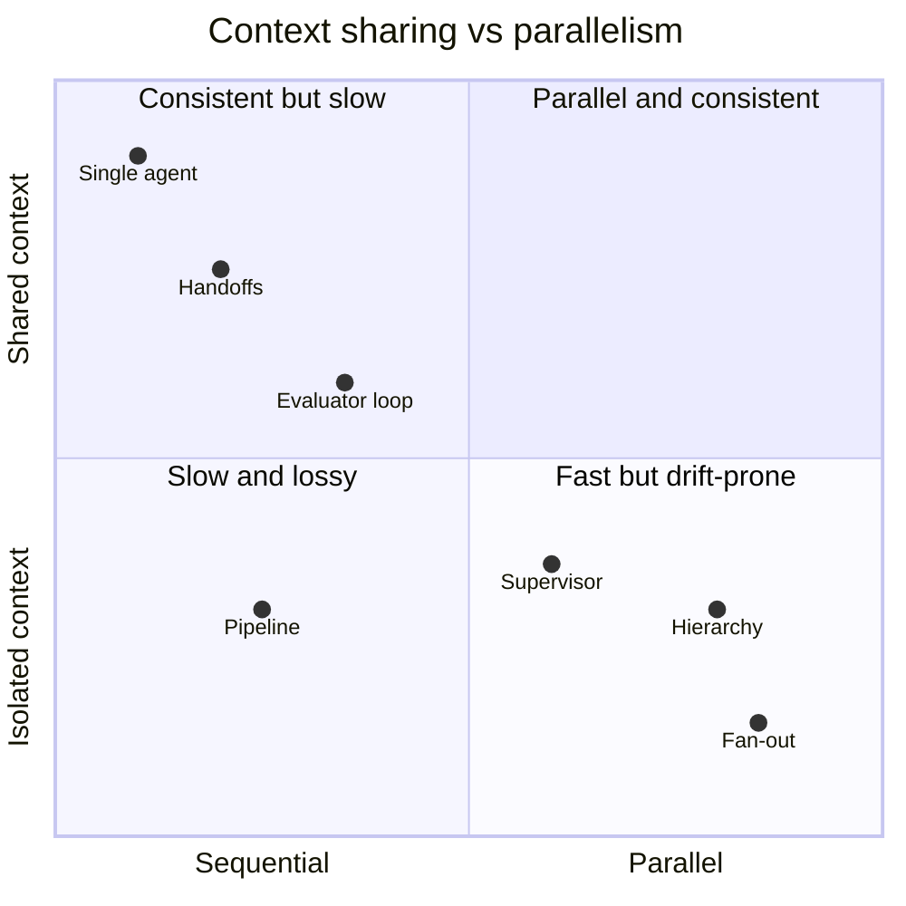
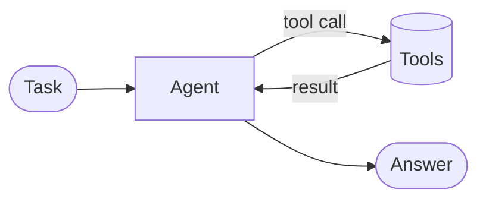
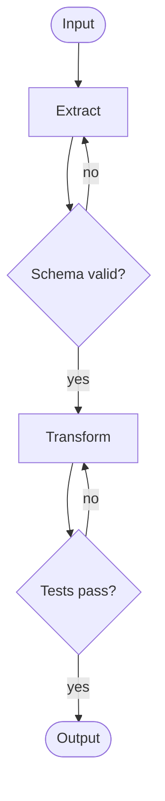
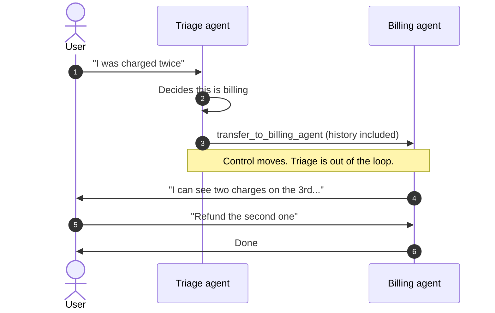
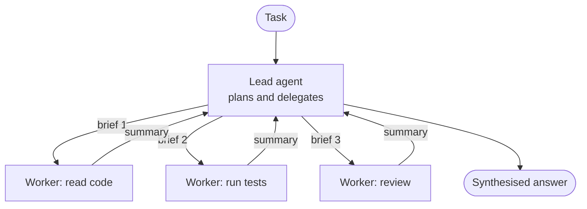
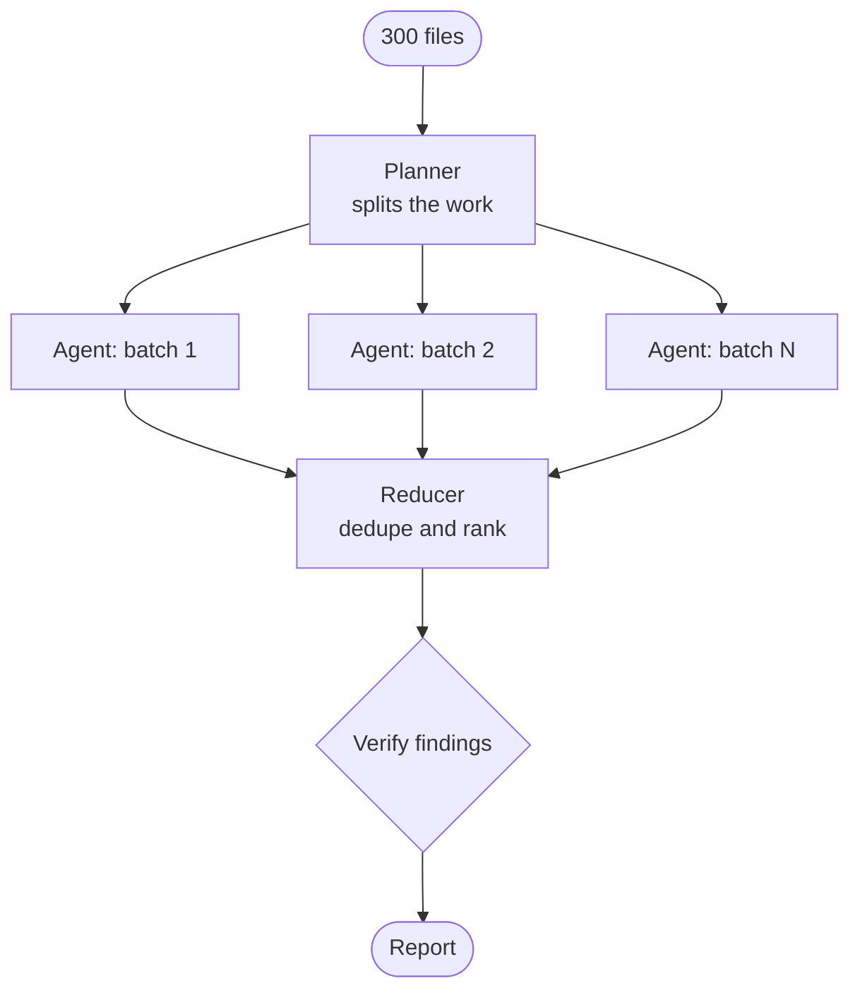
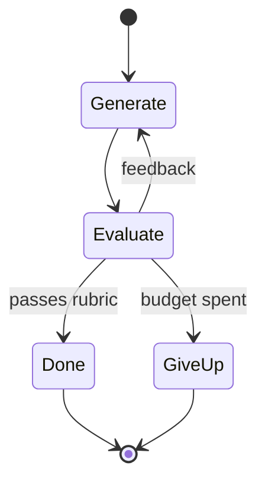
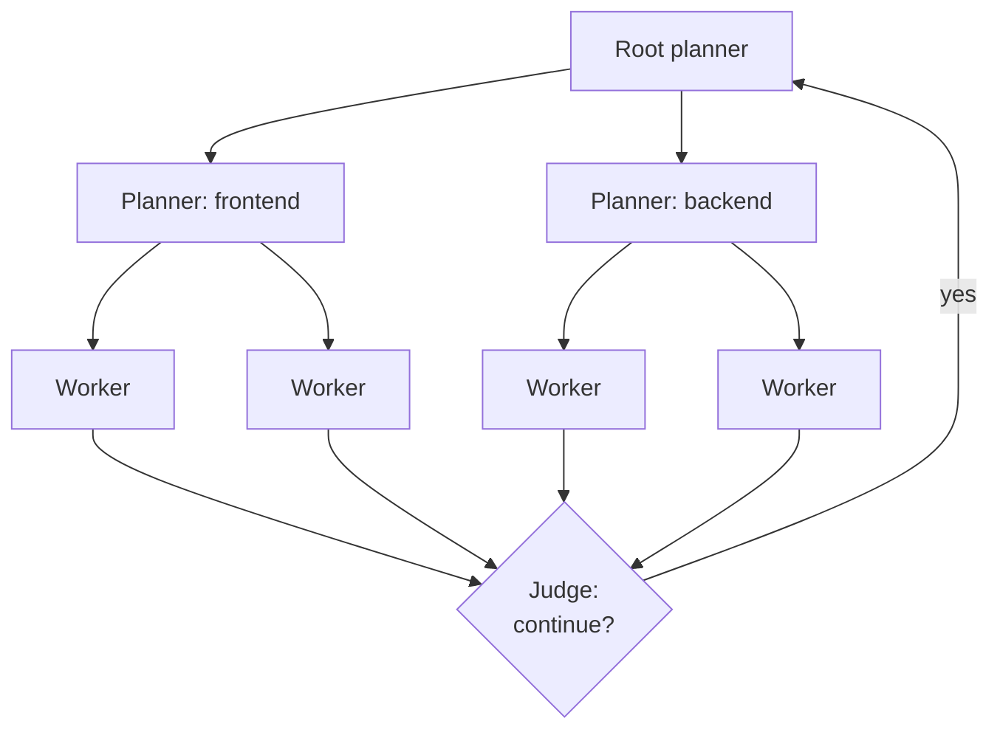
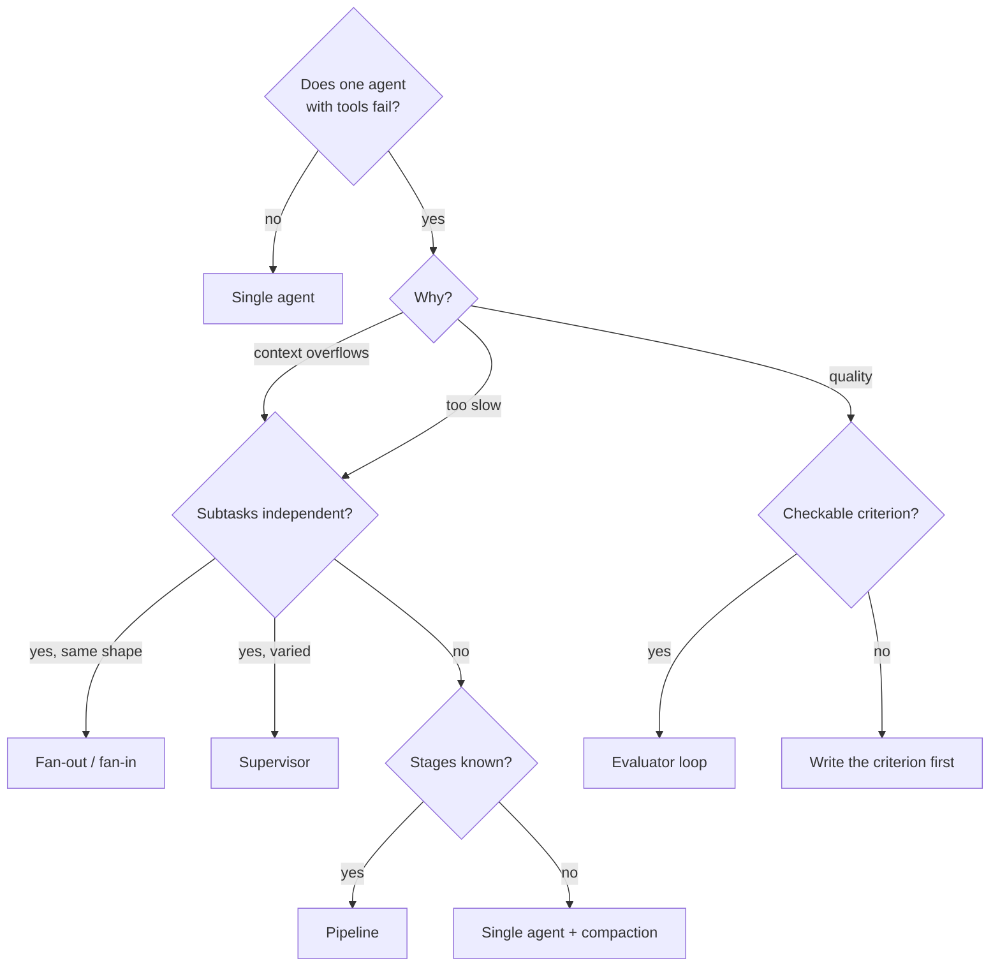

La mayoría de los diagramas multiagente que veo funcionarían mejor como un solo agente con un buen juego de herramientas. No es una pulla contra los sistemas multiagente. Es lo mismo que escriben quienes los construyen para ganarse la vida. [Building effective agents](https://www.anthropic.com/engineering/building-effective-agents), de Anthropic, empieza diciendo que busques lo más simple que funcione y que solo añadas complejidad cuando mejore los resultados de forma medible. [Don't build multi-agents](https://cognition.com/blog/dont-build-multi-agents), de Cognition, va más allá. Y luego el propio [sistema de investigación multiagente](https://www.anthropic.com/engineering/multi-agent-research-system) de Anthropic superó por mucho a un agente único en su evaluación interna.

Los dos bandos tienen razón, sobre tareas distintas. Un patrón de orquestación es un intercambio: pagas en tokens, latencia y nuevos modos de fallo, y a cambio recibes paralelismo, especialización o una segunda opinión. Este artículo es la lista de precios que uso yo. Cubre los patrones que aparecen una y otra vez en los *frameworks* de agentes, lo que cuesta cada uno y cuándo merece la pena.

## Las tres facturas y el único eje

Cada patrón te pasa alguna combinación de tres facturas.

**Tokens.** Anthropic midió que los agentes gastan unas 4 veces los tokens de un chat, y los sistemas multiagente unas 15 veces ([fuente](https://www.anthropic.com/engineering/multi-agent-research-system)). En su evaluación de navegación, el uso de tokens explicaba por sí solo el 80 % de la varianza del rendimiento. Parte de lo que compras con más agentes es, sencillamente, la capacidad de gastar más tokens en un problema a la vez.

**Latencia.** Los agentes en secuencia suman sus latencias. Los agentes en paralelo terminan cuando termina el más lento, más lo que cueste el paso de síntesis. Un pipeline de cinco agentes son cinco rondas de pensar antes de que nadie vea un resultado.

**Errores que se acumulan.** Una mala decisión al principio se convierte en la premisa de todo lo que viene después. [Towards a science of scaling agent systems](https://research.google/blog/towards-a-science-of-scaling-agent-systems-when-and-why-agent-systems-work/), de Google Research, lo midió directamente. Agentes independientes trabajando en paralelo, sin nada que revisara su salida, amplificaban los errores 17,2 veces respecto a un solo agente. Un orquestador centralizado que valida los resultados lo dejaba en unas 4,4 veces. El mismo estudio encontró que las variantes multiagente empeoraban las tareas estrictamente secuenciales, entre un 39 % y un 70 %.

Y hay un eje que predice casi todo el comportamiento de un patrón: **¿cada agente comparte el contexto completo o trabaja aislado?** El contexto compartido mantiene las decisiones coherentes y cuesta tokens. El contexto aislado es barato y paralelo, y permite que dos agentes hagan en silencio suposiciones incompatibles. El ejemplo de Cognition es un clon de Flappy Bird repartido entre dos subagentes, que volvieron con un fondo de Super Mario y un pájaro que no encajaba con ninguno de los dos. Este eje lo trato a fondo en [/blog/context-engineering](/blog/context-engineering). Aquí basta con fijarse en qué lado cae cada patrón.



## 0. Un agente con herramientas: la línea base

Este es el patrón que todos los demás tienen que batir. Un modelo, una ventana de contexto y un bucle que llama a herramientas hasta terminar la tarea. El *harness* que lo rodea ([/blog/harness-engineering](/blog/harness-engineering)) hace casi todo el trabajo: buenas herramientas, buenos mensajes de error, una estrategia de compactación cuando el contexto crece.



Tiene un único contexto, así que cada decisión es visible para todas las que vienen después y no hay nada que traspasar. Falla cuando la tarea no cabe en la ventana, o cuando el trabajo es de verdad paralelo y lo estás esperando en serie. Hasta que no se cumple una de esas dos cosas, no añado agentes.

## 1. Pipeline: etapas fijas con compuertas

Anthropic lo llama *prompt chaining*: divides la tarea en etapas conocidas de antemano y pasas la salida de cada una a la siguiente. Lo útil es la **compuerta** entre etapas, una comprobación en código normal que frena un resultado intermedio malo antes de que la siguiente etapa construya sobre él.



Cada etapa recibe un contexto pequeño y centrado, con su propio prompt y su propio modelo, así que un modelo barato puede hacerse cargo de las etapas aburridas. El coste es la latencia (las etapas se suman) y la rigidez: el pipeline no puede decidir a mitad de camino que la tarea necesitaba otra forma. Google ADK tiene un `SequentialAgent` justo para esto, y Microsoft Agent Framework lo llama *orquestación secuencial*.

Lo uso cuando puedo escribir las etapas antes de empezar y comprobar cada una con código. Una migración con un orden fijo es el caso típico: parsear, transformar, comprobar tipos, pasar tests. Si no sé nombrar las compuertas, todavía no es un pipeline.

## 2. Handoffs: traspasar el control y conservar la conversación

En un *handoff*, un agente decide que otro está mejor situado y le cede el **control**. No lo llama como a una función. El agente receptor se queda con la conversación y habla directamente con el usuario. Es el patrón de triaje de atención al cliente: un agente de recepción te deriva a facturación o a devoluciones, y es facturación quien te responde.



En el OpenAI Agents SDK el handoff se le presenta al modelo como una herramienta, así que `Billing agent` se convierte en una herramienta llamada `transfer_to_billing_agent` ([documentación](https://openai.github.io/openai-agents-python/handoffs/)):

```python title="triage.py"
from agents import Agent, Runner

billing = Agent(
    name="Billing agent",
    handoff_description="Charges, invoices and refunds.",
    instructions="Resolve billing issues. You can see the full history.",
)
tech = Agent(
    name="Tech support agent",
    handoff_description="Login problems, errors, outages.",
    instructions="Diagnose technical problems step by step.",
)
triage = Agent(
    name="Triage agent",
    instructions="Work out what the user needs and hand off. Don't answer yourself.",
    handoffs=[billing, tech],
)

result = Runner.run_sync(triage, "I was charged twice this month.")
print(result.last_agent.name, "->", result.final_output)
```

El mismo SDK tiene también la primitiva contraria, `agent.as_tool(...)`. Envuelve a un especialista como herramienta que quien llama *invoca* y de la que recibe una respuesta, sin ceder la conversación. La diferencia importa. Un handoff es una puerta de un solo sentido. Un agente como herramienta es una llamada a función.

Los handoffs mantienen el contexto compartido, porque el historial viaja con el traspaso, y mantienen cortas las instrucciones de cada agente. Lo que cuestan es supervisión: después del traspaso nadie es dueño de la tarea completa. Si facturación necesita algo que solo sabe soporte técnico, hace falta un handoff de vuelta, y los bucles de handoffs (el «ping-pong») son un modo de fallo real. Recurro a ellos cuando los dominios están separados y una conversación rara vez necesita los dos.

## 3. Orquestador–trabajador (supervisor)

Un agente líder descompone la tarea en tiempo de ejecución, delega partes en trabajadores y sintetiza lo que le devuelven. A diferencia del handoff, el líder **conserva el control**. Los trabajadores son llamadas a función con su propia ventana de contexto que devuelven un resumen. Anthropic lo recomienda para tareas en las que no se pueden predecir las subtareas necesarias, y es la forma de su sistema de investigación.



El contexto aislado del trabajador es precisamente la gracia. Un trabajador puede leer cuarenta ficheros y devolver doce líneas, y el contexto del líder sigue limpio. Anthropic describe los subagentes como filtros justo por esto. El [Claude Agent SDK](https://code.claude.com/docs/en/agent-sdk/subagents) hace de esta la forma por defecto de definir trabajadores. El líder delega mediante la herramienta `Agent`, y cada trabajador tiene su propio prompt, su lista de herramientas y su modelo:

```ts title="supervisor.ts" {6-7,21-27}
import { query } from "@anthropic-ai/claude-agent-sdk";

for await (const message of query({
  prompt: "Find why /api/orders is slow and propose a fix. Delegate the digging.",
  options: {
    // The lead can read and delegate; it can't edit anything itself.
    allowedTools: ["Read", "Grep", "Glob", "Agent"],
    agents: {
      "code-reader": {
        description: "Reads code paths and reports where time could be spent.",
        prompt: "Trace the request path. Report file:line and your reasoning.",
        tools: ["Read", "Grep", "Glob"],
        model: "haiku",
      },
      "profiler": {
        description: "Runs the benchmarks and reports numbers, not opinions.",
        prompt: "Run `npm run bench:orders`. Report p50/p95 and the hottest frames.",
        tools: ["Bash", "Read"],
      },
    },
    // Bound the tree: no nested delegation, at most 4 workers at once, $3 total.
    env: {
      ...process.env,
      CLAUDE_CODE_MAX_SUBAGENT_SPAWN_DEPTH: "1",
      CLAUDE_CODE_MAX_CONCURRENT_SUBAGENTS: "4",
    },
    maxBudgetUsd: 3,
  },
})) {
  if (message.type === "result") console.log(message.subtype, message.total_cost_usd);
}
```

Dos detalles de ese listado son lecciones que otros aprendieron por las malas. El trabajador recibe **solo** el encargo que escribe el líder, nada de su historial. La documentación del SDK lo dice sin rodeos: el prompt de la herramienta Agent es el único canal de padre a hijo. Así que la calidad de todo el sistema depende de que el líder escriba buenos encargos. La primera versión de Anthropic lanzaba 50 subagentes para consultas sencillas y tenía trabajadores duplicando el trabajo de otros porque los encargos eran vagos. Y los límites de profundidad, concurrencia y gasto existen porque es el líder quien decide cuántos trabajadores arrancar. Sin ellos, un prompt puede crecer hasta convertirse en un árbol.

> [!TIP]
> Escribe el encargo del trabajador como escribirías un ticket para un compañero que nunca ha visto el código: el objetivo, lo que ya está descartado, las rutas, el formato de salida esperado y cuándo parar. Un encargo que cabe en una línea suele ser un título, no una tarea.

Este es el patrón que más uso. Explorar, revisar y depurar se dividen de forma natural en «ve a mirar esto y cuéntame qué has encontrado».

## 4. Fan-out / fan-in

Un caso particular del supervisor que merece nombre propio: el mismo tipo de trabajo, **muchos elementos independientes**, ejecutados en paralelo y combinados al final. Es map-reduce con un modelo en el paso de map. La taxonomía de Anthropic lo llama *parallelization*, en dos variantes: *sectioning* (trozos distintos de la entrada) y *voting* (la misma tarea varias veces, para comparar respuestas).



Aquí la orquestación es código determinista y no necesita ningún modelo. En LangGraph devuelves un `Send` por elemento desde una arista condicional, y un *reducer* en el estado combina los resultados ([documentación](https://docs.langchain.com/oss/python/langgraph/graph-api-send-command)):

```python title="audit_graph.py" {8,13-14}
import operator
from typing_extensions import Annotated, TypedDict
from langgraph.graph import END, START, StateGraph
from langgraph.types import Send

class AuditState(TypedDict):
    files: list[str]
    findings: Annotated[list[dict], operator.add]  # reducer: concat worker outputs

class FileState(TypedDict):
    file: str

def fan_out(state: AuditState):
    return [Send("audit_file", {"file": f}) for f in state["files"]]

def audit_file(state: FileState):
    return {"findings": [run_auditor_agent(state["file"])]}  # your agent call

builder = StateGraph(AuditState)
builder.add_node("audit_file", audit_file)
builder.add_conditional_edges(START, fan_out, ["audit_file"])
builder.add_edge("audit_file", END)
graph = builder.compile()
```

El fan-out es donde el paralelismo de verdad compensa: Anthropic cuenta que redujo el tiempo de investigación hasta un 90 % en consultas complejas. También es donde vive la amplificación de errores de 17,2 veces, porque en el paso de map nada comprueba nada. Mi regla es que un fan-out sin un paso de verificación en el fan-in no está terminado. Por eso el diagrama acaba en una comprobación y no en «combinar».

Funciona para auditorías, migraciones, revisiones fichero a fichero y cualquier otra cosa que sea de verdad «la misma pregunta, muchas veces». Falla en cualquier cosa en la que el elemento 7 dependa de lo que aprendiste con el elemento 3.

## 5. Evaluador–optimizador, y debate

Un agente genera y otro juzga, con *feedback*, en bucle hasta que el juez lo aprueba o se acaba el presupuesto. El *debate* es la versión a varias voces: varios agentes discuten y un juez, o una votación, decide. La [documentación de agent teams](https://code.claude.com/docs/en/agent-teams.md) de Claude Code propone algo así para depurar: compañeros con hipótesis rivales, cada uno intentando refutar las de los demás, porque un único investigador tiende a anclarse en la primera teoría plausible.



El bucle en sí es sencillo. Lo difícil es la regla de parada. Aquí está como **pseudocódigo ilustrativo**. `generate`, `evaluate` y `Verdict` representan tus propias llamadas al modelo:

```python title="refine_loop.py (pseudo-code)"
def refine(task: str, max_rounds: int = 3) -> str:
    draft = generate(task)
    for round in range(max_rounds):
        verdict: Verdict = evaluate(task, draft)   # separate context, rubric-driven
        if verdict.passes:
            return draft
        if round > 0 and verdict.score <= last_score:
            break                                  # not improving: stop paying
        last_score = verdict.score
        draft = generate(task, previous=draft, feedback=verdict.feedback)
    return escalate_to_human(task, draft, verdict)
```

Compensa cuando hay un **criterio claro** que el juez pueda aplicar. La propia guía de Anthropic dice que se use cuando existen criterios de evaluación claros. Su evaluación del sistema de investigación encontró además que un único juez LLM con una rúbrica, que daba una nota de 0,0 a 1,0 más aprobado/suspenso, era lo más coherente con el juicio humano. Sin rúbrica, dos modelos se pondrán de acuerdo encantados sobre una respuesta mediocre. Y nunca dejes que el generador se juzgue a sí mismo en el mismo contexto. Expliqué por qué en [/blog/agentic-development-sessions](/blog/agentic-development-sessions).

> [!WARNING]
> Un juez también es un modelo. Si el juez y el generador comparten un punto ciego, el bucle converge en ese punto ciego con muchísima seguridad. Siempre que puedas, haz que el juez sea ejecutable: tests, un *type-checker*, un esquema.

## 6. Jerárquico

Supervisores de supervisores. Un planificador de primer nivel divide el problema en áreas, cada área tiene su propio líder y cada líder tiene sus trabajadores. [Scaling long-running autonomous coding](https://cursor.com/blog/scaling-agents), de Cursor, es el mejor relato público que conozco. Los agentes planos que se coordinaban solos se volvieron reacios al riesgo y daban vueltas sin avanzar. Lo que funcionó fueron planificadores que lanzan subplanificadores, trabajadores que no se coordinan entre sí y un juez que decide al final de cada ciclo si seguir.



Así es como el trabajo va más allá de lo que un solo líder puede seguir. También es donde se multiplican todos los costes anteriores: cada capa añade latencia, cada encargo pierde algo de detalle y cada resumen filtra algo. Por eso el Claude Agent SDK limita la profundidad de anidamiento por defecto. Cuando ya estás ejecutando decenas o cientos de agentes, los problemas dejan de ser de prompting y pasan a ser de sistemas distribuidos. Ese es el tema del artículo complementario, [/blog/agent-swarms-distributed-systems](/blog/agent-swarms-distributed-systems).

## La comparación

| Patrón | Latencia | Tokens | Fallo típico | Compensa cuando |
| --- | --- | --- | --- | --- |
| **Agente único** | En serie | 1× | Desbordar el contexto | Casi siempre, pruébalo primero |
| **Pipeline** | Suma de etapas | Bajo | Los errores tempranos se propagan | Etapas y compuertas conocidas de antemano |
| **Handoffs** | En serie | Bajo–medio | Ping-pong, sin dueño | Dominios separados, de uno en uno |
| **Supervisor** | Paralelo + síntesis | Alto | Encargos vagos, trabajo duplicado | Subtareas que solo se conocen en ejecución |
| **Fan-out / fan-in** | El trabajador más lento | Alto, crece con N | Errores sin revisar que se amplifican | Muchos elementos independientes |
| **Bucle evaluador** | Rondas × 2 | Medio–alto | El juez comparte el punto ciego | Existe una rúbrica o un test |
| **Jerárquico** | Las capas se suman | Muy alto | Resúmenes con pérdidas, árboles desbocados | Trabajo demasiado grande para un líder |

## Cómo elijo

La pregunta no es «qué patrón es mejor». Es «cuál es la estructura más barata que elimina el cuello de botella que tengo de verdad».



```steps
Línea base: Construye la versión con un solo agente y una evaluación de unos 20 casos reales. Anthropic empezó con unos 20.
Diagnostica: Lee las trazas. ¿Es contexto, latencia o calidad? Cada uno tiene un arreglo distinto.
Cambio mínimo: Añade un patrón que ataque ese cuello de botella, con límites de profundidad, concurrencia y gasto.
Mide: La misma evaluación, más tokens y tiempo real. Quédatelo solo si la mejora compensa la factura.
```

Los handoffs no aparecen en el árbol de decisión porque responden a otra pregunta. Van de *quién habla con el usuario*, no de cómo sacar el trabajo adelante, y se combinan con cualquiera de los demás.

## Cuándo no

La versión honesta: la mayoría de las tareas de programación no se paralelizan bien. Anthropic lo dice de su propio sistema de investigación. Programar tiene menos subtareas de verdad independientes que investigar, y los agentes LLM todavía coordinan mal en tiempo real. El [estudio MAST](https://arxiv.org/abs/2503.13657) de Berkeley sobre *frameworks* multiagente encontró que las mejoras respecto a un agente único solían ser mínimas, y clasificó los fallos en problemas de especificación, desalineación entre agentes y verificación débil. Ninguno de ellos se arregla añadiendo agentes.

> [!IMPORTANT]
> Si una tarea es secuencial (cada paso depende del anterior), añadir agentes la empeora, no solo la encarece. Divide el trabajo por *independencia*, nunca por puesto de trabajo. Un «agente diseñador», un «agente programador» y un «agente tester» pasándose una funcionalidad es un pipeline de handoffs con pérdidas.

Tampoco recurro a montajes multiagente para tareas de poco valor. Con 15 veces los tokens, la tarea tiene que merecerlo. Ni los uso donde no puedo verificar la salida. Más agentes producen más salida, y una salida que nadie comprueba es solo una forma más rápida de equivocarse.

## Para seguir aprendiendo

- [Building effective agents — Anthropic](https://www.anthropic.com/engineering/building-effective-agents). La taxonomía de *workflows* (chaining, routing, parallelization, orchestrator–workers, evaluator–optimizer) que hoy copian casi todos los *frameworks*. Léelo primero.
- [How we built our multi-agent research system — Anthropic](https://www.anthropic.com/engineering/multi-agent-research-system). El caso práctico de orquestador–trabajador con números reales: 15 veces los tokens, las reglas para escalar el esfuerzo, los primeros modos de fallo y la evaluación con un juez LLM.
- [Don't build multi-agents — Cognition](https://cognition.com/blog/dont-build-multi-agents). El mejor argumento del otro lado: comparte el contexto completo, y recuerda que las acciones llevan decisiones implícitas.
- [Towards a science of scaling agent systems — Google Research](https://research.google/blog/towards-a-science-of-scaling-agent-systems-when-and-why-agent-systems-work/). El estudio controlado detrás de la amplificación de errores de 17,2 frente a 4,4, y de por qué las tareas secuenciales empeoran.
- [Why do multi-agent LLM systems fail? (MAST) — Cemri et al.](https://arxiv.org/abs/2503.13657). Una taxonomía de 14 modos de fallo sacada de trazas anotadas. Útil como lista de comprobación al leer las tuyas.
- [Handoffs — OpenAI Agents SDK](https://openai.github.io/openai-agents-python/handoffs/). La documentación más clara sobre handoffs frente a agentes como herramientas.
- [Subagents in the SDK — Claude Agent SDK](https://code.claude.com/docs/en/agent-sdk/subagents). Definición de trabajadores, qué hereda un subagente y los límites de profundidad, concurrencia y gasto.
- [Workflow orchestrations — Microsoft Agent Framework](https://learn.microsoft.com/en-us/agent-framework/workflows/orchestrations/). Los mismos patrones con otros nombres (sequential, concurrent, handoff, group chat, magentic), útil para ver qué es universal.
