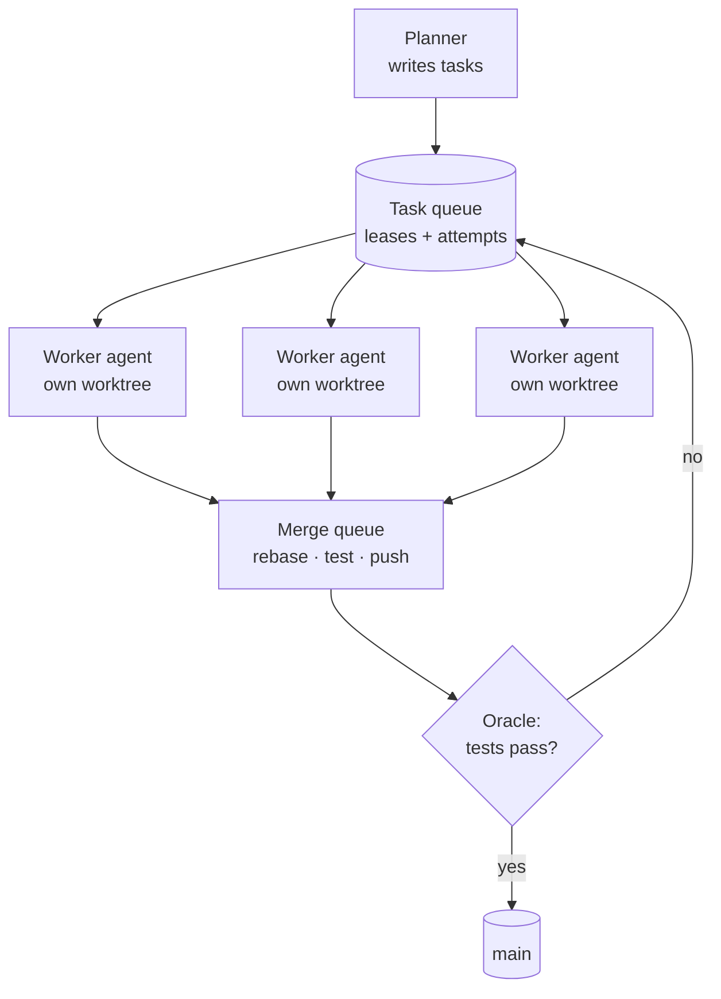
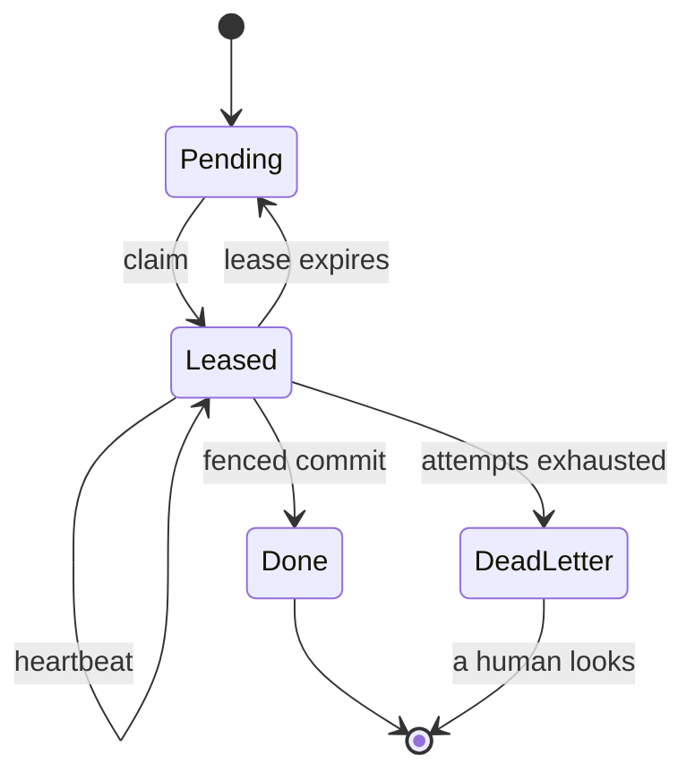
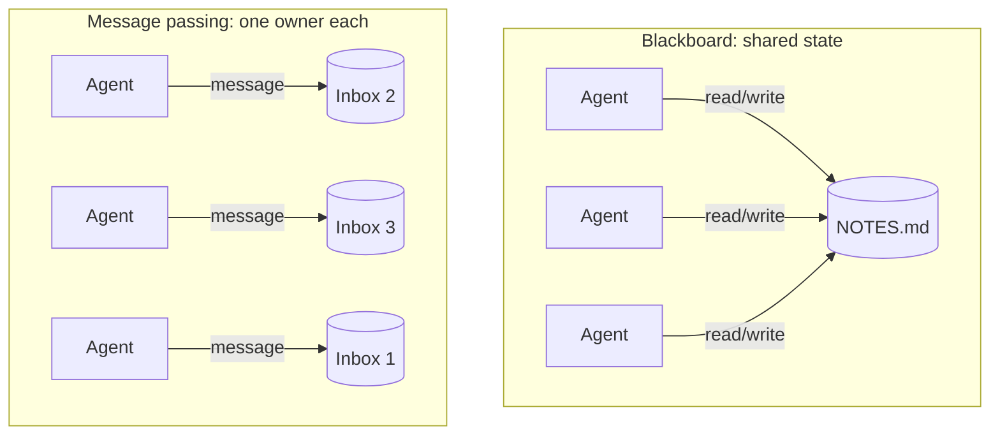
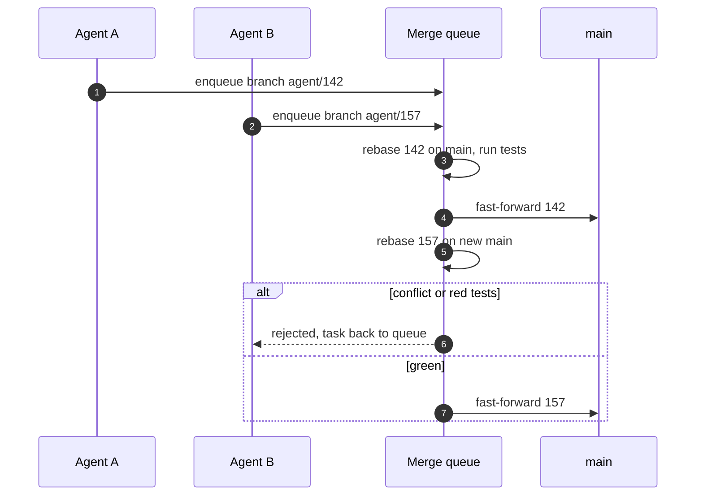
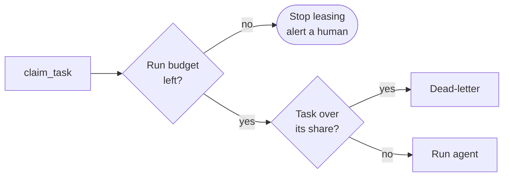

Con tres agentes, la coordinación es un problema de prompts. Escribes buenos encargos, lees los resúmenes y haces el merge a mano. Con cien deja de serlo. Lo que tienes entonces es un sistema distribuido cuyos nodos son lentos, caros, no deterministas y, de vez en cuando, se equivocan con total seguridad, y todos escriben en el mismo repositorio Git.

Los dos relatos públicos más detallados de agentes a esa escala se leen como *postmortems* de sistemas distribuidos. En [Building a C compiler with a team of parallel Claudes](https://www.anthropic.com/engineering/building-c-compiler), Nicholas Carlini tuvo 16 agentes trabajando unas dos semanas, casi 2.000 sesiones y algo menos de 20.000 dólares de API. Se coordinaban con ficheros de bloqueo en un repositorio Git compartido, sin orquestador. En [Scaling long-running autonomous coding](https://cursor.com/blog/scaling-agents), Cursor ejecuta cientos de agentes concurrentes sobre una misma base de código, y cuenta cómo probaron bloqueos, luego concurrencia optimista y luego una jerarquía.

Ninguno de sus problemas era nuevo. Eran los de cualquier asignatura de sistemas distribuidos, con un modelo donde antes había un servidor. Este artículo los recorre uno a uno, cada uno con la respuesta clásica y con lo que cambia cuando el trabajador es un agente. El [artículo complementario sobre patrones de orquestación](/blog/agent-orchestration-patterns) trata la *forma* de un sistema multiagente. Este va de hacerlo funcionar a escala.

## El mapa

| Problema del enjambre | Nombre clásico | Respuesta clásica |
| --- | --- | --- |
| **Quién trabaja en qué** | Reparto de trabajo | Una cola con leases, no un fichero de tareas compartido |
| **Un agente muere a medias** | Fallo parcial | Expiración del lease, heartbeats, reintentos con tope |
| **Una tarea se ejecuta dos veces** | Entrega al menos una vez | Tareas idempotentes, fencing tokens |
| **429 y gasto desbocado** | Sobrecarga | Backpressure, concurrencia acotada, backoff con jitter |
| **Los agentes necesitan compartir hallazgos** | Memoria compartida frente a mensajes | Paso de mensajes, un único escritor por cada estado |
| **Muchos agentes, un repositorio** | Escrituras concurrentes | Aislamiento (worktrees) y merges optimistas |
| **¿El resultado es correcto?** | Consenso | Verificación contra un oráculo, no acuerdo |
| **¿Qué está pasando?** | Observabilidad | Trazas por tarea, presupuestos como cortacircuitos |



## Reparto de trabajo: una cola con leases

El primer diseño que se le ocurre a cualquiera es un fichero compartido: una lista de tareas en la que los agentes marcan las que están haciendo. Cursor empezó por ahí y documentó exactamente cómo se rompe. Los agentes retenían los bloqueos demasiado tiempo, se olvidaban de liberarlos, fallaban mientras los tenían o editaban el fichero sin cogerlos. En sus palabras, veinte agentes acababan rindiendo como dos o tres.

El compilador de Carlini usaba ficheros de bloqueo en `current_tasks/`, y funcionó con 16 agentes por una razón: Git hacía de árbitro. Si dos agentes reclamaban la misma tarea, el segundo *push* fallaba y ese agente tenía que escoger otra cosa. Es un *compare-and-swap* con Git como registro.

La respuesta clásica es un **lease**: una reserva que caduca sola. Un trabajador que se cae, se cuelga o simplemente se distrae deja de renovarla, y la tarea vuelve a la cola sin que nadie tenga que limpiar detrás.



En Postgres cabe en una sola sentencia. `FOR UPDATE SKIP LOCKED` permite que muchos trabajadores consulten la misma tabla sin bloquearse entre sí, y la versión del lease hace también de **fencing token**:

```sql title="queue/claim_task.sql" {4,10,12}
UPDATE agent_tasks
SET status        = 'leased',
    lease_owner   = $1,                          -- worker id
    lease_version = lease_version + 1,           -- fencing token
    lease_expires = now() + interval '20 minutes',
    attempts      = attempts + 1
WHERE id = (
  SELECT id FROM agent_tasks
  WHERE attempts < max_attempts
    AND (status = 'pending' OR (status = 'leased' AND lease_expires < now()))
  ORDER BY priority DESC, created_at
  FOR UPDATE SKIP LOCKED
  LIMIT 1
)
RETURNING id, spec, lease_version;
```

El fencing token es lo que hace seguros los leases. Un trabajador cuyo lease ha caducado puede seguir ejecutándose. Los agentes son lentos, y un lease de 20 minutos puede acabarse con el agente a mitad de una batería de tests. Cuando termina, hay que rechazar su resultado, porque la tarea ya es de otro. Así que completar es condicional:

```sql title="queue/complete_task.sql"
UPDATE agent_tasks
SET status = 'done', result = $4
WHERE id = $1 AND lease_owner = $2 AND lease_version = $3;
-- 0 rows updated => you lost the lease; discard your result.
```

[How to do distributed locking](https://martin.kleppmann.com/2016/02/08/how-to-do-distributed-locking.html), de Martin Kleppmann, es el texto clásico sobre por qué importa el token. Un agente que se queda parado en una llamada larga a una herramienta es la pausa del recolector de basura de ese artículo, solo que mucho más larga.

## Fallos parciales, reintentos y tareas idempotentes

Los leases te dan ejecución **al menos una vez**: una tarea puede ejecutarse dos veces si el lease caduca bajo un trabajador que en realidad seguía vivo. Los sistemas distribuidos lo hacen seguro con idempotencia. Hacerlo dos veces tiene el mismo efecto que hacerlo una.

Con agentes, el truco es escribir las tareas como **resultados, no como acciones**. «Añade una comprobación de null a `parseOrder`» no es idempotente: ejecútala dos veces y puedes acabar con dos comprobaciones, o con un segundo agente «mejorando» el trabajo del primero. «`tests/orders/parse.test.ts` pasa y `parseOrder` gestiona que falte el campo `items`» sí lo es. Un segundo trabajador lo comprueba, ve que ya se cumple y para. Terminado es un estado que se puede comprobar, no una historia que cuenta el agente.

El resto es el manual de siempre:

- **Pon tope a los reintentos y manda el resto a una cola de mensajes muertos.** Una tarea que ha fallado tres veces suele ser una mala tarea: poco especificada, imposible o bloqueada por otra cosa. Reintentarla para siempre es como un enjambre quema dinero durante la noche. Una *dead-letter queue* es una lista de cosas que tiene que leer una persona.
- **Heartbeats con progreso, no solo con señales de vida.** Un agente puede estar vivo y atascado en un bucle. Renueva el lease solo cuando algo se ha movido: un commit, un test que ha cambiado de estado, un fichero nuevo. El [runtime de workflows](https://code.claude.com/docs/en/workflows.md) de Claude Code hace una versión de esto. Un agente cuya salida deja de llegar durante el tiempo suficiente se reinicia con el mismo prompt, como mucho cinco veces.
- **Puntos de control mejor que reinicios.** El [artículo sobre su sistema de investigación](https://www.anthropic.com/engineering/multi-agent-research-system) de Anthropic lo señala: un fallo pequeño puede cambiar toda la trayectoria de un agente, así que combinan reintentos con puntos de control y reanudan en lugar de empezar de cero.

> [!IMPORTANT]
> Un reintento tiene que empezar desde un estado limpio. La documentación de workflows advierte de que, cuando un agente atascado se reinicia, los ficheros que ya había cambiado el intento anterior siguen cambiados. Si el segundo intento se ejecuta en el worktree sucio del primero, construye sobre ediciones a medias. Tira el worktree y vuelve a crearlo desde el commit base.

## Límites de peticiones y backpressure

Un enjambre es un generador de carga apuntando a tu proveedor de modelos. Con cien agentes, cada uno haciendo idas y vueltas de llamadas a herramientas, vas a chocar con los límites de peticiones. La respuesta ingenua, que cada agente reintente al instante, es una estampida. Todos esperan el mismo intervalo, todos reintentan a la vez y todos vuelven a ser rechazados juntos.

Las respuestas clásicas se apilan:

```steps
Acota la concurrencia: Un semáforo delante de los agentes. El proveedor limita el rendimiento, así que más trabajadores a partir de ahí solo añaden cola.
Respeta retry-after: Cuando el proveedor te dice cuándo volver, créetelo.
Backoff con jitter: Exponencial y con dispersión aleatoria, para que los reintentos no se sincronicen.
Descarga hacia arriba: Cuando la cola crece más rápido de lo que se vacía, el planificador deja de crear tareas. Eso es backpressure.
```

```ts title="swarm/run.ts"
import pLimit from "p-limit";

const limit = pLimit(Number(process.env.SWARM_CONCURRENCY ?? 8));

async function withBackoff<T>(fn: () => Promise<T>, maxAttempts = 6): Promise<T> {
  for (let attempt = 1; ; attempt++) {
    try {
      return await fn();
    } catch (err) {
      if (!isRetryable(err) || attempt === maxAttempts) throw err;
      const base = retryAfterMs(err) ?? 1000 * 2 ** attempt;   // trust the server first
      const delay = Math.min(base, 60_000) * (0.5 + Math.random()); // full jitter
      await new Promise((r) => setTimeout(r, delay));
    }
  }
}

// isRetryable: 429 / 5xx / overloaded. retryAfterMs: parse the Retry-After header.
export const runAll = (tasks: Task[]) =>
  Promise.all(tasks.map((t) => limit(() => withBackoff(() => runAgent(t)))));
```

Los *frameworks* convergen en los mismos mandos. El Claude Agent SDK limita los subagentes concurrentes, a 20 por defecto, y se niega a lanzar más por encima del límite. El runtime de workflows ejecuta hasta 16 agentes concurrentes por defecto y limita cada ejecución a 1.000 agentes en total ([documentación de subagentes](https://code.claude.com/docs/en/agent-sdk/subagents), [documentación de workflows](https://code.claude.com/docs/en/workflows.md)). Uses el runtime que uses, averigua estos números antes de necesitarlos.

## Estado compartido frente a paso de mensajes

Los agentes necesitan compartir lo que aprenden: «el test inestable es un fallo de zona horaria», «no toques `auth/`, alguien lo está migrando». Hay dos diseños clásicos.

**Memoria compartida**, o *pizarra*: un fichero o una tabla que todos leen y escriben. Es fácil para empezar y tiene todos los problemas del estado mutable compartido, con el giro añadido de que quienes escriben son modelos de lenguaje que a veces reescriben un fichero entero para cambiar una línea.

**Paso de mensajes**: cada agente es dueño de su propio estado y los demás le envían mensajes. Los [agent teams](https://code.claude.com/docs/en/agent-teams.md) de Claude Code funcionan así: cada compañero tiene un buzón, y la lista de tareas compartida usa bloqueo de ficheros para que dos compañeros no reclamen la misma tarea.



Mi regla es la de los sistemas de actores: **un único escritor por cada pieza de estado**. Los logs de solo añadir se pueden compartir sin problema, porque dos añadidos concurrentes no se destruyen. Un documento compartido que los agentes reescriben, no. Y mantén bajo el volumen. Anthropic incluye «distraerse unos a otros con demasiadas actualizaciones» entre sus primeros modos de fallo, y los trabajadores de Cursor no hablan entre ellos a propósito. Cada mensaje son tokens en el contexto de alguien ([/blog/context-engineering](/blog/context-engineering) explica por qué importa).

## Muchos agentes, un repositorio

Este es el problema que no existe en la mayoría de los sistemas distribuidos y que domina en los enjambres de agentes. Todos escriben en el mismo árbol.

**Primero, aislamiento.** Cada agente tiene su propia copia de trabajo, de modo que las ediciones a medias de uno nunca rompen el build de otro. Los worktrees de Git son la forma barata de conseguirlo. Comparten un único almacén de objetos y cada uno tiene su propio checkout y su rama. Carlini fue más allá: cada agente en su propio contenedor Docker, clonando de un repositorio *bare* montado como upstream.

```bash title="swarm/worktree.sh"
# One worktree per task, always from a known base.
git fetch origin
git worktree add -b "agent/$TASK_ID" "../wt/$TASK_ID" origin/main

# ...agent works inside ../wt/$TASK_ID ...

# Integrate optimistically: rebase, verify, then a push that fails if main moved.
git -C "../wt/$TASK_ID" fetch origin
git -C "../wt/$TASK_ID" rebase origin/main && npm --prefix "../wt/$TASK_ID" test \
  && git -C "../wt/$TASK_ID" push origin "HEAD:main"   # non-fast-forward => retry

git worktree remove --force "../wt/$TASK_ID"
```

Ese último *push* es **control de concurrencia optimista**. Solo tiene éxito si `main` no se ha movido desde que hiciste el rebase, y es el esquema al que pasó Cursor cuando fallaron los bloqueos: leer con libertad, y que la escritura falle si el estado ha cambiado. Con mucha contención, los reintentos se amontonan. La solución, igual que en bases de datos y en CI, es una **cola de merge** que serializa la integración y pasa el oráculo a cada candidato.



**Particionar es mejor que resolver.** El conflicto más barato es el que no puede ocurrir. Asigna a cada tarea un conjunto de ficheros del que es dueña y planifica las tareas para que esos conjuntos no se solapen. Eso es *sharding*. El artículo del compilador tiene el mejor ejemplo de lo que pasa si no. Cuando el trabajo pasó a ser compilar el kernel de Linux, los 16 agentes se toparon con el mismo bug, lo arreglaron y se pisaron los arreglos unos a otros. La salida fue usar GCC como referencia de confianza, compilar la mayoría de los ficheros con GCC y solo un subconjunto con el compilador nuevo, de forma que cada agente pudiera perseguir un fichero *distinto* que fallaba. Que el trabajo se pudiera particionar importó más que cualquier herramienta de merge.

## El consenso es verificación

Los sistemas distribuidos usan consenso para que las réplicas se pongan de acuerdo en un valor. Los agentes no necesitan acuerdo. Necesitan **corrección**, y cien agentes de acuerdo en una respuesta equivocada es peor que un agente equivocándose, porque parece una prueba.

El [estudio de escalado](https://research.google/blog/towards-a-science-of-scaling-agent-systems-when-and-why-agent-systems-work/) de Google Research puso cifra a lo que ocurre sin una comprobación. Los agentes independientes amplificaban los errores 17,2 veces respecto a un solo agente, y un orquestador centralizado que hacía de cuello de botella de validación lo dejaba en unas 4,4 veces. En un enjambre, la validación no puede ser un modelo leyendo cada diff. Tiene que ser un **oráculo**: tests, un type-checker, una implementación de referencia. La conclusión de Carlini fue que el arnés de tests tenía que ser casi perfecto, o los agentes resolverían el problema equivocado. También diseñó su salida pensando en los límites de los agentes: logs a ficheros, etiquetas de error fáciles de buscar con grep y un modo rápido que ejecuta una muestra determinista por agente.

Donde no tienes oráculo, las herramientas clásicas siguen sirviendo en versión más débil. **Quórum**: N agentes independientes, comparas sus respuestas y tratas el desacuerdo como la señal para escalar. **Verificación independiente**: otro agente, sin el contexto del autor, intenta refutar cada afirmación. El workflow `/deep-research` que trae Claude Code contrasta las fuentes y vota cada afirmación, e informa de las que no pudo comprobar como no verificadas en lugar de refutadas. Esa distinción merece copiarse.

> [!CAUTION]
> Votar por mayoría solo ayuda cuando los errores de los votantes son independientes. Cinco copias del mismo modelo, con el mismo prompt, leyendo los mismos ficheros, no son independientes. Varía las entradas o el enfoque, o cuéntalo como un solo voto.

## Observabilidad y control de costes

No puedes vigilar cien terminales. Necesitas lo mismo que cualquier sistema distribuido: una **traza por tarea**, con cada llamada al modelo, cada llamada a herramienta, cada reintento, cada renovación de lease y cada intento de merge, etiquetada con un ID de tarea que sobreviva de un agente a otro. Las convenciones semánticas de IA generativa de OpenTelemetry dan a esos *spans* un vocabulario común, y la mayoría de los frameworks de agentes pueden exportar a ellas. Las preguntas que de verdad vas a hacer son: qué tareas están reintentando, cuáles están atascadas, adónde se van los tokens y por qué se rechazó esta.

El coste necesita **cortacircuitos**, no dashboards. Un dashboard te cuenta mañana lo que gastaste esta noche. Pon presupuestos a tres niveles: por tarea (mata al agente cuando pase de su parte), por ejecución (deja de repartir leases) y por día. El `maxBudgetUsd` del Claude Agent SDK se comporta como un cortacircuitos. Al llegar al tope se niega a lanzar subagentes nuevos, para los que estén en segundo plano y termina la consulta. Mete una comprobación así en tu propia cola: cuando se acaba el presupuesto de la ejecución, `claim_task` no devuelve nada.



Un último número para dar escala. Los 16 agentes de Carlini consumieron unos 2.000 millones de tokens de entrada y 140 millones de salida. Casi todo lo que gasta un enjambre es leer, así que el *prompt caching* y los contextos pequeños y centrados son una decisión de coste tanto como de calidad.

## Cuándo no montar un enjambre

> [!WARNING]
> Cada mecanismo de este artículo es infraestructura que tienes que construir, operar y depurar antes de que los agentes escriban una sola línea útil. Leases, fencing, colas de merge y presupuestos son el precio de entrada, no extras opcionales.

Un enjambre compensa cuando el trabajo es **ancho** (muchas piezas independientes), **comprobable** (existe un oráculo que no necesita a una persona) y **lo bastante grande** como para que el tiempo real importe más que los tokens. Un compilador con una batería de tests enorme encaja. Una migración grande con type-checker y tests encaja. Una funcionalidad que necesita un único diseño coherente no. Tampoco nada en lo que lo difícil sea decidir qué construir, porque ninguna cola arregla una especificación confusa ([/blog/spec-driven-ai-sdlc](/blog/spec-driven-ai-sdlc)). Y tampoco una base de código sin tests, porque sin oráculo un enjambre solo produce código sin verificar en paralelo.

Incluso cuando encaja, los resultados publicados vienen con matices. Cursor advierte de que su migración de Solid a React sigue necesitando una revisión cuidadosa. Carlini es explícito sobre dónde se queda corto su compilador. El enjambre traslada el cuello de botella a la verificación y la revisión. Es el sitio correcto, pero sigue siendo un cuello de botella, y sigue siendo tuyo.

## Para seguir aprendiendo

- [Building a C compiler with a team of parallel Claudes — Anthropic](https://www.anthropic.com/engineering/building-c-compiler). 16 agentes, ficheros de bloqueo en Git, sin orquestador, y por qué el arnés de tests era el verdadero producto. La historia del kernel es la mejor lección sobre particionar que conozco.
- [Scaling long-running autonomous coding — Cursor](https://cursor.com/blog/scaling-agents). Cientos de agentes. Bloqueos, luego concurrencia optimista, luego planificadores, trabajadores y un juez, con el fallo de cada paso contado con honestidad.
- [How we built our multi-agent research system — Anthropic](https://www.anthropic.com/engineering/multi-agent-research-system). La sección de producción: puntos de control, errores que se acumulan y despliegues *rainbow* para agentes de larga duración.
- [Towards a science of scaling agent systems — Google Research](https://research.google/blog/towards-a-science-of-scaling-agent-systems-when-and-why-agent-systems-work/). Evidencia controlada de que los agentes independientes amplifican los errores y la validación centralizada los contiene.
- [How to do distributed locking — Martin Kleppmann](https://martin.kleppmann.com/2016/02/08/how-to-do-distributed-locking.html). Leases y fencing tokens, explicados una vez y bien. Cambia «pausa del GC» por «llamada larga a una herramienta».
- [Dynamic workflows — documentación de Claude Code](https://code.claude.com/docs/en/workflows.md). Un runtime concreto para decenas o cientos de agentes: límites de concurrencia, reinicios por atasco, ejecuciones reanudables y avisos de coste.
- [Agent teams — documentación de Claude Code](https://code.claude.com/docs/en/agent-teams.md). Buzones, una lista de tareas compartida con reservas protegidas por bloqueo de ficheros y consejos prácticos sobre el tamaño del equipo y la propiedad de los ficheros.
