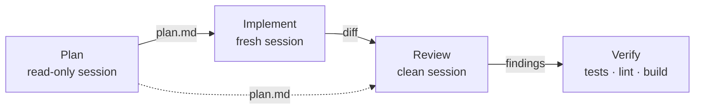
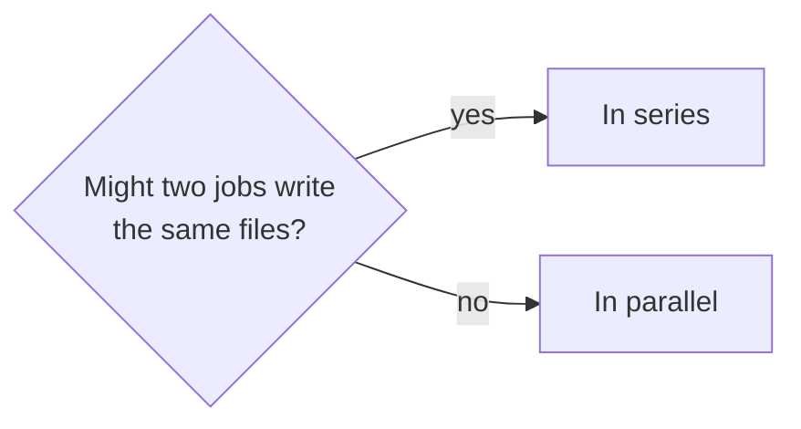
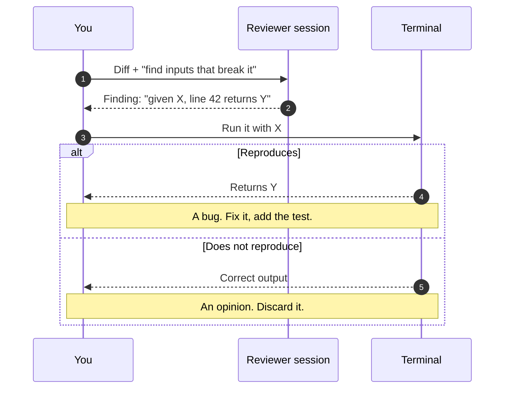

Cuando alguien me dice que los agentes de código «se pierden en tareas grandes», casi siempre está describiendo una sola conversación en la que ha planificado, implementado, depurado y revisado. No es un problema de capacidad del modelo. Es un problema de contexto.

## Por qué una sola sesión se degrada

Tres cosas ocurren a la vez en una conversación larga:

**El contexto se llena de ruido.** La salida de un test que falló hace veinte minutos, un fichero que se leyó y luego se reescribió, tres intentos descartados. Todo eso sigue ahí, compitiendo por atención con lo que de verdad importa ahora.

**Los errores se acumulan.** Si el agente decidió mal en el paso tres, los pasos cuatro a diez construyen sobre esa decisión. Y como está en su propio contexto, la trata como un hecho establecido, no como algo a cuestionar.

**Revisar el propio trabajo es sesgado.** Pedir a la misma sesión que revise lo que acaba de escribir produce una revisión complaciente: ya "sabe" por qué cada decisión estaba justificada, porque la tomó.

## Una sesión por trabajo

Lo que funciona es tratar cada fase como un trabajo distinto, con su propio contexto y su propio artefacto de entrada y salida.

**Planificar.** Sesión de sólo lectura. Explora, lee el código, hace preguntas y produce **un plan escrito**. No toca nada. Esta fase vive o muere por las preguntas: un plan que no ha preguntado nada suele estar lleno de suposiciones.

**Implementar.** Sesión nueva, cuya entrada es el plan. No tiene el historial de exploración, y eso es exactamente lo que se quiere: empieza con el contexto destilado en lugar de con el proceso que lo produjo.

**Revisar.** Sesión limpia que ve el diff y el plan, pero no la conversación que lo generó. Sin el razonamiento original, tiene que juzgar el código por lo que hace, no por lo que se pretendía que hiciera. Es la diferencia entre «esto cumple el plan» y «esto es correcto».

**Verificar.** Ejecutar los tests, el linter, la build. Esto no necesita modelo: necesita un comando y un criterio de éxito.

El artefacto entre fases es lo que hace que funcione. Un plan en markdown, un diff, la salida de una suite. Cada uno es pequeño, revisable por una persona, y no arrastra el desorden del paso anterior.



Lo que cada sesión puede ver es, en realidad, todo el diseño:

| Sesión | Ve | No ve | Produce |
| --- | --- | --- | --- |
| **Planificar** | El repositorio, tus respuestas | — | `plan.md` |
| **Implementar** | El plan, el repositorio | La exploración | Un diff |
| **Revisar** | El diff, el plan | La conversación que lo escribió | Hallazgos |
| **Verificar** | El código | Todo lo demás | Pasa o falla |

## El handoff es donde se pierde información

La parte frágil no es ninguna fase: es el paso entre ellas. Un plan que dice «refactorizar el módulo de autenticación» no es un handoff, es un título.

Lo que un plan necesita para que la siguiente sesión no tenga que reconstruirlo todo:

- **Qué ficheros**, con rutas, y por qué esos.
- **Qué contratos existen ya** y no hay que reinventar: la función que ya hace esto, el hook que ya resuelve aquello.
- **Las trampas**: lo que parece correcto y no lo es. Aquí es donde un fichero de reglas del repositorio paga su coste.
- **Cómo se verifica**, en comandos concretos.

Un handoff que lleva las cuatro cosas, para un cambio real de este sitio:

```md title="plan.md" {10-12}
# Move auth out of the public bundle

## Files
- `src/firebase.ts` — keep app + Firestore only.
- `src/firebaseAuth.ts` — new; the only module that imports `firebase/auth`.

## Reuse
- `useAuth()` already wraps sign-in state. Change its import, not its API.

## Traps
- Any public component importing `firebaseAuth.ts` puts the Auth SDK back
  in every visitor's download.

## Verify
- `npm run build`, then check no `firebase-auth` modulepreload in `dist/index.html`.
- `npm test`
```

Sin eso, la sesión de implementación vuelve a explorar el repositorio desde cero y toma decisiones distintas de las que acordó el plan.

> [!IMPORTANT]
> Si la sesión de implementación tiene que abrir más ficheros de los que nombra el plan, el plan no era un handoff. Corrige el plan, no la sesión.

## Paralelizar sólo lo independiente

Varias sesiones a la vez ayudan cuando el trabajo de verdad no se toca: explorar tres áreas del código, revisar cuatro dimensiones distintas de un mismo diff, investigar dos opciones para compararlas.

Lo que no funciona es paralelizar cosas que escriben en los mismos ficheros. Dos agentes editando el mismo módulo producen un conflicto que alguien tiene que resolver a mano, y el tiempo ahorrado se va en resolverlo.

Una heurística sencilla: si dos trabajos pueden leer lo mismo, van en paralelo; si pueden escribir lo mismo, van en serie.



## La revisión adversarial

De todas las fases, la que más valor me ha dado es una revisión hecha por una sesión que no tiene ni idea de por qué se escribió el código.

El encargo tiene que ser explícito: *busca el fallo*. Una revisión con instrucciones vagas produce felicitaciones. Una con la instrucción de encontrar entradas concretas que rompan el código produce hallazgos, y cada hallazgo se puede comprobar ejecutándolo.

```text title="review-brief.txt"
You are reviewing a diff you did not write. Assume it has a bug.
For each finding, give a concrete input, the line it reaches and the
wrong result it produces. No style comments. No praise.
```

> [!TIP]
> Un hallazgo sin un caso concreto que lo demuestre es una opinión. Un hallazgo con «con esta entrada, esta línea devuelve esto otro» es un bug, y no hace falta debatirlo: se ejecuta.



## Lo que hay que llevarse

El contexto es un recurso, no un acumulador. Una sesión que empieza con un plan de cuarenta líneas rinde mejor que una que arrastra cuatro horas de exploración, aunque esas cuatro horas fueran suyas. Separar las fases no es ceremonia: es lo que impide que un error temprano se convierta en la premisa de todo lo demás.
