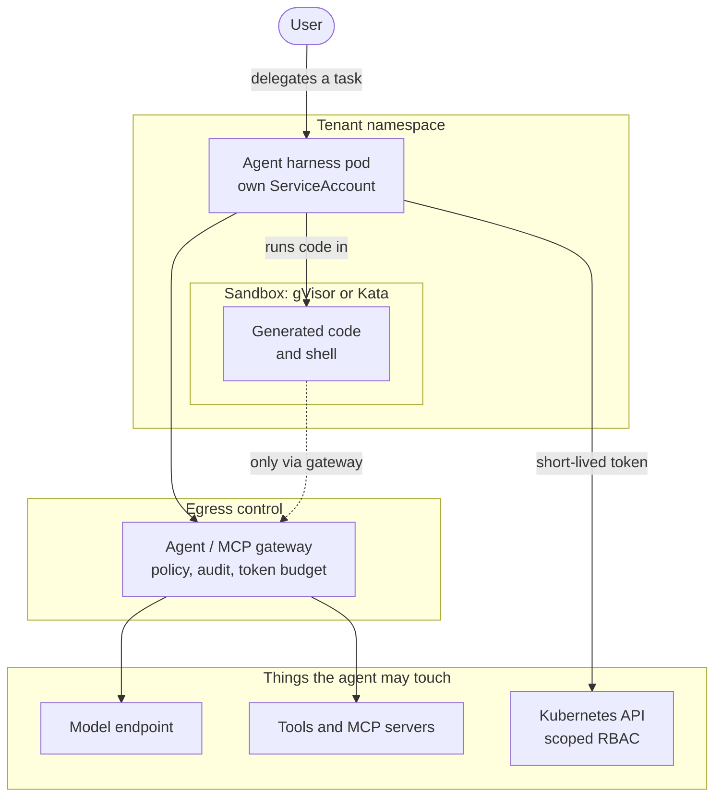
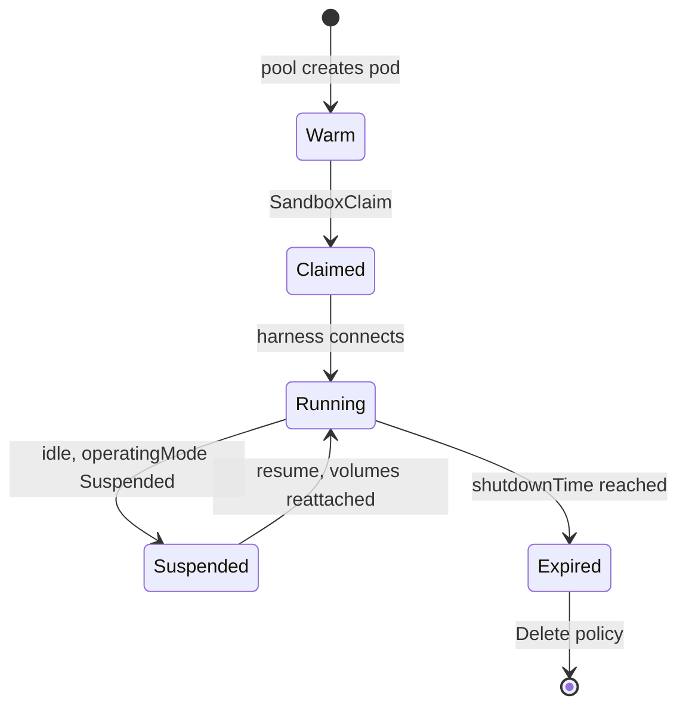
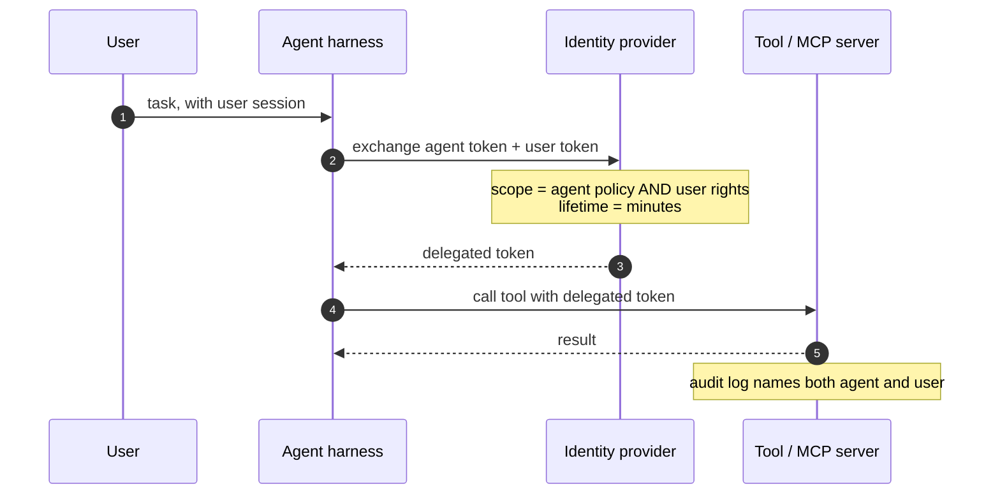
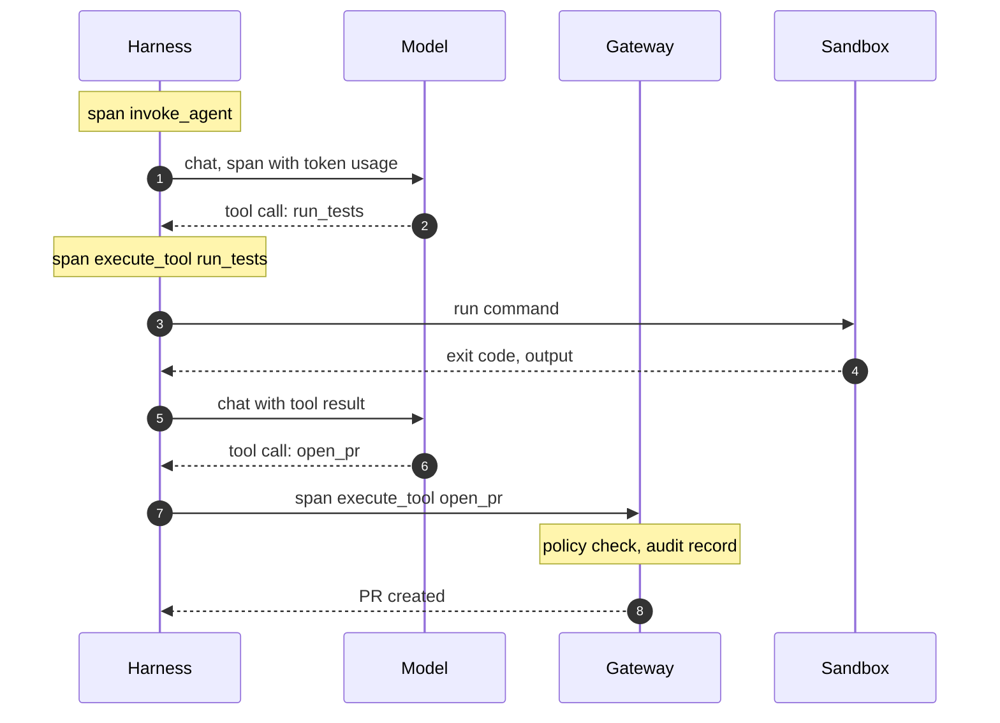

Uso agentes de programación todos los días y trabajo en una plataforma de IA
sobre Kubernetes. Durante mucho tiempo eran dos cosas separadas en mi cabeza:
el agente corría en mi portátil y el clúster servía modelos. Esa separación se
está acabando. Los agentes se mudan al clúster, al lado de los modelos a los
que llaman y de los sistemas sobre los que actúan, y la pregunta deja de ser
"¿puede Kubernetes ejecutar esto?" y pasa a ser "¿qué hace falta para
ejecutarlo **de forma segura**?".

La CNCF claramente piensa lo mismo. La KubeCon + CloudNativeCon North America
2026, que acaba de terminar en Salt Lake City (9–12 de noviembre), estrenó un
[track de AI Inference + Agentic](https://www.cncf.io/announcements/2026/08/10/cncf-reveals-kubecon-cloudnativecon-north-america-2026-schedule-adds-new-ai-inference-agentic-track/),
con "patrones prácticos para orquestar agentes autónomos" junto al *serving*
de modelos, y una de sus sesiones destacadas fue "Kubernetes Solutions for
Agent-Shaped Problems", de Tim Hockin y Dmitry Berkovich. Este post es mi
intento de dibujar esa forma: qué tiene de distinto un agente como carga de
trabajo, y qué piezas de Kubernetes existen hoy para cada diferencia.

## Lo que dejó Salt Lake City

Las keynotes fueron sorprendentemente coherentes en un punto. Según la
[crónica del primer día de Virtualization Review](https://virtualizationreview.com/articles/2026/11/12/kubecon-salt-lake-city-day-1-autonomous-agents-sandboxes-bridging-ai-infrastructure-and-kubernetes.aspx),
se trató a los agentes como cargas **no confiables y no deterministas** que
necesitan aislamiento antes de tocar redes o datos de producción. Jonathan
Bryce, de la CNCF, presentó OpenShell y Agent Substrate como formas de
envolver agentes en sandboxes construidos sobre Kata Containers, gVisor,
SPIFFE/SPIRE y gateways de políticas basados en Envoy, y atribuyó el retraso
de las empresas en adoptar agentes a que todavía no se fían de procesos
autónomos. La conclusión del artículo resume bien el tono: sandboxing,
identidades de vida corta y gateways de políticas antes de que un agente toque
nodos compartidos.

Los proveedores apuntaban en la misma dirección. Testkube contó que la mayoría
de sus clientes usan sus pipelines con agentes en modo solo lectura o con un
humano en el bucle; Komodor presentó una plataforma que impone techos de
tokens y de coste y enseña la evidencia del diagnóstico antes de cualquier
remediación automática. Y en la
[cobertura de SiliconANGLE sobre los anuncios de Red Hat](https://siliconangle.com/?p=853338)
—llm-d 1.0 y su trabajo con NVIDIA en OpenShell— aparece la advertencia que
yo pondría en grande: el sandboxing no hace que un agente sea digno de
confianza; limita el daño que puede hacer.

Así que las cuatro ideas del congreso —no confiable por defecto, sandbox,
identidad corta y salida por un gateway con políticas— son justo las
secciones de este post. Lo que sigue es cómo se ve cada una en manifiestos.

No repite a dos vecinos. El modelo de amenazas de los agentes —inyección de
prompts, la combinación letal de datos privados, entrada no confiable y una
salida— está en [Seguridad de agentes](/blog/agent-security). Y el bucle
alrededor del modelo, la parte que decide qué herramienta llamar, es el
[harness engineering](/blog/harness-engineering). Aquí me importa el pod en el
que corre ese bucle.

## Qué cambia cuando la carga es un agente

| | Servicio web | Agente |
| --- | --- | --- |
| **Vida** | Petición sin estado, milisegundos | Sesión de minutos a horas, con memoria y ficheros |
| **Código que ejecuta** | Código que revisaste y compilaste | Código que un modelo escribió hace un momento |
| **Para quién actúa** | Para sí mismo, con un rol fijo | Para un usuario que delegó una tarea, a menudo con sus permisos |
| **Red** | Llama a un conjunto conocido de dependencias | Decide en tiempo de ejecución qué URL o herramienta llamar |
| **Modo de fallo** | Se cae, devuelve 500 | Hace lo que no debía, y con éxito |
| **Qué cuesta** | CPU y memoria | Tokens, tiempo de GPU y llamadas a herramientas, por sesión |

Las dos últimas filas son las que me quitan el sueño. Un servicio web que se
cae es un problema que tu monitorización ya entiende. Un agente que borra la
rama equivocada devuelve `200 OK`.

Así que el principio de diseño al que siempre vuelvo es el mismo del que parte
el anuncio de Agent Sandbox: tratar al agente como **código no confiable con
un trabajo legítimo**. No malicioso, pero tampoco algo que dejes cerca de
nada que no necesite.



Cada flecha de ese diagrama es una decisión. El resto del post las recorre en
orden: el sandbox, la identidad, las salidas, los permisos, el registro de lo
que pasó y la factura.

## Sandboxes: un segundo kernel entre el agente y el nodo

Un contenedor normal comparte el kernel del nodo. Es un riesgo aceptable para
código que has compilado tú; es bastante peor para código que un modelo ha
generado a partir de un prompt que podría contener instrucciones de otra
persona. Kubernetes tiene la respuesta desde hace años, con `RuntimeClass`:
ejecutar el pod en otro runtime que pone una frontera más entre la carga y el
host.

| Runtime | Aislamiento | Qué cuesta |
| --- | --- | --- |
| **runc** (por defecto) | Namespaces y cgroups sobre el kernel compartido del host | Nada extra; un bug del kernel compromete el nodo |
| **gVisor** (`runsc`) | Un kernel en espacio de usuario intercepta las llamadas al sistema | Algo de sobrecarga en syscalls y huecos de compatibilidad |
| **Kata Containers** | Cada pod corre en una VM ligera con su propio kernel | Arranque y memoria de la VM; necesita virtualización en el nodo |

En OpenShift, Kata es lo que empaquetan los
[OpenShift sandboxed containers](https://docs.redhat.com/en/documentation/openshift_container_platform/4.13/html/openshift_sandboxed_containers_user_guide/understanding-sandboxed-containers),
incluido un modo *peer pods* que crea la VM a través de la API del proveedor
cloud en lugar de necesitar virtualización anidada.

Elegir runtime es la mitad fácil. La difícil es el ciclo de vida: un agente
quiere un sandbox **ya**, lo mantiene durante una sesión, puede necesitarlo
de vuelta tras una pausa y nunca debería heredar los ficheros del usuario
anterior. Un Deployment no modela nada de eso.

### Agent Sandbox

Ese hueco es el que cubre
[Agent Sandbox](https://github.com/kubernetes-sigs/agent-sandbox), un
subproyecto de SIG Apps de Kubernetes anunciado a finales de 2025 y descrito
en el [blog de Kubernetes](https://kubernetes.io/blog/2026/03/20/running-agents-on-kubernetes-with-agent-sandbox)
en marzo de 2026. Su
[v1.0.0](https://github.com/kubernetes-sigs/agent-sandbox/releases/tag/v1.0.0),
de agosto de 2026, pasó tanto la API principal como las extensiones a
`v1beta1`.

- **`Sandbox`** (`agents.x-k8s.io/v1beta1`): un pod único con estado, con
  hostname estable, volúmenes persistentes opcionales, apagado programado y
  un `operatingMode` que puede ser `Running` o `Suspended` (el pod desaparece,
  el objeto y sus volúmenes se quedan, y al reanudar se vuelven a montar).
- **`SandboxTemplate`**, **`SandboxWarmPool`** y **`SandboxClaim`**
  (`extensions.agents.x-k8s.io/v1beta1`): una plantilla reutilizable, un pool
  de sandboxes ya arrancados para que una sesión no pague un arranque en frío,
  y la petición que hace un orquestador para llevarse uno.

La plantilla es donde viven las decisiones de seguridad. El runtime es solo un
campo del spec del pod; la política de red es parte de primera clase de la
API:

```yaml title="sandbox-template.yaml" {8-21,25}
apiVersion: extensions.agents.x-k8s.io/v1beta1
kind: SandboxTemplate
metadata:
  name: code-runner
  namespace: team-a-agents
spec:
  networkPolicyManagement: Managed
  networkPolicy:
    ingress:
      - from:
          - podSelector:
              matchLabels:
                app.kubernetes.io/name: agent-harness
    egress:
      # DNS, then the agent gateway and nothing else
      - to:
          - namespaceSelector:
              matchLabels:
                kubernetes.io/metadata.name: kube-system
        ports:
          - { protocol: UDP, port: 53 }
          - { protocol: TCP, port: 53 }
      - to:
          - namespaceSelector:
              matchLabels:
                kubernetes.io/metadata.name: agent-gateway
        ports:
          - { protocol: TCP, port: 8080 }
  podTemplate:
    spec:
      runtimeClassName: gvisor
      automountServiceAccountToken: false
      containers:
        - name: runner
          image: registry.example.com/code-runner:1.4.0
          securityContext:
            allowPrivilegeEscalation: false
            capabilities:
              drop: [ALL]
```

Dos detalles del código fuente que me parecen buenos valores por defecto. Si
omites `networkPolicy` del todo, el controlador aplica un "secure default":
solo el router de sandboxes puede conectarse hacia dentro y la salida se
limita a internet pública, **bloqueando los rangos privados y el servidor de
metadatos del cloud**. Y los claims no pueden inyectar variables de entorno ni
volúmenes salvo que la plantilla lo permita explícitamente, así que quien
escribe el claim no puede ampliar a escondidas lo que decidió quien escribió
la plantilla.

Después, un pool mantiene sandboxes calientes y cada sesión reclama uno con
caducidad:

```yaml title="pool-and-claim.yaml" {16-18}
apiVersion: extensions.agents.x-k8s.io/v1beta1
kind: SandboxWarmPool
metadata:
  name: code-runner-pool
  namespace: team-a-agents
spec:
  replicas: 3
  sandboxTemplateRef:
    name: code-runner
---
apiVersion: extensions.agents.x-k8s.io/v1beta1
kind: SandboxClaim
metadata:
  name: session-7f3a
  namespace: team-a-agents
spec:
  warmPoolRef:
    name: code-runner-pool
  lifecycle:
    shutdownTime: "2026-11-13T18:00:00Z"
    shutdownPolicy: Delete
```



> [!IMPORTANT]
> Un sandbox limita el **radio de explosión**; no mejora las decisiones del
> agente. Un agente dentro de gVisor con un token capaz de borrar namespaces
> de producción sigue siendo un agente capaz de borrar namespaces de
> producción. La frontera del kernel es una capa de varias, no la respuesta.

### Otras formas de la misma idea

Agent Sandbox no es el único enfoque. Hay otros dos que merece la pena
conocer, porque hacen apuestas distintas:

- **[OpenShell](https://www.cncf.io/projects/openshell/)**, desarrollado por
  NVIDIA y aceptado en el CNCF Sandbox en septiembre de 2026, se describe
  como runtimes aislados y con políticas para agentes autónomos. Red Hat
  [anunció en octubre](https://www.redhat.com/en/about/press-releases/red-hat-ai-factory-nvidia-accelerates-agentic-ai-security-capabilities-across-open-hybrid-cloud)
  que es uno de los principales contribuidores junto a NVIDIA y que trabaja
  para convertirlo en una capacidad nativa de Red Hat AI.
- **Agent Substrate**, del ecosistema de kagent, se pregunta si el pod es la
  unidad correcta. El
  [post de Lin Sun en la CNCF](https://www.cncf.io/blog/2026/07/14/is-a-pod-the-right-deployment-unit-for-an-ai-agent)
  explica la idea: un pool fijo de pods *worker* con gVisor, sobre los que se
  planifican muchos agentes lógicos cuando llega trabajo. Los pods siguen
  siendo el entorno de ejecución; dejan de ser la unidad de identidad y de
  ciclo de vida.

El segundo argumento me parece más interesante de lo que parece a primera
vista. Un pod por sesión de agente es limpio para aislamiento e identidad, y
caro cuando la mayoría de las sesiones están ociosas la mayor parte del
tiempo. Dónde acabará la línea está genuinamente abierto.

## Identidad: quién es este agente, y durante cuánto tiempo

Cada agente debería tener su propia identidad, y esa identidad debería durar
poco. En Kubernetes eso empieza por cosas aburridas:

- **Una ServiceAccount por tipo de agente**, nunca `default`, con
  `automountServiceAccountToken: false` en todo lo que no necesite la API,
  como en el sandbox de arriba.
- **Tokens proyectados y ligados a una audiencia** para lo que sí la
  necesita. Un token proyectado se emite para una audiencia y caduca solo; el
  kubelet lo rota. No le sirve de nada a ningún servicio que compruebe la
  audiencia y no sea aquel para el que se emitió.

```yaml title="agent-harness.yaml (excerpt)" {9-11}
spec:
  serviceAccountName: code-review-agent
  automountServiceAccountToken: false
  volumes:
    - name: tools-token
      projected:
        sources:
          - serviceAccountToken:
              path: token
              audience: tools.internal.example.com
              expirationSeconds: 600
```

A partir de ahí, el token se intercambia por lo que el agente llame de
verdad: credenciales cloud mediante *workload identity federation*,
identidades SPIFFE mediante SPIRE o certificados mTLS. Los
[pod certificates](https://kubernetes.io/blog/2025/12/17/kubernetes-v1-35-release/)
del propio Kubernetes (beta desde la 1.35) permiten que el kubelet pida
credenciales X.509 para un pod mediante un `PodCertificateRequest`, y los
certificados de los firmantes integrados `kubernetes.io` duran como mucho 24
horas.

El problema difícil es la **delegación**. El agente actúa por un usuario, así
que lo que puede hacer debería ser la intersección de lo que el agente tiene
permitido y lo que ese usuario tiene permitido —no la unión, y desde luego no
el rol amplio del agente usado en nombre de todo el mundo.



No hay ninguna primitiva de Kubernetes para ese intercambio; vive en tu
proveedor de identidad y en tu gateway. Lo pongo en el diagrama igualmente,
porque es la pieza que más se salta, y es de la que depende la pregunta de la
responsabilidad del final.

## Salida de red: denegar por defecto, salir por un gateway

El control más eficaz que conozco para un agente es el aburrido: no puede
llegar a lo que no puede enrutar. Un modelo al que han convencido de mandar
tus datos a algún sitio necesita un camino de red hasta "algún sitio".

Una `NetworkPolicy` normal te da denegación por defecto y listas de permitidos
por pod, namespace y bloque de IPs. No entiende de nombres de dominio, así que
"permitir `api.github.com`" necesita o una CNI con políticas por FQDN o, mejor
en mi opinión, una única salida: un gateway de salida o de agentes por el que
pase cada llamada hacia fuera. Ahí puedes aplicar políticas por herramienta,
registrar cada llamada, quitar credenciales e imponer un presupuesto de
tokens. El [agentgateway de la Linux Foundation](https://agentgateway.dev/) es
un ejemplo pensado específicamente para MCP y tráfico entre agentes; los
gateways de IA basados en Envoy son otro.

La `SandboxTemplate` de arriba codifica exactamente esa forma: DNS, el
gateway y nada más.

> [!TIP]
> Bloquea el endpoint de metadatos del cloud (`169.254.169.254`) para todos
> los pods de agentes, incluso los que consideres inofensivos. Es el camino
> más corto entre "ejecutó algo de código" y "tiene las credenciales cloud del
> nodo", y la política por defecto de Agent Sandbox lo bloquea justo por eso.

## RBAC por agente

Si el agente habla con la API de Kubernetes —y los agentes de operaciones lo
hacen—, dale un Role que encaje con su trabajo y nada más. Un agente de
revisión que lee logs de pods en un namespace no necesita `list secrets`, no
necesita `pods/exec` y desde luego no necesita crear pods, que en la mayoría
de clústeres es un camino hacia todos los permisos que tengan las
ServiceAccounts del namespace.

```yaml title="rbac.yaml"
apiVersion: rbac.authorization.k8s.io/v1
kind: Role
metadata:
  name: log-reader-agent
  namespace: team-a
rules:
  - apiGroups: [""]
    resources: ["pods", "pods/log"]
    verbs: ["get", "list"]
  - apiGroups: ["apps"]
    resources: ["deployments"]
    verbs: ["get", "list"]
```

El patrón que usaría para preparar a un equipo:

```steps
Namespace: Un namespace por equipo o tenant, con política de red de denegación por defecto desde el primer día.
Identidad: Una cuenta de servicio por tipo de agente, sin token montado salvo que necesite la API.
Role: Un Role escrito para el trabajo y revisado como código. Nada de ClusterRoles para agentes.
Salidas: Salida solo a DNS y al gateway de agentes. El gateway guarda las credenciales de las herramientas.
Cuota: Una cuota sobre sandboxes y cómputo, y un presupuesto de tokens en el gateway.
```

## Observabilidad: registrar la trayectoria, no solo la latencia

En un servicio web quiero latencia, errores y saturación. En un agente
necesito además la **trayectoria**: qué se le pidió, qué llamadas hizo al
modelo, qué herramientas llamó con qué argumentos, qué volvió y qué decidió a
continuación. Sin eso, un mal resultado es imposible de explicar.

OpenTelemetry tiene
[convenciones semánticas de GenAI](https://github.com/open-telemetry/semantic-conventions-genai)
para esto, todavía en estado *Development*: spans `invoke_agent` y
`create_agent` para agentes, `execute_tool` para llamadas a herramientas,
spans de inferencia con uso de tokens, y páginas aparte para MCP y A2A. Si el
harness, el gateway y el servidor de modelos propagan el mismo contexto de
traza, una sola traza cuenta la historia de una sesión.



Dos avisos prácticos. Las trayectorias contienen prompts y salidas de
herramientas, que contienen datos de usuarios y a veces secretos, así que el
almacén de trazas necesita el mismo control de acceso que los propios datos. Y
guardarlo todo es caro; decide pronto qué spans conservan el contenido
completo y cuáles solo los metadatos.

## Coste y cuotas

El coste de un agente es sobre todo tokens, y los gasta un bucle que decide
por sí mismo cuándo parar. Tres sitios donde poner un techo:

- **El clúster**: una `ResourceQuota` por namespace sobre cómputo y sobre el
  número de sandboxes, para que un orquestador desbocado no se quede con todo
  el pool caliente.
- **El gateway**: tokens por sesión, por agente y por tenant, aplicados donde
  ya pasa cada llamada al modelo.
- **La capa de serving**: el control de flujo multi-tenant de llm-d v1.0
  descarta carga por prioridad y equidad, para que los agentes de un tenant
  no hundan la latencia de los demás (más en
  [el post de inferencia](/blog/llm-inference-kubernetes)).

```yaml title="quota.yaml"
apiVersion: v1
kind: ResourceQuota
metadata:
  name: agent-limits
  namespace: team-a-agents
spec:
  hard:
    requests.cpu: "16"
    requests.memory: 64Gi
    count/sandboxclaims.extensions.agents.x-k8s.io: "20"
```

## La pregunta de la responsabilidad

Cada una de estas piezas acaba sirviendo a una pregunta: cuando un agente hizo
algo, **¿quién responde?** ¿El usuario que lo pidió? ¿El equipo que desplegó
el agente? ¿La plataforma que lo ejecutó?

Kubernetes puede contestar una parte. El log de auditoría registra qué
ServiceAccount hizo cada llamada a la API; la traza registra la trayectoria;
el token delegado registra en nombre de qué usuario actuó el agente. Si
construiste esas tres cosas para que compartan un identificador, puedes
reconstruir una decisión. Si no, tienes tres historias a medias.

Lo que Kubernetes no puede contestar es si la acción debía ocurrir. Eso es
una decisión de política, y para cualquier cosa destructiva o irreversible
sigo queriendo un paso de aprobación humana, impuesto fuera del agente —en el
gateway o en el control de admisión— y no como una instrucción educada en el
prompt. Construir agentes como operadores que reconcilian una intención
declarada (ver
[operadores de Kubernetes con Kubebuilder](/blog/kubernetes-operators-kubebuilder))
también ayuda: un cambio propuesto como objeto que alguien puede revisar es
más fácil de atribuir que un comando imperativo ya ejecutado.

## Lo que todavía está verde

- **Las APIs son nuevas.** Agent Sandbox pasó a `v1beta1` en agosto de 2026 y
  sigue sacando releases casi cada semana. OpenShell y el enfoque de Agent
  Substrate son más jóvenes todavía. Espera cambios incompatibles y huecos.
- **La delegación no tiene forma estándar** en Kubernetes. Cada proveedor de
  identidad y cada gateway la resuelve a su manera, y la mayoría de tutoriales
  se la saltan.
- **Los sandboxes tienen costes reales.** gVisor tiene huecos de
  compatibilidad para algunas cargas, Kata necesita soporte de virtualización
  y los pools calientes cuestan dinero mientras esperan.
- **Las convenciones de telemetría de GenAI están en desarrollo.** Los
  nombres de atributos pueden cambiar, y no todos los frameworks los emiten.
- **Densidad frente a aislamiento sigue sin resolver.** Un pod por sesión es
  limpio y caro; multiplexar agentes sobre workers compartidos es eficiente y
  mueve el problema de aislamiento a otro sitio.
- **Nada de esto arregla una mala decisión.** Acota el daño y registra lo que
  pasó. Elegir qué debería poder hacer el agente sigue siendo cosa nuestra.

## Para seguir aprendiendo

- [Running Agents on Kubernetes with Agent Sandbox](https://kubernetes.io/blog/2026/03/20/running-agents-on-kubernetes-with-agent-sandbox) —
  la introducción del blog de Kubernetes: por qué los agentes necesitan una
  primitiva nueva, y cómo encajan Sandbox, plantillas, claims y pools
  calientes.
- [kubernetes-sigs/agent-sandbox](https://github.com/kubernetes-sigs/agent-sandbox) —
  el código y el directorio `examples/`, con decenas de manifiestos reales
  (agentes de programación, políticas de red, pools calientes). Los
  comentarios de la API en `extensions/api/v1beta1` son la mejor
  documentación de los valores por defecto.
- [Is a Pod the right deployment unit for an AI agent?](https://www.cncf.io/blog/2026/07/14/is-a-pod-the-right-deployment-unit-for-an-ai-agent) —
  el argumento de Lin Sun para separar el ciclo de vida del agente del pod, y
  una lista honesta de preguntas abiertas.
- [Convenciones semánticas de GenAI de OpenTelemetry](https://github.com/open-telemetry/semantic-conventions-genai) —
  las definiciones de spans de agentes, herramientas, MCP y A2A. Lee la
  página de spans de agentes antes de instrumentar un harness.
- [OpenShift sandboxed containers](https://docs.redhat.com/en/documentation/openshift_container_platform/4.13/html/openshift_sandboxed_containers_user_guide/understanding-sandboxed-containers) —
  cómo se empaqueta Kata como operador, incluidos los peer pods para clouds
  sin virtualización anidada.
- [KubeCon Salt Lake City, primer día](https://virtualizationreview.com/articles/2026/11/12/kubecon-salt-lake-city-day-1-autonomous-agents-sandboxes-bridging-ai-infrastructure-and-kubernetes.aspx) —
  una crónica neutral de las keynotes: los agentes como cargas no confiables,
  los proyectos de sandbox, las nuevas graduaciones y certificaciones de la
  CNCF.
- [Anuncio del programa de la KubeCon NA 2026](https://www.cncf.io/announcements/2026/08/10/cncf-reveals-kubecon-cloudnativecon-north-america-2026-schedule-adds-new-ai-inference-agentic-track/) —
  qué se propuso cubrir el nuevo track de AI Inference + Agentic; útil para
  encontrar las grabaciones de las sesiones.
- [Red Hat y NVIDIA sobre OpenShell](https://www.redhat.com/en/about/press-releases/red-hat-ai-factory-nvidia-accelerates-agentic-ai-security-capabilities-across-open-hybrid-cloud) —
  el anuncio de octubre de 2026 del trabajo conjunto en runtimes de sandbox
  para agentes.
