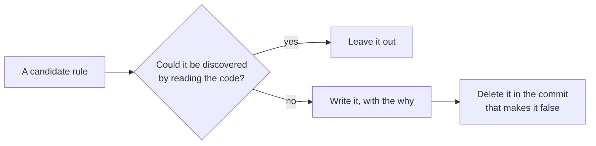
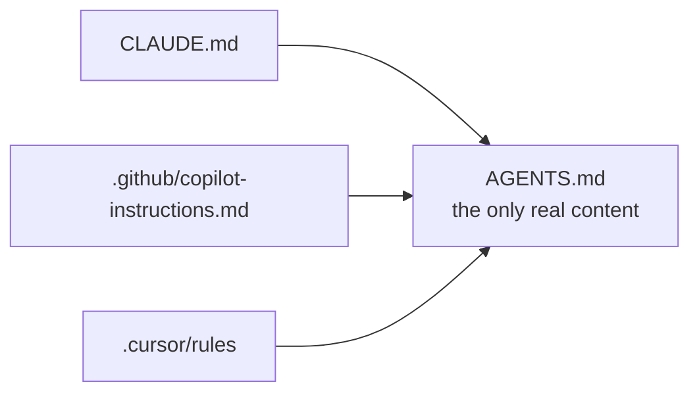
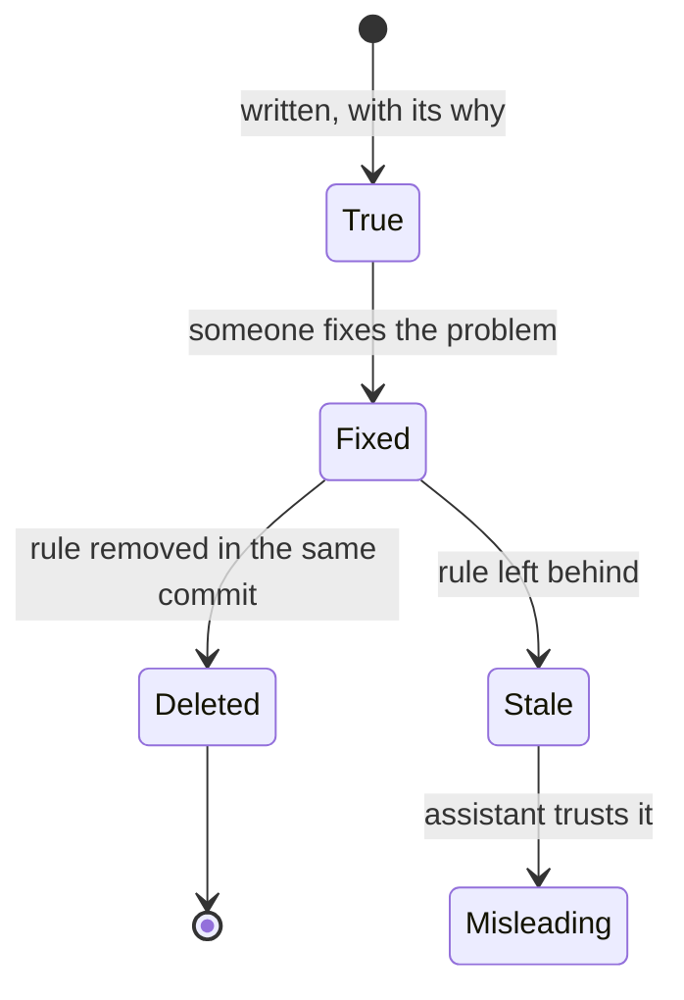

Casi todos los ficheros de reglas para asistentes de IA que he visto están llenos de cosas inútiles. «Usa TypeScript estricto.» «Escribe tests.» «Sigue las convenciones del proyecto.» El modelo ya sabe eso, o puede deducirlo leyendo dos ficheros.

Lo que no puede deducir es lo que tiene forma de estar bien y está mal.

## El criterio: ¿puede descubrirlo leyendo el código?

Si la respuesta es sí, no lo escribas. Ocupa contexto y no cambia ninguna decisión.



| Regla | ¿Se deduce del código? | ¿Se queda? |
| --- | --- | --- |
| **«Usa TypeScript estricto»** | Sí: `tsconfig.json` | No |
| **«Escribe tests»** | Sí: hay una carpeta `tests/` | No |
| **«`md:` es 650px»** | No: parece Tailwind estándar | Sí |
| **«Los posts están en `patent`»** | No: parece un error | Sí |

Lo que sí merece un sitio es aquello que **parece una cosa y es otra**. Tres ejemplos reales de este mismo repositorio:

```md title="AGENTS.md"
### Tailwind breakpoints are redefined

xs 450 · sm 550 · md 650 · lg 750 · xl 1000 · 2xl 1234

`md:` is NOT 768px. Any snippet copied from the Tailwind docs will target
the wrong viewport.
```

Ningún modelo va a adivinar eso: `md:` significa 768px en el 99% de los proyectos del mundo, y la distribución de entrenamiento lo refleja. Escribirlo en una línea evita una clase de error que sólo se manifiesta a un ancho concreto.

```md title="AGENTS.md"
### Firestore collection names are legacy

News → `intro`, Posts → `patent`, Work → `team`. Do not "fix" them.
```

Sin esa nota, un asistente razonable renombra `patent` a `posts` y deja huérfanos todos los datos de producción.

```md title="AGENTS.md"
### Never set a background-color on `html`

`body` is the canvas painter. Tried in 70d92b1, reverted in 88b2d24.
```

Esa es la forma más valiosa de regla: una decisión con la cicatriz adjunta. El commit de reversión es la prueba de que alguien ya lo intentó.

## Escribe el porqué, no sólo el qué

Una regla sin justificación se desobedece en cuanto estorba, tanto por una persona como por un modelo.

```diff title="AGENTS.md"
- Don't run Prettier on src/content/.
+ Prettier doesn't touch src/content/: those are articles, and it reformats
+ the code samples *inside* fenced blocks, editing the teaching material and
+ changing the rendered page height.
```

La segunda versión permite además razonar sobre casos nuevos. Si mañana aparece otra carpeta de prosa, la regla se generaliza sola.

## Un fichero, varios punteros

Las herramientas proliferan: `AGENTS.md`, `CLAUDE.md`, `.github/copilot-instructions.md`, `.cursor/rules`. Mantener el mismo contenido en cuatro sitios garantiza que tres estén desactualizados.

Lo que funciona es poner el contenido en uno y que los demás apunten:



```md title="CLAUDE.md" {3}
All project guidance lives in one place:

@AGENTS.md

Before touching layout or styling, read the "Landmines" section.
```

## Una regla desmentida por el código es peor que ninguna

Este es el fallo que más daño hace, y es silencioso. Un fichero de reglas que describe cómo *era* el proyecto entrena al asistente a escribir código equivocado con total seguridad.

En este repositorio, `AGENTS.md` afirmaba durante meses que el despliegue era Firebase Hosting. El workflow se había borrado hacía tiempo y el sitio estaba en Netlify. Cualquier asistente que leyera ese fichero razonaba sobre una infraestructura inexistente.



> [!IMPORTANT]
> Cuando arregles algo que estaba en las reglas, **borra la regla en el mismo commit**.

Dos de las de este repositorio describían problemas que se resolvieron; se quedaron obsoletas el día que se arreglaron, y se sustituyeron por lo que ahora es cierto.

## Deja a mano cómo se verifica

Lo último, y lo que más rendimiento da: el fichero debe decir cómo comprobar que algo no se ha roto.

```md title="CLAUDE.md"
Run `npm run visual` after any visual change — it diffs every route at seven
widths in both colour schemes.

The baseline is gitignored and local. On a fresh clone, capture one on the
unmodified tree first with `npm run visual:baseline`.
```

Un asistente que sabe cómo verificarse a sí mismo deja de proponer cambios y empieza a proponer cambios comprobados. Es la diferencia entre una sugerencia y un parche.

## La prueba de fuego

Cuando termines el fichero, hazle a un asistente nuevo dos preguntas cuya respuesta sólo esté ahí. En este repositorio serían: «¿qué significa `md:`?» y «¿qué colección guarda los proyectos?». Si responde 650px y `project` sin leer ningún fichero, el documento funciona. Si responde 768px, no has escrito reglas: has escrito decoración.
