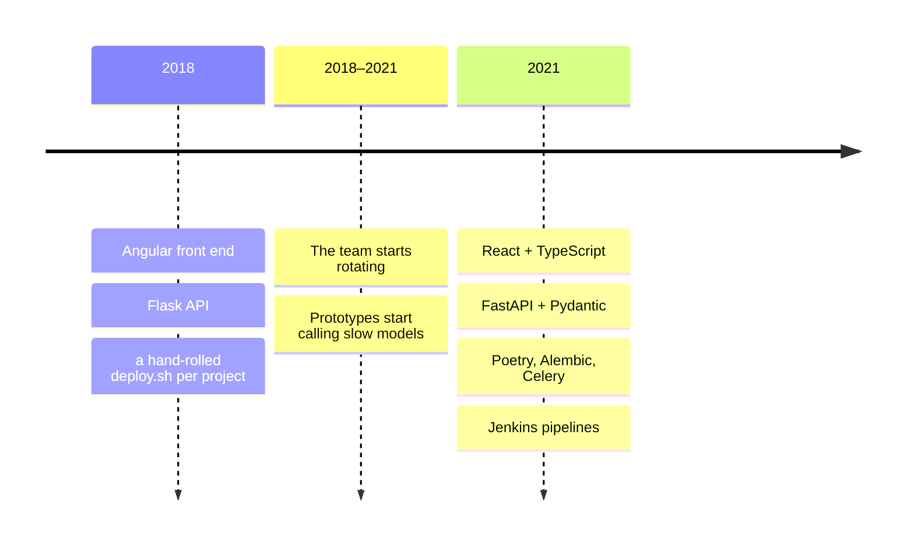
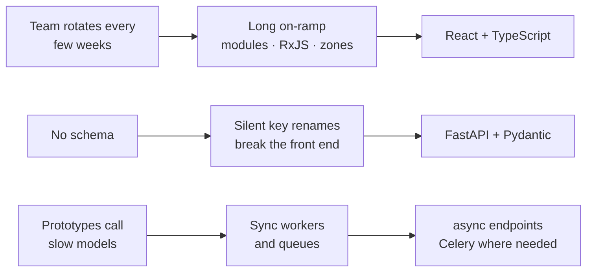

Esto cubre de 2018 a 2021, en un equipo que arrancaba prototipos continuamente.
Lo cuento porque el arco completo está documentado en el código que conservo de
los dos extremos.



## El punto de partida: Angular y Flask

En 2018, cada proyecto nuevo era Angular delante y Flask detrás. Y era una buena
decisión, aunque hoy suene antigua.

**Angular** venía con todo: enrutado, formularios, cliente HTTP, inyección de
dependencias, una CLI que generaba la estructura. Para un equipo que empieza un
prototipo cada pocas semanas, no tener que elegir doce librerías es un ahorro
real. Las discusiones de arquitectura ya estaban resueltas por el framework.

**Flask** era lo contrario y encajaba igual: un decorador y tienes un endpoint.
Para envolver un modelo o un script en una API, no hacía falta más.

Lo que fallaba no era ninguno de los dos por separado.

## Qué dejó de funcionar

**La curva de entrada de Angular.** Para alguien que llega a aportar durante seis
semanas, módulos, decoradores, RxJS y zonas son mucho que aprender antes de ser
útil. Cuando el equipo rota, la rampa pesa más que lo que el framework ahorra.

**El contrato de Flask no existía.** La API estaba en la cabeza de quien la
escribió y en el código. Sin esquema, el front adivinaba, y cada cambio
silencioso de una clave rompía algo lejos.

**La asincronía.** Cada vez más prototipos llamaban a modelos que tardan, y el
modelo síncrono de Flask obliga a trabajadores y colas para cosas que deberían
ser una espera.



## A dónde se fue

**React con TypeScript** en lugar de Angular. Menos framework y más librería:
hay que elegir enrutador y gestión de estado, pero lo que hay que aprender para
ser productivo es mucho menos. Y TypeScript, que es lo que de verdad cambió las
cosas: lo que Angular daba por estructura, ahora lo daban los tipos.

**FastAPI** en lugar de Flask. La diferencia que importa no es la velocidad, es
que **el esquema es el código**. Declaras los tipos de entrada y salida con
Pydantic y tienes validación, documentación y un OpenAPI generado, gratis. El
contrato que antes vivía en la cabeza de alguien pasó a ser un artefacto.

Esta es la diferencia en pequeño. En Flask, la forma de la respuesta es lo que
el diccionario tenga en ese momento:

```python title="app.py — Flask"
@app.route("/projects/<int:project_id>")
def get_project(project_id):
    project = db.get_project(project_id)
    return {"id": project.id, "name": project.name}  # this dict is the contract
```

En FastAPI la forma está declarada, se valida y se publica como OpenAPI en `/docs`:

```python title="main.py — FastAPI" {1-3,6}
class Project(BaseModel):
    id: int
    name: str

@app.get("/projects/{project_id}")
async def get_project(project_id: int) -> Project:
    project = await db.get_project(project_id)
    return Project(id=project.id, name=project.name)
```

Y alrededor, lo que se nota más en el día a día: Poetry en vez de `requirements.txt`,
Alembic para migraciones, Celery donde hacía falta trabajo en segundo plano de
verdad, y Jenkins. Antes de 2021, cada proyecto tenía su `deploy.sh` hecho a
mano, con su `scp` y su nginx. El salto de ahí a un pipeline fue más importante
que cualquier cambio de framework.

| | 2018 | 2021 | Por qué |
| --- | --- | --- | --- |
| **Front** | Angular | React + TypeScript | Rampa más corta; tipos en lugar de estructura del framework |
| **API** | Flask | FastAPI | El esquema es el código; asíncrono |
| **Dependencias** | `requirements.txt` | Poetry | Un lockfile |
| **Despliegue** | `deploy.sh`, `scp`, nginx | Pipeline de Jenkins | Un camino repetible en vez de un script por proyecto |

## Lo que aprendí sobre migrar stacks

**El stack no se elige una vez.** Se elige por defecto, y el defecto se revisa
cuando duele. Lo que cambió no fue una decisión arquitectónica: fue acumular
evidencia de que la rampa de entrada nos costaba más que lo que el framework nos
daba.

**Los proyectos viejos no se migran.** Los que estaban en Angular siguieron en
Angular. Reescribir algo que funciona para que coincida con el defecto nuevo es
de los gastos peor justificados que existen. El defecto aplica a lo siguiente.

> [!TIP]
> **Las plantillas son la forma real de cambiar un defecto.** Mientras arrancar en
> el stack nuevo fue más trabajo que copiar el proyecto anterior, nadie cambió. En
> cuanto hubo una plantilla con autenticación, i18n, Docker y CI ya resueltos, el
> cambio se hizo solo. Un equipo no adopta lo que le recomiendas; adopta lo que
> tiene menos fricción al empezar.

## Lo que no cambiaría

La decisión de 2018 no fue mala por haberse quedado atrás. Angular y Flask eran
la respuesta correcta a la pregunta de entonces: un equipo pequeño y estable, con
proyectos cortos y síncronos. Cuando el equipo pasó a rotar y los proyectos a
llamar modelos, la pregunta era otra.

El error habría sido mantener la respuesta cuando la pregunta ya había cambiado.
