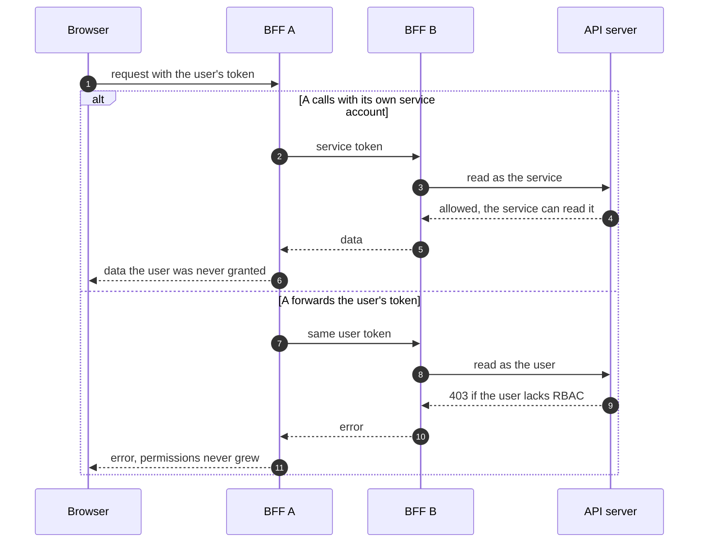

Esto es de finales de 2025 y continúa lo que conté sobre
[un BFF por módulo](/blog/bff-per-module-go).

## El momento en que se rompe el modelo

Un backend por módulo es limpio mientras cada módulo se baste a sí mismo. La
grieta aparece el día que una pantalla necesita algo que no es suyo: el catálogo
quiere saber si un modelo está desplegado, y eso lo sabe otro módulo.

Hay tres salidas y dos son malas.

**Que el navegador haga las dos llamadas.** Tentador porque no hay que cambiar
nada en el servidor. Pero devuelve al cliente la responsabilidad de componer, y
sobre todo le obliga a conocer la topología: tiene que saber que existe otro
módulo y cómo se llama.

**Que el primer backend hable directamente con la API del clúster.** Es decir,
que reimplemente lo que el segundo ya hace. Dos sitios que leen el mismo
recurso, dos interpretaciones, y la segunda se queda obsoleta.

**Que un backend llame al otro.** Es lo correcto y lo que abre la pregunta
difícil.

| Opción | Quién compone | Quién conoce la topología | Lógica duplicada |
| --- | --- | --- | --- |
| **El navegador hace las dos llamadas** | El cliente | El cliente | No |
| **A lee la API del clúster por su cuenta** | A | Nadie | Sí, A y B leen lo mismo |
| **A llama a B** | A | A, que la recibe del operador | No |

## La pregunta difícil

Cuando el servicio A llama al servicio B, ¿con qué identidad lo hace?

> [!CAUTION]
> La respuesta fácil es que A tenga su propia credencial de servicio. Y es la
> respuesta que rompe todo lo que habíamos construido: si A puede leer de B con
> permisos propios, entonces cualquier usuario que llegue a A puede leer de B,
> tenga o no permiso. Acabas de inventar una escalada de privilegios con forma de
> microservicio.

La regla que seguimos fue más estricta y mucho más simple de razonar:

> Una petición entre servicios lleva la identidad del usuario original. Nunca la
> del servicio. Un backend no puede hacer en nombre de alguien nada que esa
> persona no pudiera hacer por sí misma.

En la práctica, el token del usuario que llega a A se reenvía a B. B construye
su cliente de Kubernetes con ese token, igual que haría con una petición directa.
Si el usuario no tiene permiso, falla en el servidor de la API, que es donde
tiene que fallar.

```go {6-7}
func (c *Client) get(ctx context.Context, path string, out any) error {
    req, err := http.NewRequestWithContext(ctx, http.MethodGet, c.baseURL+path, nil)
    if err != nil {
        return err
    }
    // The caller's token, never ours.
    req.Header.Set("Authorization", "Bearer "+UserToken(ctx))
    // …
}
```



Esto hace imposible una clase entera de errores. No hay un camino por el que
alguien gane acceso atravesando servicios, porque no hay ningún punto de la
cadena donde los permisos crezcan.

## Encontrar al otro servicio

Queda el problema de las direcciones. A no puede llevar escrita la URL de B,
por lo mismo que el anfitrión no puede llevar escritas las de los módulos
remotos: dependen del clúster donde se instale.

La solución es la misma pieza. El operador, que sabe qué módulos están activos y
qué `Service` tiene cada uno, inyecta esas direcciones como variables de entorno
en cada despliegue. El servicio las lee al arrancar y construye sus clientes.

```mermaid title="Addresses come from the operator, identity comes from the user"
flowchart LR
  OP["Operator"] -- "env vars<br/>with Service URLs" --> A["BFF A"]
  U["Browser"] -- "user token" --> A
  A -- "same token" --> B["BFF B"]
  B -- "same token" --> K["API server"]
```

```go
type Clients struct {
    ModelRegistry Client
    GenAI         Client
}

func NewClients(env Env) Clients {
    return Clients{
        ModelRegistry: New(env.ModelRegistryURL),
        GenAI:         New(env.GenAIURL),
    }
}
```

Que sea una variable de entorno y no un descubrimiento dinámico es deliberado:
si falta, el servicio no arranca. Un fallo en el despliegue se ve en el
despliegue, no tres días después cuando alguien abre la pantalla que lo
necesitaba.

```go
func mustEnv(name string) string {
    v := os.Getenv(name)
    if v == "" {
        log.Fatalf("%s is not set; refusing to start", name)
    }
    return v
}
```

## Modo simulado, otra vez

El mismo patrón que hacía falta para desarrollar sin clúster hace más falta
todavía aquí. Si trabajar en el módulo A exige tener levantado el módulo B, que
a su vez quiere al C, nadie va a trabajar en su portátil.

Cada cliente tiene una implementación simulada detrás de la misma interfaz, y
una variable decide cuál se usa. No es para los tests: es para que empezar a
contribuir cueste un `npm start` y no una tarde de provisión.

```diff
 func NewClients(env Env) Clients {
+    if env.MockClients {
+        return Clients{ModelRegistry: mock.ModelRegistry{}, GenAI: mock.GenAI{}}
+    }
     return Clients{
         ModelRegistry: New(env.ModelRegistryURL),
         GenAI:         New(env.GenAIURL),
     }
 }
```

## Lo que falta por diseñar, y conviene decirlo

**Los fallos en cascada.** Si B va lento, A va lento. Hay tiempos de espera,
pero no hay cortocircuito. Es una deuda conocida, no un descuido.

**La red hay que cerrarla explícitamente.** Que A pueda llamar a B no significa
que todo deba poder llamar a todo. Las políticas de red que permiten solo las
rutas previstas son parte del diseño, no un extra de seguridad que se añade
luego.

```yaml
# Only BFF A may reach BFF B.
apiVersion: networking.k8s.io/v1
kind: NetworkPolicy
metadata:
  name: bff-b-ingress
spec:
  podSelector:
    matchLabels: { app: bff-b }
  policyTypes: [Ingress]
  ingress:
    - from:
        - podSelector:
            matchLabels: { app: bff-a }
      ports:
        - port: 8080
```

> [!TIP]
> **La observabilidad entre servicios.** Saber qué petición de usuario provocó qué
> llamada interna requiere propagar un identificador de traza, y eso es mucho más
> fácil de añadir al principio que a posteriori.

## La idea que me llevo

Reenviar la identidad en vez de sustituirla no es una decisión de seguridad que
se toma al final: es lo que hace que el sistema sea razonable. Cuando cada salto
conserva al usuario, la pregunta «¿puede esta persona hacer esto?» tiene una
sola respuesta y vive en un solo sitio.
