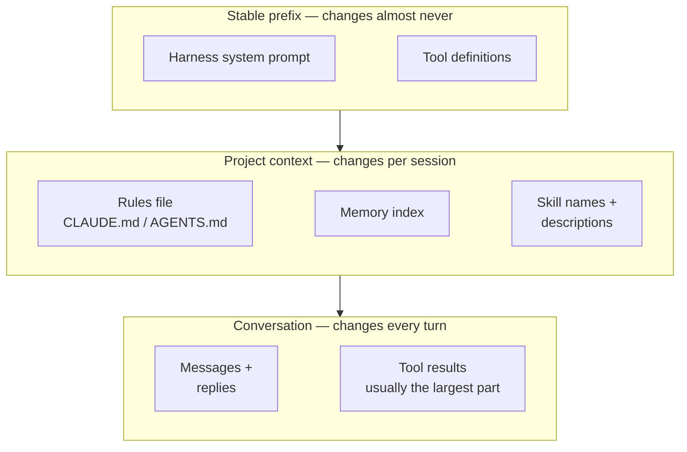
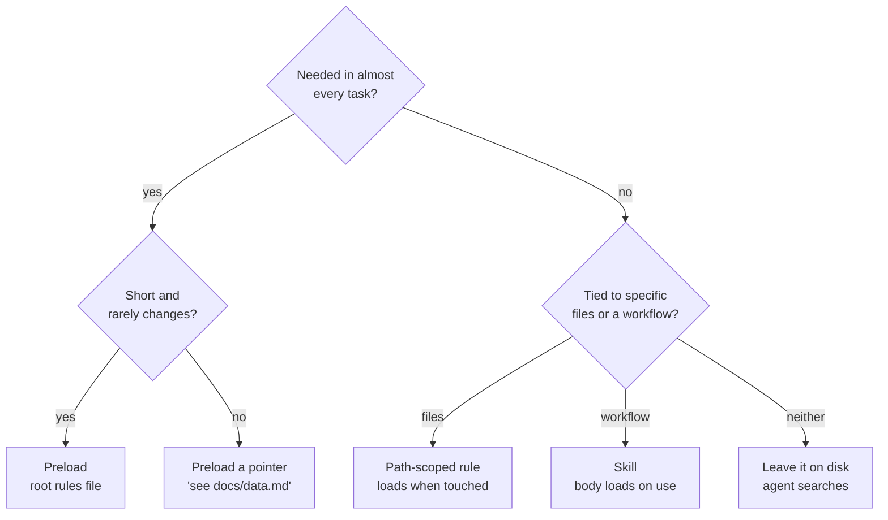
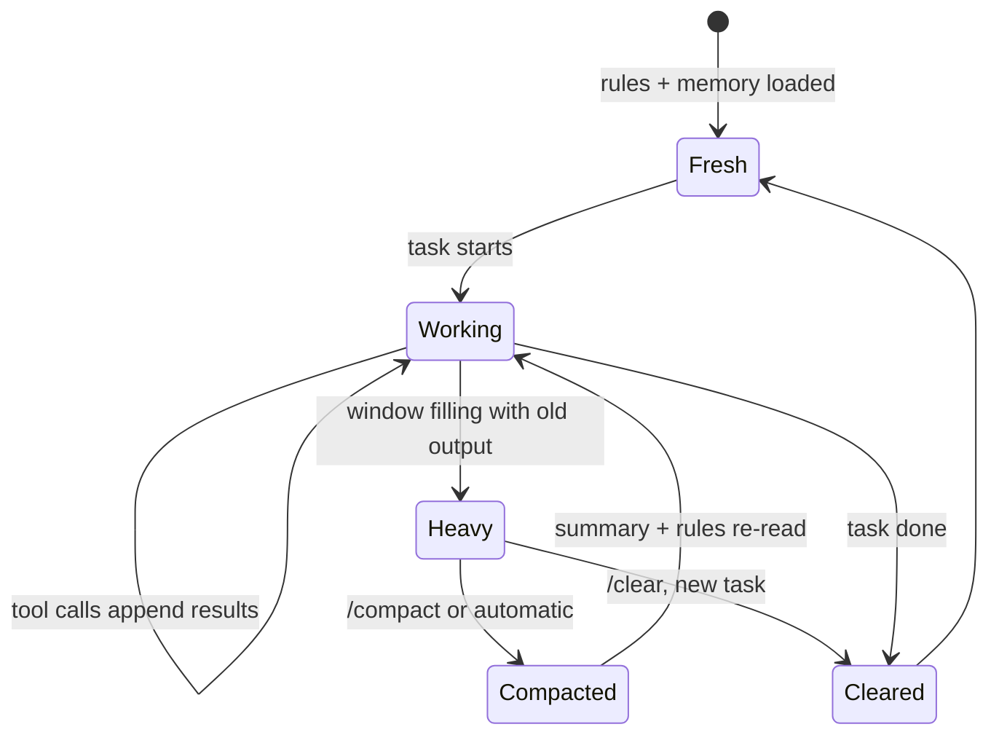
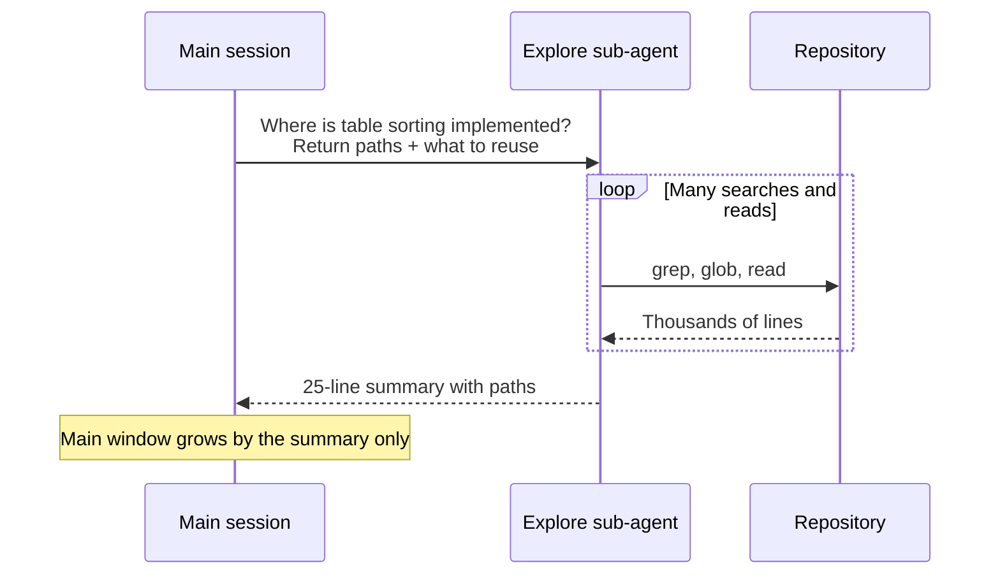

Un agente de código en el minuto cinco de una sesión está fino. Lee los ficheros correctos, sigue el fichero de reglas, hace buenas preguntas. En la tercera hora, el mismo agente con el mismo modelo empieza a repetir un enfoque que ya falló, olvida una restricción que dejaste clara al principio o cita con total seguridad una función que leyó y luego reescribió. El modelo no ha cambiado. Lo que ha cambiado es lo que tiene delante.

El equipo de ingeniería de Anthropic llama a la disciplina de gestionar eso [context engineering](https://www.anthropic.com/engineering/effective-context-engineering-for-ai-agents), y la describe como la evolución natural del *prompt engineering*: no solo escribir una buena instrucción, sino curar todo lo que acaba en la ventana a lo largo de muchos turnos. Este artículo es cómo lo veo yo en la práctica. Complementa a [una sesión por trabajo](/blog/agentic-development-sessions), que trata de repartir el trabajo en sesiones; este trata de mantener sana una sesión mientras está en marcha.

## La ventana es un presupuesto, no un cubo

El modelo mental tentador es un cubo: las ventanas más grandes caben más, así que mete más. La investigación dice lo contrario.

[Lost in the Middle](https://aclanthology.org/2024.tacl-1.9/) (Liu et al., TACL 2024) mostró que los modelos aprovechan mejor la información al principio y al final de una entrada larga que la que está en medio, y que el rendimiento baja a medida que crece la entrada, incluso en modelos pensados para contextos largos. El informe [Context Rot](https://www.trychroma.com/research/context-rot) de Chroma probó 18 modelos y encontró la misma forma en tareas deliberadamente sencillas: la fiabilidad cae al aumentar la longitud, los distractores hacen más daño cuanto más larga es la entrada y, en un benchmark realista de memoria, los modelos lo hacían mucho mejor con un prompt enfocado de unos cientos de tokens que con el completo de más de cien mil.

Anthropic plantea la consecuencia como un *presupuesto de atención*: cada token que añades tira de él. El objetivo deja de ser «incluir todo lo relevante» y pasa a ser encontrar el conjunto más pequeño de tokens con mucha señal que resuelva la tarea.

[How Long Contexts Fail](https://dbreunig.com/2025/06/22/how-contexts-fail-and-how-to-fix-them.html), de Drew Breunig, pone nombre a los modos de fallo, y los nombres me resultan útiles porque cada uno tiene un arreglo distinto:

| Fallo | Cómo se ve en una sesión de código | Lo primero que pruebo |
| --- | --- | --- |
| **Envenenamiento** | Una suposición errónea del turno 4 se trata como un hecho en el turno 40 | Corregirla de forma explícita, o reiniciar desde un plan escrito |
| **Distracción** | El agente repite sus propias jugadas en lugar de pensar | Compactar, o empezar una sesión nueva |
| **Confusión** | Herramientas o ficheros irrelevantes lo arrastran hacia la acción equivocada | Menos herramientas; delegar la exploración |
| **Choque** | Dos instrucciones de la ventana se contradicen | Arreglar la fuente, normalmente el fichero de reglas |

## Qué hay realmente en la ventana

Antes de decidir qué añadir conviene saber qué hay ya. La petición de un agente de código tiene tres capas que cambian a ritmos muy distintos.



Claude Code documenta esta separación en capas de forma explícita en su [página sobre la caché de prompts](https://code.claude.com/docs/en/prompt-caching): primero el contenido estable, porque la caché compara el prefijo de la petición de forma exacta y cualquier cambio recalcula todo lo que viene detrás. Aquí la ingeniería de contexto y la de costes tiran en la misma dirección. Mantén estable la parte de arriba de la ventana y añade por debajo.

Ejecuta `/context` en Claude Code en cualquier momento y verás el desglose en vivo por categorías. Merece la pena hacerlo en mitad de una sesión larga: lo que ha crecido no suele ser el fichero de reglas ni las herramientas, sino salidas de herramientas antiguas que ya no importan.

## Precargar o traer justo a tiempo

La decisión de diseño central es qué meter en la ventana desde el principio y qué dejar en disco para que el agente lo traiga cuando lo necesite. Anthropic describe Claude Code como un híbrido: `CLAUDE.md` se carga al empezar y todo lo demás se encuentra con herramientas como grep y glob *just in time*, usando rutas de ficheros como referencias ligeras en lugar de cargar su contenido.



Claude Code ofrece tres mecanismos bajo demanda además de la búsqueda, todos documentados en sus páginas de [memoria](https://code.claude.com/docs/en/memory) y [skills](https://code.claude.com/docs/en/skills):

- **Ficheros de reglas anidados** en subdirectorios, que se cargan cuando el agente lee o edita un fichero de esa carpeta.
- **Reglas por ruta** en `.claude/rules/` con un glob `paths:`, que se cargan cuando se toca un fichero que coincide.
- **Skills**, que usan revelación progresiva: al principio solo están en la ventana el nombre y la descripción; el cuerpo se carga al invocarla; los ficheros de apoyo, solo si el cuerpo apunta a ellos.

La regla por ruta es la que más uso. Una trampa que solo importa en una zona del código no debería costar tokens en todas las sesiones:

```md title=".claude/rules/admin-forms.md"
---
paths:
  - "src/components/admin/**/*.tsx"
---

# Admin forms

- Forms are generated from the schemas in `src/data/schema/`.
  Add a field to the schema, never to the component.
- Document IDs come from the schema's `idFrom`. Don't generate them in the UI.
```

La misma documentación es tajante con el fichero raíz: menos de 200 líneas, porque los ficheros más largos consumen más contexto y reducen la adherencia. Es el presupuesto de atención otra vez, aplicado al único fichero que siempre está cargado. El criterio para decidir qué va en él está en [Reglas eficaces para asistentes de IA](/blog/ai-coding-rules).

## La salida de las herramientas es la partida más grande

En una sesión larga de código, la capa de conversación acaba empequeñeciendo a todo lo demás, y dentro de ella mandan los resultados de herramientas: ejecuciones de tests, logs de build, resultados de búsqueda, ficheros enteros. Eso convierte la frontera de las herramientas en el sitio más barato para ahorrar contexto, y es una decisión del *harness*, no del modelo (más sobre eso en [Harness engineering](/blog/harness-engineering)).

La guía de Anthropic sobre [cómo escribir herramientas para agentes](https://www.anthropic.com/engineering/writing-tools-for-agents) recomienda paginar, filtrar y truncar con valores por defecto razonables y, la parte que la gente se salta, decirle al agente cómo conseguir más cuando un resultado se ha cortado. Las [lecciones de context engineering de Manus](https://manus.im/blog/Context-Engineering-for-AI-Agents-Lessons-from-Building-Manus) añaden un principio que me gusta mucho: que la compresión sea *recuperable*. Quita el contenido, conserva la ruta o la URL, para que la información pueda volver si hace falta.

Juntándolo todo, un envoltorio para cualquier herramienta que pueda producir mucha salida queda así:

```ts title="src/tools/trim.ts"
import { mkdir, writeFile } from "node:fs/promises";
import { join } from "node:path";

const MAX_CHARS = 12_000;

/** Keep head and tail, save the full output, and tell the model how to get the rest. */
export async function trimOutput(output: string, id: string): Promise<string> {
  if (output.length <= MAX_CHARS) return output;

  await mkdir(".agent/logs", { recursive: true });
  const fullPath = join(".agent/logs", `${id}.log`);
  await writeFile(fullPath, output);

  const head = output.slice(0, 7_000); // errors usually start near the top
  const tail = output.slice(-3_000); // summaries and exit codes are at the end
  const omitted = output.length - head.length - tail.length;
  return `${head}\n\n[${omitted} characters omitted. Full output: ${fullPath}. Search it instead of re-running.]\n\n${tail}`;
}
```

La misma idea vale para cómo escribo los prompts: «ejecuta los tests de `UserTable` y dime solo lo que falla» produce un resultado mucho más pequeño que «ejecuta los tests».

## Compactación: qué sobrevive

Tarde o temprano la ventana se llena igualmente. La compactación resume el historial hasta ese momento y continúa a partir del resumen. Claude Code lo hace automáticamente cerca del límite; también puedes ejecutar `/compact` con un foco, como `/compact keep the decisions about the table migration`, para que el resumen conserve lo que tú eliges y no lo que adivina la pasada automática.

Lo que importa es qué vuelve después. La [página de la ventana de contexto](https://code.claude.com/docs/en/context-window) de Claude Code lo detalla: el *system prompt* se mantiene, el `CLAUDE.md` de la raíz del proyecto y la memoria automática se releen de disco, las *skills* invocadas se reinyectan hasta un límite y se releen hasta cinco ficheros editados recientemente. Las instrucciones que diste solo en la conversación se resumen con todo lo demás, y así es como suele ocurrir el «se le ha olvidado lo que le dije».



> [!IMPORTANT]
> Si una instrucción tiene que sobrevivir a la compactación, no puede vivir solo en el chat. Ponla en el fichero de reglas raíz o en un fichero que el agente vuelva a leer. «Se lo dije al principio» no es una estrategia de persistencia.

Hay una herramienta más ligera que la compactación completa: borrar los resultados de herramientas antiguos y conservar la conversación. La API de Anthropic la ofrece como [context editing](https://platform.claude.com/docs/en/build-with-claude/context-editing), de momento en beta, que sustituye los resultados de herramientas más antiguos por un marcador cuando la entrada supera un umbral:

```python title="agent.py" {6-13}
response = client.beta.messages.create(
    model=MODEL,
    max_tokens=4096,
    messages=messages,
    tools=tools,
    betas=["context-management-2025-06-27"],
    context_management={
        "edits": [{
            "type": "clear_tool_uses_20250919",
            "trigger": {"type": "input_tokens", "value": 30000},
            "keep": {"type": "tool_uses", "value": 3},
        }]
    },
)
```

Un contrapeso de Manus: no limpies todos los fallos. Dejar en la ventana un intento fallido y su error ayuda al modelo a no repetirlo. Lo que yo borro es el *volumen* —el log de 4.000 líneas—, no la línea que dice por qué falló.

## Subagentes como cortafuegos de contexto

La herramienta de contexto más eficaz que uso es no meter las cosas en la ventana principal. Un subagente trabaja en su propia ventana, hace ahí la exploración ruidosa y devuelve un resumen. En Claude Code arranca con el encargo de delegación y no con el historial del padre, y solo vuelve su informe final ([documentación de subagentes](https://code.claude.com/docs/en/sub-agents)). El artículo de context engineering de Anthropic describe los resúmenes que devuelven como de entre mil y dos mil tokens, normalmente, para una exploración que pudo consumir decenas de miles.



La calidad del relevo depende por completo del encargo, así que defino el explorador una vez y le doy un contrato de salida explícito:

```md title=".claude/agents/repo-explorer.md"
---
name: repo-explorer
description: Read-only codebase search. Use when answering means reading many files and only the conclusion matters.
tools: Read, Grep, Glob
---

You locate code; you never change it. Return at most 30 lines:
the files that matter (path:line), existing helpers to reuse instead of
writing new ones, and anything that looks like one thing but is another.
No file dumps. Say what you did not check.
```

El coste son tokens —Anthropic midió que los sistemas multiagente usan unas quince veces los tokens de un chat en su [sistema de investigación](https://www.anthropic.com/engineering/multi-agent-research-system)— y pérdida de detalle: el padre solo sabe lo que dice el resumen.

## Memoria fuera de la ventana

La ventana es volátil; los ficheros, no. El artículo de Anthropic incluye la toma de notas estructurada como una de las tres técnicas para trabajos de largo recorrido, junto a la compactación y los subagentes, y su *harness* para [agentes de larga duración](https://www.anthropic.com/engineering/effective-harnesses-for-long-running-agents) se apoya en un fichero de progreso y en el historial de git para que cada sesión nueva retome donde lo dejó la anterior. Manus hace una versión de lo mismo con un `todo.md` que reescribe sobre la marcha, lo que además mantiene el plan cerca del final de la ventana, donde la atención es mayor.

La memoria automática de Claude Code es la versión integrada: notas que el agente escribe sobre tus correcciones y preferencias, de las que se cargan las primeras 200 líneas o 25 KB en cada sesión. Para una tarea de varias sesiones prefiero un fichero explícito que pueda leer y editar, con más o menos esta forma (ilustrativa):

```md title="notes/progress.md"
# Migrate the settings tables to the shared Table component

## Done
- [x] Sorting and pagination — `UsersTable` (tests pass)

## Next
- [ ] Empty and error states for `TokensTable`

## Decisions
- Keep the old column IDs: saved user preferences depend on them.

## Traps found
- `TokensTable` is also rendered by the admin page; check both.
```

Las secciones de decisiones y trampas son las que rentan. El plan lo puedes reconstruir; por qué lo elegiste, no.

## Reglas prácticas

Estos son los hábitos que se me han quedado, más o menos en el orden en que los aplico durante una sesión:

```steps
Empezar ligero: Fichero de reglas raíz por debajo de ~200 líneas; todo lo demás bajo demanda: reglas por ruta, skills, punteros a la documentación.
Delegar lecturas: Cualquier pregunta que necesite más de un puñado de ficheros va a un subagente de exploración con contrato de salida.
Pedir menos: Recortar en la herramienta, y pedir «solo lo que falla» en lugar de la ejecución entera.
Apuntarlo: Decisiones y trampas a un fichero según ocurren, no al final.
Reiniciar a propósito: /compact con foco en las pausas naturales; /clear entre tareas sin relación; sesión nueva cuando empieza a repetirse.
```

> [!TIP]
> Trata un error repetido como una señal sobre la ventana, no sobre el modelo. Si el agente olvida una y otra vez una restricción, mira dónde vive esa restricción. Normalmente la respuesta es «en el turno tres de un chat largo».

## Límites

La ingeniería de contexto no convierte un mal plan en uno bueno. Si la tarea está mal especificada, una ventana limpia te da una versión rápida y segura de sí misma de lo que no era; el arreglo está antes, en [la especificación](/blog/spec-driven-ai-sdlc). También tiene rendimientos decrecientes en tareas cortas: para un arreglo de veinte minutos, una sesión nueva con un buen fichero de reglas es toda la ingeniería de contexto que necesitas, y lo demás es ceremonia.

Cada técnica de este artículo cambia una cosa por otra. La compactación pierde detalles que quizá necesitabas. Los subagentes cuestan tokens y esconden su razonamiento. Traer las cosas justo a tiempo es más lento que tener la respuesta ya cargada, y depende de que el agente sepa qué buscar. Los ficheros de memoria se quedan obsoletos y, si nadie los poda, acaban envenenando las sesiones ellos mismos. La habilidad está en elegir ese intercambio a propósito, en lugar de dejar que la ventana se llene hasta que elija por ti.

## Para seguir aprendiendo

- [Effective context engineering for AI agents](https://www.anthropic.com/engineering/effective-context-engineering-for-ai-agents) — Anthropic. El presupuesto de atención, la recuperación *just in time*, la compactación, las notas y los subagentes en un solo sitio. Empieza por aquí.
- [Context Rot](https://www.trychroma.com/research/context-rot) — Chroma. 18 modelos, tareas sencillas y pruebas claras de que las entradas más largas degradan la fiabilidad.
- [Lost in the Middle](https://aclanthology.org/2024.tacl-1.9/) — Liu et al., TACL 2024. El artículo detrás de «pon lo importante al principio o al final».
- [How Long Contexts Fail](https://dbreunig.com/2025/06/22/how-contexts-fail-and-how-to-fix-them.html) — Drew Breunig. Envenenamiento, distracción, confusión y choque; vocabulario útil para depurar una sesión.
- [Context Engineering for AI Agents: Lessons from Building Manus](https://manus.im/blog/Context-Engineering-for-AI-Agents-Lessons-from-Building-Manus) — Yichao «Peak» Ji. Prompts amigos de la caché, compresión recuperable, recitación y dejar los errores a la vista.
- [Explore the context window](https://code.claude.com/docs/en/context-window) — documentación de Claude Code. Qué se carga y cuándo, y la lista exacta de lo que sobrevive a la compactación.
- [How Claude Code uses prompt caching](https://code.claude.com/docs/en/prompt-caching) — por qué el orden de la ventana importa para el coste y la velocidad, y qué acciones rompen la caché.
