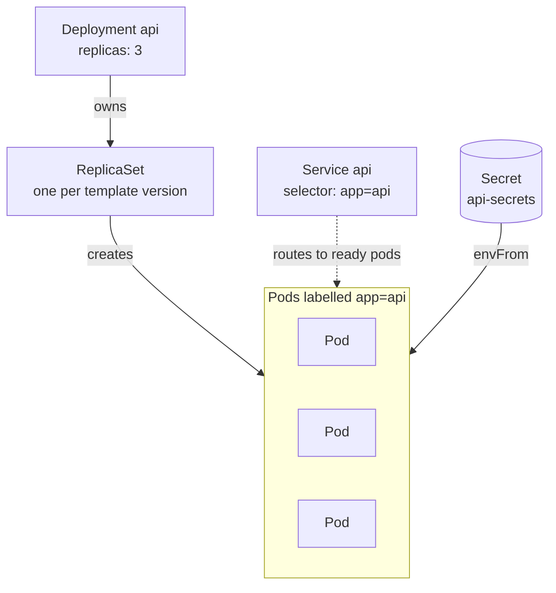
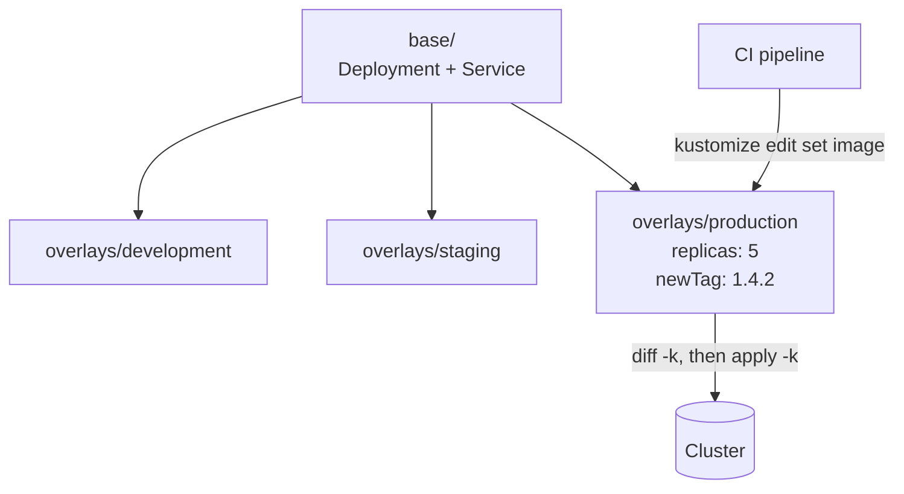

En el taller, el módulo de contenedores es donde más gente se atasca, y casi siempre por el mismo motivo: intentan traducir `docker-compose.yml` a YAML de Kubernetes línea por línea. No se traduce, porque las dos herramientas responden a preguntas distintas.

## La imagen primero, y que sea pequeña

Antes de Kubernetes, la imagen. El error habitual es una sola etapa que arrastra a producción todo el `node_modules` de desarrollo y el código fuente.

```dockerfile title="api/Dockerfile" {4,18}
# Stage 1: build
FROM node:22-alpine AS build
WORKDIR /app
COPY package*.json ./
RUN npm ci                    # ci, not install: respects the lockfile
COPY . .
RUN npm run build

# Stage 2: only what is needed to run
FROM node:22-alpine AS runtime
WORKDIR /app
ENV NODE_ENV=production
COPY package*.json ./
RUN npm ci --omit=dev && npm cache clean --force
COPY --from=build /app/dist ./dist

# Don't run as root.
USER node
EXPOSE 3000
CMD ["node", "dist/server.js"]
```

Dos detalles que importan más de lo que parece. `COPY package*.json` **antes** del resto del código hace que la capa de dependencias se reutilice mientras el lockfile no cambie: un cambio en tu código no reinstala nada. Y `USER node` es la diferencia entre una vulnerabilidad de escape de contenedor que te da root y una que no.

```mermaid title="The build stage is discarded; only the runtime stage ships"
flowchart TB
  subgraph build["build stage"]
    B1["npm ci<br/>all dependencies"] --> B2["COPY source"] --> B3["npm run build"]
  end
  subgraph runtime["runtime stage"]
    R1["npm ci --omit=dev"]
    R2["dist/"]
    R3["node dist/server.js<br/>as USER node"]
    R1 --> R3
    R2 --> R3
  end
  B3 -- "COPY --from=build" --> R2
```

Para el front, la etapa final no es Node: es un servidor estático.

```dockerfile title="web/Dockerfile"
# … same build stage as above
FROM nginx:alpine AS runtime
COPY --from=build /app/dist /usr/share/nginx/html
COPY nginx.conf /etc/nginx/conf.d/default.conf
```

Con una SPA, ese `nginx.conf` necesita el `try_files` que devuelve `index.html` para cualquier ruta, o el refresco en `/projects` da 404.

```nginx title="web/nginx.conf" {6}
server {
  listen 80;
  root /usr/share/nginx/html;

  location / {
    try_files $uri $uri/ /index.html;
  }
}
```

## compose es para desarrollo

`docker-compose` resuelve «arráncame estos tres procesos juntos en mi portátil». Eso sigue siendo útil y no desaparece:

```yaml title="docker-compose.yml" {7,10-12}
services:
  api:
    build: { context: ./api, target: build }
    command: npm run dev
    volumes: ["./api/src:/app/src"]     # hot reload
    environment: { MONGO_URL: mongodb://db:27017/app }
    depends_on: { db: { condition: service_healthy } }
  db:
    image: mongo:7
    healthcheck:
      test: ["CMD", "mongosh", "--eval", "db.adminCommand('ping')"]
      interval: 5s
```

Ese `healthcheck` con `condition: service_healthy` evita el clásico: la API arranca antes que Mongo, falla la conexión y muere en bucle.

## Kubernetes describe estado, no pasos

Aquí está el cambio mental. En compose dices «ejecuta esto». En Kubernetes declaras «quiero tres réplicas de esta imagen, sanas, accesibles bajo este nombre», y el controlador se encarga de que eso sea verdad, ahora y dentro de un mes.

```mermaid title="The reconcile loop: you edit the desired state, the controller does the rest"
flowchart TB
  D["Desired state<br/>replicas: 3"] --> C{"Controller<br/>compares"}
  O["Observed state<br/>2 pods running"] --> C
  C -- "differs" --> A["Act<br/>create 1 pod"]
  A -- "changes" --> O
  C -- "matches" --> W(["Wait for the next change"])
```

| | docker-compose | Kubernetes |
| --- | --- | --- |
| **La pregunta que responde** | Arranca estos procesos juntos | Mantén este estado |
| **Dónde** | Una máquina, normalmente la tuya | Un clúster de nodos |
| **Un proceso muere** | La política `restart:`, si la pusiste | El controlador sustituye el pod |
| **Encontrar un servicio** | Su nombre en la red de compose | Un `Service` y su nombre DNS |
| **Configuración** | `environment:` y `.env` | `ConfigMap` y `Secret` |

Las tres piezas mínimas: un Deployment, un Service y el Secret que lee:

```yaml title="base/api.yaml" {12,17-19,21}
apiVersion: apps/v1
kind: Deployment
metadata: { name: api }
spec:
  replicas: 3
  selector: { matchLabels: { app: api } }
  template:
    metadata: { labels: { app: api } }
    spec:
      containers:
        - name: api
          image: registry.example.com/api:1.4.2   # never :latest
          ports: [{ containerPort: 3000 }]
          envFrom:
            - secretRef: { name: api-secrets }
          resources:
            requests: { cpu: 100m, memory: 128Mi }
            limits:   { memory: 256Mi }
          readinessProbe:
            httpGet: { path: /healthz, port: 3000 }
          livenessProbe:
            httpGet: { path: /healthz, port: 3000 }
            initialDelaySeconds: 15
---
apiVersion: v1
kind: Service
metadata: { name: api }
spec:
  selector: { app: api }
  ports: [{ port: 80, targetPort: 3000 }]
```



El Deployment nunca ejecuta un pod por sí mismo: es dueño de un ReplicaSet por cada versión de la plantilla, y eso es lo que hace posible un rollback. El Service ni siquiera sabe que existe el Deployment: encuentra los pods por etiqueta.

Cuatro decisiones que ahorran incidentes:

**Nunca `:latest`.** Con una etiqueta móvil, dos réplicas del mismo Deployment pueden estar ejecutando código distinto, y un rollback no tiene a dónde volver.

**`requests` siempre.** Sin ellas el planificador no sabe cuánto necesitas y acaba amontonando pods hasta que el nodo se queda sin memoria.

**`limits` de memoria sí, de CPU con cuidado.** Pasarse de memoria mata el proceso; pasarse de CPU sólo lo ralentiza. Un límite de CPU demasiado bajo produce latencias que parecen un bug de la aplicación.

**`readiness` y `liveness` no son lo mismo.** Readiness decide si te llega tráfico; liveness decide si te reinician. Apuntar liveness a un endpoint que consulta la base de datos es una receta para reinicios en cascada cuando la base de datos va lenta: tu aplicación está viva, sólo está esperando.

| Sonda | Qué pregunta | Cuando falla | A qué apuntarla |
| --- | --- | --- | --- |
| **readiness** | ¿Puede este pod recibir tráfico ahora? | Sale del Service, no se reinicia | Algo que compruebe las dependencias |
| **liveness** | ¿Se ha quedado este proceso colgado para siempre? | Se reinicia el contenedor | Algo que solo responda el propio proceso |

## Configuración y secretos

Lo que cambia entre entornos va fuera de la imagen. La misma imagen debe poder desplegarse en desarrollo y en producción cambiando sólo el `ConfigMap` y el `Secret`. En cuanto construyes una imagen distinta por entorno, has perdido la garantía de que lo que probaste es lo que despliegas.

> [!WARNING]
> Un `Secret` de Kubernetes es Base64, no cifrado. Para el repositorio hace falta algo como Sealed Secrets o un gestor externo.

## Kustomize antes que copiar y pegar

Con tres entornos aparece la tentación de tener tres copias del YAML. Kustomize evita la divergencia: una base común y un parche por entorno.

```text
k8s/
├── base/
│   ├── api.yaml
│   └── kustomization.yaml
└── overlays/
    ├── development/kustomization.yaml
    ├── staging/kustomization.yaml
    └── production/kustomization.yaml
```

```yaml title="overlays/production/kustomization.yaml" {10}
resources: ["../../base"]
patches:
  - patch: |
      - op: replace
        path: /spec/replicas
        value: 5
    target: { kind: Deployment, name: api }
images:
  - name: registry.example.com/api
    newTag: 1.4.2
```

El pipeline de CI sólo tiene que actualizar ese `newTag` y aplicar. Todo lo demás vive en git, y `kubectl diff -k` te dice exactamente qué va a cambiar antes de cambiarlo.



```bash title="CI deploy step"
cd k8s/overlays/production
kustomize edit set image registry.example.com/api:1.4.3
kubectl diff -k .   # review exactly what changes
kubectl apply -k .
```

## El orden que recomiendo

```steps
Imagen: Un build multi-etapa que funciona en local, pequeño y sin root.
Compose: Todo el stack en tu portátil, con healthchecks y recarga en caliente.
Kubernetes: La misma imagen, descrita como estado deseado.
Overlays: Una base y un parche por entorno, desplegados desde CI.
```

Imagen multi-etapa que funcione en local, compose para desarrollar, y sólo entonces Kubernetes. Saltar directo al YAML sin una imagen sólida es depurar dos problemas a la vez, y desde el sitio donde menos información tienes.
