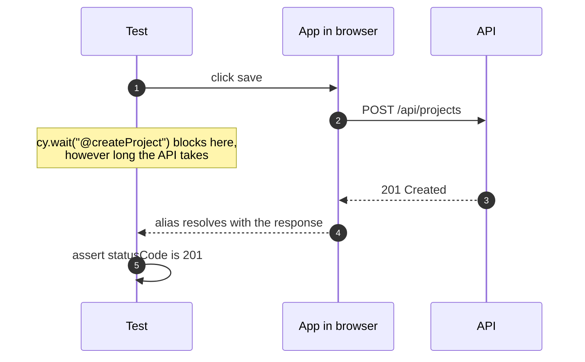
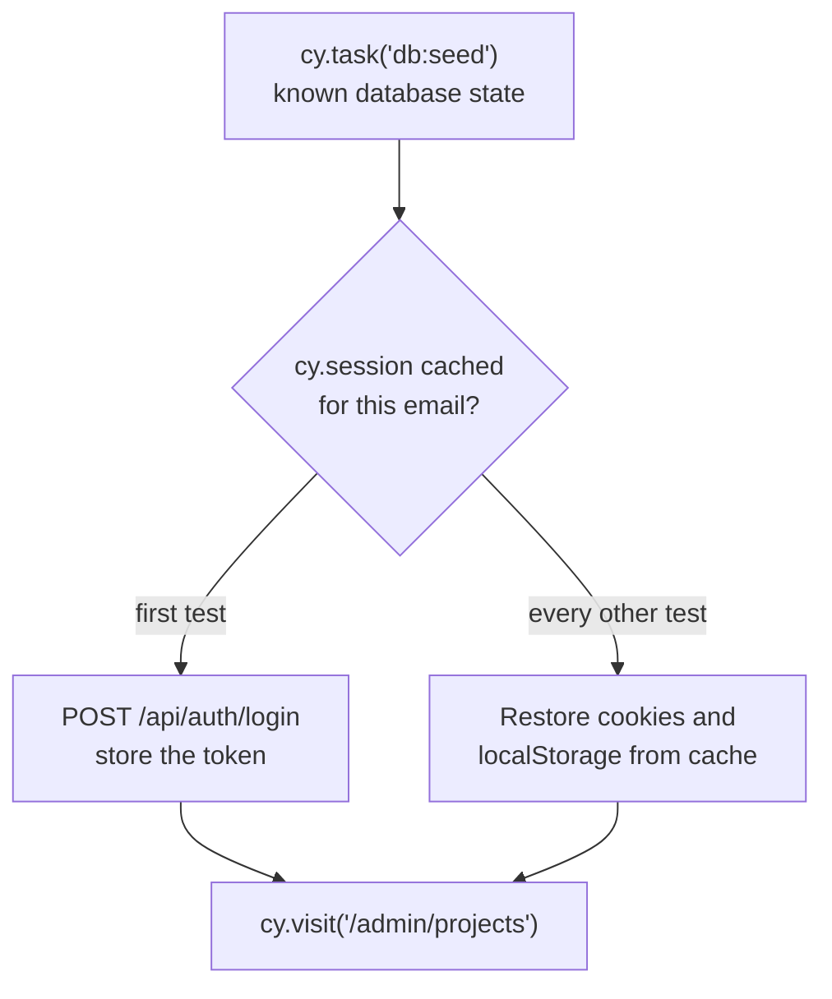
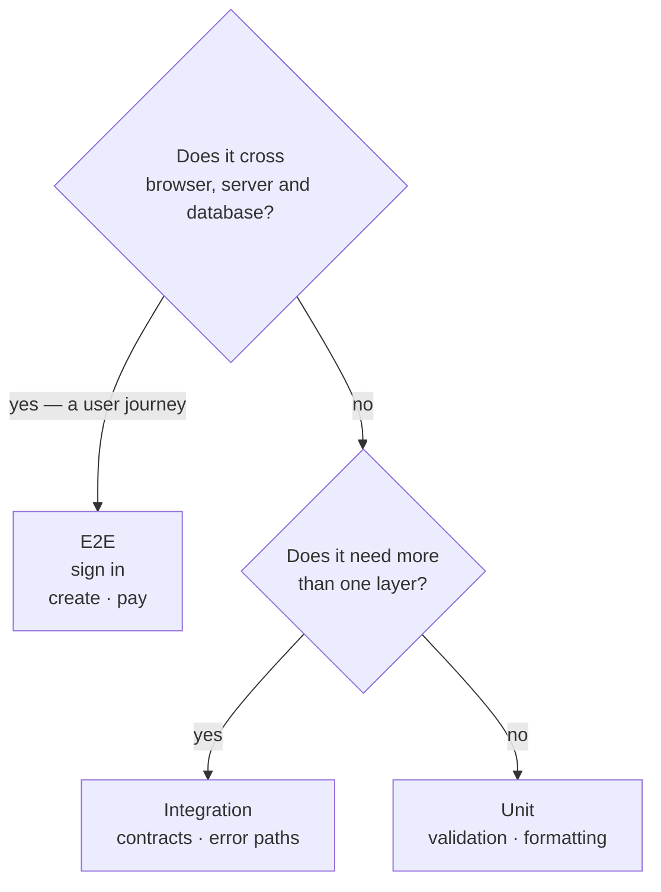

Casi todos los equipos que conozco han tenido una suite E2E y la han abandonado. El patrón se repite:

```steps
Se escribe: Con ilusión, un test por pantalla.
Intermitente: Empieza a fallar de vez en cuando.
Retry: Alguien añade un retry.
Wait: Luego un wait.
Desactivada: A los seis meses está apagada en CI, «temporalmente».
```

La fragilidad no es inherente al E2E. Viene de cuatro decisiones concretas.

## 1 · Esperar tiempo en lugar de esperar estado

El pecado original.

```diff
  cy.get("[data-cy=save]").click();
- cy.wait(500); // brittle: 500 ms is enough until one day it isn't
- cy.get("[data-cy=toast]").should("contain", "Saved");
+ // robust: wait for the condition, not the clock
+ cy.contains("[data-cy=toast]", "Saved").should("be.visible");
```

Cypress ya reintenta las aserciones hasta que se cumplen o expira el timeout. El `wait` no añade nada salvo lentitud y un fallo aleatorio cuando el CI va cargado.

Cuando de verdad necesitas esperar a la red, espera a la **petición**, no a un número:

```js {1,3}
cy.intercept("POST", "/api/projects").as("createProject");
cy.get("[data-cy=save]").click();
cy.wait("@createProject").its("response.statusCode").should("eq", 201);
```



## 2 · Selectores acoplados al diseño

`cy.get(".btn-primary")` funciona hasta que alguien renombra una clase de Tailwind. Un selector debe describir **qué es**, no cómo se pinta.

```js
// Breaks on any styling refactor
cy.get(".flex > div:nth-child(2) button.btn-primary");

// Survives refactors
cy.get("[data-cy=project-save]");
```

Mi orden de preferencia: un rol accesible con su nombre cuando lo hay (`cy.contains("button", "Save")`), y `data-cy` cuando no. El atributo dedicado existe precisamente para que nadie lo cambie por motivos visuales.

| Selector | Ejemplo | Se rompe cuando |
| --- | --- | --- |
| **Estructura CSS** | `.flex > div:nth-child(2) button` | Alguien toca el layout |
| **Clase de estilo** | `.btn-primary` | Alguien renombra una clase |
| **Rol y nombre** | `cy.contains("button", "Save")` | Cambia el texto visible — y eso lo notaría también un usuario |
| **`data-cy`** | `[data-cy=project-save]` | Alguien lo borra a propósito |

## 3 · Tests que dependen unos de otros

El error de diseño más caro. Un test que crea un proyecto y otro que lo edita se convierten en un test de 400 líneas disfrazado de dos, y cuando el primero falla el segundo miente.

Cada test debe montar su propio estado, y montarlo por la vía rápida:

```js title="cypress/e2e/projects.cy.js"
beforeEach(() => {
  cy.task("db:seed");              // known state
  cy.loginByApi("admin@test.dev"); // without the login form
  cy.visit("/admin/projects");
});
```

Ese `loginByApi` importa más de lo que parece. Si cada test atraviesa el formulario de login, estás probando el login cien veces y pagando su latencia cien veces. Pruébalo **una vez**, en su propio test, y en el resto entra por la puerta de servicio:

```js title="cypress/support/commands.js" {2}
Cypress.Commands.add("loginByApi", (email) => {
  cy.session(email, () => {
    cy.request("POST", "/api/auth/login", { email, password: Cypress.env("pw") })
      .its("body.token")
      .then((token) => window.localStorage.setItem("token", token));
  });
});
```

`cy.session` cachea el resultado entre tests, así que el coste se paga una vez por suite.



> [!TIP]
> El formulario de login sigue teniendo su propio test — exactamente uno. Todos los demás entran por la API.

## 4 · Probarlo todo por aquí

Un E2E cuesta segundos; un unitario, milisegundos. Si pruebas cada validación de formulario end-to-end, acabas con una suite de cuarenta minutos que nadie espera.

La regla que uso: **E2E sólo para recorridos que atraviesan sistemas**. Iniciar sesión, crear algo y verlo en la lista, completar un pago, recuperar la contraseña. Cinco o seis recorridos bien elegidos detectan casi todo lo que detectaría una suite de doscientos, y tardan tres minutos.

Todo lo demás —permutaciones de validación, estados de error, formato— es más barato y más preciso una capa más abajo.



## Lo que sí compensa depurar

Dos capacidades de Cypress que cambian la relación con la herramienta:

**El time-travel del runner.** Cada comando queda registrado con un snapshot del DOM en ese instante. Cuando un test falla, no adivinas qué había en pantalla: lo ves.

**Los vídeos y capturas en CI.** Un fallo que sólo ocurre en el runner es imposible de arreglar a ciegas. Con el vídeo del intento fallido, suele resolverse en minutos.

```js title="cypress.config.js" {6}
import { defineConfig } from "cypress";

export default defineConfig({
  video: true,
  screenshotOnRunFailure: true,
  retries: { runMode: 2, openMode: 0 },
});
```

> [!WARNING]
> Ese `retries` merece un matiz. Reintentar en CI oculta la intermitencia en lugar de arreglarla, y a la larga es deuda. Lo uso como red de seguridad mientras la suite madura, con la condición de mirar *qué* test está reintentando: si uno reintenta de forma sistemática, está roto, no es «flaky».

## El criterio de valor

Un E2E no está ahí para cubrir líneas. Está para responder una pregunta: *¿puede un usuario hacer lo que esta aplicación promete?* Si un test no contribuye a esa respuesta, probablemente pertenece a otra capa.
