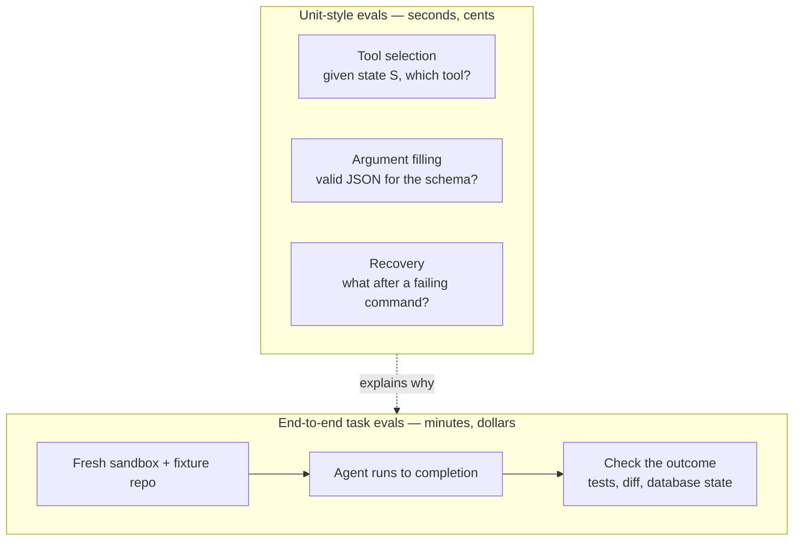
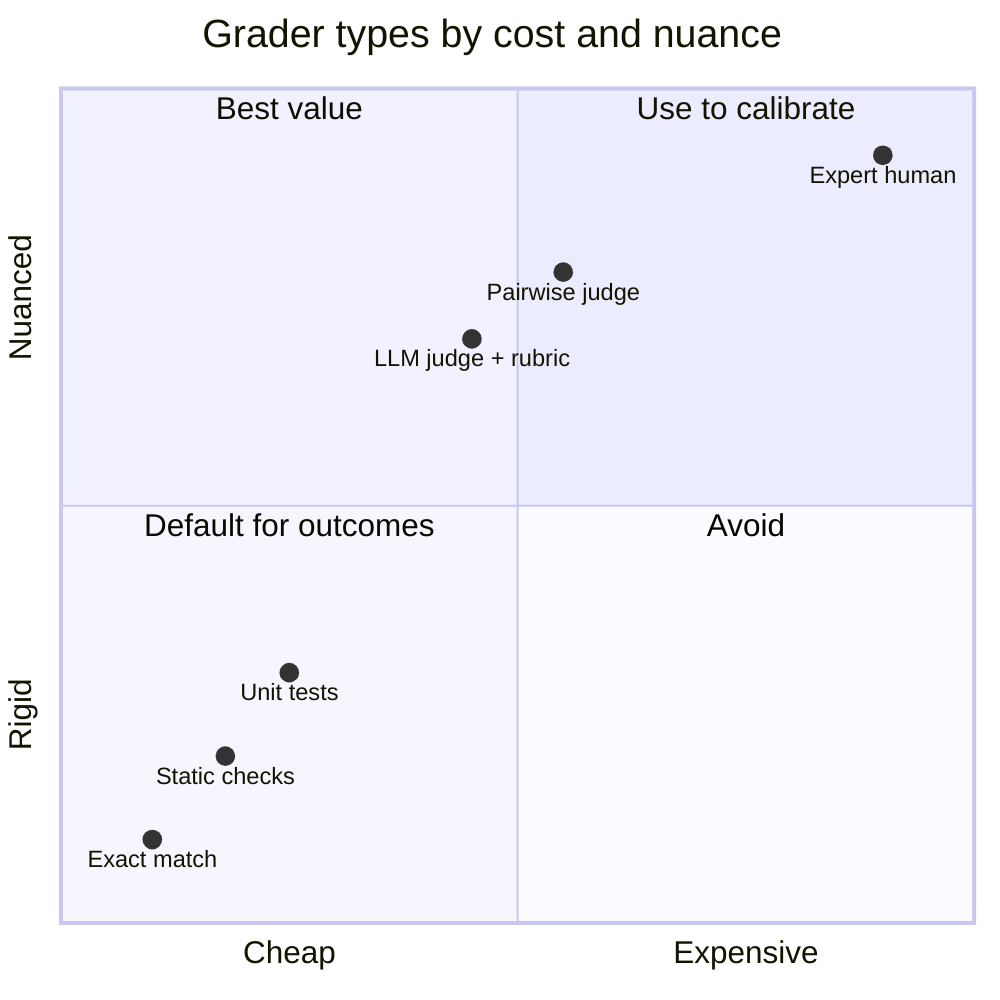
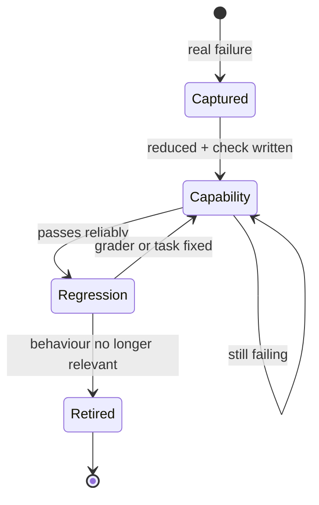
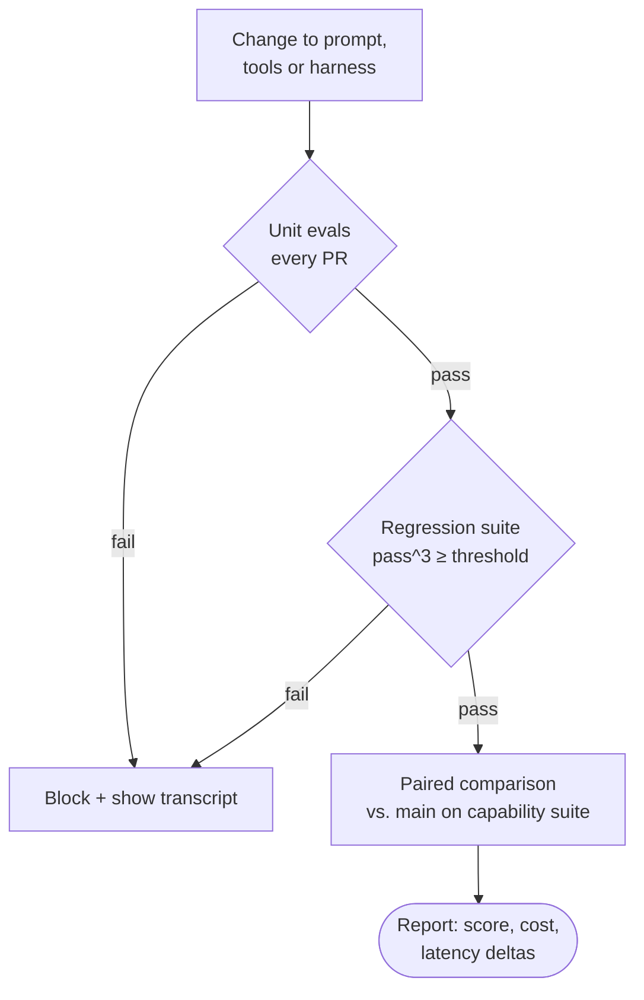

Todo cambio en un agente empieza con el mismo ritual. Retocas el *system prompt*, renombras una herramienta, añades una línea al *harness*, lanzas la tarea que fallaba y funciona. Pruebas una segunda y también funciona. *Parece* que va mejor, así que lo publicas.

Una semana después algo que funcionaba deja de funcionar, y nadie sabe decir cuándo se rompió, porque la única prueba fue una persona probando dos cosas en una terminal.

Ese es el problema que resuelven las evals. No «¿este modelo es listo?» —eso lo responden los rankings, y mal—, sino una pregunta mucho más estrecha y más útil: **¿este cambio en mi prompt, mis herramientas o mi harness ha hecho que mi agente sea mejor en mis tareas, o solo ha movido los fallos a un sitio donde no estaba mirando?**

Este artículo va de construir esa respuesta. Si quieres el contexto de qué es el harness y por qué importa tanto como el modelo, está en [harness engineering](/blog/harness-engineering); aquí doy por hecho que tienes uno y quieres medirlo.

## El vocabulario, en breve

El equipo de ingeniería de Anthropic publicó una buena guía, [Demystifying evals for AI agents](https://www.anthropic.com/engineering/demystifying-evals-for-ai-agents), y voy a tomar prestados sus términos porque son precisos:

| Término | Qué significa |
| --- | --- |
| **Task** (tarea) | Un caso de prueba: una entrada más criterios de éxito |
| **Trial** (intento) | Un intento de resolver una tarea. Se hacen varios, porque las salidas varían |
| **Grader** (evaluador) | Lógica que puntúa algún aspecto de un intento |
| **Transcript** | El registro completo de un intento: mensajes, llamadas a herramientas, resultados intermedios |
| **Outcome** (resultado) | El estado final del entorno tras el intento |
| **Eval harness** | Lo que ejecuta las tareas, guarda los transcripts, puntúa y agrega |

La distinción que más importa es **transcript frente a resultado**. El ejemplo de la guía es un agente que dice «tu vuelo está reservado». El transcript dice reservado. El resultado es si de verdad existe una reserva en la base de datos. Puntúa el resultado siempre que puedas.

La otra que conviene tener presente: cuando evalúas «un agente», estás evaluando el modelo *y* el harness juntos. Cambia cualquiera de los dos y tienes un sistema distinto.

## Evals unitarias y evals de extremo a extremo

Me resulta útil dividir las evals como dividiría los tests normales.

**Las evals de estilo unitario** comprueban una decisión aislada. Dado este estado de la conversación, ¿elige el agente la herramienta correcta? Dada esta descripción de herramienta, ¿rellena bien los argumentos? Dada esta salida de error, ¿reintenta o se rinde? Son baratas —a menudo una sola llamada al modelo— y el evaluador suele ser exacto.

**Las evals de tarea de extremo a extremo** le dan al agente una tarea real en un entorno real (aislado) y comprueban el estado final. Arregla este test que falla. Añade este campo a la API y a su formulario. Son lentas, caras y ruidosas, y son lo único que te dice si el sistema completo funciona.



La mayoría de los cambios que hago tocan un comportamiento concreto —la descripción de una herramienta, una línea de las instrucciones—, así que quiero que la capa unitaria me diga rápido si ese comportamiento se ha movido, y que la capa de extremo a extremo me diga si se ha roto algo más. Cuando falla una tarea de extremo a extremo, las evals unitarias son donde busco el *porqué*.

## Evaluadores: exactos, de código, juez y humanos

El evaluador es donde la mayoría de las evals fallan sin hacer ruido, así que merece la pena elegir con intención qué tipo usar.



**Evaluadores exactos y basados en código**: comparación de cadenas, ejecutar la batería de tests, comprobar que existe un fichero, analizar el diff, contar llamadas a herramientas. Rápidos, baratos, reproducibles y fáciles de depurar. Su debilidad es la rigidez: una respuesta correcta formulada de otra manera falla. Para agentes de código es la opción por defecto, porque «los tests pasan» es un evaluador de código que además se acerca bastante a la verdad.

**LLM como juez**: un modelo puntúa la salida contra una rúbrica. Flexible, maneja salidas abiertas (la descripción de un PR, una explicación, un plan) y escala. También es no determinista, cuesta dinero cada puntuación y tiene sesgos conocidos: el [artículo de MT-Bench](https://arxiv.org/abs/2306.05685) documentó hace años el sesgo de posición, el de verbosidad y el de autopromoción en los jueces, y esos fallos no han desaparecido.

**Evaluadores humanos**: el patrón oro y el cuello de botella. No se usan para puntuar cada ejecución; se usan para **calibrar** al juez.

Hay dos prácticas que hacen fiable a un juez. La primera es pedir veredictos binarios por criterio en lugar de una nota del 1 al 10; Hamel Husain y Shreya Shankar lo argumentan bien en su [FAQ sobre evals](https://hamel.dev/blog/posts/evals-faq/): nadie se pone de acuerdo en la diferencia entre un 6 y un 7. La segunda es darle al juez una salida explícita («unknown»), para que no se invente un veredicto cuando el transcript no contiene la evidencia.

Esta es una rúbrica que usaría para puntuar la descripción del pull request que escribe un agente tras un cambio:

```md title="evals/judges/pr-description.md"
You are grading a pull request description written by a coding agent.
You get the task, the final diff and the description. Judge only what is there.

For each criterion answer "pass", "fail" or "unknown" and quote the evidence.

1. accurate   — Every change the description claims is present in the diff.
2. complete   — Every behavioural change in the diff is mentioned.
3. verifiable — It names how the change was checked (command, test, screenshot).
4. honest     — Anything not done or not verified is stated, not implied done.
5. scoped     — No changes outside the task are made or claimed.

Answer "unknown" when the diff does not contain enough to decide.
Respond with JSON only:
{"accurate": {"verdict": "...", "evidence": "..."}, ...}
```

Y la parte que la gente se salta: antes de fiarme de ese juez, etiqueto a mano entre 30 y 50 transcripts y mido cuántas veces coincide conmigo, por separado para los fallos que detecta (tasa de verdaderos positivos) y para las salidas buenas que deja pasar (tasa de verdaderos negativos). Un juez que lo aprueba todo tiene una concordancia estupenda en un conjunto mayoritariamente bueno y no sirve para nada.

> [!WARNING]
> No dejes que el modelo que estás probando sea el único juez de su propia salida sin calibrarlo contra etiquetas humanas. El sesgo de autopromoción está documentado, y acabarás midiendo el gusto de tu juez en lugar de la calidad de tu agente.

## Construye el conjunto de evals a partir de fallos reales

El motivo más común por el que un equipo no tiene evals es que se imagina que necesita un benchmark: cientos de tareas cuidadosamente seleccionadas. No hace falta. La guía de Anthropic sugiere que **entre 20 y 50 tareas sencillas sacadas de fallos reales** son un buen punto de partida, porque los primeros cambios suelen tener efectos grandes que un conjunto pequeño puede detectar.

¿De dónde salen las tareas? De los sitios donde el agente ya ha fallado:

```steps loop="Cada fallo nuevo se convierte en una tarea"
Capturar: Una sesión sale mal. Guarda el transcript y el estado inicial (commit, fixture, prompt).
Diagnosticar: Lee el transcript. Pon nombre al fallo: herramienta equivocada, instrucción ignorada, se rindió, se inventó un fichero.
Reducir: Recórtalo a la tarea más pequeña que siga fallando. Escribe la comprobación que lo habría detectado.
Validar la tarea: Confirma que una solución de referencia pasa el evaluador; si no, lo roto es la tarea, no el agente.
Añadir: A la suite de capacidades. Cuando pase de forma fiable, se gradúa a regresión.
```

Dos reglas de la guía que he visto que importan. Una buena tarea es aquella en la que **dos expertos coincidirían por separado en si pasa o falla**: si no eres capaz de escribir la comprobación, la tarea es ambigua. Y equilibra el conjunto: incluye casos en los que el comportamiento *debe* ocurrir y casos en los que *no*. Una eval que solo comprueba «¿usa la herramienta de búsqueda cuando hace falta?» produce un agente que lo busca todo.



**Las evals de capacidad** deberían empezar con una tasa de acierto baja; esa es la gracia, miden lo que intentas mejorar. **Las evals de regresión** deberían estar cerca del 100 %, y cualquier caída significa que algo se ha roto. Una tarea pasa de un grupo al otro cuando se vuelve fiable.

## Las trayectorias son datos

Cuando falla una tarea de extremo a extremo, la puntuación te dice *que* ha fallado. El transcript te dice *por qué*. «Lee los transcripts» es el consejo que más se repite en la guía, y es el que yo subrayaría: una tasa de acierto del 0 % en muchos intentos suele indicar una tarea o un evaluador rotos más que un agente incapaz, y solo el transcript te dice cuál de las dos cosas es.

Guarda el transcript de cada intento junto a su puntuación. Así se convierten en datos que puedes consultar, no en logs:

- **Pasos y llamadas a herramientas por tarea**: un cambio que mantiene la tasa de acierto pero duplica los pasos es una regresión en coste y latencia.
- **Tasa de errores de herramienta**: una herramienta renombrada a la que el agente sigue llamando con los argumentos antiguos aparece aquí antes que en la tasa de acierto.
- **Dónde divergen los intentos**: ejecuta la misma tarea cinco veces y compara las trayectorias; el primer punto en el que las ejecuciones buenas y las malas se separan suele ser el fallo.

Lo que evito es **puntuar el camino**. Exigir que el agente llame a `read_file` antes que a `edit_file` parece riguroso y penaliza soluciones válidas. Puntúa el resultado; usa el camino para diagnosticar.

## pass@k, pass^k y varianza

Los agentes no son deterministas, así que un intento por tarea dice muy poco. Hay dos métricas que resumen varios intentos, y responden a preguntas opuestas:

- **pass@k**: la probabilidad de que **al menos uno** de k intentos salga bien. Sube con k. Es la métrica adecuada cuando basta con un acierto: vas a revisar la salida de todas formas y te quedas con la buena.
- **pass^k** (pass-hat-k): la probabilidad de que **los k** intentos salgan bien. Baja con k. Se introdujo en [τ-bench](https://arxiv.org/abs/2406.12045), y es la métrica adecuada cuando lo que importa es la consistencia: un agente de cara al usuario, un bot de CI, cualquier cosa que funcione sin supervisión.

Con una tasa de acierto por intento del 75 % en una tarea, y suponiendo intentos independientes:

| k | pass@k | pass^k |
| --- | --- | --- |
| **1** | 75 % | 75 % |
| **3** | 98,4 % | 42,2 % |
| **5** | 99,9 % | 23,7 % |
| **10** | ~100 % | 5,6 % |

El mismo agente, la misma tarea, dos historias completamente distintas. Si alguien da un número sin decir cuál es, pregunta.

La otra trampa es el tamaño de la muestra. Con 50 tareas y una tasa de acierto en torno al 70 %, el error estándar ronda los 6,5 puntos, así que un intervalo aproximado del 95 % es de ±13 puntos. Pasar del 68 % al 73 % en ese conjunto es ruido. El artículo de Anthropic sobre [un enfoque estadístico para evaluar modelos](https://www.anthropic.com/research/statistical-approach-to-model-evals) cubre los remedios; los dos que uso de verdad son **varios intentos por tarea** (para reducir la varianza dentro de cada tarea) y **comparaciones pareadas**: ejecuta la versión base y la candidata sobre las mismas tareas y mira las diferencias tarea a tarea, no dos medias independientes.

## Un harness pequeño que puedes ejecutar

No necesitas un framework para empezar. Este es el bucle completo en Python sin dependencias: copia un fixture a un directorio limpio, ejecuta el agente, ejecuta la comprobación y lo guarda todo. El agente es cualquier CLI que lea un prompt por la entrada estándar; pon el tuyo en `AGENT_CMD`.

```jsonl title="evals/tasks/regression.jsonl"
{"id": "fix-date-locale", "fixture": "evals/fixtures/blog", "prompt": "Dates on /es/blog render in English. Fix it.", "check": "npx vitest run tests/unit/date.test.ts"}
{"id": "no-new-deps", "fixture": "evals/fixtures/blog", "prompt": "Add a reading-time label to posts.", "check": "git diff --quiet HEAD -- package.json && npx vitest run tests/unit/readingTime.test.ts"}
```

```python title="evals/harness.py" {10-15}
import json, os, shlex, shutil, subprocess, sys, tempfile, time
from math import comb
from pathlib import Path

AGENT = shlex.split(os.environ["AGENT_CMD"])  # e.g. "my-agent --headless"

def run_trial(task: dict) -> dict:
    with tempfile.TemporaryDirectory() as tmp:
        work = Path(tmp) / "repo"
        # Fresh copy per trial: leftover state from a previous run inflates scores.
        shutil.copytree(task["fixture"], work)
        subprocess.run(["git", "init", "-q"], cwd=work, check=True)
        subprocess.run(["git", "add", "-A"], cwd=work, check=True)
        subprocess.run(["git", "-c", "user.name=eval", "-c", "user.email=eval@localhost",
                        "commit", "-qm", "fixture"], cwd=work, check=True)
        start = time.monotonic()
        try:
            agent = subprocess.run(AGENT, input=task["prompt"], cwd=work, text=True,
                                   capture_output=True, timeout=task.get("timeout", 900))
            transcript = agent.stdout
        except subprocess.TimeoutExpired:
            transcript = "TIMEOUT"
        seconds = time.monotonic() - start
        check = subprocess.run(task["check"], shell=True, cwd=work,
                               capture_output=True, text=True)
        return {"id": task["id"], "passed": transcript != "TIMEOUT" and check.returncode == 0,
                "seconds": round(seconds, 1), "transcript": transcript,
                "check_output": (check.stdout + check.stderr)[-4000:]}
```

Las líneas de `git` convierten el fixture en un repositorio, de modo que una comprobación como `git diff --quiet HEAD -- package.json` puede asegurar que el agente *no* ha tocado algo. Las métricas son los estimadores insesgados de los artículos de Codex y τ-bench, calculados a partir de `n` intentos con `c` aciertos:

```python title="evals/harness.py (continued)"
def pass_at_k(n: int, c: int, k: int) -> float:
    return 1.0 if n - c < k else 1 - comb(n - c, k) / comb(n, k)

def pass_hat_k(n: int, c: int, k: int) -> float:
    return comb(c, k) / comb(n, k)  # comb(c, k) is 0 when c < k

def main(suite: str, trials: int, k: int, min_pass_hat: float) -> int:
    tasks = [json.loads(l) for l in Path(suite).read_text().splitlines() if l.strip()]
    worst = 1.0
    with open("eval-results.jsonl", "w") as out:
        for task in tasks:
            results = [run_trial(task) for _ in range(trials)]
            for r in results:
                out.write(json.dumps(r) + "\n")  # transcripts are data: keep them
            c = sum(r["passed"] for r in results)
            ph = pass_hat_k(trials, c, k)
            worst = min(worst, ph)
            print(f"{task['id']:<24} {c}/{trials}  pass@{k}={pass_at_k(trials, c, k):.2f}  pass^{k}={ph:.2f}")
    return 0 if worst >= min_pass_hat else 1

if __name__ == "__main__":
    suite, trials, k, threshold = sys.argv[1], int(sys.argv[2]), int(sys.argv[3]), float(sys.argv[4])
    sys.exit(main(suite, trials, k, threshold))
```

Se ejecuta con `AGENT_CMD="my-agent --headless" python evals/harness.py evals/tasks/regression.jsonl 5 3 0.9`. Lanza los intentos en secuencia para que se entienda; paralelízalo con `concurrent.futures` cuando sea lo bastante lento como para molestarte. Cambia el `check` de shell por una llamada a un juez cuando la salida sea texto en lugar de código.

## Regresiones en CI

Una vez existe la suite de regresión, debería ejecutarse en cada cambio que pueda afectar al agente, y solo en esos, porque cuesta dinero de verdad.



```yaml title=".github/workflows/agent-evals.yml"
name: agent-evals
on:
  pull_request:
    paths: ["agent/prompts/**", "agent/tools/**", "agent/harness/**", "evals/**"]
permissions:
  contents: read
jobs:
  regression:
    runs-on: ubuntu-latest
    timeout-minutes: 60
    steps:
      - uses: actions/checkout@v4
      - uses: actions/setup-python@v5
        with: { python-version: "3.12" }
      - run: python evals/harness.py evals/tasks/regression.jsonl 3 3 0.9
        env:
          AGENT_CMD: ./agent/bin/run --headless
          AGENT_API_KEY: ${{ secrets.EVAL_API_KEY }}
      - uses: actions/upload-artifact@v4
        if: always()
        with: { name: eval-transcripts, path: eval-results.jsonl }
```

Subir los transcripts cuando falla es la línea más útil de ese fichero. Un check en rojo sin transcript manda a alguien a reproducirlo en local; un check en rojo con el transcript normalmente se explica solo en un minuto.

> [!TIP]
> Usa una API key dedicada para las evals, con su propio límite de gasto. Una suite de regresión que entra en bucle con una tarea rota es capaz de gastarse el presupuesto de un mes en una tarde.

## El coste y la latencia también son métricas

Un cambio que sube la tasa de acierto tres puntos y duplica los tokens por tarea no es obviamente una mejora. Yo doy tres números por suite, junto a los de la versión base: **tasa de acierto** (diciendo qué métrica es), **coste por tarea** y **tiempo por tarea** —la mediana y la cola lenta, porque la cola lenta es lo que nota el usuario—.

Los pasos por tarea son un buen sustituto cuando no puedes obtener el coste directamente: más pasos significa más tokens y más latencia, y a menudo significa que el agente va dando palos de ciego. Un cambio en el prompt que baja la mediana de pasos de 14 a 9 con la misma tasa de acierto es una mejora real, aunque no se haya movido ninguna puntuación.

## Advertencias sobre los benchmarks

Los benchmarks públicos sirven para elegir modelo y casi nada para evaluar tus cambios. Por dos motivos.

**Contaminación.** SWE-bench saca sus tareas de repositorios públicos de GitHub, que también son datos de entrenamiento. En febrero de 2026 OpenAI [dejó de publicar resultados de SWE-bench Verified](https://openai.com/index/why-we-no-longer-evaluate-swe-bench-verified/), alegando tests que rechazan soluciones correctas e indicios de que las mejoras reflejan cada vez más la exposición al benchmark durante el entrenamiento. Tus propias tareas, construidas a partir de tus propios fallos, no pueden haberse colado en el entrenamiento de nadie.

**Validez de la puntuación.** El artículo de la [Agentic Benchmark Checklist](https://arxiv.org/abs/2507.02825) auditó benchmarks agénticos populares y encontró problemas en la preparación de las tareas y en el diseño de la recompensa que distorsionan sustancialmente las puntuaciones publicadas. La guía de Anthropic cuenta una historia parecida sobre un benchmark cuya puntuación se disparó al arreglar fallos en la evaluación. Si quienes construyen benchmarks como oficio se equivocan con los evaluadores, tú también lo harás; por eso leer los transcripts no es opcional.

> El benchmark te dice qué modelo probar. Solo tu conjunto de evals te dice si tu cambio ha ayudado.

## Lo que las evals no arreglan

Conviene ser honesto con esto: las evals miden lo que se te ocurrió probar. Una suite construida a partir de fallos pasados es, por definición, un registro de los problemas que ya te has encontrado; el siguiente será nuevo. Las evals reducen la probabilidad de una regresión; no certifican que algo sea correcto.

Además tienen un coste real. Cada intento de extremo a extremo son tokens y minutos, los jueces necesitan una calibración humana que alguien tiene que hacer, y un conjunto de evals se pudre: los fixtures se alejan del código real, y tareas que tenían sentido hace seis meses prueban comportamientos que ya nadie necesita. Trato la suite como cualquier batería de tests: borro las tareas que ya no compensan su tiempo de ejecución.

Y los conjuntos pequeños tienen barras de error anchas. Veinte tareas bastan para detectar un cambio que rompe las cosas de verdad, y no bastan para distinguir entre dos prompts decentes. Cuando la diferencia que intentas medir es menor que el ruido, la respuesta honesta es «no lo sé», y lo que toca es añadir más tareas o más intentos, no dar un decimal con mucha seguridad.

## Para seguir aprendiendo

- [Demystifying evals for AI agents](https://www.anthropic.com/engineering/demystifying-evals-for-ai-agents): la guía de ingeniería de Anthropic; el vocabulario de este artículo, los compromisos entre evaluadores, pass@k frente a pass^k y cómo empezar con 20–50 tareas.
- [A statistical approach to model evaluations](https://www.anthropic.com/research/statistical-approach-to-model-evals): errores estándar, agrupación, diferencias pareadas y análisis de potencia aplicados a evals. Léelo antes de fiarte de una diferencia de dos puntos.
- [AI Evals FAQ](https://hamel.dev/blog/posts/evals-faq/): Hamel Husain y Shreya Shankar sobre análisis de errores, jueces binarios y cómo validar un juez contra etiquetas humanas.
- [τ-bench](https://arxiv.org/abs/2406.12045): el artículo que introdujo pass^k, con una demostración concreta de lo rápido que cae la consistencia en intentos repetidos.
- [Judging LLM-as-a-Judge with MT-Bench and Chatbot Arena](https://arxiv.org/abs/2306.05685): donde se midieron los sesgos clásicos de los jueces (posición, verbosidad, autopromoción).
- [Establishing Best Practices for Building Rigorous Agentic Benchmarks](https://arxiv.org/abs/2507.02825): la Agentic Benchmark Checklist; útil como lista de comprobación para tus propios evaluadores, no solo para benchmarks públicos.
- [Why we no longer evaluate SWE-bench Verified](https://openai.com/index/why-we-no-longer-evaluate-swe-bench-verified/): OpenAI sobre la contaminación y los tests defectuosos del benchmark de código más citado.
