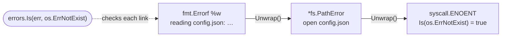
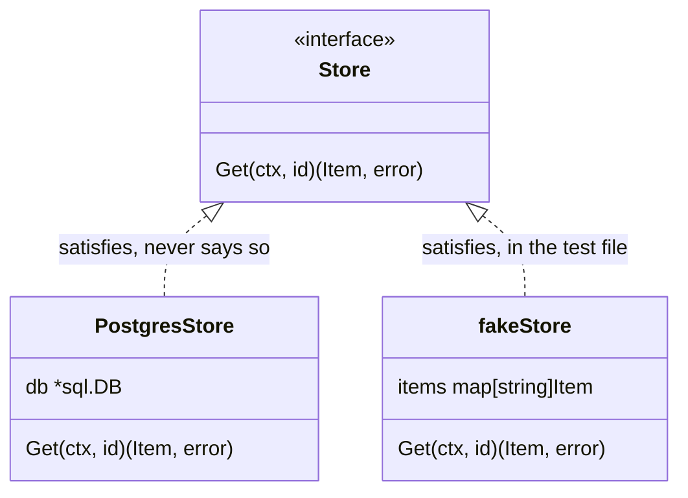
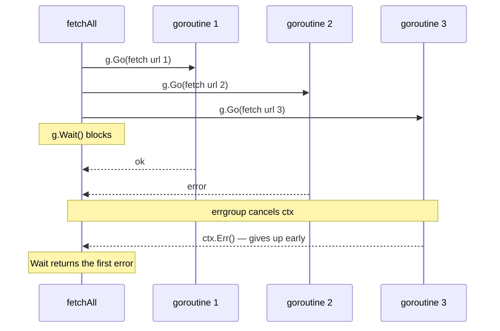

Si vienes de TypeScript, Go te va a parecer al principio un lenguaje incompleto. No hay excepciones, no hay clases, no hay `null` seguro, y el gestor de paquetes no se parece a npm. Casi todas esas ausencias son decisiones, y entenderlas es lo que hace que el lenguaje encaje.

| En TypeScript | En Go | Sección |
| --- | --- | --- |
| **`throw` / `try…catch`** | Un `error` devuelto y `if err != nil` | 1 |
| **`class Foo implements Bar`** | Nada: basta con tener los métodos | 2 |
| **`Promise.all`** | Goroutines más `errgroup` | 3 |
| **`AbortController`** | `context.Context`, primer parámetro por convención | 3 |
| **`undefined` frente a `0`** | El valor cero, o un puntero cuando importa «no informado» | 4 |
| **`finally`** | `defer`, junto a la adquisición del recurso | — |

## 1 · Los errores son valores

Lo primero que choca. En Go no se lanza: se devuelve.

```go {3-5,8-10}
func readConfig(path string) (Config, error) {
    data, err := os.ReadFile(path)
    if err != nil {
        return Config{}, fmt.Errorf("reading %s: %w", path, err)
    }

    var cfg Config
    if err := json.Unmarshal(data, &cfg); err != nil {
        return Config{}, fmt.Errorf("parsing %s: %w", path, err)
    }

    return cfg, nil
}
```

Sí, hay mucho `if err != nil`. A cambio, **cada punto de fallo es visible en el sitio donde ocurre**. En TypeScript, una función que puede lanzar tiene exactamente la misma firma que una que no; sólo lo descubres leyendo la implementación o en producción.

El `%w` de `fmt.Errorf` envuelve el error original, y `errors.Is` y `errors.As` permiten recorrerlo después:

```go
if errors.Is(err, os.ErrNotExist) {
    // fallback path
}
```



Es el equivalente a comprobar el tipo de una excepción, sin el salto de control.

## 2 · Las interfaces se satisfacen solas

En TypeScript declaras `class Foo implements Bar`. En Go no existe esa declaración: si un tipo tiene los métodos, cumple la interfaz.

```go
type Store interface {
    Get(ctx context.Context, id string) (Item, error)
}

// No "implements". Having the method is enough.
type PostgresStore struct{ db *sql.DB }

func (s *PostgresStore) Get(ctx context.Context, id string) (Item, error) {
    // ...
}
```

La consecuencia cultural: **las interfaces se definen donde se consumen, no donde se implementan**. El paquete que necesita leer declara la interfaz pequeña que necesita, y cualquier implementación encaja sin saberlo. Es lo contrario a la costumbre de Java de exportar la interfaz junto al servicio.



En la práctica esto hace los tests triviales: un struct de cinco líneas en el propio fichero de test ya es un doble válido.

> [!TIP]
> Mantén las interfaces del consumidor en el método o dos que de verdad llama. Cuanto más pequeña es la interfaz, más tipos la satisfacen sin proponérselo, y de eso se trata.

## 3 · Concurrencia con canales

Una goroutine no es un hilo del sistema: es una corrutina que el runtime multiplexa sobre unos pocos hilos reales. Arrancar diez mil es normal.

```go {2,6,16}
func fetchAll(ctx context.Context, urls []string) ([]Result, error) {
    g, ctx := errgroup.WithContext(ctx)
    results := make([]Result, len(urls))

    for i, url := range urls {
        g.Go(func() error {
            r, err := fetch(ctx, url)
            if err != nil {
                return err
            }
            results[i] = r
            return nil
        })
    }

    if err := g.Wait(); err != nil {
        return nil, err
    }
    return results, nil
}
```

> [!NOTE]
> En código más antiguo verás una línea `i, url := i, url` dentro del bucle para que cada goroutine tenga su propia copia. Desde Go 1.22 cada iteración tiene sus propias variables de bucle, así que ya no hace falta.

Eso es `Promise.all` con cancelación: si una goroutine devuelve error, `errgroup` cancela el contexto y el resto abandonan.



Y esa es la pieza que a un desarrollador de JavaScript le falta sin saberlo: **`context.Context` es un mecanismo de cancelación que atraviesa toda la pila**. En JavaScript existe `AbortController`, pero casi nadie lo propaga. En Go, `ctx` es el primer parámetro por convención precisamente para que se propague siempre.

## 4 · El valor cero siempre es útil

Go no tiene constructores. Cada tipo tiene un valor cero válido, y las librerías bien diseñadas hacen que ese valor cero funcione:

```go
var buf bytes.Buffer     // ready to use
buf.WriteString("hello")

var mu sync.Mutex        // ready to use
mu.Lock()
```

El corolario incómodo: no hay distinción entre «cero» y «no informado». Un `int` a 0 puede ser un valor legítimo o un campo que nadie rellenó. Cuando esa diferencia importa —típicamente al deserializar JSON— se usa un puntero:

```go
type Settings struct {
    Retries *int `json:"retries"` // nil means "not provided"
}
```

Es el mismo problema que `undefined` frente a `0` en TypeScript, resuelto de forma más explícita y más ruidosa.

## Lo que se traduce directo

No todo es diferente. `slices` y `maps` se comportan como arrays y objetos; `defer` es un `finally` que se lee mejor porque está junto a la adquisición del recurso; los genéricos, desde Go 1.18, funcionan como esperas:

```go
func Map[T, U any](items []T, fn func(T) U) []U {
    out := make([]U, len(items))
    for i, item := range items {
        out[i] = fn(item)
    }
    return out
}
```

## Por dónde empezar

Un servicio HTTP pequeño. La librería estándar es suficiente —`net/http` con el enrutado de Go 1.22 cubre casi todo— y en un backend-for-frontend vas a tocar exactamente las cuatro ideas de arriba: errores como valores en cada llamada, interfaces para los clientes que necesitas simular, goroutines para paralelizar peticiones, y `context` para propagar la cancelación cuando el usuario cierra la pestaña.

Después de un par de semanas, el `if err != nil` deja de parecer ruido y empieza a parecer información.
