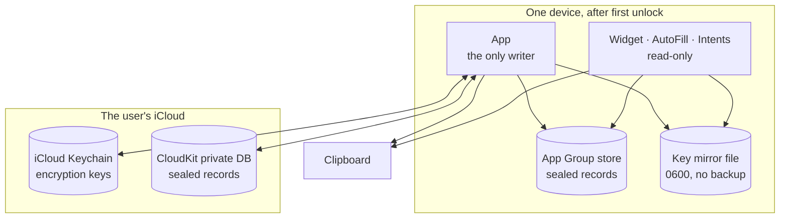
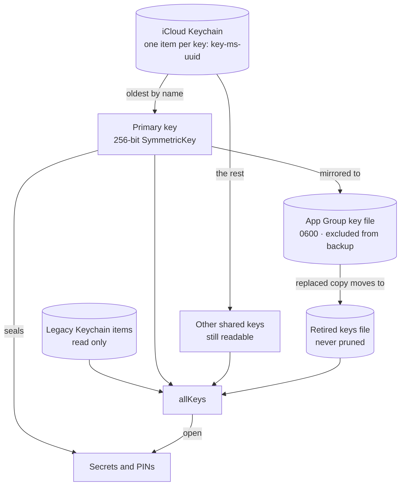
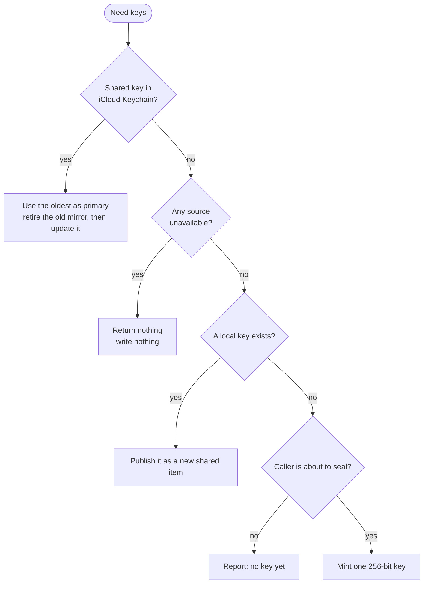
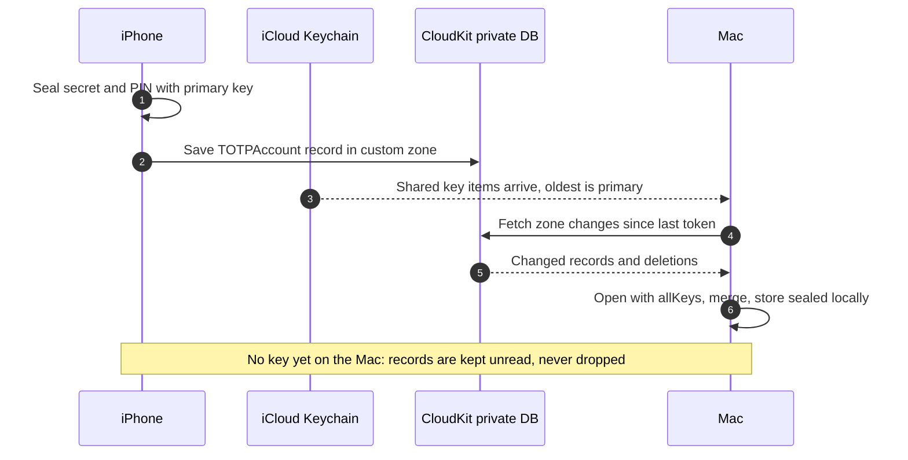
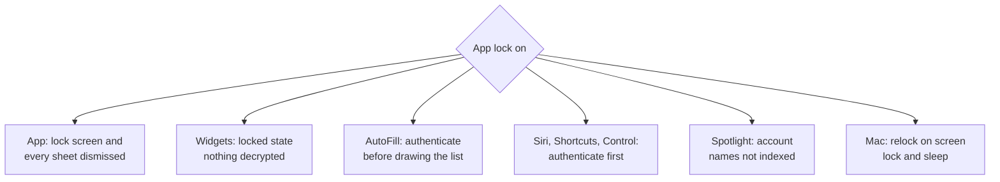

TOTP Password vivió unos tres años en TestFlight. Era el autenticador que usaba a diario, y ese era precisamente el problema: una app que le funciona a su autor no es lo mismo que una app que puedes darle a gente que va a meter en ella el segundo factor de su banco y olvidarse.

Lo que por fin la llevó al App Store, para iPhone, iPad y Mac, no fue una funcionalidad. Fue una ronda de auditorías de seguridad y el endurecimiento que salió de ellas. Este artículo va de ese trabajo: qué protege la app, dónde viven las claves, cómo la sincronización sigue cifrada y qué hallazgos tuve que corregir antes de quedarme tranquilo publicándola. El código está [abierto en GitHub](https://github.com/lucferbux/TOTP), así que cada fragmento es real, recortado.

## Qué tiene que proteger un autenticador

Una app TOTP guarda muy pocos datos, pero todos son sensibles. Hay tres tipos:

- **Los secretos.** La clave compartida de cada cuenta ([RFC 6238](https://datatracker.ietf.org/doc/html/rfc6238)). Quien la tenga puede generar tus códigos para siempre.
- **El prefijo PIN.** Algunos servicios piden un PIN fijo tecleado antes del código. La app lo guarda y lo antepone cada vez que copia o autocompleta un código. Eso lo convierte en media credencial, no en una preferencia.
- **Los códigos.** Duran poco, pero un código en el portapapeles o en un widget de la pantalla de bloqueo es un código que otra persona puede leer.

Luego está por dónde viajan. Los secretos no se quedan en un solo proceso: la app, una extensión de widgets, una extensión de autocompletado, App Intents para Siri y Atajos, un control del Centro de Control, la barra de menús del Mac y los demás dispositivos del usuario a través de iCloud. Cada uno es una puerta.



El diagrama es también el modelo de amenazas en miniatura. Todo lo que cruza el borde de una caja va sellado, salvo los códigos que van al portapapeles, que tienen sus propias reglas más abajo. Y no hay ninguna caja para mí: la app no tiene servidor, ni analítica, ni código de terceros, y no hace peticiones de red propias. El único tráfico de red es el iCloud del propio usuario.

## Sellar secretos con ChaChaPoly

Cada secreto y cada PIN se sella con [`ChaChaPoly`](https://developer.apple.com/documentation/cryptokit/chachapoly) de CryptoKit antes de tocar cualquier almacén, local o remoto. La función auxiliar es aburrida a propósito:

```swift title="Shared/Model/AccountStore.swift"
public enum AccountCrypto {
    public static func seal(_ data: Data, using key: SymmetricKey) throws -> Data {
        try ChaChaPoly.seal(data, using: key).combined
    }

    /// Tries every key in order; throws the last failure when none works.
    public static func open(_ data: Data, usingAny keys: [SymmetricKey]) throws -> Data {
        guard !keys.isEmpty else { throw CryptoKitError.authenticationFailure }
        var lastError: Error = CryptoKitError.authenticationFailure
        for key in keys {
            do { return try open(data, using: key) } catch { lastError = error }
        }
        throw lastError
    }
}
```

`combined` es el [nonce, el texto cifrado y la etiqueta](https://developer.apple.com/documentation/cryptokit/chachapoly/sealedbox/combined) en un solo bloque, así que cada campo guardado es autosuficiente, y como es cifrado autenticado, un registro manipulado falla al abrirse en lugar de descifrarse como basura. `open(_:usingAny:)` existe porque puede haber más de una clave, que es donde acabó la mayor parte del trabajo.

El registro guardado mantiene los metadatos (emisor, nombre de cuenta, dígitos, periodo) en claro y el material secreto sellado. Hasta la 4.4 esa separación estaba mal: el prefijo PIN iba en un campo `prefix` en claro, en local y en CloudKit. Ahora va en `encryptedPrefix`, sellado con la misma clave, y el campo en claro se sigue leyendo para datos antiguos pero no se vuelve a escribir nunca:

```swift title="Shared/Model/AccountStore.swift" {6,9}
public init(model: OtpModel, key: SymmetricKey, createdDate: Date = .now) throws {
    let sealedPrefix = try model.prefix.flatMap { prefix -> Data? in
        prefix.isEmpty ? nil : try AccountCrypto.seal(Data(prefix.utf8), using: key)
    }
    self.init(
        // …
        prefix: nil,   // never written in the clear from 4.4 on
        encryptedKey: try AccountCrypto.seal(model.entry.key, using: key),
        // …
        encryptedPrefix: sealedPrefix
    )
}
```

## Dónde vive la clave

Cifrar solo traslada el problema a la clave. La mía vive en dos sitios, y los motivos de cada uno están en los tipos:



**El llavero de iCloud** es la fuente de verdad. El elemento es [sincronizable](https://developer.apple.com/documentation/security/ksecattrsynchronizable), así que un registro subido desde mi iPhone se puede abrir en mi Mac. Su clase de accesibilidad es [`kSecAttrAccessibleAfterFirstUnlock`](https://developer.apple.com/documentation/security/ksecattraccessibleafterfirstunlock): ilegible tras un reinicio hasta el primer desbloqueo y disponible desde entonces, que es lo que Apple recomienda para elementos que necesitan procesos en segundo plano. Los widgets y el autocompletado son exactamente eso. Una clase `ThisDeviceOnly` sería más estricta, pero esas clases no migran, y una clave que no llega a tus otros dispositivos no puede abrir allí tus registros sincronizados. En macOS, además, cada consulta activa [`kSecUseDataProtectionKeychain`](https://developer.apple.com/documentation/security/ksecusedataprotectionkeychain), para que el Mac use el llavero al estilo de iOS y no el llavero de ficheros heredado, donde la accesibilidad y la sincronización se comportaban de forma inconsistente.

**Un fichero espejo en el contenedor del App Group** existe para que las extensiones lean la clave sin ir y volver al llavero. Se escribe solo legible por su dueño, excluido de las copias de seguridad (el llavero de iCloud siempre puede restaurarla, así que no hay motivo para que esté junto al texto cifrado en una copia sin cifrar) y, en iOS, protegido hasta el primer desbloqueo.

Dos detalles salieron directamente de la revisión. Primero, la documentación de Apple dice que [actualizar o borrar un elemento sincronizable afecta a todas sus copias](https://developer.apple.com/documentation/security/ksecattrsynchronizable), no solo a la local. Así que la app nunca actualiza ni borra uno. Cada clave tiene su propio elemento, con un nombre que lleva su hora de creación en milisegundos y un UUID, y la más antigua por nombre es la principal en todos los dispositivos. Dos dispositivos que generan cada uno una clave antes de que el llavero de iCloud se haya sincronizado acaban con dos elementos, se ponen de acuerdo en cuál gana y conservan ambas legibles.

Segundo, una clave no se tira nunca. Cuando una clave compartida distinta sustituye al espejo, la antigua pasa antes a un fichero de claves retiradas, y si esa escritura falla, el espejo no se toca.

## Las claves nunca se crean al leer

Este es el hallazgo que más me preocupó, y merece contarse con precisión. El código antiguo buscaba la clave y, si la búsqueda fallaba, creaba una nueva. Con el dispositivo bloqueado la lectura del llavero falla, y ese fallo era idéntico a un primer arranque. Así que la app generaba una clave nueva, borraba el elemento sincronizable (lo que, como hemos visto, propaga el borrado a todos los dispositivos) y sobrescribía el espejo. Todos los registros existentes quedaban sellados con una clave que ya no existía en ningún sitio.

La solución es un tipo que se niega a confundir «no hay nada» con «ahora mismo no puedo mirar»:

```swift title="Shared/Model/EncryptionKeyManager.swift"
/// Result of looking for a key in one place.
enum Lookup: Equatable {
    /// A key is there and was read.
    case found(SymmetricKey)
    /// There is definitely no key here (and writing one is safe).
    case absent
    /// A key may exist but can't be read right now — never overwrite on this.
    case unavailable
}
```

Cada origen responde con uno de los tres, y `errSecItemNotFound` es el único estado del llavero que se traduce en `absent`. Todo lo demás, incluido `errSecInteractionNotAllowed` con el dispositivo bloqueado, es `unavailable`. La resolución sigue después un orden estricto:



La última rama es la segunda mitad del arreglo. Solo `primaryKey`, que es lo que pide quien va a sellar, puede crear una clave. `allKeys`, que se usa para descifrar, en Ajustes y en todas las extensiones, no lo hace nunca. En un dispositivo nuevo, la primera sincronización lee registros de iCloud antes de que el llavero de iCloud haya entregado la clave compartida; crear una ahí competiría con la que estaba a punto de llegar. Las extensiones van más allá y usan `existingKey()`, que no tiene ningún camino que escriba nada.

El mismo principio se aplica a los datos. Los registros que no se podían descifrar se perdían en silencio en el siguiente guardado. Ahora se conservan byte a byte y se vuelven a escribir en cada guardado, y un almacén legible solo en parte no se vuelve a sellar nunca. Un registro que hoy no puedes abrir quizá se abra mañana, cuando llegue la clave correcta.

> [!IMPORTANT]
> La línea más peligrosa de una app cifrada es la que crea una clave. Haz que «ausente» sea algo que un origen tenga que demostrar, no algo que deduces de un error.

## Sincronizar por la base de datos privada

Las cuentas se sincronizan a través de la base de datos **privada** de CloudKit, en una zona propia, con un registro por cuenta cuyo nombre es su UUID. Los registros de una base de datos privada [solo los puede leer y escribir su dueño y no son visibles para el desarrollador](https://developer.apple.com/documentation/cloudkit/ckdatabase/scope/private). Encima de eso, el secreto y el PIN de cada registro son el mismo texto cifrado con ChaChaPoly que guarda el almacén local, así que el registro no sirve de nada sin una clave del llavero de iCloud del usuario.



Dos reglas de sincronización salieron de errores, no de revisiones. Las lecturas usan [tokens de cambios de zona](https://developer.apple.com/documentation/cloudkit/ckdatabase/recordzonechanges(inzonewith:since:desiredkeys:resultslimit:)) y nunca `CKQuery`: una consulta necesita un índice consultable que un esquema creado automáticamente no tiene, así que antes de la 4.2 todas las lecturas fallaban y la app concluía que iCloud estaba vacío. Y los conflictos se resuelven por cuenta, gana la última escritura según `modifiedDate`, con una excepción para HOTP:

```swift title="Shared/Model/OtpModel.swift"
public static func resolved(_ mine: OtpModel, _ theirs: OtpModel) -> OtpModel {
    var winner = theirs.modifiedDate > mine.modifiedDate ? theirs : mine
    let loser = winner == theirs ? mine : theirs
    if case let .hotp(key, digits, counter, algorithm) = winner.entry,
       loser.entry.key == key, let other = loser.entry.counter, other > counter {
        winner.entry = .hotp(key: key, digits: digits, counter: other, algorithm: algorithm)
    }
    return winner
}
```

Un contador nunca retrocede para el mismo secreto, porque un código HOTP reutilizado es un inicio de sesión rechazado. La misma pasada de endurecimiento descubrió que `modifiedDate` se actualizaba en cada guardado, lo que dejaba sin sentido lo de «última escritura». Ahora solo lo cambian una edición o un uso de HOTP. Un conflicto al guardar en el servidor se resuelve con la misma función en lugar de machacar la copia del servidor, y los borrados esperan en una lista de pendientes hasta que CloudKit los confirma, así que un borrado hecho sin conexión no puede resucitar en la siguiente sincronización.

## Un bloqueo, todas las superficies

El bloqueo opcional de la app (Face ID, Touch ID o código, mediante [`deviceOwnerAuthentication`](https://developer.apple.com/documentation/localauthentication/lapolicy/deviceownerauthentication)) era antes una capa encima de la vista principal. La revisión señaló lo que eso implica: una hoja presentada por encima, como la de Añadir con un secreto a la vista, seguía siendo legible. Y fuera de la app el bloqueo directamente no existía.



Cada superficie necesitó su propia respuesta. Un widget no puede pedir Face ID, así que, con el bloqueo activo, el widget comprueba esa preferencia antes de cargar nada y muestra un estado bloqueado; los secretos no llegan a descifrarse en el proceso del widget. El autocompletado mostraba todos los códigos y luego preguntaba; ahora se autentica antes de dibujar, y cuando el sistema le pide una credencial en silencio desde la barra QuickType, la rechaza para que el sistema tenga que mostrar la interfaz de la extensión. `AppIntent.authenticationPolicy` tiene que ser una constante en tiempo de compilación, así que cada *intent* que entrega un código declara `.requiresAuthentication` (nada de códigos a Siri con el dispositivo bloqueado) y después ejecuta encima la comprobación del bloqueo de la app.

Otros tres hallazgos son de la misma familia. HOTP no sale nunca de la app: el autocompletado rellenaba códigos HOTP sin avanzar el contador, así que la vez siguiente rellenaba el mismo código. La búsqueda por emisor del autocompletado solo coincide con la etiqueta que nombra el sitio, así que a un dominio como `github.evil.example` no se le ofrece el código de GitHub. Y un manejador de URL `totp://copy`, que permitía a cualquier página web escribir en el portapapeles, ha desaparecido.

## El portapapeles

Copiar es el momento en que un código sale del control de la app, así que cada copia, desde cualquier superficie, pasa por una única función:

```steps
Local only: The pasteboard item is marked localOnly, so Universal Clipboard doesn't send it to nearby devices unless the user opts in.
Expires: It carries an expirationDate (60 seconds by default; 30, 120 or never are options), so the system removes it.
Concealed on Mac: macOS marks it with the ConcealedType convention so clipboard managers skip it, and clears it on a timer.
Never someone else's: On the Mac the timer clears only if nothing else was copied since, so it can't wipe what the user copied next.
```

En iOS las dos reglas no son más que [opciones de `UIPasteboard`](https://developer.apple.com/documentation/uikit/uipasteboard/optionskey/localonly), [`localOnly`](https://developer.apple.com/documentation/uikit/uipasteboard/optionskey/localonly) y [`expirationDate`](https://developer.apple.com/documentation/uikit/uipasteboard/optionskey/expirationdate), en una sola llamada. Que las copias se queden en el dispositivo es lo predeterminado porque un segundo factor no debería ir a parar a todos los Mac y iPad de la misma cuenta.

## Los hallazgos, en una tabla

Casi todo lo anterior salió de la revisión de seguridad de la 4.3 y de la pasada de endurecimiento que vino después, antes de publicar la 4.5. Reunido:

| Hallazgo | Solución |
| --- | --- |
| Un dispositivo bloqueado parecía un primer arranque, así que se creaba una clave nueva y se borraba la compartida | `absent` frente a `unavailable`; crear solo cuando todos los orígenes demuestran que no hay nada, y solo para sellar |
| Los registros indescifrables se perdían al guardar | Se conservan byte a byte y se reescriben; los almacenes parciales no se vuelven a sellar |
| El prefijo PIN se guardaba y sincronizaba en claro | Sellado como `encryptedPrefix`; los datos antiguos se migran al cargar |
| Sustituir el espejo de la clave perdía la anterior | La clave antigua pasa antes a un fichero de claves retiradas |
| El bloqueo era una capa; las hojas y las extensiones lo ignoraban | Hojas cerradas; widgets, autocompletado, *intents* y control protegidos |
| El autocompletado mostraba códigos antes de autenticar y rellenaba HOTP | Autentica primero; nada de HOTP fuera de la app |
| Un manejador de URL dejaba a cualquier página escribir en el portapapeles | Eliminado |
| Fichero de clave legible por todos y en las copias de seguridad | `0600`, excluido de las copias |
| Estado `@Published` modificado fuera del hilo principal durante la sincronización | `SyncManager`, `SharedDataManager` y `CloudKitDataManager` son `@MainActor` |

La última fila merece una frase. Las mutaciones asíncronas de los gestores de datos saltaban al ejecutor global y modificaban estado publicado fuera del hilo principal mientras la sincronización también lo tocaba: una condición de carrera en el código que decide qué copia de un secreto gana. Mover toda la capa de datos al *main actor*, junto con una sola pasada de sincronización a la vez y la regla de no llevar nunca una instantánea de la lista de cuentas a través de un `await`, convirtió el orden en algo sobre lo que podía razonar.

> [!NOTE]
> Ninguno de estos fallos fue un ataque que alguien usara. Eran cosas que la revisión encontró preguntándole a cada llamada de almacenamiento «¿y qué pasa si esto falla?». Las respuestas rara vez eran las que yo suponía.

## Privacidad, declarada

Publicar también suponía declarar todo esto. Cada *bundle* —la app, el widget y la extensión de autocompletado— lleva su propio [manifiesto de privacidad](https://developer.apple.com/documentation/bundleresources/privacy-manifest-files), porque el de la app no cubre a una extensión: sin rastreo, sin datos recopilados, y la única API con motivo obligatorio que usa, `UserDefaults`, declarada para el App Group y para los ajustes propios de la app. Sin ellos, las subidas fallaban la validación. La ficha del App Store dice *Datos no recopilados*, algo fácil de afirmar con verdad cuando no hay nada con lo que recopilarlos.

## Lo que no resuelve

Límites honestos, porque un autenticador que promete de más es peor que uno que no lo hace:

- **Los metadatos no van sellados.** El emisor y el nombre de cuenta se guardan tal cual en CloudKit, para que el registro sirva para sincronizar y emparejar. Viven en la base de datos privada del usuario, pero no son texto cifrado. CloudKit tiene sus propios [`encryptedValues`](https://developer.apple.com/documentation/cloudkit/ckrecord/encryptedvalues), que solo se aplican a campos nuevos; mover ahí los metadatos es lo siguiente que miraría.
- **Que gane la última escritura no es una fusión.** Edita la misma cuenta en dos dispositivos sin conexión y una de las ediciones se pierde. Para un autenticador es un compromiso aceptable, pero es un compromiso.
- **La clave está tan segura como el llavero de iCloud y el código del dispositivo del usuario.** Quien tenga ambos tiene los códigos. El bloqueo protege un móvil desbloqueado encima de la mesa, no una cuenta comprometida.
- **Tras el primer desbloqueo, la clave se puede leer en segundo plano.** Es lo que permite que funcionen los widgets y el autocompletado, y es lo principal a lo que renunciaría un diseño más estricto.

Lo que haría distinto es sobre todo una cuestión de orden. La regla de «nunca crear al leer» y la búsqueda con tres estados deberían haber sido la primera versión del gestor de claves, no la cuarta. Todo lo que corregí era un caso en el que un fallo se trataba como una respuesta.

## Para seguir aprendiendo

- [RFC 6238: TOTP](https://datatracker.ietf.org/doc/html/rfc6238) — el algoritmo, corto y legible, con los vectores de prueba que toda implementación debería pasar.
- [ChaChaPoly (CryptoKit)](https://developer.apple.com/documentation/cryptokit/chachapoly) — el cifrado autenticado que se usa aquí para cada secreto y cada PIN.
- [kSecAttrSynchronizable](https://developer.apple.com/documentation/security/ksecattrsynchronizable) — lee las advertencias: actualizar o borrar un elemento sincronizado afecta a todos los dispositivos.
- [kSecAttrAccessibleAfterFirstUnlock](https://developer.apple.com/documentation/security/ksecattraccessibleafterfirstunlock) — la clase de accesibilidad para elementos que tienen que leer extensiones en segundo plano.
- [kSecUseDataProtectionKeychain](https://developer.apple.com/documentation/security/ksecusedataprotectionkeychain) — por qué una app de Mac debería usar el llavero al estilo de iOS.
- [CKRecord.encryptedValues](https://developer.apple.com/documentation/cloudkit/ckrecord/encryptedvalues) — el cifrado de campos del propio CloudKit, y sus límites (solo campos nuevos, sin índices).
- [Privacy manifest files](https://developer.apple.com/documentation/bundleresources/privacy-manifest-files) — qué va en `PrivacyInfo.xcprivacy`, *bundle* a *bundle*.
- [TOTP Password en GitHub](https://github.com/lucferbux/TOTP) — el código completo, incluidos el gestor de claves y sus tests.
