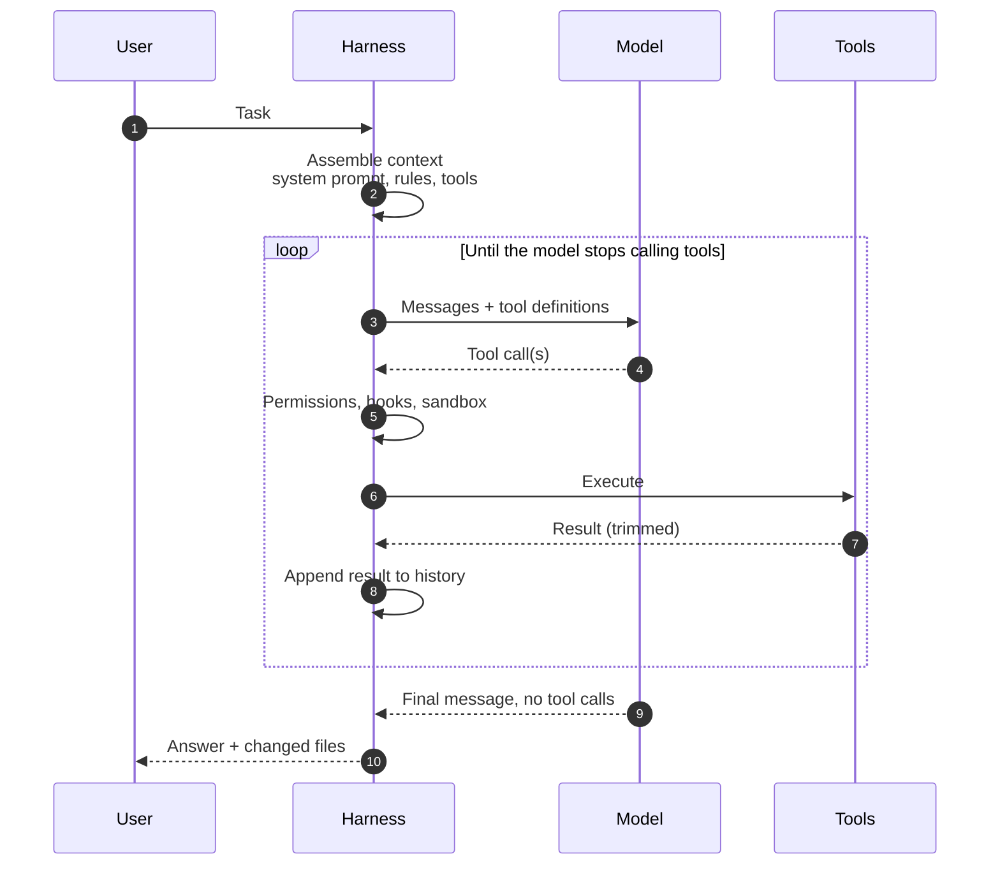
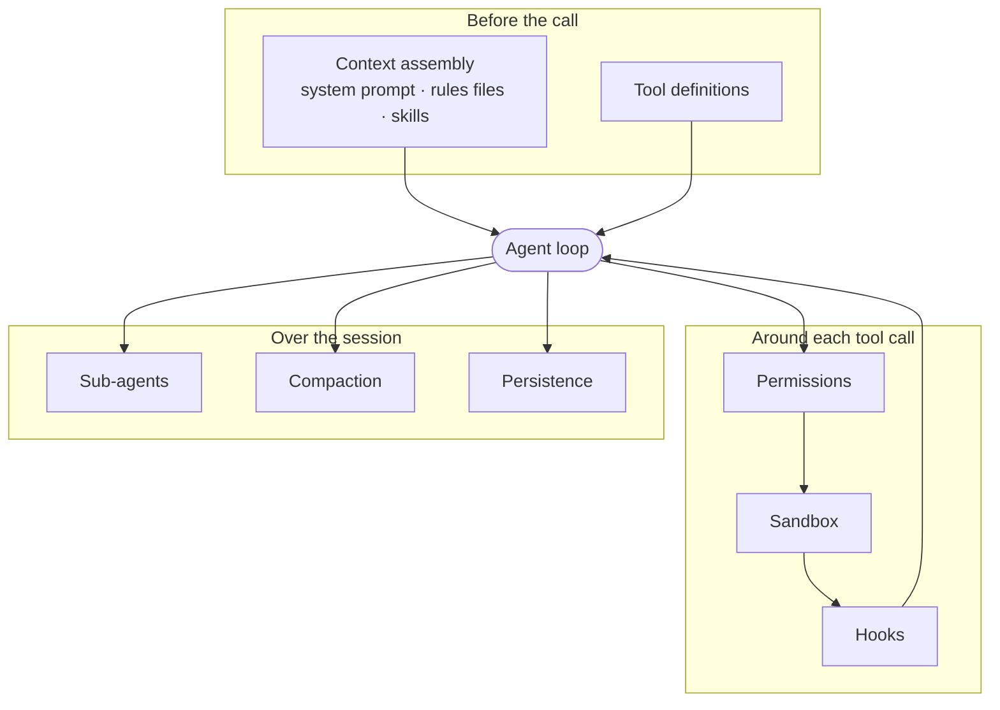
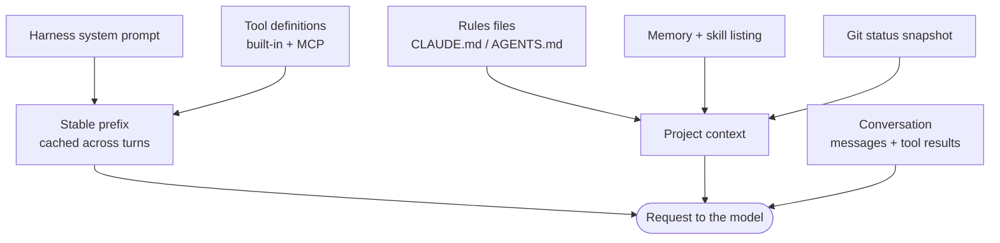
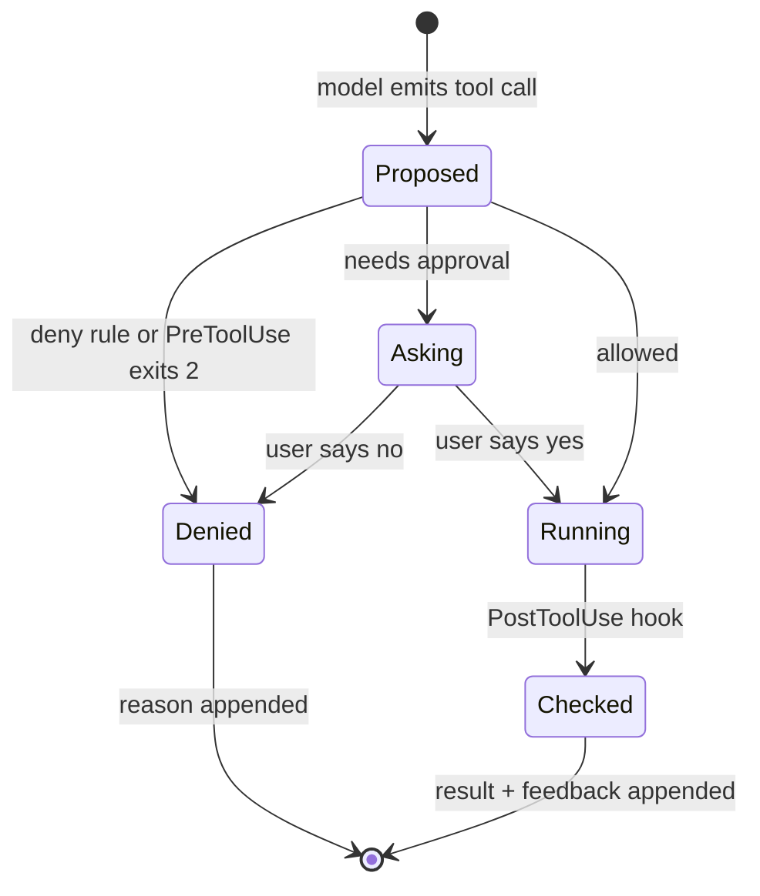

Cuando un agente de código hace algo brillante o algo absurdo, el primer reflejo es atribuírselo al modelo. La mayoría de las veces me resulta más útil preguntar por todo lo que rodea al modelo: qué herramientas tenía, qué había en su contexto cuando decidió, qué se le permitía tocar y qué le avisó de que se estaba equivocando.

Ese «todo lo que rodea» ya tiene nombre. El [artículo de Birgitta Böckeler en martinfowler.com](https://martinfowler.com/articles/harness-engineering.html) lo resume en una línea: el *harness* es todo lo que hay en un agente de código salvo el modelo. Claude Code, Codex CLI y el resto son *harnesses*. También lo son el `AGENTS.md`, la configuración del linter y el pipeline de CI que añades encima. Este artículo es mi mapa de ese territorio: cuáles son las piezas, cómo dos *harnesses* populares toman decisiones distintas y qué cambios a nivel de *harness* mueven más los resultados que cambiar de modelo.

## El bucle es lo de menos

Si desmontas un agente de código, lo que queda es un bucle. El *harness* envía al modelo un prompt y una lista de herramientas. El modelo responde con texto o con una o varias llamadas a herramientas. El *harness* las ejecuta, añade los resultados y vuelve a preguntar. Cuando el modelo responde sin llamar a ninguna herramienta, el turno termina. La [explicación de OpenAI sobre el bucle de Codex](https://openai.com/index/unrolling-the-codex-agent-loop/) describe justo esto: el ciclo se repite hasta que el modelo deja de pedir herramientas y escribe un mensaje para el usuario.



En código, contra el SDK de Anthropic, ese bucle es lo bastante corto como para leerlo de una sentada:

```ts title="agent-loop.ts" {16,24}
import Anthropic from "@anthropic-ai/sdk";
import { tools, execute } from "./tools"; // definitions + an executor you own

const client = new Anthropic();

export async function runAgent(task: string, system: string) {
  const messages: Anthropic.MessageParam[] = [{ role: "user", content: task }];

  for (let turn = 0; turn < 50; turn++) {
    const response = await client.messages.create({
      model: process.env.AGENT_MODEL!,
      max_tokens: 8192,
      system,
      tools,
      messages,
    });
    messages.push({ role: "assistant", content: response.content });
    if (response.stop_reason !== "tool_use") return response; // the model is done

    const results: Anthropic.ToolResultBlockParam[] = [];
    for (const block of response.content) {
      if (block.type !== "tool_use") continue;
      // Permissions, hooks, sandboxing and output trimming all live in here.
      const { output, isError } = await execute(block.name, block.input);
      results.push({ type: "tool_result", tool_use_id: block.id, content: output, is_error: isError });
    }
    messages.push({ role: "user", content: results });
  }
  throw new Error("Turn budget exhausted");
}
```

Dos líneas cargan con todo el diseño. La comprobación de `stop_reason` es la condición de parada. La llamada a `execute` es donde se esconde cada decisión interesante. El resto del artículo trata, en cierto modo, de qué va dentro de `system`, `tools` y `execute`, y de qué le pasa a `messages` cuando se hace largo.

## Anatomía de un harness

Cuando miro cualquier agente de código busco las mismas ocho piezas. Cada producto las llama de una forma, pero siempre están, aunque alguna esté vacía.



| Pieza | Qué decide | Qué falla sin ella |
| --- | --- | --- |
| **Herramientas** | Qué puede hacer el agente y cómo vuelven los resultados | Diez herramientas que se solapan y el modelo elige la equivocada |
| **Montaje del contexto** | Qué sabe el modelo antes de actuar | Redescubre el repositorio en cada sesión, o se ahoga en él |
| **Permisos** | Si una acción necesita un «sí» humano | Fatiga de aprobaciones, o ningún freno |
| **Sandbox** | Hasta dónde llega una acción una vez se ejecuta | Un script «inofensivo» lee `~/.ssh` |
| **Hooks** | Código determinista en puntos fijos del bucle | Reglas que solo existen como peticiones educadas |
| **Subagentes** | Trabajo hecho en otra ventana de contexto | El ruido de la exploración llena la sesión principal |
| **Compactación** | Qué sobrevive cuando la ventana se llena | La sesión muere, u olvida sus instrucciones |
| **Persistencia** | Qué pasa de una sesión a otra | Cada sesión empieza de cero |

### Herramientas

Las herramientas son el vocabulario del *harness*. El artículo de Anthropic sobre [cómo escribir herramientas para agentes](https://www.anthropic.com/engineering/writing-tools-for-agents) es la mejor fuente primaria que conozco, y su consejo va contra el instinto de envolver cada endpoint de una API: pocas herramientas que encajen con flujos de trabajo reales, espacios de nombres claros, resultados en lenguaje natural en lugar de IDs opacos y salidas eficientes en tokens, con paginación y truncado por defecto. También menciona que Claude Code limita por defecto las respuestas de herramientas a 25.000 tokens: una decisión del *harness*, no del modelo.

La descripción forma parte del prompt, así que la escribo como si fuera para un compañero nuevo que nunca ha visto el repositorio:

```json title="tools/search_code.json"
{
  "name": "search_code",
  "description": "Search the repository with a regular expression. Returns matching lines as path:line: text, at most `limit` matches. Use it before reading whole files. If the result says it was truncated, narrow `path` instead of raising `limit`.",
  "input_schema": {
    "type": "object",
    "properties": {
      "pattern": { "type": "string", "description": "Regular expression, ripgrep syntax." },
      "path": { "type": "string", "description": "Directory or file relative to the repo root. Defaults to the root." },
      "limit": { "type": "integer", "minimum": 1, "maximum": 200, "default": 50 }
    },
    "required": ["pattern"]
  }
}
```

La otra mitad de una herramienta son sus mensajes de error. «ENOENT» no le enseña nada al modelo; «No existe `src/hooks/useAuth.tsx`, ¿querías decir `src/hooks/useAuth.ts`?» acaba con el desvío en un paso.

### Montaje del contexto

Antes de la primera llamada, el *harness* construye la petición. En Claude Code eso significa su propio *system prompt* y las definiciones de herramientas, y después el `CLAUDE.md` del proyecto (o `AGENTS.md` cuando no hay `CLAUDE.md`), la memoria automática, los nombres y descripciones de las *skills* disponibles y una instantánea de `git status`. Los ficheros de reglas anidados en subdirectorios se cargan más tarde, bajo demanda, cuando el agente toca ficheros de esa carpeta ([documentación de memoria](https://code.claude.com/docs/en/memory)).



El orden no es casual. Tanto [Claude Code](https://code.claude.com/docs/en/prompt-caching) como Codex ponen primero lo que casi nunca cambia, porque la caché de prompts compara el inicio de la petición de forma exacta: si cambias algo en el prefijo, todo lo que viene detrás se recalcula. Por eso Claude Code no aplica un `CLAUDE.md` editado a mitad de sesión, y por eso conectar un servidor MCP puede hacer que el siguiente turno sea lento. Qué entra *dentro* de ese presupuesto, y cuándo, da para un artículo propio: [Context engineering](/blog/context-engineering). Qué poner en el fichero de reglas está en [Reglas eficaces para asistentes de IA](/blog/ai-coding-rules).

### Permisos y sandbox: dos preguntas distintas

Es la parte que más veo confundida. Un sistema de permisos responde a *¿debe preguntar el agente antes de hacer esto?* Un sandbox responde a *¿hasta dónde puede llegar esta acción una vez se ejecuta?* La documentación de Claude Code lo dice sin rodeos: los [modos de permisos](https://code.claude.com/docs/en/permission-modes) y el [sandbox de Bash](https://code.claude.com/docs/en/sandboxing) son independientes y se pueden combinar.

- **Los modos de permisos** de Claude Code van desde preguntar antes de cada edición (`default`), pasando por `acceptEdits` y el modo de solo lectura `plan`, hasta `auto` (un clasificador aparte revisa las acciones de riesgo) y `bypassPermissions`, que la documentación reserva para contenedores y máquinas virtuales aisladas. Las reglas de denegación bloquean en todos los modos.
- **El sandbox** envuelve los comandos de shell con primitivas del sistema operativo: Seatbelt en macOS, bubblewrap en Linux y WSL2. Las escrituras se limitan al directorio de trabajo; el tráfico de red pasa por un proxy con una lista de dominios permitidos que empieza vacía.

Anthropic contó que el sandbox [redujo un 84 % las peticiones de permiso](https://www.anthropic.com/engineering/claude-code-sandboxing) en su uso interno. Encaja con la intuición: una vez acotado el radio de impacto, la mayoría de las preguntas no necesitaban respuesta.

> [!WARNING]
> Un fichero de reglas es un consejo. «Nunca ejecutes `git push --force`» en `AGENTS.md` es una petición que el modelo normalmente respetará. Una regla de denegación, un hook `PreToolUse` o un sandbox son una imposición. Cualquier cosa cuyo fallo no te puedas permitir pertenece al segundo grupo.

### Hooks: guías y sensores que se ejecutan

Los hooks son comandos de shell que el *harness* ejecuta en puntos fijos: antes de una llamada a una herramienta, después, cuando el agente intenta parar, antes de compactar y en muchos más ([referencia de hooks](https://code.claude.com/docs/en/hooks)). Son el puente entre los dos tipos de control de Böckeler: **guías**, que orientan antes de que el agente actúe, y **sensores**, que observan después para que pueda corregirse.



El que añadiría a cualquier repositorio de TypeScript es un sensor: pasar el linter al fichero que el agente acaba de editar y devolverle los errores al momento, en lugar de dejar que se acumulen hasta el CI.

```json title=".claude/settings.json"
{
  "hooks": {
    "PostToolUse": [
      {
        "matcher": "Edit|Write",
        "hooks": [
          { "type": "command", "command": "\"$CLAUDE_PROJECT_DIR\"/.claude/hooks/lint-edited.sh" }
        ]
      }
    ]
  }
}
```

```bash title=".claude/hooks/lint-edited.sh"
#!/bin/bash
# PostToolUse: lint the file the agent just edited and return the errors to it.
input=$(cat)
file=$(jq -r '.tool_input.file_path // empty' <<<"$input")
[[ "$file" =~ \.(ts|tsx)$ ]] || exit 0

if ! out=$(npx eslint --max-warnings=0 "$file" 2>&1); then
  jq -n --arg r "ESLint failed on $file. Fix it before moving on:
$out" '{decision: "block", reason: $r}'
fi
exit 0
```

El JSON con `decision: "block"` añade el motivo junto al resultado de la herramienta, así que la siguiente llamada al modelo ve la edición y lo que tiene de malo. El mensaje está escrito para el agente, no para una persona: qué ha fallado, dónde y qué hacer.

### Subagentes

Un subagente es el mismo bucle ejecutado otra vez con una ventana de contexto limpia, su propio *system prompt* y normalmente un conjunto de herramientas más reducido. En Claude Code recibe el encargo de delegación y no el historial del padre, y solo vuelve su resumen final ([documentación de subagentes](https://code.claude.com/docs/en/sub-agents)). Ahí está su valor: mil líneas de salida de grep se quedan en la ventana del hijo y el padre recibe treinta líneas de conclusión.

No sale gratis. El artículo de Anthropic sobre su [sistema de investigación multiagente](https://www.anthropic.com/engineering/multi-agent-research-system) midió que los agentes usan unas cuatro veces los tokens de un chat y los sistemas multiagente unas quince, y señalaba la programación como un dominio con menos tareas realmente paralelizables que la investigación. Mi regla de [una sesión por trabajo](/blog/agentic-development-sessions) sigue valiendo: paraleliza las lecturas, serializa las escrituras.

### Compactación y persistencia

Las sesiones largas acaban llenando la ventana. La compactación resume el historial y continúa a partir del resumen; Codex lo hace con un endpoint específico de la Responses API cuando se supera un umbral de tokens, y Claude Code lo hace automáticamente cerca del límite o con `/compact`. La persistencia es lo que permite que el trabajo sobreviva a una sesión: transcripciones que se pueden reanudar, ficheros de memoria y, lo que más uso, artefactos en el repositorio.

El artículo de Anthropic sobre [harnesses para agentes de larga duración](https://www.anthropic.com/engineering/effective-harnesses-for-long-running-agents) lo ilustra bien: la compactación sola no bastaba, así que un agente inicial preparaba el entorno y las sesiones siguientes avanzaban de forma incremental, dejando un fichero de progreso y commits en git para que la siguiente los leyera. El *harness* convirtió el relevo en un fichero en lugar de en un recuerdo.

## Mismas piezas, decisiones distintas

Comparar *harnesses* es sobre todo comparar valores por defecto. Estos son dos que uso, limitándome a lo que dice su documentación:

| | Claude Code | Codex CLI |
| --- | --- | --- |
| **Fichero de reglas** | `CLAUDE.md`; lee `AGENTS.md` cuando no hay `CLAUDE.md` | `AGENTS.md` |
| **Aprobación** | Modos de permisos: `default`, `acceptEdits`, `plan`, `auto`, `dontAsk`, `bypassPermissions` | `approval_policy`: `on-request`, `never` |
| **Sandbox** | Opcional para comandos de shell; Seatbelt / bubblewrap; lista de dominios permitidos | `sandbox_mode`: `read-only`, `workspace-write`, `danger-full-access`; Seatbelt / bubblewrap / Windows nativo |
| **Puntos de extensión** | Hooks, skills, subagentes, MCP, plugins | Servidores MCP, `AGENTS.md`, `config.toml` |
| **Compactación** | Automática cerca del límite, o `/compact` con un foco | Endpoint de compactación por encima de un umbral de tokens |

Las filosofías difieren de una forma que se nota en el día a día. La [documentación de sandbox de Codex](https://learn.chatgpt.com/docs/sandboxing) hace del sandbox la frontera principal y de la aprobación la excepción para salir de él. Claude Code partió de la aprobación por acción y añadió encima el sandbox y un modo automático. Ninguno está mal; fallan de forma distinta. Un *harness* que prioriza el sandbox puede hacer mucho daño *dentro* del espacio de trabajo; uno que prioriza la aprobación puede acostumbrarte a pulsar «sí» sin leer.

## Cambios en el harness que superan a un cambio de modelo

La prueba más convincente que he visto de que el *harness* importa viene de LangChain. En [Improving Deep Agents with harness engineering](https://www.langchain.com/blog/improving-deep-agents-with-harness-engineering) mantuvieron fijo el modelo y llevaron a su agente de código del 52,8 % al 66,5 % en Terminal Bench 2.0 cambiando solo el prompt, las herramientas y el middleware. Es un benchmark, un equipo y sin desglose por cambio, pero lo interesante son los cambios en sí, porque ninguno es exótico:

- **Una pasada de verificación antes de parar.** Su fallo más común era un agente que escribía una solución, releía su propio código, decidía que estaba bien y paraba. Un middleware intercepta la salida y le pide comprobarlo contra la tarea.
- **Detección de bucles.** Contar ediciones por fichero; a partir de N, decirle al agente que replantee el enfoque.
- **Contexto local desde el principio.** Mapear el directorio de trabajo y las herramientas disponibles al arrancar, para que el agente no gaste sus primeros turnos descubriéndolos.
- **Avisos de presupuesto de tiempo**, que empujan al agente de construir a verificar.

El [artículo de OpenAI sobre harness engineering](https://openai.com/index/harness-engineering/) llega a conclusiones parecidas desde el otro lado. Según [el resumen de InfoQ](https://www.infoq.com/news/2026/02/openai-harness-engineering-codex), su equipo trató un directorio `docs/` estructurado como el sistema de referencia del agente e impuso los límites de arquitectura con linters y tests estructurales en CI en lugar de con prosa.

Lo que saco de ambos es un bucle propio, un nivel por encima del del agente:

```steps loop="El harness tiene un fallo menos cada vuelta"
Detectar: El agente ha cometido el mismo error dos veces. Es un bug del harness, no mala suerte.
Clasificar: ¿Le faltaba información (una guía) o una señal de que se equivocaba (un sensor)?
Codificar: Mejor la forma determinista más barata: una regla de lint, un test, un hook. Prosa solo si nada más encaja.
Repetir: Misma tarea, sesión nueva. ¿Ha desaparecido el fallo sin que aparezca otro?
```

> [!TIP]
> Escribe la salida de cada sensor para el agente. «Regla `no-restricted-syntax`: no leas `item.title_en` directamente, llama a `pick()` de `src/utils/localized.ts`» se arregla sola; una ✗ roja en un log de CI, no.

## Cómo es mi harness exterior

No construyo *harnesses* para ganarme la vida; los configuro. En un monorepo grande de React y TypeScript, el *harness* exterior que mantengo es poco vistoso: un `AGENTS.md` corto que funciona como mapa y apunta a documentación más profunda en lugar de contenerla; type-check, lint y los tests relevantes como comandos de verificación del agente, nombrados explícitamente para que no tenga que adivinarlos; unas cuantas reglas por ruta para las zonas con trampas; un hook de lint tras cada edición; y un subagente de exploración de solo lectura para que la sesión principal se mantenga limpia.

```md title="AGENTS.md (excerpt)"
## Verify before you say done
- `npm run type-check` and `npm run lint` — both must pass.
- Tests for what you touched: `npx vitest run <path>`.

## Where things are explained
- Data access and query descriptors: `docs/data.md`
- Breakpoints are redefined — read `docs/styling.md` before any responsive class.
```

Nada de esto es ingenioso. Es lo mismo que los buenos equipos han hecho siempre con las incorporaciones nuevas —que lo correcto sea fácil y lo incorrecto haga ruido—, dirigido a un compañero que lee muy rápido y lo olvida todo al final de la sesión.

## Límites, y cuándo no merece la pena

El *harness* no puede aportar el criterio que el modelo no tiene, ni volver precisa una tarea vaga. Böckeler reconoce con franqueza que el comportamiento —si la aplicación hace de verdad lo que tiene que hacer— es el área menos resuelta, y que los tests escritos por IA aún no bastan para cerrarla. Una suite en verde que el agente escribió para su propio código es un sensor débil.

El trabajo en el *harness* también tiene su curva de coste. Cada hook añade latencia a cada llamada a herramienta, cada regla añade tokens a cada petición y cada subagente multiplica el gasto. Para un script puntual o una prueba exploratoria, el *harness* de serie con valores razonables sobra; yo solo empezaría a codificar reglas después de ver el mismo fallo dos veces. Y el *harness* interior cambia bajo tus pies: las funcionalidades se mueven entre versiones, así que todo lo que montes sobre un hook o una opción concretos merece una comprobación rápida después de actualizar.

El modelo es la parte que alquilas. El *harness* es la parte que es tuya, y precisamente por eso merece la atención.

## Para seguir aprendiendo

- [Harness engineering for coding agent users](https://martinfowler.com/articles/harness-engineering.html) — Birgitta Böckeler en martinfowler.com. El vocabulario de guías/sensores y computacional/inferencial que uso aquí; el marco conceptual más claro que he encontrado.
- [Unrolling the Codex agent loop](https://openai.com/index/unrolling-the-codex-agent-loop/) — Michael Bolin (OpenAI). Cómo un *harness* real construye las peticiones, mantiene el prefijo cacheable y compacta.
- [Harness engineering: leveraging Codex in an agent-first world](https://openai.com/index/harness-engineering/) — el relato de OpenAI sobre un producto construido con agentes y el entorno que montaron a su alrededor.
- [Writing effective tools for agents — with agents](https://www.anthropic.com/engineering/writing-tools-for-agents) — Anthropic. Diseño de herramientas, descripciones, resultados eficientes en tokens y cómo evaluarlas.
- [Effective harnesses for long-running agents](https://www.anthropic.com/engineering/effective-harnesses-for-long-running-agents) — Anthropic. Ficheros de progreso, preparación inicial y sesiones incrementales cuando una ventana de contexto no basta.
- [Improving Deep Agents with harness engineering](https://www.langchain.com/blog/improving-deep-agents-with-harness-engineering) — LangChain. Un modelo fijo, un *harness* mejor y una diferencia medible, con el middleware descrito.
- [Referencia de hooks de Claude Code](https://code.claude.com/docs/en/hooks) — todos los eventos, la entrada que recibe cada hook y cómo bloquear o añadir feedback.
