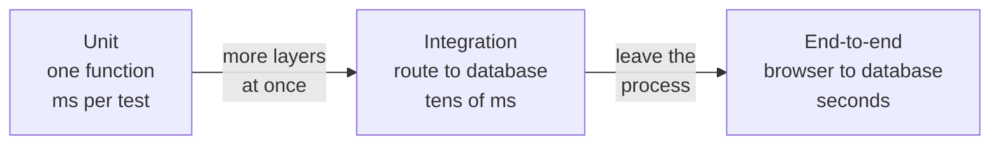
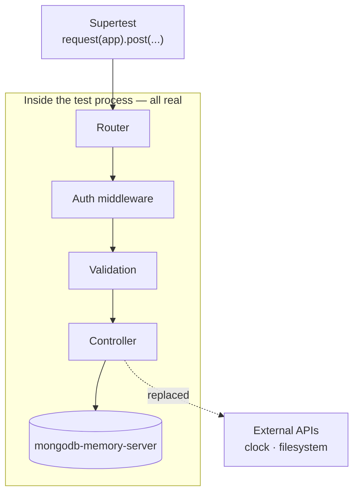
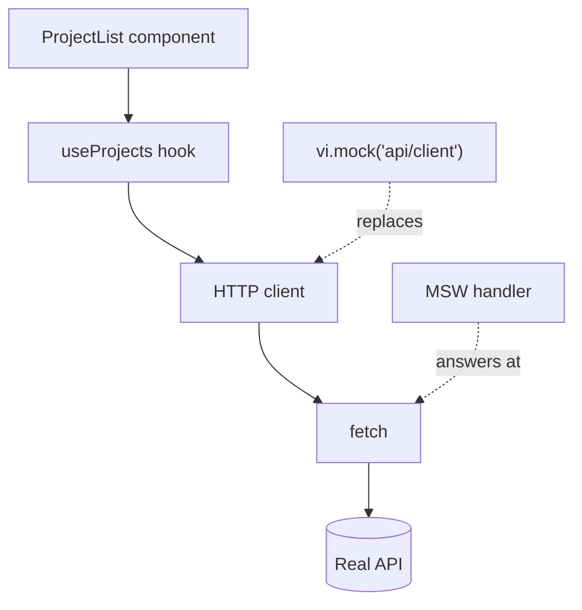

La pirámide de tests se suele dibujar con una base enorme de tests unitarios y una franja fina de integración. En mi experiencia, esa franja fina es donde aparecen la mayoría de los bugs que llegan a producción, porque el fallo típico no es que una función esté mal: es que dos funciones correctas tienen una idea distinta del contrato entre ellas.



## Qué es un test de integración aquí

No es «un test lento». Es un test que ejercita **más de una capa a la vez** sin salir del proceso: la ruta HTTP, la validación, el controlador y el acceso a datos. Lo que se sustituye es lo que está fuera del proceso — la red externa, el reloj, el sistema de ficheros.



En un backend de Express, eso es Supertest.

```js title="tests/projects.test.js" {6-9}
import request from "supertest";
import { app } from "../src/app.js";

describe("POST /api/projects", () => {
  it("rejects a body with no title", async () => {
    const res = await request(app)
      .post("/api/projects")
      .set("Authorization", `Bearer ${token}`)
      .send({ description: "no title" });

    expect(res.status).toBe(400);
    expect(res.body.error).toMatch(/title/i);
  });

  it("creates the project and returns it with an id", async () => {
    const res = await request(app)
      .post("/api/projects")
      .set("Authorization", `Bearer ${token}`)
      .send({ title: "New", description: "..." });

    expect(res.status).toBe(201);
    expect(res.body).toMatchObject({ title: "New" });
    expect(res.body.id).toEqual(expect.any(String));
  });
});
```

Supertest levanta el servidor en memoria y hace la petición de verdad: pasa por el router real, por el middleware real y por la validación real. Ningún test unitario del controlador habría detectado que el middleware de autenticación estaba registrado *después* de la ruta:

```diff title="src/app.js"
- app.use("/api/projects", projectsRouter);
- app.use(requireAuth); // too late: Express already answered
+ app.use(requireAuth);
+ app.use("/api/projects", projectsRouter);
```

Los tests unitarios del controlador pasan en los dos casos. La petición de Supertest sin token recibe un 201 en lugar de un 401, y de eso se trata.

## La base de datos: ni mock ni producción

El punto que más se discute. Tres opciones y sus consecuencias reales:

| Opción | Velocidad | ¿Detecta un índice único que falta? | Coste |
| --- | --- | --- | --- |
| **Mockear el modelo** | La más rápida | No | Ciego a los errores que importan |
| **Base de datos real en Docker** | Lenta de arrancar | Sí | Un incordio en local |
| **Base de datos en memoria** | Rápida | Sí | Una dependencia de desarrollo |

**Mockear el modelo.** Rápido, y completamente ciego a los errores que importan: un índice único que falta, una validación de esquema que no se dispara, una consulta que en Mongo devuelve `null` en lugar de lanzar.

**Base de datos real en Docker.** Fiel, pero lenta de arrancar y un incordio en local.

**Base de datos en memoria.** Para MongoDB, `mongodb-memory-server` arranca un `mongod` de verdad contra un directorio temporal. Es el equilibrio que uso:

```js title="tests/setup/db.js" {11-15}
import { MongoMemoryServer } from "mongodb-memory-server";
import mongoose from "mongoose";

let mongod;

beforeAll(async () => {
  mongod = await MongoMemoryServer.create();
  await mongoose.connect(mongod.getUri());
});

afterEach(async () => {
  // Isolation between tests without restarting the server.
  const { collections } = mongoose.connection;
  await Promise.all(Object.values(collections).map((c) => c.deleteMany({})));
});

afterAll(async () => {
  await mongoose.disconnect();
  await mongod.stop();
});
```

```steps
beforeAll: Arranca un mongod y conecta. Se paga una vez por fichero.
Test: Escribe lo que necesite.
afterEach: Vacía todas las colecciones. El siguiente test empieza limpio.
afterAll: Desconecta y para mongod.
```

> [!IMPORTANT]
> Ese `afterEach` es lo que evita el fallo más frustrante de una suite de integración: tests que pasan sueltos y fallan juntos porque comparten estado.

## En el frontend: MSW

En el lado del cliente, el equivalente es interceptar la red en lugar de mockear el módulo que la llama. Mock Service Worker intercepta a nivel de `fetch`, así que el componente, el hook y el cliente HTTP se ejecutan de verdad.



Con `vi.mock` el cliente no llega a ejecutarse; con MSW, todo lo que está por encima de `fetch` es tu código real.

```jsx title="tests/ProjectList.test.jsx" {10,15-17}
import { http, HttpResponse } from "msw";
import { setupServer } from "msw/node";

const server = setupServer(
  http.get("/api/projects", () =>
    HttpResponse.json([{ id: "1", title: "One" }])
  )
);

beforeAll(() => server.listen({ onUnhandledRequest: "error" }));
afterEach(() => server.resetHandlers());
afterAll(() => server.close());

it("shows an error state when the API fails", async () => {
  server.use(
    http.get("/api/projects", () => new HttpResponse(null, { status: 500 }))
  );

  render(<ProjectList />);
  expect(await screen.findByRole("alert")).toBeInTheDocument();
});
```

Dos detalles que marcan la diferencia. `onUnhandledRequest: "error"` convierte una petición que no esperabas en un fallo ruidoso en vez de en un `undefined` silencioso. Y `server.use` dentro de un test permite sobrescribir un handler sólo para ese caso, que es como se prueban los caminos de error sin ensuciar el resto.

> [!WARNING]
> MSW intercepta HTTP. Si tu cliente usa otro transporte —el SDK de Firestore, por ejemplo, habla WebChannel— no hay nada que interceptar, y hay que mockear el módulo. Vale la pena comprobarlo antes de montar toda una capa de handlers que nunca se dispara.

## Qué probar aquí y qué no

La integración es cara por test, así que conviene ser selectivo. Lo que compensa:

- **Los contratos**: forma de la respuesta, códigos de estado, forma del error.
- **La autorización**: que un recurso ajeno devuelva 404 y no 200, con el usuario real pasando por el middleware real.
- **Los caminos de error**: caída de la base de datos, entrada inválida, token caducado. Son los que nadie prueba a mano.
- **Las migraciones de esquema**: que un documento antiguo se siga leyendo.

El de autorización es el primero que escribiría, porque es el que un test unitario no sabe expresar:

```js
it("returns 404 for another user's project", async () => {
  const theirs = await Project.create({ title: "Theirs", ownerId: "someone-else" });

  const res = await request(app)
    .get(`/api/projects/${theirs.id}`)
    .set("Authorization", `Bearer ${token}`);

  expect(res.status).toBe(404);
});
```

Lo que no: permutaciones de lógica pura. Eso es un test unitario, cuesta milisegundos y te dice exactamente qué se rompió.

## La señal de que está funcionando

Cuando un refactor interno —renombrar un servicio, partir un controlador, cambiar el ORM— no rompe ni un solo test de integración, pero cambiar el código de estado de una respuesta rompe uno inmediatamente. Eso significa que estás probando el contrato y no la implementación, que es justo lo que hace que una suite sobreviva a un año de cambios.
