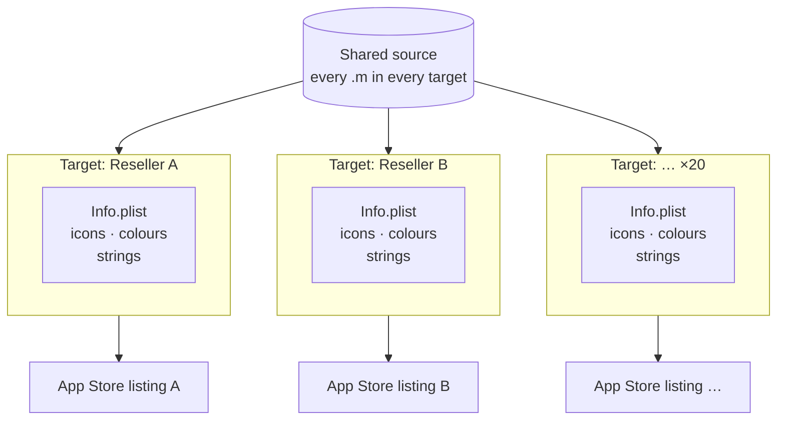
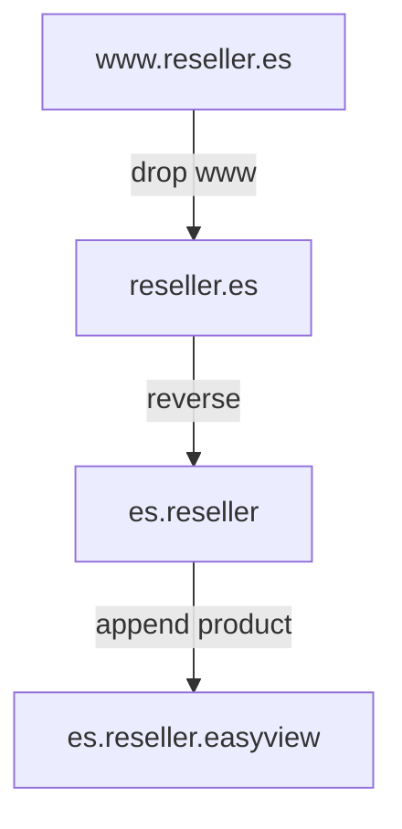

Esto es de 2016 y 2017, en mi primer trabajo. Hacíamos una app iOS de
videovigilancia para cámaras IP, y cada distribuidor la vendía con su marca. El
código ya no existe y es anterior a mi cuenta pública de GitHub, así que lo
cuento de memoria y desde la documentación que conservo.

## El encargo

Una aplicación. Veintitantos distribuidores. Cada uno quería su nombre, su
icono, sus colores y su propia ficha en la App Store, porque sus clientes
buscaban su marca y no la nuestra. Y todos querían las mismas funciones, salvo
unos pocos que pagaban por una versión con extras.

Visto desde hoy suena a problema resuelto. En 2016, con Xcode 7 y 8, no lo era.

## Lo que hicimos

**Un target por distribuidor.** Un target de Xcode es una receta de compilación:
qué ficheros entran, con qué identificador, con qué recursos, con qué iconos.
Duplicar el target y cambiarle los recursos daba una app distinta a partir del
mismo código.

Veinte targets en un proyecto suena mal y funcionaba razonablemente bien,
siempre que se respetara una regla: **ningún fichero de código se añade a un
target concreto.** Todos pertenecen a todos. Lo único que varía son los recursos
y la configuración. En cuanto alguien añadía una clase solo a un target para
arreglar algo rápido, la siguiente persona pasaba una tarde entendiendo por qué
compilaba en una marca y no en otra.



> [!IMPORTANT]
> La pertenencia a un target es una casilla en el inspector de ficheros de Xcode,
> y nada te avisa cuando las casillas de un fichero no coinciden con las del
> resto. La regla tenía que vivir en la cabeza de la gente, porque la
> herramienta no la iba a hacer cumplir.

**Una convención para los identificadores.** El *bundle identifier* se derivaba
del dominio del distribuidor, invertido:



Que fuese una regla y no una decisión caso a caso quitó de en medio una
conversación recurrente. Cuando entraba un distribuidor nuevo, su identificador
no se discutía: se calculaba.

**Una rama para los sabores.** Los cambios de marca vivían en una rama aparte
que se mezclaba con la de desarrollo. Hoy haría otra cosa; entonces era lo que
nos permitía añadir un distribuidor sin tocar la rama donde trabajaba el resto.

## Lo que salió caro

**Veinte veces todo.** Veinte fichas, veinte juegos de capturas, veinte
descripciones, veinte certificados y perfiles de aprovisionamiento. Cada
publicación era un día entero, y el fallo típico no era de código sino de
proceso: una captura de la marca equivocada, un perfil caducado el día que
tocaba publicar.

```steps loop="×20, one per reseller"
Build: Pick the reseller's scheme, archive, check the icon and name on the device.
Sign: The right certificate and that brand's provisioning profile, still valid.
Upload: Send the binary through Xcode or Application Loader and wait for processing.
Listing: That brand's screenshots, description and keywords.
Submit: Send it to review and move on to the next brand.
```

**Los iconos.** Cada target necesitaba su juego completo de tamaños. Un
distribuidor mandaba un PNG grande y había que generar la familia entera. Lo
automatizamos tarde, después de haberlo hecho a mano demasiadas veces, que es el
orden equivocado y el que sigue pasando.

**El riesgo de la divergencia.** La presión para hacer «solo para este cliente,
solo esta vez» era constante. Cada vez que cedíamos, el sistema se parecía un
poco más a veinte aplicaciones y un poco menos a una. Lo que lo sostuvo no fue
una herramienta: fue decir que no bastantes veces.

## Lo que hoy sería distinto

Casi todo, y conviene reconocerlo en vez de contar la batallita como si
siguiera aplicando:

- Los **xcconfig** y los esquemas hacen mucho de lo que hacíamos duplicando
  targets.
- **Fastlane** convierte ese día de publicación en un comando.
- Los **app clips** y las configuraciones remotas cubren parte de lo que
  entonces obligaba a compilar binarios distintos.
- Y, sobre todo, hoy preguntaría si hacen falta veinte apps. Muchas veces lo que
  el cliente quiere es ver su logotipo, y eso no exige una ficha propia en la
  tienda.

| Problema | 2016 | Hoy |
| --- | --- | --- |
| **Ajustes por marca** | Un target duplicado por distribuidor | Un target y un `.xcconfig` por marca |
| **Día de publicación** | Un día de clics, veinte veces | *Lanes* de `fastlane` que recorren las marcas |
| **Firma** | Perfiles renovados a mano, a menudo tarde | Firma gestionada o `match` |
| **Iconos** | Generados a mano, automatizados demasiado tarde | Una imagen de origen, generada en la compilación |
| **«Solo su logo»** | Un binario y una ficha aparte | Configuración remota en una sola app |

Con un xcconfig, un distribuidor deja de ser la copia de un target y pasa a ser
un puñado de líneas:

```ini title="Config/Reseller.xcconfig"
// Everything that varies per brand, and nothing else
PRODUCT_BUNDLE_IDENTIFIER = es.reseller.easyview
PRODUCT_NAME = Reseller View
ASSETCATALOG_COMPILER_APPICON_NAME = AppIcon-Reseller
```

## Lo que sigo usando

Dos cosas se me quedaron de aquello.

La primera: **una convención mecánica vale más que una decisión acertada.** La
regla del dominio invertido no era la mejor forma posible de nombrar nada. Su
valor estaba en que nadie tenía que pensarla.

La segunda: **lo que se personaliza hay que acotarlo por diseño, no por
voluntad.** Mientras lo variable eran recursos y configuración, el sistema
aguantó veinte marcas. El día que lo variable pudo ser código, habría dejado de
ser una aplicación.
