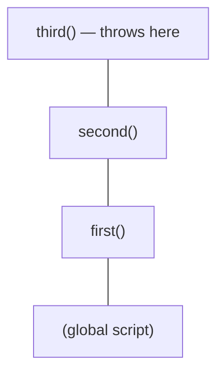
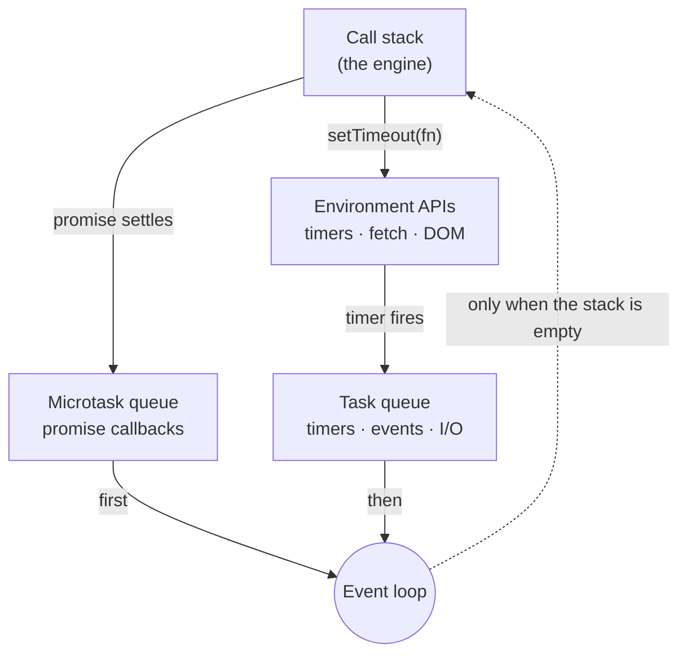
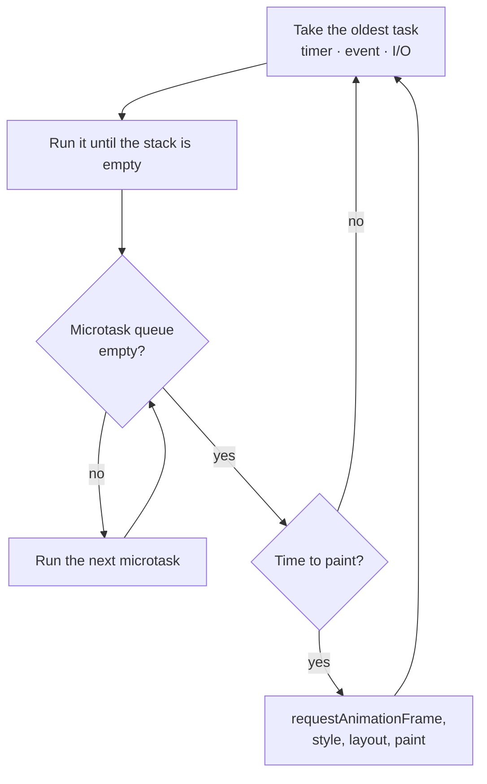
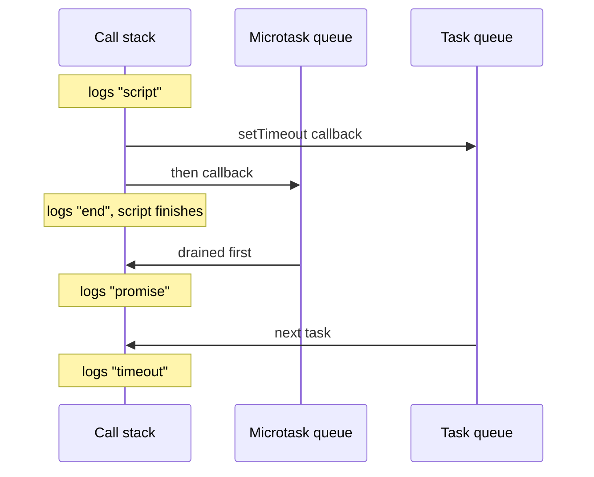

Hay una frase que se repite en todas las entrevistas de frontend: «JavaScript es de un solo hilo». Es cierta, y a la vez explica muy poco. Si sólo hay un hilo, ¿cómo es posible que una petición de red tarde dos segundos y la interfaz siga respondiendo? La respuesta no está en el lenguaje, está en el entorno que lo ejecuta.

## El motor sólo sabe ejecutar código

Un motor de JavaScript —V8 en Chrome y Node, JavaScriptCore en Safari, SpiderMonkey en Firefox— tiene dos piezas: el *heap*, donde viven los objetos, y la *call stack*, donde se apilan las llamadas a funciones.

La pila funciona exactamente como su nombre indica. Cuando llamas a una función, se apila un marco. Cuando esa función retorna, el marco se desapila.

```js
function third() {
  throw new Error("here");
}
function second() {
  third();
}
function first() {
  second();
}
first();
```



El stack trace que ves en la consola es literalmente el contenido de la pila en el momento del error, leído de arriba abajo. No es una metáfora: es la estructura de datos.

Y aquí está la clave: **el motor no sabe nada de `setTimeout`, ni de `fetch`, ni del DOM**. Ninguna de esas cosas forma parte del lenguaje. Son APIs que proporciona el entorno.

## El entorno es quien espera

Cuando escribes `setTimeout(fn, 1000)`, el motor hace una sola cosa: llamar a una función que le ofrece el navegador y desapilarla inmediatamente. El temporizador lo gestiona el navegador, en otro hilo, fuera de tu control.

Cuando pasa un segundo, el navegador no puede simplemente ejecutar `fn`: la pila podría estar ocupada, y JavaScript no admite dos cosas a la vez. Lo que hace es dejar `fn` en la **cola de tareas** (*task queue*).



El **event loop** es el bucle que vigila las dos estructuras:

> Si la call stack está vacía, coge la primera tarea de la cola y apílala.

Eso es todo. Un `while` conceptual con una condición. Y explica el comportamiento que a todo el mundo le resulta raro la primera vez:

```js
console.log("one");
setTimeout(() => console.log("two"), 0);
console.log("three");

// one
// three
// two
```

Un `setTimeout` de 0 ms no significa «ejecuta esto ya». Significa «ponlo en la cola cuanto antes». La cola no se toca hasta que la pila se vacía, y la pila no se vacía hasta que termina todo el script síncrono.

## Las microtareas se cuelan por delante

Las promesas no usan la cola de tareas. Usan la **cola de microtareas**, que tiene prioridad: el event loop la vacía **entera** después de cada tarea, antes de coger la siguiente.



```js {5}
console.log("script");

setTimeout(() => console.log("timeout"), 0);

Promise.resolve().then(() => console.log("promise"));

console.log("end");

// script
// end
// promise
// timeout
```



`promise` sale antes que `timeout` aunque se haya registrado después. Esto tiene una consecuencia práctica incómoda: una cadena de microtareas que se regenera a sí misma **bloquea el renderizado indefinidamente**, porque el event loop nunca llega a la siguiente tarea.

```js
// Don't do this: the page stops responding.
function loop() {
  Promise.resolve().then(loop);
}
loop();
```

> [!WARNING]
> La cola de microtareas no tiene un límite de «una por vuelta». Cualquier cosa que siga encolando microtareas —un `.then` recursivo, un `await` dentro de un bucle que nunca cede el paso a una tarea de verdad— deja sin pintar y sin atender eventos igual que un `while (true)`.

Con `setTimeout` el mismo bucle sería inofensivo, porque entre tarea y tarea el navegador puede pintar.

## Por qué esto importa en el día a día

Tres consecuencias que sí vas a notar escribiendo código:

**Un cálculo pesado congela la interfaz.** No hay magia: si tu función tarda 300 ms, la pila está ocupada 300 ms y no se procesa ningún clic. La solución no es `setTimeout`, es trocear el trabajo o moverlo a un *Web Worker*, que sí es otro hilo de verdad.

**El orden de los `await` importa.** `await` parte la función en dos: lo que hay antes se ejecuta de forma síncrona, lo que hay después se convierte en una microtarea.

```js {3-4}
async function demo() {
  console.log("a"); // synchronous
  await null;
  console.log("b"); // microtask
}
demo();
console.log("c");
// a, c, b
```

**Los temporizadores no son precisos.** `setTimeout(fn, 100)` garantiza *al menos* 100 ms, nunca exactamente 100. Si la pila está ocupada cuando vence el plazo, la tarea espera. Para animaciones usa `requestAnimationFrame`, que se sincroniza con el repintado.

> [!TIP]
> Cuando un temporizador salta tarde, la pregunta no es «qué le pasa al temporizador» sino «qué había en la pila». Las *long tasks* del panel Performance (todo lo que pase de 50 ms) suelen ser la respuesta.

## El modelo mental

Si te quedas con una sola imagen, que sea esta:

| Pieza | Qué contiene | Cuándo se ejecuta |
| --- | --- | --- |
| **Call stack** | Lo que se está ejecutando *ahora*, siempre una cosa | Hasta que se vacía |
| **APIs del entorno** | Lo que espera por ti, fuera del hilo | En paralelo, fuera de JavaScript |
| **Cola de microtareas** | Callbacks de promesas, continuaciones de `await` | Se vacía entera entre tarea y tarea |
| **Cola de tareas** | Temporizadores, eventos, E/S | Una por vuelta |
| **Event loop** | Nada: mueve cosas de las colas a la pila | **Sólo cuando la pila está vacía** |

JavaScript no es asíncrono. JavaScript es síncrono y de un solo hilo, ejecutándose dentro de un entorno que sí sabe esperar. Toda la asincronía que usas a diario es esa frontera.
