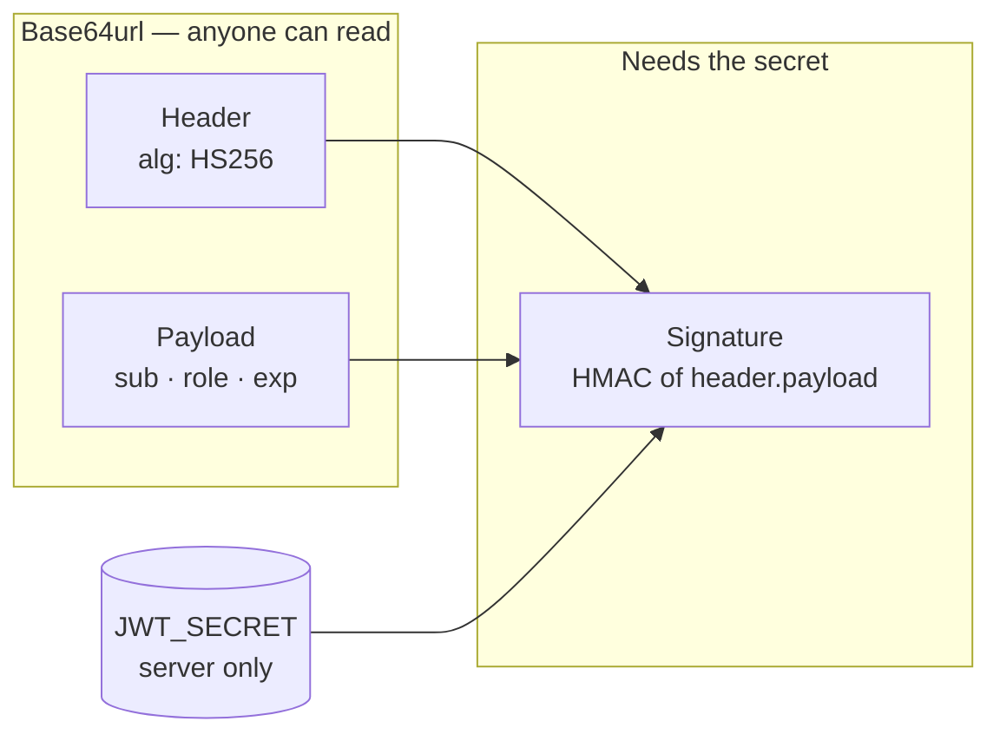
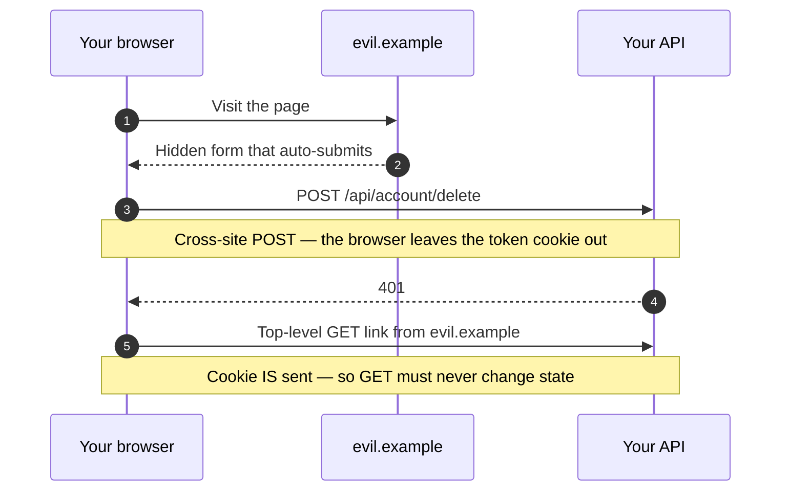
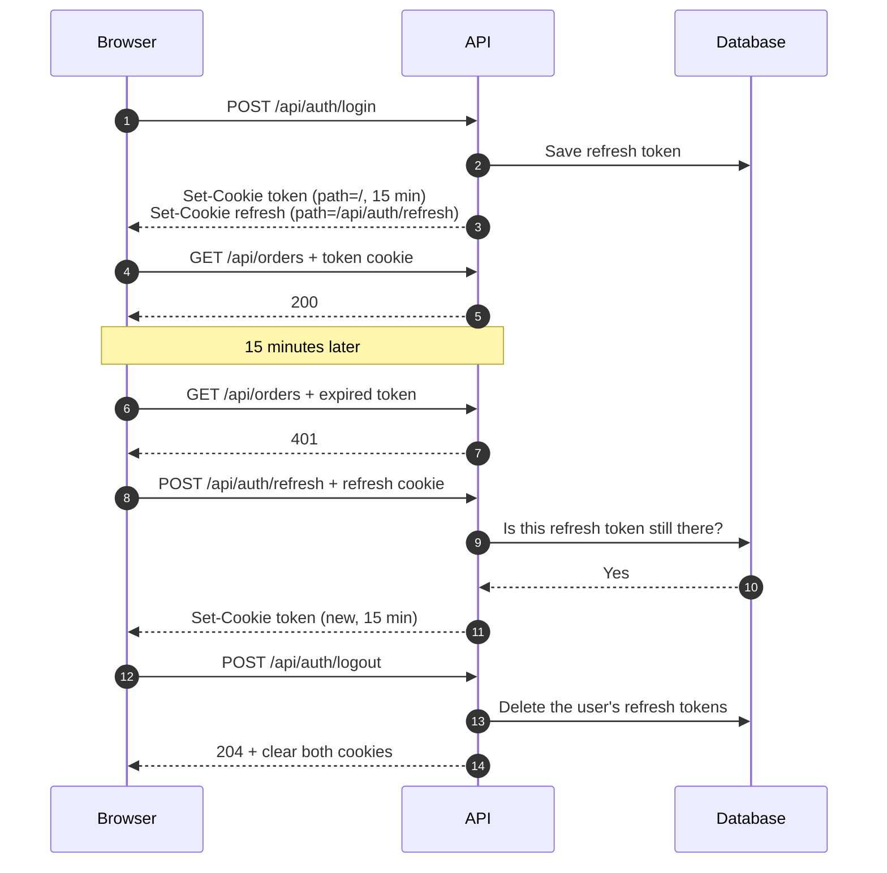

En el taller de full stack esta es la parte donde más discusión hay, y con razón: es la decisión de seguridad con más consecuencias de toda la aplicación, y las dos opciones habituales te dejan expuesto a cosas distintas.

## Qué es y qué no es un JWT

Un JSON Web Token son tres partes en Base64 separadas por puntos: cabecera, payload y firma. La parte que sorprende es que **el payload no está cifrado**. Está codificado, que no es lo mismo.



```js {3}
// Anyone holding the token can read this
const [, payload] = token.split(".");
console.log(JSON.parse(Buffer.from(payload, "base64url").toString()));
// { sub: "user_123", role: "admin", exp: 1790000000 }
```

Lo que la firma garantiza es **integridad**, no confidencialidad: nadie puede modificar el payload sin invalidarla, porque no tiene la clave. De ahí la regla: en un JWT va lo que identifica, nunca lo que es secreto.

> [!WARNING]
> Nada de correos completos si no hace falta, y desde luego nada de datos personales sensibles. Lo que metas en el payload lo puede leer cualquiera que tenga el token.

```js title="src/auth/tokens.js" {4}
import jwt from "jsonwebtoken";

const token = jwt.sign(
  { sub: user.id, role: user.role },   // the bare minimum
  process.env.JWT_SECRET,
  { expiresIn: "1h", algorithm: "HS256" }
);
```

Y al verificar, **fija el algoritmo**. Omitirlo abre una familia entera de ataques en la que un atacante cambia la cabecera a `alg: "none"` y la librería acepta un token sin firmar:

```js
jwt.verify(token, process.env.JWT_SECRET, { algorithms: ["HS256"] });
```

## Las dos opciones, y a qué te expone cada una

**`localStorage`** es cómodo: lo lees con JavaScript y lo mandas en una cabecera `Authorization`. El problema es exactamente eso — lo lee JavaScript. **Todo** el JavaScript de la página, incluido el que entre por una dependencia comprometida o por un XSS. Un solo script malicioso y el token se va.

**Una cookie `httpOnly`** no es accesible desde JavaScript, así que un XSS no puede robarla. A cambio, el navegador la envía sola en cada petición a tu dominio, incluidas las que origina otro sitio — que es la puerta del CSRF.

| | `localStorage` | Cookie `httpOnly` |
| --- | --- | --- |
| **La leen los scripts de la página** | Sí | No |
| **Se envía sola** | No — añades tú la cabecera | Sí, en cada petición a tu dominio |
| **Expuesta a** | Un XSS roba el token | Un CSRF se aprovecha de ella |
| **Mitigación** | No tener nunca un XSS, tampoco en las dependencias | `sameSite`, y un token anti-CSRF si necesitas `none` |

Mi elección por defecto es la cookie, porque el XSS es mucho más frecuente que el CSRF y el CSRF tiene una mitigación de una línea:

```js title="src/routes/auth.js" {2,4}
res.cookie("token", token, {
  httpOnly: true,                       // out of JavaScript's reach
  secure: process.env.NODE_ENV === "production",
  sameSite: "lax",                      // not sent on cross-site requests
  maxAge: 60 * 60 * 1000,
  path: "/",
});
```

`sameSite: "lax"` bloquea el envío de la cookie en peticiones originadas por otro sitio, salvo navegación de nivel superior con GET. Eso cubre el CSRF clásico por formulario.



> [!CAUTION]
> Si necesitas `sameSite: "none"` porque el front está en otro dominio, entonces sí hace falta un token anti-CSRF explícito. Y `lax` da por hecho que ningún endpoint `GET` cambia nada.

## El refresh y el cierre de sesión

Un token de una hora sin renovación obliga a volver a iniciar sesión cada hora. Un token de treinta días es un token robado que sirve treinta días. La salida habitual son dos tokens:

- **Access token**, corto (15 minutos), el que se envía en cada petición.
- **Refresh token**, largo, guardado en su propia cookie `httpOnly` con `path: "/api/auth/refresh"` para que no viaje en ninguna otra petición, y **almacenado en base de datos**.

Ese último punto es el que hace posible cerrar sesión de verdad. Un JWT es válido hasta que expira: no hay forma de invalidarlo, porque el servidor no guarda nada. Si el refresh token sí está en base de datos, cerrar sesión es borrar esa fila, y el access token caduca solo en quince minutos.



El endpoint de refresh es donde la base de datos se gana el sitio: un token que no está en la tabla no obtiene nada.

```js title="src/routes/auth.js" {2-3}
app.post("/api/auth/refresh", async (req, res) => {
  const stored = await RefreshToken.findOne({ token: req.cookies?.refresh });
  if (!stored || stored.expiresAt < new Date()) return res.sendStatus(401);

  const user = await User.findById(stored.userId);
  const token = jwt.sign({ sub: user.id, role: user.role }, process.env.JWT_SECRET, {
    expiresIn: "15m",
    algorithm: "HS256",
  });
  res.cookie("token", token, { httpOnly: true, secure: true, sameSite: "lax", path: "/" });
  res.sendStatus(204);
});
```

Y cerrar sesión es borrar las filas:

```js title="src/routes/auth.js" {2}
app.post("/api/auth/logout", requireAuth, async (req, res) => {
  await RefreshToken.deleteMany({ userId: req.user.sub });
  res.clearCookie("token", { path: "/" });
  res.clearCookie("refresh", { path: "/api/auth/refresh" });
  res.sendStatus(204);
});
```

## El middleware, y el error que casi todo el mundo comete

```js title="src/middleware/requireAuth.js" {6}
export function requireAuth(req, res, next) {
  const token = req.cookies?.token;
  if (!token) return res.sendStatus(401);

  try {
    req.user = jwt.verify(token, process.env.JWT_SECRET, {
      algorithms: ["HS256"],
    });
    next();
  } catch {
    // Don't distinguish "expired" from "bad signature" to the outside.
    res.sendStatus(401);
  }
}
```

> [!IMPORTANT]
> **Autenticar no es autorizar.** `requireAuth` te dice quién es, no a qué tiene derecho.

Un endpoint que comprueba el token pero no la propiedad del recurso deja que cualquier usuario válido lea los datos de cualquier otro:

```diff title="src/routes/orders.js"
- // Wrong
- app.get("/api/orders/:id", requireAuth, async (req, res) =>
-   res.json(await Order.findById(req.params.id))
- );
+ // Right: ownership is part of the query
+ app.get("/api/orders/:id", requireAuth, async (req, res) => {
+   const order = await Order.findOne({ _id: req.params.id, userId: req.user.sub });
+   if (!order) return res.sendStatus(404);
+   res.json(order);
+ });
```

Devolver 404 en lugar de 403 es deliberado: un 403 confirma que el recurso existe.

## Lo mínimo

Firma con algoritmo fijado, payload sin secretos, cookie `httpOnly` + `secure` + `sameSite`, refresh token en base de datos para poder revocar, y propiedad del recurso dentro de la consulta. Con eso cubres la mayor parte de lo que se rompe en una aplicación normal, y ninguna de las cinco cosas cuesta más de diez minutos.
