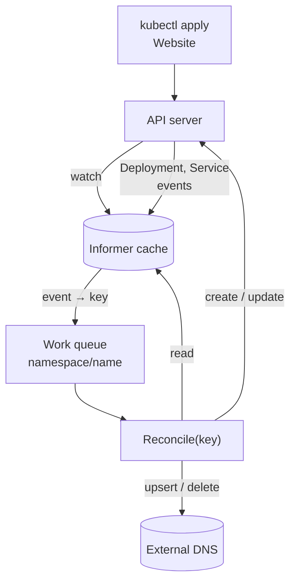
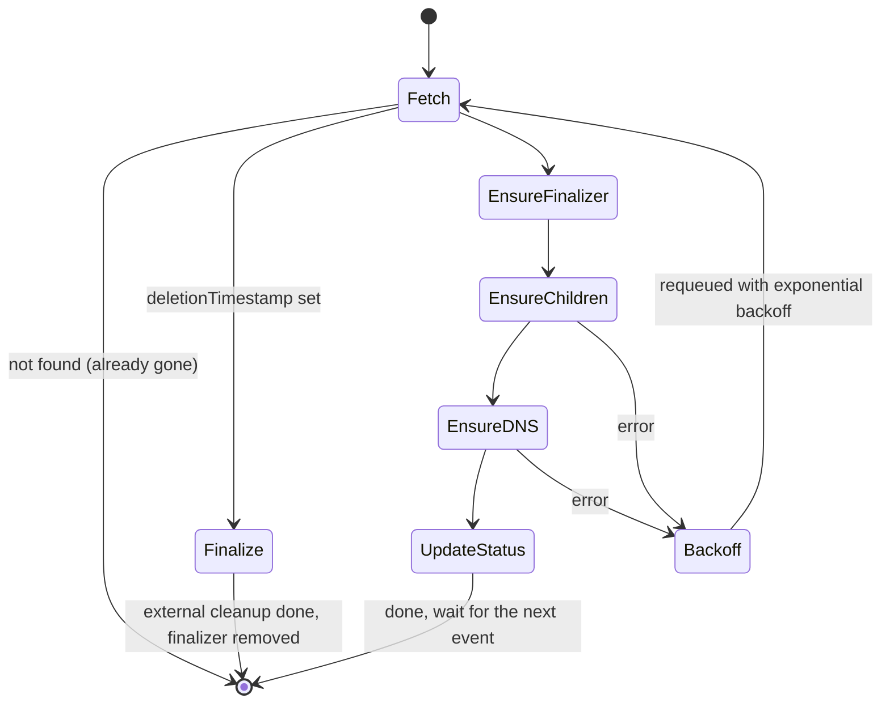
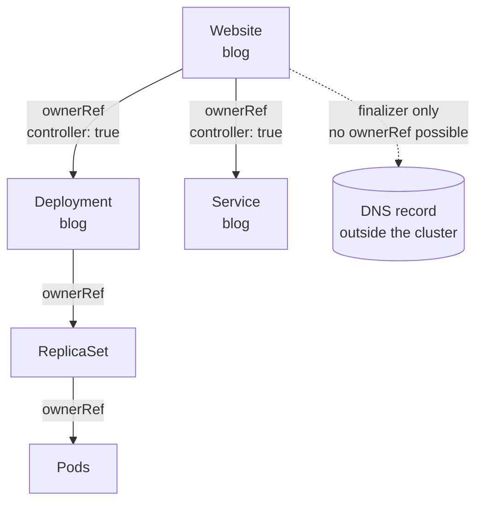
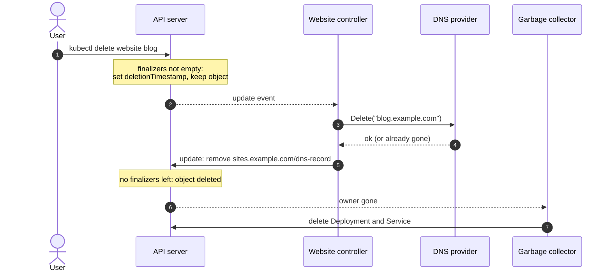

Casi todo lo que publico en el trabajo corre encima de operadores. El dashboard
de Open Data Hub lo despliega uno, y los componentes que lo rodean son recursos
personalizados que algún controlador, en algún sitio, está reconciliando sin
parar. Durante mucho tiempo leí código de operadores bastante más de lo que lo
escribí, y hasta que no escribí uno desde cero las reglas no dejaron de parecerme
folclore.

Este artículo construye un operador pequeño pero completo con
[kubebuilder](https://book.kubebuilder.io/): un recurso `Website` que ejecuta un
contenedor, lo expone con un Service y registra un registro DNS en un proveedor
fuera del clúster. Esa última parte está ahí a propósito: es lo que obliga a
meter un *finalizer* en el diseño. Por el camino quiero dejar claras las pocas
ideas que deciden si un operador se porta bien o si va llenando el clúster de
sorpresas.

He comprobado las APIs contra kubebuilder v4.16 y controller-runtime v0.25, las
[últimas versiones](https://github.com/kubernetes-sigs/controller-runtime/releases)
cuando escribí esto. Los conceptos son bastante más antiguos que ambas.

## El patrón operador en un dibujo

La [definición de Kubernetes](https://kubernetes.io/docs/concepts/extend-kubernetes/operator/)
es corta: un operador es un recurso personalizado más un controlador que
codifica el conocimiento operativo para gestionarlo. Tú declaras lo que quieres
en el `spec`, un controlador hace que el mundo encaje y cuenta lo que ha visto
en el `status`.



Dos detalles de ese diagrama importan más de lo que parece:

- **Reconcile recibe una clave, no un evento.** controller-runtime colapsa lo que
  haya pasado (un alta, cinco actualizaciones, un cambio en un Deployment del que
  es dueño) en `namespace/name` y lo mete en una cola. Las claves duplicadas se
  fusionan mientras esperan.
- **Las lecturas salen de una caché.** `r.Get` no va al API server por defecto:
  lee la copia local del *informer*, que puede ir un instante por detrás de tus
  propias escrituras.

Las dos cosas empujan hacia la misma forma de pensar.

## Por nivel, no por flanco

Un sistema *edge-triggered* reacciona a *cambios*: "las réplicas pasaron de 2 a 3,
así que añade un pod". Uno *level-triggered* reacciona al *estado*: "el spec dice
3, veo 2, crea uno". Los controladores de Kubernetes son *level-triggered*, y toda
la API está diseñada así: nunca te cuentan *qué* ha cambiado, solo *que* algo de
este objeto podría haber cambiado.

Eso tiene una consecuencia liberadora. Si tu controlador se cae, pierde eventos
o se reinicia durante una actualización, no se pierde nada: al arrancar lista
todo y reconcilia cada objeto contra lo que ve en ese momento. Las
[buenas prácticas de kubebuilder](https://book.kubebuilder.io/reference/good-practices)
lo dicen sin rodeos: el bucle de reconciliación tiene que ser idempotente, y la
lógica que se ramifica según el *tipo* de evento rompe el patrón.

> Reconcile es una función de "cómo está el mundo ahora" a "el siguiente paso
> hacia lo que pide el spec". Ejecútala dos veces y la segunda no debería
> encontrar nada que hacer.

## Generar el proyecto

```steps
Init: kubebuilder init crea el módulo de Go, el manager y el Makefile.
Crear la API: kubebuilder create api genera los tipos y un controlador vacío.
Diseñar los tipos: Spec, status y marcadores de validación.
Generar: make manifests generate escribe el CRD, el RBAC y el código DeepCopy.
Ejecutar: make install run carga el CRD y ejecuta el manager en tu máquina.
```

```bash title="terminal"
kubebuilder init --domain example.com --repo github.com/example/website-operator
kubebuilder create api --group sites --version v1alpha1 --kind Website \
  --resource --controller
make manifests generate
make install   # CRDs into the cluster in your kubeconfig
make run       # the manager runs on your machine against that cluster
```

El resultado es una API `sites.example.com/v1alpha1`, los tipos en
`api/v1alpha1/website_types.go`, un controlador en
`internal/controller/website_controller.go` y una suite de envtest a su lado.

## Diseñar el CRD: el spec es intención, el status es observación

Las [convenciones de la API](https://github.com/kubernetes/community/blob/master/contributors/devel/sig-architecture/api-conventions.md#spec-and-status)
trazan una línea dura: el `spec` es lo que quiere el usuario y solo lo escribe el
usuario; el `status` es lo que ha observado el controlador y solo lo escribe el
controlador. El marcador `+kubebuilder:subresource:status` hace cumplir esa línea
en la API: una actualización del recurso principal ignora el status, y una
actualización de `/status` ignora todo lo demás.

```go title="api/v1alpha1/website_types.go" {12-14,20,24-27,31}
type WebsiteSpec struct {
	// Container image that serves the site.
	// +kubebuilder:validation:MinLength=1
	Image string `json:"image"`

	// Public hostname registered in the external DNS provider.
	// +kubebuilder:validation:Pattern=`^[a-z0-9]([-a-z0-9.]*[a-z0-9])?$`
	Hostname string `json:"hostname"`

	// +kubebuilder:validation:Minimum=0
	// +kubebuilder:validation:Maximum=10
	// +kubebuilder:default=1
	// +optional
	Replicas *int32 `json:"replicas,omitempty"`
}

type WebsiteStatus struct {
	// The spec generation this status describes.
	// +optional
	ObservedGeneration int64 `json:"observedGeneration,omitempty"`
	// +optional
	ReadyReplicas int32 `json:"readyReplicas,omitempty"`

	// +listType=map
	// +listMapKey=type
	// +optional
	Conditions []metav1.Condition `json:"conditions,omitempty"`
}

// +kubebuilder:object:root=true
// +kubebuilder:subresource:status
// +kubebuilder:printcolumn:name="Available",type=string,JSONPath=`.status.conditions[?(@.type=="Available")].status`
type Website struct {
	metav1.TypeMeta   `json:",inline"`
	metav1.ObjectMeta `json:"metadata,omitempty"`

	Spec   WebsiteSpec   `json:"spec,omitempty"`
	Status WebsiteStatus `json:"status,omitempty"`
}
```

Ahí hay tres decisiones que merece la pena defender:

- **`Replicas` es un puntero con valor por defecto.** Un `int32` a secas no
  distingue entre "el usuario pidió cero" y "el usuario no dijo nada": el mismo
  problema del valor cero que contaba en [Go para desarrolladores de TypeScript](/blog/go-for-typescript-developers).
  El marcador `+kubebuilder:default` hace que el API server lo rellene, así que el
  controlador ve un valor en cualquier caso.
- **La validación vive en el CRD.** Los marcadores se convierten en esquema
  OpenAPI, y el API server lo aplica antes de que tu controlador vea el objeto.
  Cada regla que empujas ahí es un camino de error menos en Go.
- **Las condiciones son `metav1.Condition`, como un mapa indexado por `type`.** Es
  la forma que usan todos los recursos nativos, lo que significa que
  `kubectl wait --for=condition=Available` funciona con tu recurso gratis. Los
  marcadores `listType=map` permiten que Server-Side Apply fusione la lista por
  tipo en lugar de reemplazarla.

`observedGeneration` es el campo que la gente se salta y luego echa de menos.
`metadata.generation` sube cada vez que cambia el spec; copiarlo en el status (y en
cada condición) le dice a quien lo lea si "Available=True" se refiere al spec que
acaba de aplicar o al anterior.

## El bucle de reconciliación

Esta es la forma del controlador, antes de ver código:



Y el punto de entrada. Fíjate en que nunca pregunta qué ha pasado: lee el objeto
y decide a partir de su estado actual:

```go title="internal/controller/website_controller.go" {16-23}
const websiteFinalizer = "sites.example.com/dns-record"

type WebsiteReconciler struct {
	client.Client
	Scheme *runtime.Scheme
	DNS    DNSProvider // external, injected from cmd/main.go
}

func (r *WebsiteReconciler) Reconcile(ctx context.Context, req ctrl.Request) (ctrl.Result, error) {
	var site sitesv1alpha1.Website
	if err := r.Get(ctx, req.NamespacedName, &site); err != nil {
		// Deleted between the event and now: nothing left to do.
		return ctrl.Result{}, client.IgnoreNotFound(err)
	}

	if !site.DeletionTimestamp.IsZero() {
		return r.finalize(ctx, &site)
	}
	if controllerutil.AddFinalizer(&site, websiteFinalizer) {
		if err := r.Update(ctx, &site); err != nil {
			return ctrl.Result{}, err
		}
	}

	deploy, err := r.reconcileDeployment(ctx, &site)
	if err != nil {
		return ctrl.Result{}, err
	}
	// … reconcileService follows the same shape
	if err := r.DNS.Upsert(ctx, site.Spec.Hostname, site.Name+"."+site.Namespace); err != nil {
		return ctrl.Result{}, fmt.Errorf("registering %s: %w", site.Spec.Hostname, err)
	}
	return ctrl.Result{}, r.updateStatus(ctx, &site, deploy)
}
```

`DNSProvider` es una interfaz de dos métodos, `Upsert(ctx, hostname, target)` y
`Delete(ctx, hostname)`, para que los tests puedan cambiarla por un mapa. Los dos
métodos tienen que ser idempotentes: hacer *upsert* de un registro que ya existe,
o borrar uno que ya no está, debe salir bien. Es la misma regla que Reconcile,
empujada un nivel más abajo.

### Los hijos: crear o actualizar, y ser su dueño

```go title="internal/controller/website_controller.go"
func (r *WebsiteReconciler) reconcileDeployment(ctx context.Context, site *sitesv1alpha1.Website) (*appsv1.Deployment, error) {
	deploy := &appsv1.Deployment{ObjectMeta: metav1.ObjectMeta{Name: site.Name, Namespace: site.Namespace}}
	labels := map[string]string{"app.kubernetes.io/name": "website", "app.kubernetes.io/instance": site.Name}

	_, err := controllerutil.CreateOrUpdate(ctx, r.Client, deploy, func() error {
		deploy.Spec.Replicas = site.Spec.Replicas
		deploy.Spec.Selector = &metav1.LabelSelector{MatchLabels: labels}
		deploy.Spec.Template.Labels = labels
		if len(deploy.Spec.Template.Spec.Containers) == 0 {
			deploy.Spec.Template.Spec.Containers = []corev1.Container{{Name: "web"}}
		}
		web := &deploy.Spec.Template.Spec.Containers[0]
		web.Image = site.Spec.Image
		web.Ports = []corev1.ContainerPort{{Name: "http", ContainerPort: 8080}}
		return controllerutil.SetControllerReference(site, deploy, r.Scheme)
	})
	return deploy, err
}
```

`CreateOrUpdate` lee el objeto, ejecuta la función de mutación y solo envía una
actualización si el resultado difiere de lo que leyó. Esa última parte es la
razón de que la función edite los campos *en su sitio* en lugar de asignar una
lista de contenedores nueva: un `corev1.Container{}` recién creado no tiene los
campos que el API server rellena por defecto (`imagePullPolicy`,
`terminationMessagePath`…), así que la comparación siempre vería una diferencia y
enviarías una actualización inútil en cada pasada.

`SetControllerReference` es la línea que convierte un Deployment en *el*
Deployment del Website.

## Owner references y recolección de basura

Una *owner reference* es un puntero de un dependiente a su dueño: tipo, nombre
y, sobre todo, UID. El recolector de basura de `kube-controller-manager` la usa
para borrar los dependientes cuando el dueño desaparece.



En la API las flechas van del dependiente al dueño, pero lee el diagrama como
"borrar lo de arriba elimina todo lo que cuelga con línea continua". Las reglas
de la página de [dueños y dependientes](https://kubernetes.io/docs/concepts/overview/working-with-objects/owners-dependents/)
que muerden en la práctica:

| Regla | Consecuencia |
| --- | --- |
| **El dueño tiene que estar en el mismo namespace** | Un Website con namespace no puede ser dueño de algo en otro namespace. La referencia se trata como ausente y el dependiente puede ser recolectado. |
| **Los dependientes de clúster necesitan dueños de clúster** | Tu recurso con namespace no puede ser dueño de un ClusterRole. |
| **Solo un dueño puede ser el `controller`** | `SetControllerReference` falla si otro controlador ya reclama el objeto. Es una ventaja: impide que dos operadores se peleen por un mismo Deployment. |
| **Las referencias llevan el UID** | Borra y vuelve a crear un Website con el mismo nombre y los hijos antiguos quedan huérfanos, no adoptados. |
| **Nada fuera del API server puede tener dueño** | Un registro DNS, un bucket, una fila en una base de datos: el recolector de basura no ha oído hablar de ellos. |

La marca `controller: true` es también lo que usa `Owns()` para devolver los
eventos a su origen: cuando cambia el status del Deployment, controller-runtime
sigue la referencia de controlador y encola el Website dueño. Por eso el
reconciliador nunca pregunta en bucle "¿está ya listo el Deployment?".

## Finalizers: la limpieza que el recolector de basura no puede hacer

Esa última fila es el motivo del *finalizer*. Un
[finalizer](https://kubernetes.io/docs/concepts/overview/working-with-objects/finalizers/)
es una cadena en `metadata.finalizers`. Mientras la lista no esté vacía, una
petición de borrado no elimina el objeto: el API server solo pone
`deletionTimestamp`, y el objeto sigue legible hasta que quien añadió cada
finalizer lo quite.



```go title="internal/controller/website_controller.go"
func (r *WebsiteReconciler) finalize(ctx context.Context, site *sitesv1alpha1.Website) (ctrl.Result, error) {
	if !controllerutil.ContainsFinalizer(site, websiteFinalizer) {
		return ctrl.Result{}, nil // someone else's finalizer is holding it
	}
	if err := r.DNS.Delete(ctx, site.Spec.Hostname); err != nil {
		// Keep the finalizer: the error requeues and we try again.
		return ctrl.Result{}, fmt.Errorf("deleting DNS record %s: %w", site.Spec.Hostname, err)
	}
	controllerutil.RemoveFinalizer(site, websiteFinalizer)
	return ctrl.Result{}, r.Update(ctx, site)
}
```

> [!WARNING]
> Un finalizer es una promesa de que tu controlador estará ahí para cumplirla.
> Desinstala el operador antes que sus recursos y cada `kubectl delete` se queda
> colgado para siempre en `Terminating`; lo mismo le pasa al namespace que los
> contiene. Borra primero los recursos personalizados, y añade un finalizer solo
> cuando de verdad haya algo fuera del clúster que limpiar: los hijos con dueño no
> lo necesitan.

Dos reglas más pequeñas de la misma página: una vez puesto el `deletionTimestamp`
puedes quitar finalizers pero no añadir nuevos, y el nombre debería llevar
dominio (`sites.example.com/dns-record`) para que no choque con el de nadie.

## Actualizar el status, y el conflicto que verás el primer día

```go title="internal/controller/website_controller.go" {3,11,13}
func (r *WebsiteReconciler) updateStatus(ctx context.Context, site *sitesv1alpha1.Website, deploy *appsv1.Deployment) error {
	desired := ptr.Deref(site.Spec.Replicas, 1)
	base := site.DeepCopy()

	cond := metav1.Condition{Type: "Available", ObservedGeneration: site.Generation,
		Status: metav1.ConditionFalse, Reason: "ReplicasUnavailable",
		Message: fmt.Sprintf("%d/%d replicas available", deploy.Status.AvailableReplicas, desired)}
	if deploy.Status.AvailableReplicas >= desired {
		cond.Status, cond.Reason = metav1.ConditionTrue, "MinimumReplicasAvailable"
	}
	meta.SetStatusCondition(&site.Status.Conditions, cond)
	site.Status.ObservedGeneration, site.Status.ReadyReplicas = site.Generation, deploy.Status.AvailableReplicas
	return r.Status().Patch(ctx, site, client.MergeFrom(base))
}
```

Tarde o temprano tus logs enseñan *"the object has been modified; please apply
your changes to the latest version and try again"*. Es concurrencia optimista: un
`Update` lleva el `resourceVersion` que leíste, y si alguien ha escrito el objeto
desde entonces (incluida tu propia reconciliación anterior, que aún no se ve en
la caché) el API server lo rechaza con un 409.

No es un bug, y lo correcto suele ser no hacer nada: devuelves el error, la clave
se vuelve a encolar y la siguiente pasada empieza con una lectura fresca. Dos
decisiones de este código hacen que pase menos:

- **El status va por `Status().Patch` con `MergeFrom`.** Un *merge patch* envía
  solo la diferencia y sin `resourceVersion`, así que no entra en conflicto. Eso sí,
  reemplaza el array `conditions` entero, lo cual aquí no importa porque este
  controlador es el único que escribe el status.
- **El finalizer va por `Update`, a propósito.** `finalizers` es una lista que
  otros controladores también pueden tocar. Un *merge patch* normal pisaría los
  suyos; un `Update` en conflicto falla sin hacer daño y se reintenta.

`meta.SetStatusCondition` solo cambia `lastTransitionTime` cuando el estado de
la condición cambia de verdad, así que escribir la misma condición en cada pasada
no hace parecer que haya pasado algo.

## Estrategias de reencolado

`ctrl.Result` y el error que devuelves son tus únicas palancas sobre *cuándo*
llega la siguiente pasada. La [documentación del paquete reconcile](https://pkg.go.dev/sigs.k8s.io/controller-runtime/pkg/reconcile)
es precisa sobre lo que hace cada combinación:

| Devuelves | Qué pasa | Úsalo para |
| --- | --- | --- |
| **`Result{}, nil`** | Nada hasta el siguiente evento | El caso normal: esperas algo que ya vigilas |
| **`Result{}, err`** | Se reencola con *backoff* exponencial; el resultado se ignora | Fallos transitorios: errores de la API, conflictos, el proveedor DNS que no responde |
| **`Result{}, reconcile.TerminalError(err)`** | Se registra y se cuenta, pero no se reintenta | Errores que ningún reintento va a arreglar, como una configuración inválida |
| **`Result{RequeueAfter: d}, nil`** | Se reencola tras `d` | Consultar algo que no puedes vigilar: una API externa, la caducidad de un certificado |
| **`Result{Requeue: true}, nil`** | Reencolado con limitación de ritmo | Nada: está obsoleto en favor de `RequeueAfter` |

El error que más veo es `RequeueAfter: 5 * time.Second` como forma de esperar a
que un Deployment esté listo. Ya lo vigilas: su cambio de status te va a encolar.
Consultar encima solo añade carga y esconde *watches* que faltan.

## Watches y predicados

```go title="internal/controller/website_controller.go"
// +kubebuilder:rbac:groups=sites.example.com,resources=websites,verbs=get;list;watch;update;patch
// +kubebuilder:rbac:groups=sites.example.com,resources=websites/status,verbs=get;update;patch
// +kubebuilder:rbac:groups=sites.example.com,resources=websites/finalizers,verbs=update
// +kubebuilder:rbac:groups=apps,resources=deployments,verbs=get;list;watch;create;update;patch;delete
// +kubebuilder:rbac:groups="",resources=services,verbs=get;list;watch;create;update;patch;delete

func (r *WebsiteReconciler) SetupWithManager(mgr ctrl.Manager) error {
	return ctrl.NewControllerManagedBy(mgr).
		For(&sitesv1alpha1.Website{}, builder.WithPredicates(predicate.GenerationChangedPredicate{})).
		Owns(&appsv1.Deployment{}).
		Owns(&corev1.Service{}).
		Named("website").
		Complete(r)
}
```

`For` vigila el recurso principal, `Owns` vigila los hijos y los asocia a su
dueño controlador, y `Watches` con un *handler* cubre todo lo demás, por ejemplo
un ConfigMap referenciado por nombre. Los marcadores de RBAC se convierten en el
ClusterRole al hacer `make manifests`; si se te olvida uno, el *informer* registra
errores "forbidden" y nunca se sincroniza al arrancar, que al menos hace ruido.

`GenerationChangedPredicate` descarta los eventos de actualización del Website
que no cambian `metadata.generation`, lo que incluye nuestros propios parches de
status, así que el controlador no se despierta a sí mismo cada vez que informa. El
borrado sigue pasando, porque el API server sube la generación cuando pone el
`deletionTimestamp`. El precio: también se filtran los cambios de etiquetas y
anotaciones. Si tu controlador reacciona a una anotación, combina predicados o no
uses este.

> [!TIP]
> Los predicados son una optimización, no una herramienta de corrección. Un
> reconciliador *level-triggered* tiene que dar el resultado correcto aunque le
> llegasen todos los eventos: filtra solo lo que estés seguro de que no cambia nada.

## Probar con envtest

[envtest](https://book.kubebuilder.io/reference/envtest) arranca un etcd y un
kube-apiserver reales, y nada más. La suite generada en
`internal/controller/suite_test.go` los levanta con tus CRDs y te da un
`k8sClient`; `make test` descarga los binarios con `setup-envtest`. El test de
controlador generado llama a `Reconcile` directamente, lo que mantiene los tests
deterministas:

```go title="internal/controller/website_controller_test.go"
It("owns its Deployment and cleans DNS up on delete", func(ctx SpecContext) {
	dns := &fakeDNS{records: map[string]string{}}
	r := &WebsiteReconciler{Client: k8sClient, Scheme: k8sClient.Scheme(), DNS: dns}
	site := &sitesv1alpha1.Website{
		ObjectMeta: metav1.ObjectMeta{Name: "blog", Namespace: "default"},
		Spec:       sitesv1alpha1.WebsiteSpec{Image: "nginx:1.27", Hostname: "blog.example.com"},
	}
	key := client.ObjectKeyFromObject(site)
	Expect(k8sClient.Create(ctx, site)).To(Succeed())

	_, err := r.Reconcile(ctx, reconcile.Request{NamespacedName: key})
	Expect(err).NotTo(HaveOccurred())

	var deploy appsv1.Deployment
	Expect(k8sClient.Get(ctx, key, &deploy)).To(Succeed())
	Expect(metav1.IsControlledBy(&deploy, site)).To(BeTrue())
	Expect(dns.records).To(HaveKey("blog.example.com"))

	Expect(k8sClient.Delete(ctx, site)).To(Succeed())
	_, err = r.Reconcile(ctx, reconcile.Request{NamespacedName: key})
	Expect(err).NotTo(HaveOccurred())
	Expect(dns.records).To(BeEmpty())
	Expect(apierrors.IsNotFound(k8sClient.Get(ctx, key, site))).To(BeTrue())
})
```

Lo que envtest *no* ejecuta es igual de instructivo. No hay controller-manager,
así que el recolector de basura nunca borra el Deployment cuando el Website ya no
está: compruebas la *owner reference*, como arriba. Tampoco hay controlador de
Deployments, así que `AvailableReplicas` se queda en cero y la condición es
siempre `Available=False`. Y los namespaces borrados se quedan en `Terminating`
para siempre, así que usa un namespace nuevo por test en vez de recrear uno.

> [!NOTE]
> Añade una segunda llamada a `Reconcile` justo después de la primera y comprueba
> que no ha cambiado nada. Es el test de idempotencia más barato que existe, y
> caza la función de mutación que siempre devuelve algo distinto de antes.

## Errores habituales

La mayoría los he cometido o los he revisado:

- **Ramificar según lo que ha pasado.** "Al crear, haz X; al actualizar, haz Y" se
  rompe la primera vez que se pierde un evento. Lee el estado y calcula el
  siguiente paso.
- **Consultar en bucle lo que podrías vigilar.** Un `RequeueAfter` mientras
  esperas a un hijo es un `Owns` que falta.
- **Escribir el status a partir de un objeto viejo.** Construye el status con lo
  que has observado en *esta* pasada, y rellena `observedGeneration`.
- **Generar nombres.** Los hijos con `GenerateName` no son idempotentes: cada
  reintento tras un fallo crea otro. Deriva los nombres del dueño.
- **Finalizers para hijos dentro del clúster.** De esos ya se encargan las *owner
  references*. Un finalizer que no necesitas es solo otra forma de quedarte
  atascado en `Terminating`.
- **Olvidar que el spec puede cambiar por debajo.** Si `hostname` pasa de
  `a.example.com` a `b.example.com`, este operador registra `b` y nunca borra `a`.
  La solución es apuntar lo que has publicado (un `status.publishedHostname`) y
  limpiar la diferencia.
- **Llamadas largas y bloqueantes dentro de Reconcile.** Los *workers* son
  limitados (uno por defecto; `MaxConcurrentReconciles` para cambiarlo). Una
  llamada HTTP de treinta segundos frena a todos los Website que vienen detrás.

## Límites y trampas, con honestidad

Unas cuantas cosas que este ejemplo pasa por encima, porque merecen su propio
artículo:

- **`CreateOrUpdate` es una fusión en el cliente.** Funciona cuando tu operador es
  el único que escribe los campos que toca. Cuando un HPA u otro controlador
  comparte el objeto, Server-Side Apply con tu propio *field manager* es mejor
  herramienta, y viene con su propia trampa, que conté en
  [el campo que renombré y la sonda que se rompió](/blog/server-side-apply-field-manager).
- **La caché es eventualmente consistente.** Justo después de escribir, un `Get`
  puede devolver el objeto antiguo. La idempotencia es lo que hace que eso no
  importe; una reconciliación que depende de leer su propia escritura fallará a
  ratos. controller-runtime v0.25 añadió un cliente experimental que lee sus
  propias escrituras, pero no lo he usado, así que aquí no cuento con él.
- **Los CRDs con varias versiones necesitan conversión.** El día que pases de
  `v1alpha1` a `v1` con un cambio de esquema, necesitas un *webhook* de conversión.
  Kubebuilder lo genera, pero es trabajo real y superficie operativa real.
- **Un operador es software que ahora tienes que operar.** Necesita revisiones de
  RBAC, actualizaciones, métricas y alguien de guardia. Si un chart de Helm y un
  CronJob resuelven el problema, es menos que mantener.

Lo que me llevé de escribir uno es sobre todo un hábito mental: un controlador no
es un script que se ejecuta cuando pasa algo, es una función a la que se sigue
llamando hasta que el mundo coincide con el spec. Cuando escribes cada línea
pensando en eso ("¿y si esto se ejecuta otra vez, ahora mismo, con una lectura
vieja?"), el resto del framework deja de ser magia.

## Para seguir aprendiendo

- [The Kubebuilder Book: Getting started](https://book.kubebuilder.io/getting-started):
  el tutorial oficial construye un operador de Memcached con las mismas piezas que
  este artículo: condiciones, Deployments con dueño, marcadores de RBAC.
- [Kubebuilder: Using finalizers](https://book.kubebuilder.io/reference/using-finalizers):
  el patrón canónico de finalizer, corto y para copiarlo tal cual.
- [Kubebuilder: Configuring envtest](https://book.kubebuilder.io/reference/envtest):
  qué ejecuta envtest, qué no (ni recolección de basura ni borrado de namespaces)
  y cómo instalar sus binarios.
- [Paquete `reconcile` de controller-runtime](https://pkg.go.dev/sigs.k8s.io/controller-runtime/pkg/reconcile):
  la semántica exacta de `Result`, `RequeueAfter`, `TerminalError` y la
  obsolescencia de `Requeue`.
- [Kubernetes: Owners and dependents](https://kubernetes.io/docs/concepts/overview/working-with-objects/owners-dependents/):
  las reglas de namespace de las *owner references* y cómo funciona
  `blockOwnerDeletion`.
- [Kubernetes: Finalizers](https://kubernetes.io/docs/concepts/overview/working-with-objects/finalizers/):
  cómo avanza un borrado con finalizers, desde el punto de vista del API server.
- [Convenciones de la API de Kubernetes](https://github.com/kubernetes/community/blob/master/contributors/devel/sig-architecture/api-conventions.md):
  la fuente de spec frente a status, condiciones y `observedGeneration`; es largo,
  pero las secciones sobre status son las que hay que leer.
- [Kubebuilder: Good practices](https://book.kubebuilder.io/reference/good-practices):
  idempotencia, un controlador por tipo, y por qué no ramificar según el tipo de
  evento.
