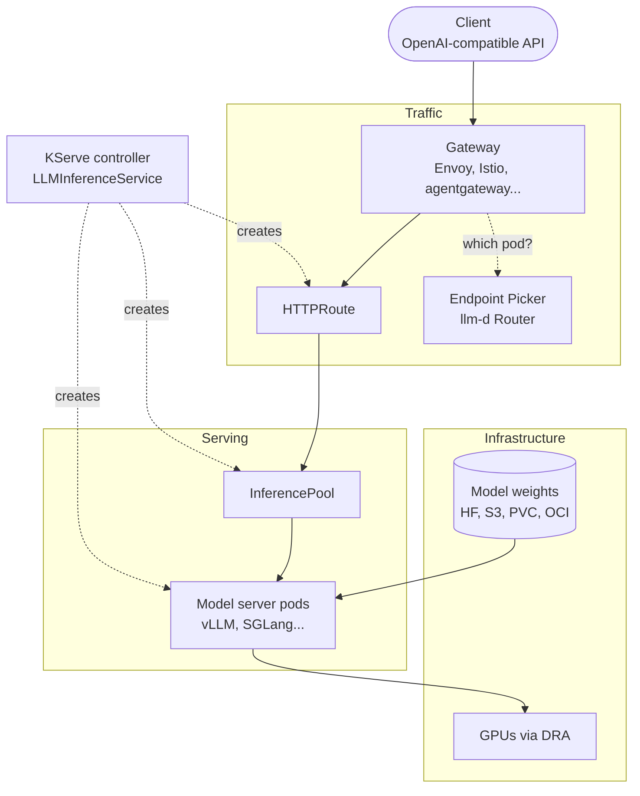
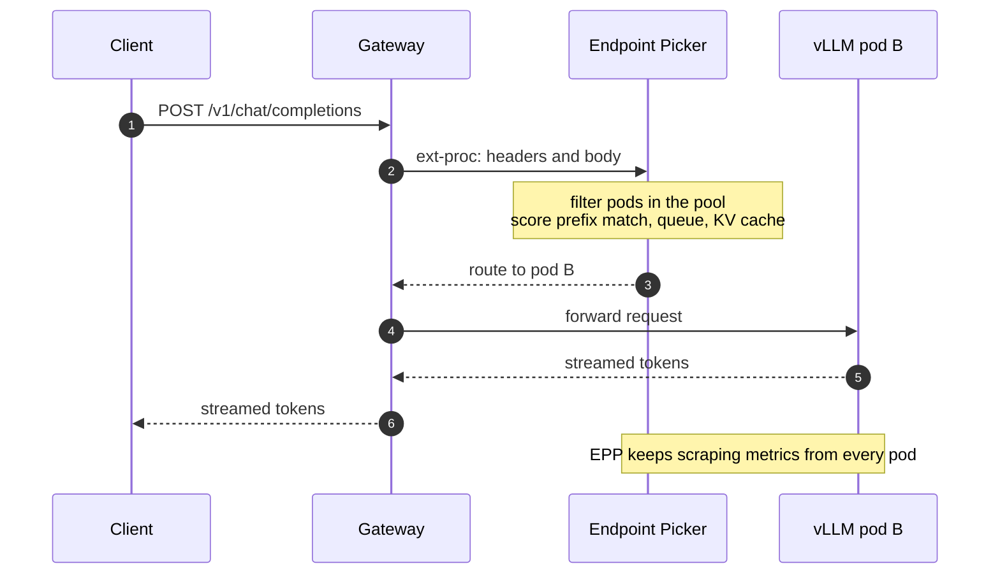
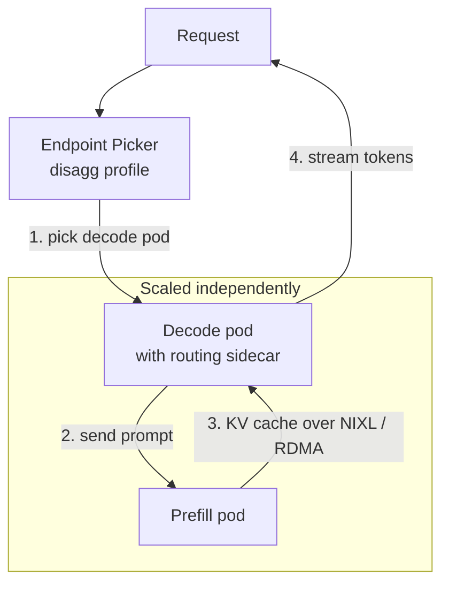
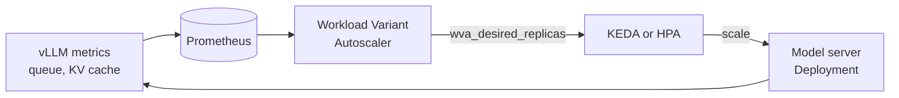
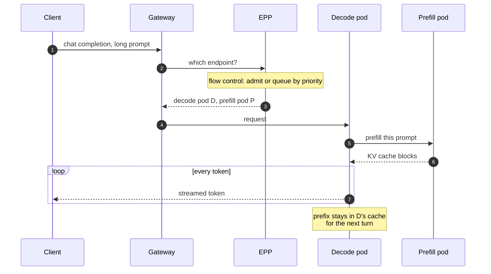

Trabajo en el dashboard de Open Data Hub / OpenShift AI, lo que significa que
casi siempre veo el *serving* de modelos desde arriba: un formulario donde
alguien elige un modelo, un tamaño y un número de réplicas, y un estado que
acaba poniéndose en verde. Debajo de ese formulario hay una pila de proyectos
que ha cambiado muchísimo en el último año y medio, y quería una página donde
verla entera, capa a capa, con los manifiestos tal y como son **hoy** y no
como estaban en el tutorial que leí en 2024.

Esta es esa página. Todo lo que sigue está contrastado con la documentación y
el código de cada proyecto a noviembre de 2026: KServe v0.21, llm-d v1.0, la
Gateway API Inference Extension v1.6 y Kubernetes 1.37.

## Por qué un LLM no es un servicio web

El primer instinto es tratar un servidor de modelos como cualquier otro
backend HTTP: un Deployment, un Service, un HPA sobre CPU y listo. Funciona
para una demo y se cae poco después, por motivos que merece la pena decir con
precisión, porque cada capa de la pila existe para arreglar uno de ellos.

Una petición a un LLM tiene **dos fases** con costes muy distintos. El
*prefill* lee el prompt entero en una pasada paralela y está limitado por
cómputo. El *decode* produce un token cada vez y está limitado por el ancho de
banda de memoria. Un prompt de 20.000 tokens con una respuesta de 50 y un
prompt de 50 tokens con una respuesta de 2.000 son ambos "una petición", y
cargan la GPU de maneras completamente diferentes.

El prefill deja detrás una **caché KV**: las claves y valores de atención de
cada token visto hasta el momento, guardados en memoria de la GPU. Si la
siguiente petición comparte prefijo con una anterior (el mismo *system
prompt*, el mismo documento, los turnos previos de una conversación), un
servidor que todavía tenga ese prefijo puede saltarse casi todo el prefill.
Eso convierte la caché en **estado**, y ese estado vive en una réplica
concreta.

Y el recurso que se agota no es la CPU. Es la memoria de GPU para la caché KV,
y la cola de peticiones esperando un hueco en el lote en ejecución.

| Suposición heredada de los servicios web | Lo que pasa de verdad con los LLMs |
| --- | --- |
| **Las peticiones cuestan más o menos lo mismo** | El coste depende de la longitud del prompt y de la salida, y varía en órdenes de magnitud |
| **Cualquier réplica vale igual** | La réplica que tiene tu prefijo en su caché KV responde mucho antes |
| **La CPU te dice cuándo escalar** | La GPU se satura con la CPU ociosa; las señales son la cola y el uso de la caché KV |
| **Los pods arrancan en segundos** | Descargar decenas de gigas de pesos y cargarlos en la GPU lleva minutos |
| **Un nodo por pod** | Los modelos grandes ocupan varias GPUs, y a veces varios nodos |

## La pila de un vistazo



De abajo arriba: un servidor de modelos convierte una GPU en un endpoint
compatible con la API de OpenAI; KServe convierte "quiero servir este modelo"
en objetos de Kubernetes; la Gateway API Inference Extension y el llm-d Router
deciden qué réplica recibe cada petición; llm-d añade los trucos de
distribución; DRA reparte las GPUs. Vamos una por una.

## El servidor de modelos: vLLM y compañía

[vLLM](https://docs.vllm.ai/) es el servidor de modelos por defecto en este
ecosistema. Las dos ideas suyas que importan aquí son el *continuous batching*
(las peticiones nuevas se suman al lote en cada paso en lugar de esperar a que
termine) y la *paged attention* (la caché KV se gestiona en bloques de tamaño
fijo, como páginas de memoria virtual, para poder compartirla y reutilizarla).
Además hace *prefix caching* automático, que es lo que hace que merezca la
pena "mandar esta petición a la réplica que ya tiene el prefijo".

vLLM no es la única opción. La release v1.0 de llm-d lista imágenes de vLLM,
SGLang y TensorRT-LLM entre los motores que usan sus guías, sobre NVIDIA, AMD,
TPU, Intel XPU y CPU. Lo que comparten es el contrato del que depende el resto
de la pila: una API HTTP compatible con OpenAI y **métricas** sobre su propio
estado interno.

Esas métricas son lo más importante que el servidor de modelos le da a la
plataforma. Según el
[documento de diseño de métricas de vLLM](https://docs.vllm.ai/en/latest/design/metrics.html):

| Métrica | Qué le dice a la plataforma |
| --- | --- |
| **`vllm:num_requests_waiting`** | Peticiones en cola, todavía fuera del lote. La señal de saturación más clara |
| **`vllm:num_requests_running`** | Peticiones en el lote actual |
| **`vllm:kv_cache_usage_perc`** | Fracción de bloques de la caché KV en uso, de 0 a 1 |
| **`vllm:time_to_first_token_seconds`** | Histograma del TTFT, dominado por la cola y el prefill |
| **`vllm:inter_token_latency_seconds`** | Histograma del tiempo entre tokens, dominado por el decode |
| **`vllm:prefix_cache_hits`** | Contador; divídelo entre `vllm:prefix_cache_queries` para la tasa de aciertos |

Ten esta tabla en mente. Tanto el router como el autoescalador que vienen
después son, en el fondo, consumidores de estos números.

## KServe: de la intención a los objetos

[KServe](https://kserve.github.io/website/) es el plano de control que
convierte un único recurso en Deployments, Services, rutas y pools. Hoy tiene
dos recursos para LLMs, y la diferencia importa.

El **`InferenceService`** (`serving.kserve.io/v1beta1`) es el original, de
propósito general. Sirve igual un modelo de scikit-learn que un LLM, y para un
LLM usa el runtime de Hugging Face con vLLM como backend:

```yaml title="inferenceservice.yaml"
apiVersion: serving.kserve.io/v1beta1
kind: InferenceService
metadata:
  name: qwen-chat
spec:
  predictor:
    model:
      modelFormat:
        name: huggingface
      storageUri: hf://Qwen/Qwen2.5-7B-Instruct
      args:
        - --backend=vllm
        - --max_model_len=8192
      resources:
        requests:
          cpu: "2"
          memory: 16Gi
          nvidia.com/gpu: "1"
        limits:
          cpu: "4"
          memory: 32Gi
          nvidia.com/gpu: "1"
```

Eso vale para una réplica detrás de un Service normal. No sabe nada de
prefijos, colas ni prefill.

El **`LLMInferenceService`** es el recurso nuevo, específico para LLMs y
construido alrededor de llm-d. Su versión de almacenamiento en KServe v0.21 es
`v1alpha2` (la documentación antigua y algunos productos muestran `v1alpha1`,
que todavía se sirve). Los
[ejemplos de KServe](https://github.com/kserve/kserve/tree/master/docs/samples/llmisvc)
tienen esta pinta:

```yaml title="llminferenceservice.yaml" {8,10-13}
apiVersion: serving.kserve.io/v1alpha2
kind: LLMInferenceService
metadata:
  name: qwen-chat
spec:
  model:
    uri: hf://Qwen/Qwen2.5-7B-Instruct
    name: Qwen/Qwen2.5-7B-Instruct
  replicas: 3
  router:
    scheduler: {}  # create an InferencePool and an Endpoint Picker
    route: {}      # generate the HTTPRoute
    gateway: {}    # attach to the managed Gateway
  template:
    containers:
      - name: main
        resources:
          requests:
            cpu: "2"
            memory: 16Gi
            nvidia.com/gpu: "1"
          limits:
            cpu: "4"
            memory: 32Gi
            nvidia.com/gpu: "1"
```

Lo interesante es el bloque `router`. Tres objetos vacíos significan "hazme
lo de por defecto": KServe crea el InferencePool, despliega el Endpoint
Picker, genera la HTTPRoute y la engancha a un Gateway. Cada uno puede apuntar
en su lugar a algo que ya tengas (`gateway.refs`, `route.http.refs`,
`scheduler.pool.ref`). La
[documentación de configuración](https://kserve.github.io/website/docs/model-serving/generative-inference/llmisvc/llmisvc-configuration)
explica también cómo la forma del spec elige la topología: una sección
`worker` significa multinodo, una sección `prefill` significa prefill/decode
desagregados, y ninguna de las dos significa un despliegue normal de un solo
nodo.

> [!NOTE]
> `LLMInferenceService` sigue siendo una API alfa. La versión pasó de
> `v1alpha1` a `v1alpha2` durante 2026, y la documentación de producto va por
> detrás de upstream. Comprueba qué sirve tu clúster con
> `kubectl get crd llminferenceservices.serving.kserve.io -o yaml` antes de
> copiar un manifiesto de cualquier sitio, este post incluido.

## El gateway que sabe de modelos

Esta es la capa que más ha cambiado, y la que creo que merece la pena entender
aunque nunca toques las demás.

La [Gateway API Inference Extension](https://gateway-api-inference-extension.sigs.k8s.io/)
añade un recurso a Gateway API: el **`InferencePool`**. Es GA en
`inference.networking.k8s.io/v1` (desde la v1.0.0, en septiembre de 2025). Un
InferencePool parece un Service con opinión propia: selecciona pods de
servidor de modelos por etiqueta y nombra un **Endpoint Picker** (EPP) al que
el gateway tiene que preguntar antes de reenviar cada petición.

```yaml title="inferencepool.yaml"
apiVersion: inference.networking.k8s.io/v1
kind: InferencePool
metadata:
  name: qwen-chat
spec:
  selector:
    matchLabels:
      app: qwen-chat
  targetPorts:
    - number: 8000
  endpointPickerRef:
    name: qwen-chat-epp   # a Service in front of the EPP
    port:
      number: 9002
    failureMode: FailOpen # default is FailClose
```

Una `HTTPRoute` usa luego el pool como backend, justo donde normalmente
pondrías un Service:

```yaml title="httproute.yaml" {12-14}
apiVersion: gateway.networking.k8s.io/v1
kind: HTTPRoute
metadata:
  name: qwen-chat
spec:
  parentRefs:
    - name: inference-gateway
  rules:
    - matches:
        - path:
            type: PathPrefix
            value: /v1
      backendRefs:
        - group: inference.networking.k8s.io
          kind: InferencePool
          name: qwen-chat
```

El mecanismo es el
[external processing](https://www.envoyproxy.io/docs/envoy/latest/configuration/http/http_filters/ext_proc_filter)
(ext-proc) de Envoy. Cualquier gateway que soporte Gateway API y ext-proc
puede convertirse en un "inference gateway": envía la petición al EPP, el EPP
responde con el pod a usar y el gateway la manda allí.



Algo que es fácil pasar por alto si tu modelo mental es de 2025: desde
[GIE v1.6.0](https://github.com/kubernetes-sigs/gateway-api-inference-extension/releases/tag/v1.6.0)
(agosto de 2026), el EPP completo y las APIs `InferenceObjective` e
`InferenceModelRewrite` **salieron del repositorio del SIG de Kubernetes y se
fueron a [llm-d/llm-d-router](https://github.com/llm-d/llm-d-router)**. El
proyecto del SIG aloja ahora la API InferencePool, el protocolo entre gateway
y picker, un picker ligero de referencia para conformidad y los tests de
conformidad. La misma release hizo opcional `endpointPickerRef`. Me gusta la
separación: el estándar es la parte pequeña y estable, y la inteligencia de
planificación puede moverse a su ritmo en otro sitio.

### Qué decide realmente el picker

El EPP del llm-d Router ejecuta una cadena de **filtros** (qué pods son
elegibles) y **scorers** con peso (cuál de los elegibles es mejor), y después
un **picker**. Se configura con un `EndpointPickerConfig`, cuya API pasó a
`llm-d.ai/v1` en llm-d v1.0. Esta, sacada del
[documento de arquitectura del router](https://github.com/llm-d/llm-d-router/blob/main/docs/architecture.md),
puntúa los pods según cuánto del prefijo del prompt tienen ya:

```yaml title="epp-config.yaml" {4-9}
apiVersion: llm-d.ai/v1
kind: EndpointPickerConfig
plugins:
  - type: precise-prefix-cache-producer
    parameters:
      tokenProcessorConfig:
        blockSizeTokens: 5
  - type: prefix-cache-scorer
    parameters:
      prefixMatchInfoProducerName: precise-prefix-cache-producer
  - type: decode-filter
  - type: max-score-picker
  - type: single-profile-handler
schedulingProfiles:
  - name: default
    plugins:
      - pluginRef: decode-filter
      - pluginRef: max-score-picker
      - pluginRef: prefix-cache-scorer
        weight: 50
```

La afinidad por prefijo sola mandaría todo lo que comparte *system prompt* al
mismo pod, así que en la práctica se pondera contra la carga: profundidad de
cola y uso de la caché KV. Ese equilibrio —localidad de caché frente a repartir
la carga— es todo el trabajo del planificador, y es la razón por la que esto
no puede ser un Service con round-robin.

## llm-d: repartir el trabajo

[llm-d](https://llm-d.ai/) es el proyecto que une todo esto. Lo empezaron Red
Hat, Google e IBM Research, entre otros,
[entró en la CNCF como proyecto Sandbox](https://www.cncf.io/blog/2026/03/24/welcome-llm-d-to-the-cncf-evolving-kubernetes-into-sota-ai-infrastructure/)
en marzo de 2026 y publicó la
[v1.0.0](https://github.com/llm-d/llm-d/releases/tag/v1.0.0) el 20 de octubre
de 2026. Más que un binario es un conjunto de caminos bien iluminados: el
router, las imágenes y guías de servidores de modelos, el autoescalador y
algunas piezas de apoyo, todo versionado a la vez a partir de la 1.0.

Su funcionalidad estrella es el **prefill y decode desagregados**. Como las
dos fases quieren cosas distintas del hardware, las ejecutas en pods
distintos: los *workers* de prefill procesan prompts y pasan la caché KV
resultante a los de decode por una interconexión rápida (la librería NIXL de
NVIDIA, sobre RDMA cuando lo hay), y los de decode emiten los tokens.



En KServe esto es la sección `prefill` de un `LLMInferenceService`: un segundo
spec de carga con sus propias réplicas y recursos. El ejemplo de KServe es
casi todo flags de vLLM para el conector de transferencia de KV y recursos
RDMA, lo cual da una buena pista de dónde vive la complejidad. llm-d v1.0
además gestiona los dos pools como una unidad mediante el nuevo
`DisaggregatedSet` de LeaderWorkerSet, de modo que un *rollout* actualiza
prefill y decode a la vez en lugar de dejar una ventana en la que discrepan
sobre el protocolo de transferencia.

> [!WARNING]
> La desagregación compensa con prompts largos, modelos grandes y mucho
> tráfico. Con un modelo de 7B y prompts cortos, la transferencia de KV puede
> costar más de lo que ahorra, y has duplicado las cosas que pueden estar mal
> configuradas. Las notas de la release lo dicen claramente: las guías de P/D
> necesitan versiones concretas de LeaderWorkerSet y red RDMA. Empieza
> agregado y mide primero.

La v1.0 también se inclina hacia los agentes: enrutado consciente de sesión
para que una conversación de varios turnos se quede cerca de su contexto
cacheado, planificación por prioridad de turno y control de flujo multi-tenant
con descarte de carga, para que una ráfaga de los agentes de un tenant no
hunda la latencia del tráfico sensible de los demás. Ese es el puente hacia
[el siguiente post](/blog/agents-on-kubernetes).

## Autoescalar con la señal correcta

Un servidor de modelos limitado por GPU puede estar completamente saturado
con la CPU plana, así que un HPA sobre CPU escala en el momento equivocado o
no escala. Las señales que importan son las de la tabla de vLLM: cuántas
peticiones esperan y cómo de llena está la caché KV.



El `LLMInferenceService` de KServe lo cablea con el campo `scaling` (que es
mutuamente excluyente con `replicas`). Con `wva`, el **Workload Variant
Autoscaler** de llm-d lee métricas de inferencia como el uso de la caché KV y
la profundidad de cola, calcula un número de réplicas deseado y lo publica
como `wva_desired_replicas`; KEDA o un HPA actúan sobre él. Merece la pena
leer los comentarios del código: con el actuador HPA necesitas un Prometheus
Adapter, y si falta, el HPA no puede leer la métrica y deja de escalar en
silencio. KEDA habla directamente con Prometheus, que es una pieza móvil
menos.

```yaml title="llminferenceservice.yaml (scaling)"
spec:
  # replicas: omitted, scaling owns the count
  scaling:
    minReplicas: 1
    maxReplicas: 4
    wva:
      keda:
        pollingInterval: 30
        cooldownPeriod: 300
```

Si prefieres tus propios disparadores, `scaling.keda` (sin `wva`) crea un
ScaledObject de KEDA con los triggers que indiques, por ejemplo una consulta
de Prometheus sobre `vllm:num_requests_waiting`.

Escalar hacia arriba es la dirección barata. Escalar hacia abajo es donde
está el dinero, y también donde duele: una réplica nueva tarda minutos en
estar lista, así que un *cooldown* demasiado corto convierte cada bajada de
tráfico en un arranque en frío unos minutos después. Lo que nos lleva al
fondo de la pila.

## GPUs: Dynamic Resource Allocation

Durante años, las GPUs llegaban a los pods por *device plugins*: el nodo
anuncia `nvidia.com/gpu: 8` y el pod pide un número. Eso es todo lo que sabe
el planificador: ni tamaño de memoria, ni modelo, ni topología, ni compartir.

[Dynamic Resource Allocation](https://kubernetes.io/docs/concepts/scheduling-eviction/dynamic-resource-allocation/)
sustituye el número por una reclamación. Los drivers publican objetos
`ResourceSlice` que describen los dispositivos reales y sus atributos, los
administradores definen `DeviceClass`es y las cargas piden dispositivos con
`ResourceClaim`s o `ResourceClaimTemplate`s, opcionalmente filtrados con
expresiones CEL. El planificador asigna dispositivos reales que cumplan la
reclamación. La API principal
[pasó a GA en Kubernetes 1.34](https://kubernetes.io/blog/2025/09/01/kubernetes-v1-34-dra-updates/)
como `resource.k8s.io/v1`.

KServe tiene un atajo experimental para el caso común: una anotación en el
`LLMInferenceService` que hace que el controlador cree el
`ResourceClaimTemplate` y lo enganche al pod por ti.

```yaml title="llminferenceservice.yaml (DRA)"
metadata:
  name: qwen-chat
  annotations:
    # experimental: KServe creates <name>-managed-dra and injects the claim
    serving.kserve.io/exp-dra-device-class: gpu.nvidia.com
```

Para cualquier cosa más allá de "N dispositivos de la clase X", escribes tú
la reclamación. llm-d v1.0 incluye una guía de DRA para colocación consciente
de topología, que importa cuando la transferencia de KV entre prefill y decode
debe ir por una NIC concreta.

## Llevar los pesos hasta la GPU

La última capa es la que domina los arranques en frío. Una URI `hf://` es
cómoda: el *storage initializer* de KServe descarga el modelo cuando arranca
el pod. Para un modelo de decenas de gigas, eso son minutos por réplica, cada
vez, desde un origen fuera de tu clúster.

```steps
Descargar la imagen: Solo la imagen de vLLM ocupa varios gigas. Descárgala de antemano o mantenla caliente en los nodos con GPU.
Traer los pesos: Desde Hugging Face, S3, un PVC o un artefacto OCI. Suele ser el paso más largo.
Cargar en la GPU: Leer los pesos a memoria de GPU e inicializar el motor.
Calentar: Reservar la caché KV, compilar y pasar la readiness probe.
```

Las opciones, más o menos por orden de esfuerzo:

- **Un PVC** con los pesos ya dentro (`pvc://`), compartido entre réplicas.
  Sencillo, y la descarga ocurre una vez.
- **Imágenes OCI como transporte de modelos**, para que los pesos viajen por
  los mismos registros y cachés que todo lo demás. Los
  [image volumes](https://kubernetes.io/blog/2025/04/29/kubernetes-v1-33-image-volume-beta/)
  de Kubernetes montan un artefacto OCI de solo lectura en un pod, lo que
  encaja muy bien aquí.
- **El `LocalModelCache` de KServe** descarga de antemano los modelos al disco
  local de un grupo de nodos; la v0.18 añadió un `LocalModelNamespaceCache`
  con ámbito de namespace para que un equipo gestione su propia caché sin ser
  administrador del clúster.

Nada de esto es vistoso, y en mi experiencia es donde acaban la mayoría de
preguntas del tipo "el modelo tarda una eternidad en arrancar". El router y
el autoescalador solo pueden ser tan ágiles como el más lento de estos cuatro
pasos.

## La petición completa, de punta a punta



## Lo que todavía está verde

No querría que nadie leyera esto como "resuelto". Algunas advertencias
honestas:

- **Las APIs son jóvenes y se mueven.** InferencePool es GA, pero
  `LLMInferenceService` es alfa, el EPP y sus APIs cambiaron de repositorio en
  2026 y la 1.0 de llm-d tiene semanas. La documentación, los productos y los
  posts se contradicen sobre versiones; me lo encontré una y otra vez
  escribiendo este.
- **La desagregación es exigente.** Red RDMA, versiones que encajen entre
  LeaderWorkerSet, el servidor de modelos y el router, y un benchmark de
  verdad que demuestre que ayuda. Comprueba el estado de soporte en el
  producto donde lo vayas a usar: upstream lo presenta como funcionalidad
  central, pero los fabricantes suelen etiquetarlo con más cautela, y ese es
  un resumen justo de dónde está para la mayoría de equipos.
- **Los arranques en frío siguen siendo de minutos.** Las cachés lo acortan;
  nada lo elimina. Escalar a cero un modelo grande es una decisión de coste
  con factura de latencia.
- **La observabilidad entre capas es difícil.** Una respuesta lenta puede ser
  la cola del EPP, el pod de prefill, la transferencia de KV o el lote de
  decode. Cada capa tiene sus métricas; unirlas en una sola historia por
  petición sigue siendo trabajo tuyo.
- **Son muchas piezas para un solo modelo.** Si sirves un modelo pequeño a un
  puñado de usuarios, un único Deployment de vLLM detrás de un Service es una
  respuesta perfectamente razonable. La pila se gana el sueldo con muchas
  réplicas, muchos modelos, prefijos compartidos y GPUs caras.

## Para seguir aprendiendo

- [Documentación de la Gateway API Inference Extension](https://gateway-api-inference-extension.sigs.k8s.io/) —
  la API InferencePool, el protocolo del Endpoint Picker y la lista de
  gateways conformes. Empieza por la página de InferencePool.
- [Arquitectura del llm-d Router](https://github.com/llm-d/llm-d-router/blob/main/docs/architecture.md) —
  cómo se combinan filtros, scorers y pickers, y la referencia completa de
  `EndpointPickerConfig`. La explicación más clara de qué significa en código
  "enrutado consciente de la caché KV".
- [Notas de la release v1.0.0 de llm-d](https://github.com/llm-d/llm-d/releases/tag/v1.0.0) —
  qué considera estable el proyecto, las versiones de componentes probadas
  juntas y los requisitos de las guías de P/D.
- [Configuración de LLMInferenceService en KServe](https://kserve.github.io/website/docs/model-serving/generative-inference/llmisvc/llmisvc-configuration) —
  cada campo de las secciones `router`, `prefill`, `worker` y `scaling`. El
  [directorio de ejemplos](https://github.com/kserve/kserve/tree/master/docs/samples/llmisvc)
  es el mejor sitio del que copiar.
- [Diseño de métricas de vLLM](https://docs.vllm.ai/en/latest/design/metrics.html) —
  qué significa cada métrica y cómo se calcula; léelo antes de montar una
  regla de autoescalado sobre una.
- [Documentación de DRA en Kubernetes](https://kubernetes.io/docs/concepts/scheduling-eviction/dynamic-resource-allocation/) —
  ResourceSlices, DeviceClasses y reclamaciones, con el
  [post de la GA en 1.34](https://kubernetes.io/blog/2025/09/01/kubernetes-v1-34-dra-updates/)
  para la historia.
- [Welcome llm-d to the CNCF](https://www.cncf.io/blog/2026/03/24/welcome-llm-d-to-the-cncf-evolving-kubernetes-into-sota-ai-infrastructure/) —
  cómo explica el propio proyecto por qué la inferencia necesita primitivas
  nativas de Kubernetes.
