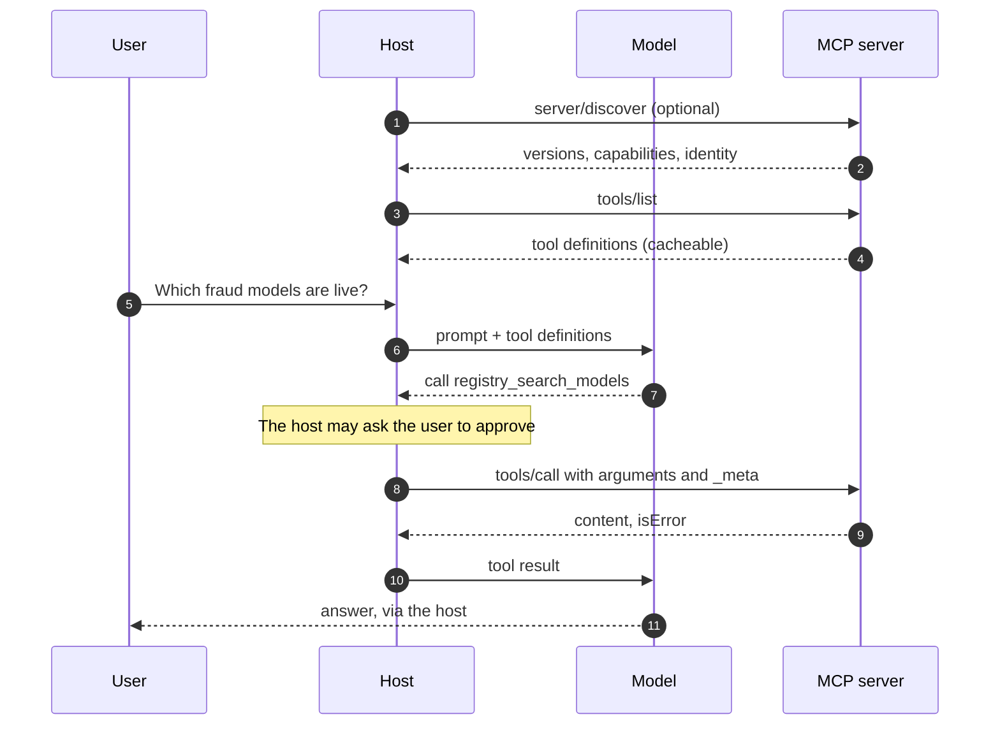
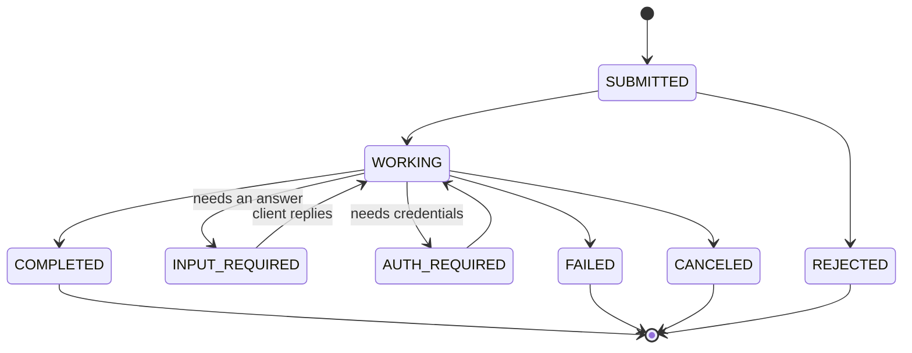
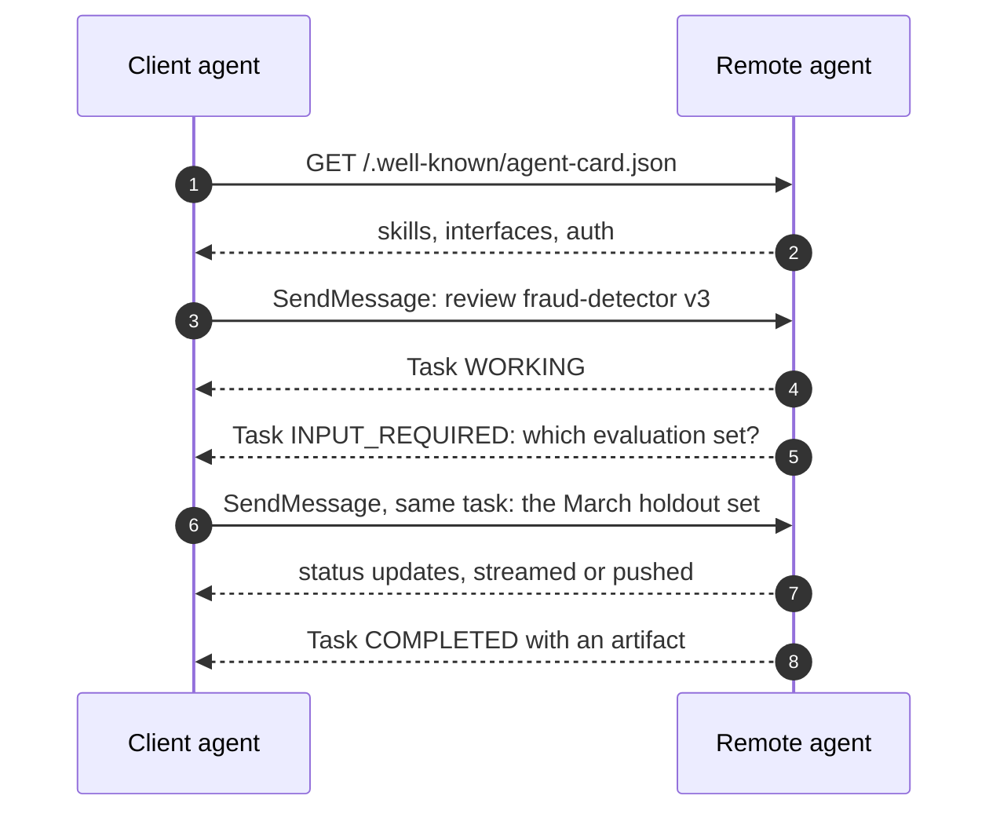
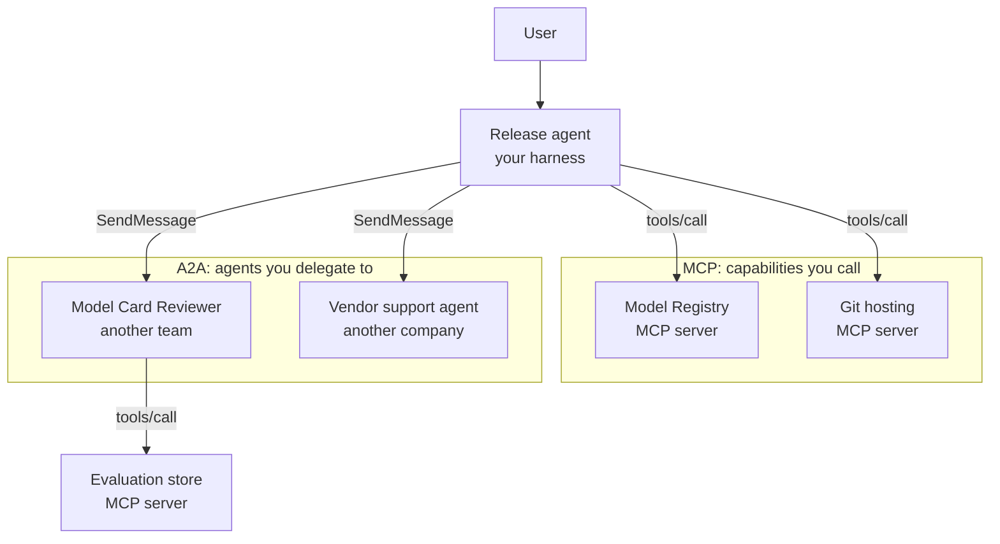
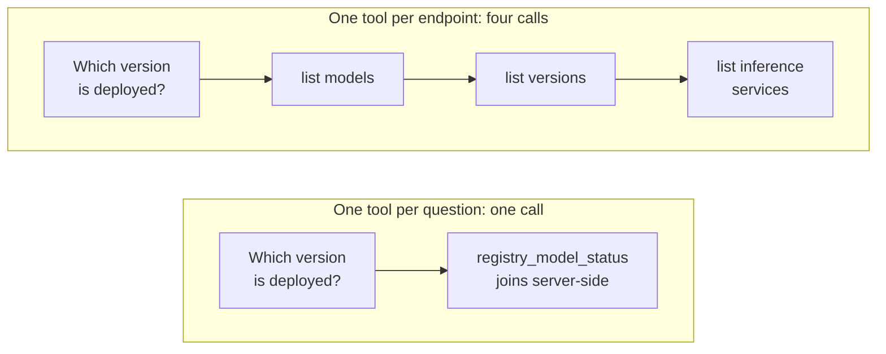

Cada pocas semanas alguien me pregunta cuál de los dos va a ganar, MCP o A2A, como si fueran
dos navegadores peleándose por los mismos usuarios. No compiten. Responden a dos preguntas
distintas, y la confusión viene de que los dos tienen la palabra «agente» cerca.

- El **Model Context Protocol** responde a: _¿cómo usa un agente algo?_ Una base de datos, una
  API, un sistema de ficheros, un registro de modelos.
- **Agent2Agent** responde a: _¿cómo le pasa trabajo un agente a otro agente cuyo interior no
  puede ver?_ El agente de otra persona, con su propio modelo, sus propias herramientas y su
  propia idea de cómo hacer el trabajo.

La diferencia es la **opacidad**. Una herramienta MCP te enseña su esquema y hace exactamente
una cosa cuando la llamas. Un agente A2A te enseña una lista de habilidades y se guarda todo lo
demás: tú pides un resultado, él decide cómo llegar, y puede volver una hora después con una
pregunta.

Este artículo cubre qué estandariza cada uno de verdad, según las especificaciones publicadas
este año, cómo encajan entre sí, y la parte que para mí más importa en el día a día: cómo
diseñar un servidor MCP que un modelo sepa usar bien.

## Qué estandariza MCP

MCP es JSON-RPC 2.0 entre tres roles. El **host** es la aplicación con la que habla el usuario
(Claude Code, un IDE, tu propio _harness_). Dentro de él, un **cliente** por conexión habla con
un **servidor**, que es quien expone las capacidades. El diseño se inspira abiertamente en el
Language Server Protocol: escribes la integración una vez y la usas desde cualquier host.

Un servidor puede ofrecer tres primitivas, y la forma útil de distinguirlas es _quién decide
cuándo se usan_:

| Primitiva     | La controla     | Qué es                                                          | Ejemplo                            |
| ------------- | --------------- | --------------------------------------------------------------- | ---------------------------------- |
| **Tools**     | El modelo       | Funciones con un JSON Schema que el modelo puede decidir llamar | `registry_search_models`           |
| **Resources** | La aplicación   | Datos direccionados por URI que el host puede meter en contexto | `registry://models/fraud-detector` |
| **Prompts**   | El usuario      | Mensajes con plantilla, normalmente expuestos como comandos     | `/release-notes`                   |

La mayoría de servidores que hay por ahí solo tienen herramientas, y está bien. Los recursos
merecen la pena cuando el host tiene buena interfaz para adjuntar contexto; los prompts, cuando
hay un flujo que los usuarios lanzan por su nombre.

Hay dos [transportes](https://modelcontextprotocol.io/specification/2026-07-28/basic/transports)
estándar: **stdio**, donde el host lanza el servidor como subproceso e intercambian JSON-RPC
delimitado por saltos de línea, y **Streamable HTTP**, donde cada mensaje es un POST a un único
endpoint y la respuesta es un objeto JSON o un stream SSE ligado a esa petición.

### Qué cambió en la revisión 2026-07-28

La revisión actual es la [2026-07-28](https://modelcontextprotocol.io/specification/2026-07-28/changelog),
y es el mayor cambio de forma del protocolo desde que apareció. Si aprendiste MCP hace un año,
estos son los puntos que hay que volver a aprender:

- **No tiene estado.** El _handshake_ `initialize` y la cabecera `Mcp-Session-Id` han
  desaparecido. Cada petición lleva su versión de protocolo y las capacidades del cliente en
  `_meta`, y los servidores implementan un método `server/discover` para los clientes que
  quieran negociar por adelantado.
- **El estado es explícito.** Un servidor que necesite recordar algo entre llamadas (un carrito,
  un contexto de navegador, una transacción) devuelve un _handle_ desde una herramienta y lo
  acepta como argumento en la siguiente. La [guía sobre herramientas con estado](https://modelcontextprotocol.io/specification/2026-07-28/server/tools)
  pide que indiques la vida útil del _handle_ en la descripción de la herramienta, para que el
  modelo la vea.
- **Los servidores ya no envían peticiones al cliente.** Cuando una herramienta necesita algo
  más del usuario, devuelve un resultado `input_required` y el cliente reintenta la llamada
  original con las respuestas: el patrón de peticiones de varias vueltas.
- **Roots, Sampling y Logging quedan obsoletos**, y el trabajo de larga duración pasa a una
  **extensión de Tasks** opcional.

Ese último punto importa aquí: MCP tiene ahora su propia idea de tarea de larga duración, que se
solapa un poco con A2A. Vuelvo a ello más abajo.

### Autorización

Para servidores HTTP, la [especificación de autorización](https://modelcontextprotocol.io/specification/2026-07-28/basic/authorization)
convierte al servidor MCP en un **servidor de recursos OAuth 2.1**. Publica Protected Resource
Metadata (RFC 9728) para que el cliente descubra qué servidor de autorización usar; el cliente
pide un token ligado a ese servidor concreto con un _resource indicator_ (RFC 8707); y el
servidor tiene que comprobar que cada token se emitió _para él_. No puede aceptar tokens
pensados para otro, ni reenviar el token del cliente a una API de más abajo. Los Client ID
Metadata Documents son ahora la forma preferida de registrar un cliente, y el Dynamic Client
Registration queda obsoleto.

Para servidores stdio la respuesta es más sencilla: nada de OAuth, las credenciales se leen del
entorno.



Fíjate en lo que el servidor no ve nunca: el modelo, la conversación, los otros servidores.
Recibe un nombre y unos argumentos. Esa estrechez es precisamente lo que hace de algo una
herramienta.

## Qué estandariza A2A

[Agent2Agent](https://a2a-protocol.org/latest/specification/) nació en Google, se cedió a la
Linux Foundation en 2025 y ahora vive en la Agentic AI Foundation, junto a MCP. Su
especificación **1.0** es la primera estable. Donde MCP describe una llamada a función, A2A
describe una conversación sobre un trabajo entre dos agentes que no comparten memoria,
herramientas ni implementación.

Estandariza cuatro cosas.

**Descubrimiento: la Agent Card.** Un documento JSON, servido por convención en
`/.well-known/agent-card.json`, que dice quién es el agente, qué habilidades ofrece, qué
_bindings_ de protocolo habla (JSON-RPC, gRPC o HTTP+JSON) y cómo autenticarse. Se parece más a
un documento OpenAPI para una persona que al esquema de una herramienta: las habilidades tienen
descripciones, etiquetas y peticiones de ejemplo, no tipos de parámetros.

```json title=".well-known/agent-card.json"
{
  "name": "Model Card Reviewer",
  "description": "Reviews a model version's card and evaluation results against the publishing checklist, and explains what is missing.",
  "version": "0.4.0",
  "provider": { "organization": "ML Platform team", "url": "https://platform.example.com" },
  "supportedInterfaces": [
    { "url": "https://reviewer.example.com/a2a/v1", "protocolBinding": "JSONRPC", "protocolVersion": "1.0" },
    { "url": "https://reviewer.example.com/a2a/json", "protocolBinding": "HTTP+JSON", "protocolVersion": "1.0" }
  ],
  "capabilities": { "streaming": true, "pushNotifications": true },
  "securitySchemes": {
    "oidc": {
      "openIdConnectSecurityScheme": {
        "openIdConnectUrl": "https://sso.example.com/.well-known/openid-configuration"
      }
    }
  },
  "securityRequirements": [{ "schemes": { "oidc": { "list": ["openid", "reviews"] } } }],
  "defaultInputModes": ["text/plain", "application/json"],
  "defaultOutputModes": ["text/markdown", "application/json"],
  "skills": [
    {
      "id": "review-model-card",
      "name": "Review a model card",
      "description": "Checks intended use, limitations, evaluation data and licence. Asks for missing information instead of guessing it.",
      "tags": ["model-registry", "governance", "review"],
      "examples": ["Review version 3 of fraud-detector before we publish it."]
    }
  ]
}
```

**Tareas.** Enviar un mensaje puede crear una **Task**, una unidad de trabajo con estado: un id,
un `contextId` que agrupa tareas relacionadas en una misma conversación, un estado y un
historial. El ciclo de vida es donde A2A más se aleja de una llamada a herramienta: una tarea
puede pararse y preguntar.



**Mensajes y partes.** Un mensaje tiene un rol (usuario o agente) y una lista de **partes**, cada
una de las cuales es texto, bytes, una URL o datos JSON arbitrarios. Los resultados de una tarea
van en **artefactos**, que también están hechos de partes. La especificación deja claro que las
salidas van en artefactos y no en mensajes de chat, una regla pequeña que ahorra mucho
_parsing_.

**Operaciones y entrega.** `SendMessage`, `SendStreamingMessage`, `GetTask`, `ListTasks`,
`CancelTask` y `SubscribeToTask`, más configuraciones de notificaciones _push_ para tareas que
duran lo bastante como para que mantener un stream abierto no tenga sentido.



Con el _binding_ HTTP+JSON, el primer mensaje es tan sencillo como parece:

```http title="POST /a2a/json/message:send"
POST /a2a/json/message:send HTTP/1.1
Host: reviewer.example.com
Authorization: Bearer <token for reviewer.example.com>
A2A-Version: 1.0
Content-Type: application/json

{
  "message": {
    "messageId": "9f0c6a1e-3c1d-4f43-9a55-0b7f4d2e8c11",
    "role": "ROLE_USER",
    "parts": [{ "text": "Review version 3 of fraud-detector before we publish it." }]
  },
  "configuration": { "acceptedOutputModes": ["text/markdown"] }
}
```

## Cómo encajan

La propia especificación tiene una sección sobre esto, y su planteamiento es el que uso yo: MCP
conecta a un agente con herramientas y datos; A2A conecta agentes entre sí. Un agente A2A remoto
usará muy a menudo MCP por dentro para hacer su trabajo. Acabas con un árbol en el que las
aristas cambian de protocolo según lo que haya al otro lado sea una capacidad o un colega.



|                         | MCP                                                  | A2A                                                    |
| ----------------------- | ---------------------------------------------------- | ------------------------------------------------------ |
| **Conecta**             | Un agente con herramientas, datos y prompts          | Un agente con otro agente                              |
| **El otro lado enseña** | Su esquema completo                                  | Habilidades y ejemplos; lo de dentro queda privado     |
| **Quién decide cómo**   | Tu modelo elige la llamada; la herramienta la ejecuta | El agente remoto planifica sus propios pasos           |
| **Unidad de trabajo**   | Una llamada, normalmente segundos                    | Una tarea que puede durar horas y hacer preguntas      |
| **Estado**              | Ninguno en el protocolo; _handles_ explícitos        | Tareas y contextos son de primera clase                |
| **Descubrimiento**      | `tools/list` en un servidor que has configurado      | Una Agent Card en una URL conocida                     |
| **Autenticación**       | Servidor de recursos OAuth 2.1; variables de entorno en stdio | Esquemas de seguridad declarados en la tarjeta |

> [!NOTE]
> El solapamiento existe. La extensión de Tasks de MCP da a las herramientas _handles_ duraderos
> y entrada a mitad de ejecución, y nada te impide envolver un subagente entero como una
> herramienta MCP. Si controlas los dos extremos, suele ser más sencillo. A2A se gana su sitio
> cuando el otro agente es de otro: otro equipo, otro proveedor, otro ritmo de _releases_.

Mi regla práctica: si podría escribir yo mismo el esquema de la herramienta, es MCP. Si lo que
quiero decir es «este es el objetivo, avísame cuando acabes o te atasques», y lo que lo hace es
de otro, es A2A. Los patrones para conectar varios agentes entre sí son un tema aparte, en
[patrones de orquestación de agentes](/blog/agent-orchestration-patterns).

---

## Diseñar un servidor MCP que un modelo sepa usar

Aquí es donde debería ir casi todo el esfuerzo, y donde se quedan cortos la mayoría de servidores
que he probado. El protocolo es la parte fácil. Lo difícil es que tu usuario es un modelo de
lenguaje que lee tu lista de herramientas en frío, en cada sesión, con un presupuesto de atención
limitado.

Los artículos de ingeniería de Anthropic sobre [cómo construir agentes efectivos](https://www.anthropic.com/engineering/building-effective-agents)
y [cómo escribir herramientas para agentes](https://www.anthropic.com/engineering/writing-tools-for-agents)
son la mejor guía práctica que conozco. Lo que sigue es cómo los aplico yo.

### Herramientas con forma de tarea, no de endpoint

La primera versión tentadora de un servidor MCP es un generador: lo apuntas a un documento
OpenAPI y sale una herramienta por endpoint. Para la API REST del Model Registry de Kubeflow eso
serían decenas de herramientas (`get_registered_models`, `get_registered_model`,
`get_model_versions`, `get_model_version_artifacts`…) y el modelo tendría que aprenderse el
modelo de datos a partir de los nombres antes de poder responder «¿qué versión de
fraud-detector está en producción?».

Un servidor mejor tiene pocas herramientas con la forma de las preguntas que hace la gente, y
hace los _joins_ él mismo.



### No expongas 80 herramientas

Cada definición de herramienta se paga en contexto, en cada turno, se use o no. En el artículo
de Anthropic sobre [uso avanzado de herramientas](https://www.anthropic.com/engineering/advanced-tool-use),
un servidor de GitHub con 35 herramientas ocupa unos 26K tokens antes de que empiece la
conversación. Los hosts se están adaptando (la carga diferida y la búsqueda de herramientas
permiten al modelo pedir definiciones bajo demanda), pero eso no convierte un servidor hinchado
en uno bueno; lo convierte en uno buscable.

Lo que hago yo:

- **Empezar con entre tres y ocho herramientas** y añadir una solo cuando una sesión real
  demuestre que falta.
- **Ponerles un prefijo** (`registry_search_models`, `registry_list_versions`), porque los hosts
  mezclan herramientas de varios servidores y dos de ellos tendrán un `search`.
- **Separar servidores de lectura y de escritura** cuando la escritura es peligrosa, para que un
  usuario pueda instalar el de solo lectura sin pensárselo.
- **Devolver las herramientas en orden determinista.** La nueva revisión lo recomienda, y
  mantiene caliente la caché de prompts.

Cuánto de la ventana de contexto deberían poder ocupar tus herramientas es parte de la
[ingeniería de contexto](/blog/context-engineering).

### La descripción es un prompt

El modelo no lee tu código. Lee el nombre, la descripción y el esquema, y eso es todo lo que
sabrá nunca de la herramienta. Escribe la descripción para un colega competente que no ha visto
nunca tu sistema: qué hace, cuándo usarla en lugar de la de al lado, qué significan los
argumentos, qué devuelve y cómo pedir la siguiente página. Cada `.describe()` de un campo acaba
en el JSON Schema que ve el modelo, así que úsalos.

### Los errores son instrucciones

La especificación separa dos tipos de fallo. Los **errores de protocolo** (herramienta
desconocida, petición mal formada) son errores JSON-RPC de los que el modelo rara vez se
recupera. Los **errores de ejecución** son resultados normales con `isError: true`, y se espera
que el cliente se los enseñe al modelo para que se corrija. Eso convierte el texto del error en
parte de tu interfaz. «Error 400» no enseña nada; «`query` no puede llevar comillas; busca un
fragmento más corto del nombre» te da una segunda llamada correcta.

Lo mismo vale para los resultados vacíos. «Ningún modelo LIVE coincide con 'frud'. Prueba un
fragmento más corto, o `state: ARCHIVED`» es mejor respuesta que `[]`.

### Pagina, y que las respuestas sean pequeñas

Una herramienta que devuelve 4.000 filas ha gastado la atención del modelo en 3.990 filas que
no necesitaba. Por defecto, un `limit` pequeño; devuelve un `cursor` cuando haya más, y explica
en la descripción cómo usarlo. Devuelve los campos que ayudan a la siguiente decisión (nombres,
estados, responsables), no todas las columnas. El artículo de Anthropic sobre herramientas
sugiere un argumento `response_format` con modos `concise` y `detailed` para los casos en los
que el modelo de verdad necesita la versión larga.

### Autenticación: el servidor no puede hacer más que el usuario

En HTTP, el servidor valida tokens emitidos para él y llama a las APIs de más abajo con
credenciales que ha obtenido él mismo, nunca reenviando el token del cliente. En stdio, lee un
token del entorno y actúa por tanto con los permisos de quien lo lanzó. En ambos casos, la
propiedad que quiero es la de [un BFF por módulo](/blog/bff-per-module-go): la herramienta no
puede hacer nada que el usuario no pudiera hacer directamente. Las anotaciones como
`readOnlyHint` ayudan al host a decidir qué aprobar automáticamente, pero la especificación pide
tratarlas como no fiables salvo que el servidor lo sea, y las descripciones son un sitio conocido
para esconder instrucciones. Más sobre eso en [seguridad de agentes](/blog/agent-security).

> [!WARNING]
> La descripción de una herramienta es texto que entra directamente en el contexto del modelo.
> Instalar un servidor MCP se parece más a instalar una dependencia que escribe parte de tu prompt
> que a añadir una API key. Léelo antes de fiarte.

### Un servidor pequeño y real

Esta es la herramienta de búsqueda de un servidor de solo lectura para el Model Registry, escrita
con el SDK de TypeScript v2 (`@modelcontextprotocol/server`), que implementa la revisión
2026-07-28. Las llamadas REST son la API `v1alpha3` real del registro. Primero, un cliente fino y
los dos _helpers_ de resultado:

```ts title="src/registry.ts"
const API = `${process.env.MODEL_REGISTRY_URL}/api/model_registry/v1alpha3`;
const TOKEN = process.env.MODEL_REGISTRY_TOKEN; // stdio: credentials come from the environment

export class RegistryError extends Error {
  constructor(readonly status: number) {
    super(`Model Registry returned HTTP ${status}`);
  }
}

export async function registry<T>(
  path: string,
  params: Record<string, string>,
): Promise<T> {
  const url = new URL(API + path);
  for (const [key, value] of Object.entries(params)) url.searchParams.set(key, value);
  const res = await fetch(url, {
    headers: TOKEN ? { Authorization: `Bearer ${TOKEN}` } : {},
  });
  if (!res.ok) throw new RegistryError(res.status);
  return (await res.json()) as T;
}

export const ok = (data: unknown) => ({
  content: [{ type: "text" as const, text: JSON.stringify(data) }],
});
export const fail = (text: string) => ({
  content: [{ type: "text" as const, text }],
  isError: true,
});
```

Después, la definición de la herramienta. Todo lo que el modelo va a saber está en este bloque:

```ts title="src/server.ts" {8-13,20}
import { McpServer } from "@modelcontextprotocol/server";
import { serveStdio } from "@modelcontextprotocol/server/stdio";
import * as z from "zod/v4";
import { registry, RegistryError, ok, fail } from "./registry.js";

const searchModels = {
  title: "Search registered models",
  description: [
    "Find registered models whose name contains `query` (case-insensitive).",
    "Returns at most `limit` models, newest first, and a `cursor`",
    "when there are more: pass it back unchanged for the next page.",
    "To see a model's versions, call registry_list_versions with its `id`.",
  ].join(" "),
  inputSchema: z.object({
    query: z.string().min(2).describe("Part of the model name, e.g. 'fraud'"),
    state: z.enum(["LIVE", "ARCHIVED"]).default("LIVE"),
    limit: z.number().int().min(1).max(25).default(10),
    cursor: z.string().optional().describe("The cursor from a previous call"),
  }),
  annotations: { readOnlyHint: true, openWorldHint: false },
};
```

Y el _handler_, donde la mayoría de líneas van de fallar de forma útil:

```ts title="src/server.ts" {5-7,27-32}
type Model = { id: string; name: string; owner?: string; state?: string };
type Args = z.infer<typeof searchModels.inputSchema>;

async function handleSearch({ query, state, limit, cursor }: Args) {
  if (query.includes("'")) {
    return fail("`query` cannot contain quotes. Search a shorter part of the name.");
  }
  try {
    const page = await registry<{ items: Model[]; nextPageToken: string }>(
      "/registered_models",
      {
        filterQuery: `name ILIKE '%${query}%' AND state='${state}'`,
        pageSize: String(limit),
        orderBy: "LAST_UPDATE_TIME",
        sortOrder: "DESC",
        ...(cursor ? { nextPageToken: cursor } : {}),
      },
    );
    const models = page.items.map(({ id, name, owner }) => ({ id, name, owner }));
    if (models.length === 0) {
      const hint = `No ${state} models match '${query}'. Try a shorter fragment.`;
      return ok({ models, hint });
    }
    return ok({ models, cursor: page.nextPageToken || null });
  } catch (err) {
    if (!(err instanceof RegistryError)) throw err;
    if (err.status === 401 || err.status === 403) {
      return fail(`Registry refused the request (HTTP ${err.status}). ` +
        "Retrying will not help: tell the user their token lacks access.");
    }
    return fail(`Registry unavailable (HTTP ${err.status}). ` +
      "Retry once; if it fails again, tell the user.");
  }
}
```

Conectarlo todo es la parte corta:

```ts title="src/server.ts"
function createServer() {
  const server = new McpServer({ name: "model-registry", version: "0.1.0" });
  server.registerTool("registry_search_models", searchModels, handleSearch);
  // registry_list_versions and registry_model_status follow the same shape.
  return server;
}

serveStdio(createServer, { onerror: (error) => console.error(error) });
```

Hay algunos detalles deliberados. `createServer` es una factoría porque `serveStdio` construye
una instancia nueva cuando la necesita, que es como el mismo binario responde tanto a los
clientes actuales como a los antiguos que todavía empiezan con `initialize`. El esquema limita
`limit` a 25, y si el modelo pide 999 el SDK devuelve un resultado con `isError` explicando el
límite antes de que se ejecute mi _handler_. La comprobación de comillas existe porque el filtro
es una cadena parecida a SQL; un servidor real escaparía en vez de rechazar, pero rechazar con un
motivo sigue siendo mejor que un 400. Y los dos mensajes de error dicen si reintentar puede
ayudar, porque esa es la decisión que el modelo tiene que tomar a continuación.

Para comprobarlo, la CLI del MCP Inspector lista las herramientas en las dos eras del protocolo
(`--protocol-era modern` y `legacy`), lo que pilla el error clásico de un servidor que solo
funciona con los clientes del año pasado.

## Cuándo no

Ninguno de los dos protocolos es motivo para construir algo.

**Puede que no necesites MCP.** Si una aplicación llama a una API con tres funciones fijas, el
_tool calling_ nativo del proveedor del modelo es menos maquinaria. MCP compensa cuando la misma
integración tiene que funcionar en varios hosts, o cuando quieres que los usuarios la instalen
ellos mismos.

**Probablemente aún no necesitas A2A.** Dentro de un mismo código, de un mismo equipo, un
subagente es una llamada a función, o como mucho una herramienta MCP. A2A añade
descubrimiento, un ciclo de vida de tareas y otra frontera de autenticación, que es justo lo que
quieres entre organizaciones y pura sobrecarga dentro de una.

> [!IMPORTANT]
> Ningún protocolo hace fiable a la otra parte. Una Agent Card es una afirmación, la descripción
> de una herramienta es texto no fiable, y el artefacto de un agente remoto es una entrada que no
> has escrito tú. Valida lo que vuelve como validarías cualquier otro dato externo.

Y los dos se mueven. MCP ha cambiado de forma este año y ha marcado funcionalidades como
obsoletas con un plazo de doce meses; A2A no llegó a la 1.0 hasta este año. Fija la versión de
protocolo contra la que pruebas, y lee el _changelog_ antes de actualizar el SDK.

## Para seguir aprendiendo

- [Especificación de MCP, 2026-07-28](https://modelcontextprotocol.io/specification/2026-07-28):
  la revisión actual. Empieza por el [changelog](https://modelcontextprotocol.io/specification/2026-07-28/changelog)
  si conocías las versiones de 2025; el rediseño sin estado deja obsoletos muchos tutoriales.
- [Especificación de herramientas de MCP](https://modelcontextprotocol.io/specification/2026-07-28/server/tools):
  corta y merece la pena leerla entera, sobre todo las secciones de herramientas con estado y de
  manejo de errores.
- [Autorización en MCP](https://modelcontextprotocol.io/specification/2026-07-28/basic/authorization):
  el flujo OAuth, la validación de audiencia y la prohibición de reenviar tokens, con un diagrama
  de secuencia completo.
- [Especificación de A2A](https://a2a-protocol.org/latest/specification/): la especificación 1.0.
  El ejemplo de Agent Card y el apéndice sobre la relación entre A2A y MCP son lo primero que hay
  que leer.
- [SDK de TypeScript](https://github.com/modelcontextprotocol/typescript-sdk): el SDK v2 que usa
  el ejemplo, con guías sobre herramientas, errores y cómo probar un servidor en memoria.
- [Writing effective tools for agents](https://www.anthropic.com/engineering/writing-tools-for-agents):
  la guía de Anthropic sobre diseño de herramientas: consolidación, prefijos, tamaño de respuesta y
  mensajes de error. Casi toda la sección de diseño de arriba sale de aquí, aplicada.
- [Building effective agents](https://www.anthropic.com/engineering/building-effective-agents):
  el apéndice sobre cómo hacer _prompt engineering_ de las herramientas (la interfaz
  agente-ordenador) es el argumento más corto que conozco para tomarse las descripciones tan en
  serio como los prompts.
